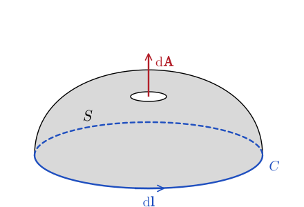
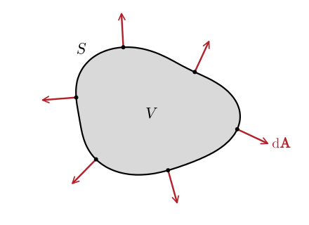

# Vector Calculus {#sec-vec}

::: {.callout-note}
This chapter is in preparation.
:::

Fluid mechanics is most concisely and generally written in the language
of vector calculus. This appendix gives key definitions and theorems used
throughout the rest of these notes. A more extended, but still concise
treatment can be found in @griffiths2023 [Chapter 1 and Appendix A]. The
point of view we follow in these notes is geometrical: we will introduce
the elements of vector calculus in terms of geometrical/physical
quantities without reference to any coordinate system.

## Vector fields

::: {#def-vec-point}
## Point
We define a point to be an element of three-dimensional Euclidean space
$\mathbb{E}^3$. We will denote points with capital letters,
$A, B, C \in \mathbb{E}^3$.
:::

In a given coordinate system, the position of a
point is given by three numbers $x_1, x_2, x_3$ and we will write, with
slight abuse of notation, $A = (x_1, x_2, x_3)$. For example, in
Cartesian coordinates each point will be associated to one
triple $A = (x,y,z)$, while in spherical coordinates the same point will be
written as $A = (r,\theta,\phi)$.

::: {#def-vec-vector}
## Vector
A vector is a translation of Euclidean space, that is, a shift that moves
every point by the same distance in the same direction. For any two points
$A$ and $B$ there is exactly one translation that moves $A$ to $B$. We
denote it by $\overrightarrow{AB} = B - A$.
:::

We can picture $\overrightarrow{AB}$ as an arrow connecting $A$ to $B$,
and pointing from $A$ to $B$. Since a translation moves all points in the
same way, the arrow can be moved parallel to itself without changing the
vector: $\overrightarrow{AB} = \overrightarrow{CD}$ whenever $A$, $B$,
$D$, and $C$ are the vertices of a parallelogram. We will
choose a special point in Euclidean space called the origin $O$ and
define as the *position vector* of a point $P$ the vector $\vb{r}_P :=
\overrightarrow{OP}$.

Most frequently, we deal with *vector fields* in these notes. An example
is the fluid velocity $\vb{v}$. Vector fields associate to each point in
Euclidean space a vector in *another* Euclidean space, e.g., the space of
velocities in the case of $\vb{v}$.

Vector fields can be decomposed over a vector basis as
$$
    \vb{v} = v_1(x_1,x_2,x_3) \vb{e}_1 + v_2(x_1,x_2,x_3) \vb{e}_2 + v_3(x_1,x_2,x_3) \vb{e}_3,
$$ {#eq-vec-decomp}
where $\vb{e}_1, \vb{e}_2, \vb{e}_3$ are, at each point, linearly
independent vectors.  For example, the Cartesian basis is $\vb{e}_1 =
\hat{\vb{x}}$, $\vb{e}_2 = \hat{\vb{y}}$, and $\vb{e}_3 = \hat{\vb{z}}$.
Alternatively, we might take a spherical basis $\vb{e}_1 = \hat{\vb{r}}$,
$\vb{e}_2 = \hat{\vb{\theta}}$, and $\vb{e}_3 = \hat{\vb{\phi}}$. Note
that, in the latter case, the basis vectors are themselves position
dependent, since, e.g., the radial direction is different for different
$(\theta,\phi)$. This must be taken into account when computing
derivatives of vector fields in the spherical basis. Note that, because
vector fields live in a different space from the coordinates, we can, in
principle, combine vector basis and coordinate choices in an arbitrary
way. For example, we could work in spherical coordinates, but still
consider the $\hat{\vb{x}}$, $\hat{\vb{y}}$, and $\hat{\vb{z}}$
components of vector fields. In practice, throughout these notes we will
use the vector basis naturally associated with the chosen coordinate system.
For a coordinate system $(x_1, x_2, x_3)$, the natural vector basis is
chosen so that the unit vector $\vb{e}_i$ points along the direction in which
$x_i$ increases, while all other coordinates are kept constant. In other
words, the natural basis is formed by unit vectors that are tangent to the
coordinate lines.

## Gradient

::: {#def-vec-gradient}
## Gradient
If $f$ is a scalar function, we define its gradient $\nabla f$ as being
the only vector field such that, for every pair of points $A$ and $B$ and
any (smooth) curve connecting them
$$
    f(B) - f(A) = \int_A^B \nabla f \cdot \dd \vb{l}.
$$ {#eq-vec-gradient}
:::

In Cartesian coordinates, we can find the expression of the gradient by
considering two points $A = (x,y,z)$ and $B = (x+\dd x, y+\dd y, z + \dd
z)$. Taylor expanding to first order, the LHS of @eq-vec-gradient is
$$
    f(B) - f(A) = f(x+\dd x, y+\dd y, z + \dd z) - f(x,y,z) =
    \partial_x f \dd x + \partial_y f \dd y + \partial_z f \dd z .
$$ {#eq-vec-gradient-lhs}
The RHS is
$$
    \int_A^B \nabla f \cdot \dd \vb{l} = (\nabla f)_x {} \dd x + (\nabla f)_y {} \dd y + (\nabla f)_z {} \dd z ,
$$ {#eq-vec-gradient-rhs}
so we conclude that
$$
    \nabla f = \left(\begin{array}{c}
        \partial_x f \\
        \partial_y f \\
        \partial_z f
    \end{array}
    \right).
$$ {#eq-vec-gradient-cartesian}
For the generalization to curvilinear coordinates, see @griffiths2023 [Appendix A].

Note that the definition of gradient can be extended to vectors. In this
case the gradient is a matrix $\nabla \vb{v}$ such that
$$
    \vb{v}(B) - \vb{v}(A) = \int_A^B (\nabla\vb{v}) \cdot \dd \vb{l}.
$$ {#eq-vec-gradient-vec}
The dot in the integral denotes a matrix--vector multiplication,
$[(\nabla\vb{v}) \cdot \dd\vb{l}]_i = \sum_j (\nabla\vb{v})_{ij}\, \dd l_j$.
Repeating the calculation done for @eq-vec-gradient-cartesian for each
component of $\vb{v}$, we find that, in Cartesian coordinates,
$$
    (\nabla\vb{v})_{ij} = \partial_j v_i ,
$$ {#eq-vec-gradient-vec-cartesian}
that is, the $i$-th row of $\nabla\vb{v}$ is the gradient of $v_i$. Be
aware that some textbooks use the transposed convention,
$(\nabla\vb{v})_{ij} = \partial_i v_j$. The derivative of $\vb{v}$ along a
vector $\vb{a}$ is written as
$$
    (\vb{a}\cdot\nabla)\vb{v} = (\nabla\vb{v}) \cdot \vb{a} , \qquad
    \left[ (\vb{a}\cdot\nabla)\vb{v} \right]_i = \sum_j a_j \partial_j v_i .
$$ {#eq-vec-directional}

## Curl

::: {#def-vec-curl}
## Curl
Given a vector field $\vb{v}$, we define its curl $\nabla\times\vb{v}$ as
being the only vector field such that, for every smooth two-dimensional surface
$S$ bounded by a closed curve $C$, we have
$$
    \oint_C \vb{v} \cdot \dd\vb{l} = \int_S (\nabla\times\vb{v}) \cdot \dd \vb{A},
$$ {#eq-vec-curl}
where $\dd\vb{A} = \hat{\vb{n}}\, \dd A$, $\hat{\vb{n}}$ is the unit normal
to $S$, and the direction in which $C$ is traversed is related to
$\hat{\vb{n}}$ by the right-hand rule (@fig-vec-stokes).
:::

{#fig-vec-stokes fig-alt="A dome-shaped grey surface S whose rim is the closed curve C, drawn as an ellipse. An arrow on the front of C shows the direction of the line element dl, counterclockwise when seen from above. A small patch on top of the dome carries the area element dA, an arrow pointing up, away from the surface."}

The expression in @eq-vec-curl is known as Stokes' theorem.
We take it as the operational definition of the curl. In Cartesian coordinates,
the curl can be written as the following formal determinant
$$
    \nabla\times\vb{v} = \left|
        \begin{array}{ccc}
            \hat{\vb{x}} & \hat{\vb{y}} & \hat{\vb{z}} \\
            \partial_x & \partial_y & \partial_z \\
            v_x & v_y & v_z
        \end{array}
        \right| =
        \left( \partial_y v_z - \partial_z v_y \right) \hat{\vb{x}} +
        \left( \partial_z v_x - \partial_x v_z \right) \hat{\vb{y}} +
        \left( \partial_x v_y - \partial_y v_x \right) \hat{\vb{z}}.
$$ {#eq-vec-curl-determinant}
This is formally the same expression as the vector product between the
"vector" $\nabla = \partial_x \hat{\vb{x}} + \partial_y \hat{\vb{y}} +
\partial_z \hat{\vb{z}}$ and $\vb{v}$. However, note that this
equivalence breaks down in curvilinear coordinates.

## Divergence

::: {#def-vec-div}
## Divergence
Given a vector field $\vb{v}$, we define its divergence
$\nabla\cdot\vb{v}$ as being the only scalar field such that, for every
closed surface $S$ enclosing a volume $V$, we have
$$
    \oint_S \vb{v} \cdot \dd \vb{A} = \int_V \nabla \cdot \vb{v}\, \dd V,
$$ {#eq-vec-div}
where $\dd\vb{A} = \hat{\vb{n}}\, \dd A$ and $\hat{\vb{n}}$ is the
outward-pointing unit normal to $S$ (@fig-vec-gauss).
:::

{#fig-vec-gauss fig-alt="A closed, irregular grey region V bounded by the surface S, drawn as a thick outline. Arrows labelled dA at six points of S are perpendicular to it and point outwards."}

The expression in @eq-vec-div is known as Gauss' theorem, or the
divergence theorem. In
Cartesian coordinates, we can find the expression for the divergence by
considering @eq-vec-div applied to a rectangular region centered at
$(x,y,z)$ with sides of length $\dd x$, $\dd y$, and $\dd z$. The
derivation is analogous to the calculation leading to @eq-continua-volume
in @sec-continua and will not be repeated here. The result is that
$$
    \nabla\cdot\vb{v} = \partial_x v_x + \partial_y v_y + \partial_z v_z.
$$ {#eq-vec-div-cartesian}
This is formally the same expression as if we were to take the dot
product between $\nabla$ and $\vb{v}$. However, once again, this
equivalence breaks down in curvilinear coordinates.

The divergence can be extended to tensor fields, such as the stress
tensors that appear in the equations of fluid dynamics.

::: {#def-vec-div-tensor}
## Divergence of a tensor
Given a tensor field $\vb{T}$, we define its divergence
$\nabla\cdot\vb{T}$ as being the only vector field such that, for every
closed surface $S$ enclosing a volume $V$, we have
$$
    \oint_S \vb{T} \cdot \dd \vb{A} = \int_V \nabla \cdot \vb{T}\, \dd V,
$$ {#eq-vec-div-tensor}
where $(\vb{T}\cdot\dd\vb{A})_i = \sum_j T_{ij}\, \dd A_j$.
:::

In Cartesian coordinates, the $i$-th component of the LHS of
@eq-vec-div-tensor is the flux of the vector field formed by the $i$-th
row of $\vb{T}$, $(T_{ix}, T_{iy}, T_{iz})$. Applying @eq-vec-div to each
row, we find
$$
    (\nabla\cdot\vb{T})_i = \partial_x T_{ix} + \partial_y T_{iy} + \partial_z T_{iz} .
$$ {#eq-vec-div-tensor-cartesian}
For a symmetric tensor, $T_{ij} = T_{ji}$, it does not matter which index
is summed over. All the stress tensors in these notes are symmetric.

## Laplacian

::: {#def-vec-laplacian}
## Laplacian
If $f$ is a scalar function, we define its Laplacian as
$\nabla^2 f = \nabla\cdot(\nabla f)$. If $\vb{v}$ is a vector field, we
define its Laplacian as $\nabla^2 \vb{v} = \nabla\cdot(\nabla \vb{v})$.
:::

In Cartesian coordinates
$$
    \nabla^2 f = \partial_x^2 f + \partial_y^2 f + \partial_z^2 f.
$$ {#eq-vec-laplacian-cartesian}

From @eq-vec-gradient-vec-cartesian and @eq-vec-div-tensor-cartesian, the
Cartesian components of $\nabla^2\vb{v}$ are the Laplacians of the
components of $\vb{v}$, $(\nabla^2\vb{v})_i = \nabla^2 v_i$. This is not
true for the components in a curvilinear basis.

## Vector identities

The identities involving derivatives of vector fields that we use in
these notes, such as the product rules (@eq-eqs-product-rules) and the
expression for the advective term (@eq-eqs-advection-identities), are
collected in @sec-eqs. They can all be verified by writing them out in
Cartesian components. However, because gradient, curl, and divergence are
geometrical objects, these identities hold in any coordinate system.
Here, we prove two particularly important identities.

::: {#thm-vec-second-derivatives}
## Curl of a gradient and divergence of a curl
For any smooth scalar field $f$ and vector field $\vb{a}$,
$$
\nabla \times (\nabla f) = 0 , \qquad \nabla \cdot (\nabla \times \vb{a}) = 0 .
$$ {#eq-vec-second-derivatives}
:::

{#fig-vec-div-curl fig-alt="A closed surface cut along a closed curve C into two pieces, drawn pulled apart. The upper piece S_1 is a dome with its area element dA pointing up, and an arrow shows C traversed counterclockwise seen from above. The lower piece S_2 is a bowl with its area element dA pointing down, and an arrow shows C traversed clockwise seen from above, the opposite direction."}

::: {.proof}
For the first identity, consider any surface $S$ bounded by a closed curve
$C$. By @eq-vec-curl and @eq-vec-gradient,
$$
\int_S [\nabla \times (\nabla f)] \cdot \dd\vb{A}
= \oint_C \nabla f \cdot \dd\vb{l} = f(P) - f(P) = 0 ,
$$ {#eq-vec-curl-grad-proof}
because a closed curve starts and ends at the same point $P$. Since this
holds for every surface, $\nabla \times (\nabla f) = 0$.

For the second identity, consider a closed surface $S$ enclosing a volume
$V$, and cut it along a closed curve $C$ into two pieces $S_1$ and $S_2$
(@fig-vec-div-curl). Applying @eq-vec-curl to each piece, with
$\dd\vb{A}$ pointing out of $V$, we find
$$
\begin{aligned}
\oint_S (\nabla \times \vb{a}) \cdot \dd\vb{A}
&= \int_{S_1} (\nabla \times \vb{a}) \cdot \dd\vb{A} \\
&\quad {} + \int_{S_2} (\nabla \times \vb{a}) \cdot \dd\vb{A} \\
&= \oint_C \vb{a} \cdot \dd\vb{l} - \oint_C \vb{a} \cdot \dd\vb{l} = 0 .
\end{aligned}
$$ {#eq-vec-div-curl-proof}
The two line integrals have opposite signs because the outward normals of
$S_1$ and $S_2$ lie on opposite sides of $C$, so the right-hand rule
traverses $C$ in opposite directions. By @eq-vec-div, the integral of
$\nabla \cdot (\nabla \times \vb{a})$ then vanishes over every volume, so
$\nabla \cdot (\nabla \times \vb{a}) = 0$.
:::

## In-class worksheet {#sec-vec-worksheet}

1.  Compute the gradient of the function
    $$
    f (x, y, z) = \frac{x}{\sqrt{x^2 + y^2 + z^2}} .
    $$ {#eq-vec-1}

2.  Consider the vector field
    $$
    \vb{E}= \hat{\vb{r}} = \left(\begin{array}{c}
    \frac{x}{\sqrt{x^2 + y^2 + z^2}}\\
    \frac{y}{\sqrt{x^2 + y^2 + z^2}}\\
    \frac{z}{\sqrt{x^2 + y^2 + z^2}}
    \end{array}\right) .
    $$ {#eq-vec-2}
    Its gradient $\nabla \vb{E}$ is the matrix
    $$
    \begin{pmatrix}
    \partial_x E_x & \partial_y E_x & \partial_z E_x\\
    \partial_x E_y & \partial_y E_y & \partial_z E_y\\
    \partial_x E_z & \partial_y E_z & \partial_z E_z
    \end{pmatrix} .
    $$ {#eq-vec-3}
    Compute

    1.  the gradient $\nabla \vb{E}$;

    2.  $\nabla \cdot \vb{E}$;

    3.  $\nabla \times \vb{E}$.

3.  Prove that
    $$
    \nabla \cdot \nabla f = \nabla^2 f = \frac{\partial^2 f}{\partial x^2} +
    \frac{\partial^2 f}{\partial y^2} + \frac{\partial^2 f}{\partial z^2} .
    $$ {#eq-vec-4}

4.  The divergence of a tensor field
    $$
    \vb{T}= \left(\begin{array}{ccc}
    T_{x x} & T_{x y} & T_{x z}\\
    T_{y x} & T_{y y} & T_{y z}\\
    T_{z x} & T_{z y} & T_{z z}
    \end{array}\right)
    $$ {#eq-vec-5}
    is the vector with components
    $$
    \begin{aligned}
    (\nabla \cdot \vb{T})_x &= \partial_x T_{x x} + \partial_y T_{x y} + \partial_z T_{x z} , \\
    (\nabla \cdot \vb{T})_y &= \partial_x T_{y x} + \partial_y T_{y y} + \partial_z T_{y z} , \\
    (\nabla \cdot \vb{T})_z &= \partial_x T_{z x} + \partial_y T_{z y} + \partial_z T_{z z} .
    \end{aligned}
    $$ {#eq-vec-6}
    Prove that
    $$
    \nabla \cdot (p\vb{I}) = \nabla \cdot \left(\begin{array}{ccc}
    p &  & \\
    & p & \\
    &  & p
    \end{array}\right) = \nabla p.
    $$ {#eq-vec-7}
