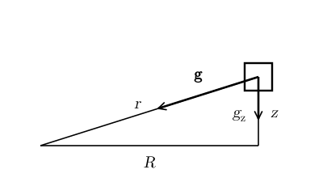
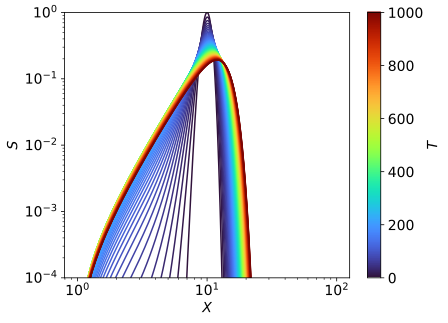

# Accretion Disks I: Structure and Viscous Evolution {#sec-disk}

::: {.callout-note}
This chapter is in preparation.
:::

## In-class worksheet {#sec-disk-worksheet}

1.  Cylindrical coordinates $(R, \phi, z)$ are defined as follows
    $$
    x = R \cos \phi, \qquad y = R \sin \phi, \qquad z = z.
    $$ {#eq-disk-1}
    The unit vectors in the $R, \phi$, and $z$ directions are
    $$
    \begin{gathered}
    \hat{\vb{R}} = \frac{1}{\sqrt{x^2 + y^2}}  \left(\begin{array}{c}
    x\\
    y\\
    0
    \end{array}\right), \\
    \hat{\vb{\phi}} = \frac{1}{\sqrt{x^2 +
    y^2}}  \left(\begin{array}{c}
    - y\\
    x\\
    0
    \end{array}\right), \\
    \hat{\vb{z}} = \left(\begin{array}{c}
    0\\
    0\\
    1
    \end{array}\right) .
    \end{gathered}
    $$ {#eq-disk-2}

    1.  Given the fluid velocity written as $\vb{v}= v_R \hat{\vb{R}} + v_{\phi} \hat{\vb{\phi}} + v_z \hat{\vb{z}}$, find its Cartesian components $v_x, v_y,$ and $v_z$.

    2.  Use the chain rule for derivatives to show that
        $$
        \frac{\partial}{\partial R} = \frac{x}{R}  \frac{\partial}{\partial x}
        + \frac{y}{R}  \frac{\partial}{\partial y}, \qquad
        \frac{\partial}{\partial \phi} = - y \frac{\partial}{\partial x} + x
        \frac{\partial}{\partial y} .
        $$ {#eq-disk-3}

    3.  Using the results from the previous points show that
        $$
        \nabla \cdot \vb{v}= \frac{1}{R}  \frac{\partial (Rv_R)}{\partial
        R} + \frac{1}{R}  \frac{\partial v_{\phi}}{\partial \phi} +
        \frac{\partial v_z}{\partial z} .
        $$ {#eq-disk-4}

    4.  Conclude that the continuity equation in cylindrical coordinates is
        $$
        \frac{\partial \rho}{\partial t} + \frac{1}{R}  \left[ \frac{\partial
        (\rho Rv_R)}{\partial R} + \frac{\partial (\rho v_{\phi})}{\partial
        \phi} \right] + \frac{\partial (\rho v_z)}{\partial z} = 0.
        $$ {#eq-disk-5}

## Exercises {#sec-disk-exercises}

::: {#exr-disk-alpha}
## α-disks: scale height, viscosity, Reynolds number

1.  Consider gas in an accretion disk that is in hydrostatic equilibrium in the vertical direction, with the vertical pressure gradient balancing the vertical component of the gravitational acceleration due to the central object. Show that the angular frequency of rotation $\Omega$, the sound speed $c_s$, and the vertical scale height $H$ of the disk satisfy $c_s \sim H \Omega$.

2.  Suppose now that the $R \phi$ component of the viscous stress tensor equals a factor $\alpha$ times the thermal pressure. Show that (i) $\nu \sim \alpha c_s H$ and (ii) the Reynolds number is $\mathrm{Re} \sim \frac{1}{\alpha} \left( \frac{R}{H} \right)^2$.

Adapted from @clarke2007, Problem 47.
:::

::: {.content-visible when-profile="solutions"}
::: {.solution}
1.  The vertical structure of the disk is set by the balance between pressure and gravity, as shown in @fig-disk-vertical-gravity.

    {#fig-disk-vertical-gravity fig-alt="A right triangle with horizontal leg R along the midplane, vertical leg z, and hypotenuse r pointing towards the central object at the left. A fluid element at the top of the vertical leg, drawn as a small square, feels the gravitational acceleration g along the hypotenuse towards the centre; its vertical component g_z points downward."}

    The vertical component of the gravitational acceleration is
    $$
    g_z = \vb{g} \cdot \hat{\vb{z}} = - \frac{GM}{r^3} \vb{r}
    \cdot \hat{\vb{z}} = - \frac{GMz}{r^3} \approx - \Omega^2 z,
    $$
    where we have used $r \approx R$ for $z \ll R$. Accordingly, hydrostatic equilibrium becomes
    $$
    \partial_z p = \rho g_z = - \Omega^2 z \rho \Longrightarrow \partial_z \rho = -
    \frac{\Omega^2}{c_s^2} \rho z.
    $$
    This can be integrated to find
    $$
    \rho (t, R, z) = \rho_0 (t, R) \exp \left( - \frac{z^2}{2 H^2} \right),
    \qquad H = \frac{c_s}{\Omega},
    $$
    where $H$ is the scale height of the disk: the density drops by a factor $\ee^{-1/2}$ at $|z| = H$.

2.  The $R \phi$ component of the viscous stress is
    $$
    \tau_{R \phi} = \rho \nu R \frac{\dd \Omega}{\dd R} = - \frac{3}{2} \rho \nu \Omega ,
    $$
    where $\nu$ is the kinematic viscosity, since $\Omega = \left( \frac{GM}{R^3} \right)^{1 / 2}$. Note that the stress depends on the shear, $R \, \dd \Omega / \dd R$, and not on $\partial_R v_{\phi}$, because a rigid rotation produces no stress. If we assume $\tau_{R \phi} = - \alpha p$, then we obtain
    $$
    \alpha p = \alpha c_s^2 \rho = \frac{3}{2} \rho \nu \Omega \Longrightarrow \nu = \frac{2}{3} \alpha \frac{c_s^2}{\Omega} = \frac{2}{3} \alpha c_s H \sim \alpha c_s H .
    $$
    The Reynolds number is
    $$
    \mathrm{Re} = \frac{v_{\phi} R}{\nu} \sim \frac{v_{\phi} R}{\alpha c_s H} =
    \frac{v_{\phi} R}{\alpha H^2 \Omega} = \frac{\Omega R^2}{\alpha H^2
    \Omega} = \frac{1}{\alpha}  \left( \frac{R}{H} \right)^2 .
    $$
:::
:::

::: {#exr-disk-similarity}
## Similarity form of the disk equation

1.  Show that the viscous evolution equation of a Keplerian accretion disk,
    $$
    \frac{\partial \Sigma}{\partial t} = \frac{3}{R}
    \frac{\partial}{\partial R} \left[ R^{1 / 2}  \frac{\partial}{\partial
    R} (\nu \Sigma R^{1 / 2}) \right],
    $$ {#eq-disk-evolution}
    can be recast as
    $$
    \frac{\partial S}{\partial t} = \frac{\partial^2 Y}{\partial X^2},
    $$ {#eq-disk-similarity-form}
    with $S = \Sigma R^{3 / 2}$, $Y = 3 \nu \Sigma R^{1 / 2}$, and $X = 2 R^{1 / 2}$.

2.  Obtain also a partial differential equation for $S (t, X)$ when $Y = Y_0 + \beta (S - S_0)$, where $Y_0$, $S_0$, and $\beta$ are constants.

3.  Describe how $S$ evolves in the two cases (a) $\beta > 0$ and (b) $\beta < 0$.

Adapted from @clarke2007, Problem 49.
:::

::: {.content-visible when-profile="solutions"}
::: {.solution}
1.  We can exchange derivatives w.r.t. $R$ with derivatives w.r.t. $X$ as
    $$
    \frac{\partial}{\partial R} = \frac{\partial X}{\partial R}
    \frac{\partial}{\partial X} = \frac{1}{R^{1 / 2}}
    \frac{\partial}{\partial X} .
    $$
    Inserting this into the viscous evolution equation, we obtain
    $$
    \frac{\partial \Sigma}{\partial t} = \frac{3}{R^{3 / 2}}
    \frac{\partial}{\partial X} \left[ \frac{\partial}{\partial X} (\nu
    \Sigma R^{1 / 2}) \right],
    $$
    multiplying both terms by $R^{3 / 2}$ and introducing the variables $S = \Sigma R^{3 / 2}$ and $Y = 3 \nu \Sigma R^{1 / 2}$:
    $$
    \frac{\partial S}{\partial t} = \frac{\partial^2 Y}{\partial X^2} .
    $$

2.  Since $Y_0$, $\beta$, and $S_0$ are constants, we obtain
    $$
    \frac{\partial S}{\partial t} = \beta \frac{\partial^2 S}{\partial X^2} .
    $$

3.  We can look for solutions in the form $S (t, X) = \hat{S} (t) \ee^{\ii kX}$. In this case, we obtain:
    $$
    \frac{\partial S}{\partial t} = \frac{\dd \hat{S} (t)}{\dd t}
    \ee^{\ii kX}, \quad \frac{\partial^2 S}{\partial X^2} = - k^2 \hat{S} (t)
    \ee^{\ii kX}, \quad \Longrightarrow \quad  \frac{\dd \hat{S}
    (t)}{\dd t} = - \beta k^2  \hat{S} (t) .
    $$
    The last equation can be solved to find that
    $$
    S (t, X) = \hat{S} (0) \ee^{- \beta k^2 t} \ee^{\ii kX} .
    $$
    The solutions are exponentially decaying in time if $\beta > 0$. This means that if $\beta > 0$, then the disk is stable. Otherwise, if $\beta < 0$, we have exponentially growing solutions, so the disk is unstable.
:::
:::

::: {#exr-disk-numerical}
## Numerical evolution of an accretion disk

1.  Show that @eq-disk-evolution can be written as
    $$
    \frac{\partial S}{\partial T} = \frac{\partial^2 (SX^{- 2})}{\partial
    X^2},
    $$ {#eq-disk-diffusion}
    where $S$ and $X$ are defined as in @exr-disk-similarity and $T = 12 \nu t$.

2.  To solve @eq-disk-diffusion numerically, introduce a grid
    $$
    \{ (T_n, X_k) = (n \Delta T, X_{\min} + k \Delta X) : n = 0, 1, \ldots,
    N_T, k = 0, 1, \ldots, N_X \},
    $$ {#eq-disk-grid}
    where $\Delta T$, $X_{\min}$, and $\Delta X$ are fixed parameters. Let $S^n_k$ be the approximation of $S$ at $(T_n, X_k)$[^disk-1]. Then $S_k^n$ for $k = 1, \ldots, N_X - 1$ can be written as
    $$
    \frac{S^{n + 1}_k - S^n_k}{\Delta T} = \frac{S^{n + 1}_{k + 1} X_{k +
    1}^{- 2} - 2 S^{n + 1}_k X_k^{- 2} + S^{n + 1}_{k - 1} X_{k - 1}^{-
    2}}{\Delta X^2} .
    $$ {#eq-disk-finite-differencing}
    The boundary conditions for this problem are
    $$
    S_0 = S_{N_X} = 0,
    $$ {#eq-disk-boundary}
    corresponding to Dirichlet boundary condition for $S$.

    Show that @eq-disk-finite-differencing can be written as
    $$
    (I - \Delta TA) \vb{S}^{n + 1} =\vb{S}^n,
    $$ {#eq-disk-heat-numerical}
    where $\vb{S}^n = (S_1^n, S_2^n, \ldots, S^n_{N_X - 1})$ is a vector of values, $I$ is the identity matrix, and $A$ is a tridiagonal matrix. Find the explicit form of $A$.

3.  Write code to evolve in time the density in the disk by repeatedly solving @eq-disk-heat-numerical starting from some initial condition $\vb{S}^0$. You can use `scipy.linalg.solve_banded` to solve the linear equations.

4.  Consider as initial conditions
    $$
    S (t = 0, X) = \ee^{- (X - 10)^2},
    $$ {#eq-disk-initial}
    with $X_{\min} = 1$. Plot the numerical solutions at successive times. Interpret the results in a few sentences.
:::

[^disk-1]: Note that the $n$ in $S^n_k$ is an index and not a power.

::: {.content-visible when-profile="solutions"}
::: {.solution}
1.  From the previous definitions, it follows that $Y = 12 \nu SX^{- 2}$ and
    $$
    \frac{\partial}{\partial t} = \frac{\partial T}{\partial t}
    \frac{\partial}{\partial T} = 12 \nu \frac{\partial}{\partial T} .
    $$
    Combining this last equation with @eq-disk-similarity-form yields
    $$
    \frac{\partial S}{\partial T} = \frac{\partial^2 (SX^{- 2})}{\partial
    X^2} .
    $$

2.  Rearranging the terms in @eq-disk-finite-differencing, we obtain (for $1 \leq k \leq N_X - 1$)
    $$
    \left[ S_k^{n + 1} - \frac{\Delta T}{\Delta X^2}  (S^{n + 1}_{k + 1} X_{k
    + 1}^{- 2} - 2 S^{n + 1}_k X_k^{- 2} + S^{n + 1}_{k - 1} X_{k - 1}^{- 2})
    \right] = S_k^n .
    $$
    The last equation can be written as
    $$
    [I - \Delta TA] \vb{S}^{n + 1} =\vb{S}^n,
    $$
    where
    $$
    A = \frac{1}{\Delta X^2} \left(\begin{array}{ccccccc}
    - 2 X_1^{- 2} & X_2^{- 2} &  &  &  &  & \\
    X_1^{- 2} & - 2 X_2^{- 2} & X_3^{- 2} &  &  &  & \\
    & \ddots & \ddots & \ddots &  &  & \\
    &  & X_{k - 1}^{- 2} & - 2 X_k^{- 2} & X_{k + 1}^{- 2} &  & \\
    &  &  & \ddots & \ddots & \ddots & \\
    &  &  &  & X_{N_X - 3}^{- 2} & - 2 X^{- 2}_{N_X - 2} & X^{- 2}_{N_X -
    1}\\
    &  &  &  &  & X_{N_X - 2}^{- 2} & - 2 X_{N_X - 1}^{- 2}
    \end{array}\right) .
    $$
    Note that $X_0 = X_{\min}$ and $X_{N_X}$ is the last grid point.

3.  @fig-disk-evolution shows the evolution of $S$. See [`accretion-disk.py`](https://github.com/dradice/astrofluids/blob/main/solutions/code/accretion-disks-structure/accretion-disk.py) for the implementation.

    {#fig-disk-evolution fig-alt="Log-log plot of S against X, with the curves coloured by time T from 0 to 1000 (colour bar at the right). The initial narrow peak near X = 10 broadens with time: the left side spreads towards small X and the right side towards larger X, while the peak height drops from 1 to about 0.2."}

4.  The disk is viscously spreading. Part of the material is accreted by the central object, while the rest moves outward, carrying away the angular momentum. In our calculation, some of this material leaves the grid at $X_{\max}$.
:::
:::

## Further reading {#sec-disk-reading}

- @clarke2007, Chapter 12 (accretion discs).
