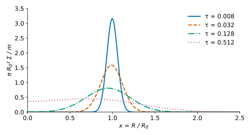
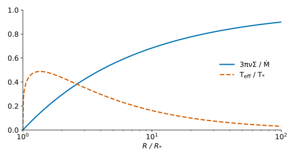
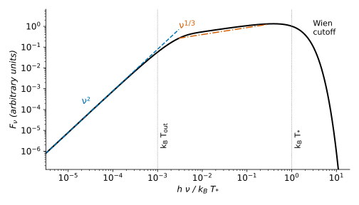
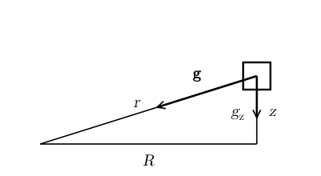
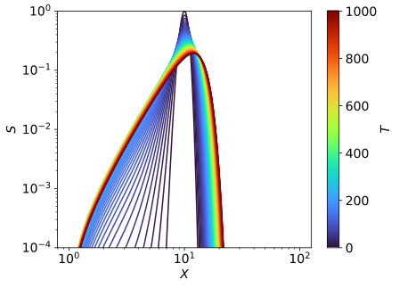

# Accretion Disks {#sec-disk}

Accretion disks are found in a wide range of astrophysical systems. Young stars are surrounded by **protoplanetary disks**, which are the sites of planet formation. For example, the ALMA image of the disk around the young star HL Tau shows a series of bright rings separated by dark gaps, which might have been carved by forming planets [@almapartnership2015]. Accretion disks around white dwarfs, neutron stars, and stellar-mass black holes power cataclysmic variables and X-ray binaries. On much larger scales, accretion onto supermassive black holes powers active galactic nuclei (AGN). The Event Horizon Telescope image of the black hole at the center of the galaxy M87 shows the emission from the innermost region of one such accretion flow (@fig-disk-m87). Note that the gas around this black hole is very hot and dilute, so this flow is not well described by the thin disks that we will discuss in this chapter.

![Image of the black hole at the center of the galaxy M87, taken by the Event Horizon Telescope at a wavelength of 1.3 mm [@eht2019]. The bright ring is the emission from hot gas near the black hole, bent into a ring by gravitational lensing, and it has a diameter of about $40\,\mu\mathrm{as}$. Image credit: EHT Collaboration, via ESO, [CC BY 4.0](https://creativecommons.org/licenses/by/4.0/); cropped. Not covered by the license of these notes.](../figures/accretion-disks/m87-eht.jpg){#fig-disk-m87 fig-alt="A blurred ring of orange and yellow light on a black background, surrounding a dark central region. The ring is brighter on its lower side than on its upper side."}

Disks are so common because gas falling towards a central object almost always has some angular momentum. The gas can lose energy, for example through shocks and radiation, much more easily than it can lose angular momentum. Since, for a given angular momentum, the orbit with the lowest energy is a circular orbit, the gas settles on circular orbits in the plane perpendicular to its angular momentum. In other words, the gas forms a ring at the *circularization radius* $R_c$, where the specific angular momentum of a circular orbit, $\sqrt{G M R_c}$, is equal to that of the gas. However, gas on circular orbits cannot fall onto the central object. In order to be accreted, the gas needs to get rid of its angular momentum. In this chapter, we will see that viscosity can do this, by transporting angular momentum outwards and mass inwards. We will then compute the luminosity and the spectrum of a disk in a steady state.

## Vertically integrated equations {#sec-disk-equations}

We use cylindrical coordinates $(R, \phi, z)$ and we take the disk to lie in the plane $z = 0$. In the in-class worksheet (@sec-disk-worksheet), we will show that the continuity equation in cylindrical coordinates reads
$$
\frac{\partial \rho}{\partial t} + \frac{1}{R} \left[ \frac{\partial (\rho R v_R)}{\partial R} + \frac{\partial (\rho v_{\phi})}{\partial \phi} \right] + \frac{\partial (\rho v_z)}{\partial z} = 0 .
$$ {#eq-disk-continuity-cylindrical}
We assume that the disk is axisymmetric, $\partial_{\phi} = 0$, and thin, so that we can neglect $v_z$. We also assume that the gas rotates with angular velocity $\Omega$, that is $v_{\phi} = R \Omega$. It is convenient to introduce the **surface density**
$$
\Sigma = \int_{- \infty}^{\infty} \rho \dd z ,
$$ {#eq-disk-surface-density}
which is the mass per unit area of the disk. If we integrate @eq-disk-continuity-cylindrical in the vertical direction, we obtain
$$
\frac{\partial \Sigma}{\partial t} + \frac{1}{R} \frac{\partial (R \Sigma v_R)}{\partial R} = 0 .
$$ {#eq-disk-continuity}

To find an equation for $v_R$, we use the conservation of angular momentum (@sec-conserv). The $z$-component of the angular momentum density is $\rho R v_{\phi} = \rho R^2 \Omega$. The pressure does not exert any torque on the gas, since $\partial_{\phi} p = 0$, and neither does the gravity of the central object. However, the viscous stresses do. The only component of the viscous stress tensor (@eq-visc-viscous-stress) that can exert a torque on the gas is
$$
\tau_{R \phi} = \rho \nu R \frac{\partial \Omega}{\partial R} .
$$ {#eq-disk-stress}
Note that $\tau_{R \phi}$ depends only on the shear, $R \, \partial_R \Omega$, so it vanishes for a rigid rotation, as it should. The flux of angular momentum in the radial direction is then $\rho R v_{\phi} v_R - R \tau_{R \phi}$, where the second term is the torque per unit area exerted by the viscous stresses. Accordingly, the conservation of angular momentum reads
$$
\begin{aligned}
&\frac{\partial (\rho R^2 \Omega)}{\partial t} + \frac{1}{R} \frac{\partial}{\partial R} \left( \rho R^3 \Omega v_R - \rho \nu R^3 \frac{\partial \Omega}{\partial R} \right) \\
&\qquad + \frac{\partial (\ldots)}{\partial z} = 0 .
\end{aligned}
$$ {#eq-disk-angular-momentum-3d}
When we integrate in the vertical direction, the last term vanishes and we find
$$
\frac{\partial (\Sigma R^2 \Omega)}{\partial t} + \frac{1}{R} \frac{\partial (\Sigma R^3 \Omega v_R)}{\partial R} = \frac{1}{R} \frac{\partial}{\partial R} \left( \nu \Sigma R^3 \frac{\partial \Omega}{\partial R} \right) ,
$$ {#eq-disk-angular-momentum}
where $\nu$ now denotes the density-weighted average of the viscosity, $\nu \Sigma = \int \rho \nu \dd z$.

We still need an equation for $\Omega$, which is given by the radial component of the momentum equation. The radial pressure gradient term is of order $p / (\rho R) \sim c_s^2 / R$. As we will see below, this is smaller than the gravitational acceleration, $G M / R^2 = \Omega^2 R$, by a factor $(H / R)^2$, where $H$ is the thickness of the disk. So, for a thin disk, the gas moves on nearly circular Keplerian orbits. The angular velocity and the specific angular momentum $j$ of a **Keplerian disk** are
$$
\Omega = \left( \frac{G M}{R^3} \right)^{1 / 2}, \qquad j = R^2 \Omega = \sqrt{G M R} .
$$ {#eq-disk-keplerian}
Since $\partial_R \Omega = - \frac{3}{2} \Omega / R$, we have $\nu \Sigma R^3 \partial_R \Omega = - \frac{3}{2} \nu \Sigma j$, and @eq-disk-angular-momentum can be written as
$$
\frac{\partial (\Sigma j)}{\partial t} + \frac{1}{R} \frac{\partial}{\partial R} \left[ R \Sigma j \left( v_R + \frac{3}{2} \frac{\nu}{R} \right) \right] = 0 .
$$ {#eq-disk-angular-momentum-keplerian}
This is a conservation law for the angular momentum per unit area $\Sigma j$. The first contribution to the flux, $\Sigma j v_R$, is the angular momentum carried by the gas as it moves in the radial direction. The second contribution, $\frac{3}{2} \nu \Sigma j / R$, is due to viscosity, and it is always positive. In other words, **viscosity transports angular momentum outwards**. This makes sense, because $\Omega$ decreases with $R$, so each ring of gas rotates faster than the ring just outside of it. The friction between the two rings slows down the inner ring and speeds up the outer one. Since $j$ increases with $R$, the inner ring, having lost angular momentum, has to move inwards.

## Viscous evolution {#sec-disk-viscous-evolution}

We now eliminate $v_R$ to obtain an equation for $\Sigma$ alone. Using @eq-disk-continuity, we can rewrite the LHS of @eq-disk-angular-momentum as
$$
\begin{aligned}
&\frac{\partial (\Sigma R^2 \Omega)}{\partial t} + \frac{1}{R} \frac{\partial}{\partial R} \left( R \Sigma v_R \cdot R^2 \Omega \right) \\
&\qquad = R^2 \Omega \left[ \frac{\partial \Sigma}{\partial t} + \frac{1}{R} \frac{\partial (R \Sigma v_R)}{\partial R} \right] \\
&\qquad\qquad {} + \Sigma v_R \frac{\partial (R^2 \Omega)}{\partial R} \\
&\qquad = \Sigma v_R \frac{\partial (R^2 \Omega)}{\partial R} ,
\end{aligned}
$$ {#eq-disk-lhs}
where we have used the fact that $\Omega$ depends only on $R$. Combining this with @eq-disk-angular-momentum yields
$$
R \Sigma v_R = \left[ \frac{\partial (R^2 \Omega)}{\partial R} \right]^{- 1} \frac{\partial}{\partial R} \left( \nu \Sigma R^3 \frac{\partial \Omega}{\partial R} \right) .
$$ {#eq-disk-radial-velocity-general}
For a Keplerian disk, $\partial_R (R^2 \Omega) = \frac{1}{2} R \Omega = \frac{1}{2} \sqrt{G M} R^{- 1 / 2}$ and $\nu \Sigma R^3 \partial_R \Omega = - \frac{3}{2} \sqrt{G M} \nu \Sigma R^{1 / 2}$, so
$$
R \Sigma v_R = - 3 R^{1 / 2} \frac{\partial}{\partial R} \left( \nu \Sigma R^{1 / 2} \right) .
$$ {#eq-disk-radial-velocity}
Plugging this into the continuity equation, @eq-disk-continuity, gives
$$
\boxed{\frac{\partial \Sigma}{\partial t} = \frac{3}{R} \frac{\partial}{\partial R} \left[ R^{1 / 2} \frac{\partial}{\partial R} \left( \nu \Sigma R^{1 / 2} \right) \right] .}
$$ {#eq-disk-viscous-evolution}
This is a diffusion-like equation for $\Sigma$, similar to those we have discussed in @sec-visc. Note that the equation is nonlinear if $\nu$ depends on $\Sigma$. We will study some of its properties in @exr-disk-similarity and @exr-disk-numerical, and in the in-class worksheet.

To see how this works, we consider a ring of mass $m$ that is initially located at $R = R_0$, and we take $\nu$ to be constant. In this case, @eq-disk-viscous-evolution can be solved exactly [@lyndenbell1974]. The solution is shown in @fig-disk-spreading-ring as a function of $x = R / R_0$ and of the dimensionless time $\tau = 12 \nu t / R_0^2$. The ring spreads both inwards and outwards. As time goes on, most of the mass moves inwards and is accreted by the central object, while a small fraction of the mass moves to large radii, carrying with it almost all of the angular momentum. In other words, the disk can accrete mass while conserving its angular momentum, as long as some of the gas moves outwards.

{#fig-disk-spreading-ring fig-alt="Surface density against x equal to R over R_0, from 0 to 2.5, at four times tau equal to 0.008, 0.032, 0.128 and 0.512, each in a different colour and line style. At the earliest time the curve is a narrow peak at x equal to 1, of height about 3. At later times the peak becomes lower and wider and moves slightly towards smaller x; at tau equal to 0.512 the curve is almost flat, at about 0.4, and extends from x equal to 0 to beyond x equal to 2."}

### Accretion timescale

@eq-disk-radial-velocity tells us that the radial velocity is of order $v_R \sim \nu / R$. This is also what we would expect from dimensional analysis, since $\nu$ has units of $\mathrm{m^2\,s^{-1}}$. So the typical timescale for accretion is
$$
t_* \sim \frac{R}{v_R} \sim \frac{R^2}{\nu} = \frac{R}{v_{\phi}} \frac{v_{\phi} R}{\nu} = \frac{\mathrm{Re}}{\Omega} ,
$$ {#eq-disk-accretion-timescale}
where $\mathrm{Re} = v_{\phi} R / \nu$ is the Reynolds number of the disk. The Reynolds numbers of astrophysical disks are very large, so $t_* \gg \Omega^{- 1}$. In other words, the gas completes many orbits before being accreted.

::: {.callout-tip icon=false}
## Example

Consider the solar nebula, which is the protoplanetary disk from which the planets of the Solar System formed. At $1\,\mathrm{AU}$, we take $T \approx 300\,\mathrm{K}$ and $\rho \approx 10^{-9}\,\mathrm{g\,cm^{-3}} = 10^{-6}\,\mathrm{kg\,m^{-3}}$, for molecular gas with $\mu = 2.3$. The isothermal sound speed is $c_{\mathrm{iso}} \approx 1\,\mathrm{km/s}$ and the number density is $n = \rho / (\mu m_u) \approx 3 \times 10^{20}\,\mathrm{m^{-3}}$. The cross section for collisions between hydrogen molecules is $\sigma_{\mathrm{H_2}} \approx 2 \times 10^{-19}\,\mathrm{m^2}$, so the mean free path is $\lambda = 1 / (n \sigma_{\mathrm{H_2}}) \approx 2\,\mathrm{cm}$ and the molecular viscosity is $\nu \sim \lambda c_{\mathrm{iso}} \approx 20\,\mathrm{m^2\,s^{-1}}$. The orbital velocity is $v_{\phi} \approx 30\,\mathrm{km/s}$, so
$$
\begin{aligned}
\mathrm{Re} = \frac{v_{\phi} R}{\nu} &\approx \frac{(3 \times 10^4\,\mathrm{m\,s^{-1}}) (1.5 \times 10^{11}\,\mathrm{m})}{20\,\mathrm{m^2\,s^{-1}}} \\
&\approx 2 \times 10^{14} .
\end{aligned}
$$ {#eq-disk-reynolds-nebula}
With $\Omega = 2 \pi / \mathrm{yr}$, the accretion timescale is $t_* \sim \mathrm{Re} / \Omega \sim 3 \times 10^{13}\,\mathrm{yr}$. This is much longer than the age of the Universe. On the other hand, protoplanetary disks are observed to disappear in a few million years.
:::

The previous Example shows that the molecular viscosity is too small to explain the accretion of gas in disks. Instead, the viscosity to use is an effective viscosity $\nu_T \gg \nu$ due to turbulence (@sec-turb). What is the source of this turbulence? We will see in @sec-mri that a weak magnetic field makes the disk unstable, and that the resulting turbulence can transport angular momentum. For the moment, we estimate $\nu_T$ on dimensional grounds. The disk is in hydrostatic equilibrium in the vertical direction, with a scale height
$$
H = \frac{c_s}{\Omega} ,
$$ {#eq-disk-scale-height}
where $c_s$ is the sound speed, which is equal to $c_{\mathrm{iso}}$ for an isothermal disk (@exr-disk-alpha). The largest turbulent eddies cannot be larger than $H$, and their velocity cannot be much larger than $c_s$, otherwise they would produce shocks and be dissipated. So we write
$$
\nu_T = \alpha c_s H = \alpha \Omega H^2 , \qquad \alpha \lesssim 1 .
$$ {#eq-disk-alpha}
This is the so-called **α-viscosity** model of @shakura1973. Observations and simulations suggest $\alpha \sim 0.01$–$0.1$. For the solar nebula at $1\,\mathrm{AU}$, we have $H / R = c_s / v_{\phi} \approx 0.035$, and $\alpha = 0.01$ gives $t_* \sim R^2 / \nu_T = \alpha^{- 1} (R / H)^2 \Omega^{- 1} \sim 10^4\,\mathrm{yr}$. Note also that the radial pressure gradient term is of order $c_s^2 / R = \Omega^2 H^2 / R$, which is smaller than the gravitational acceleration $\Omega^2 R$ by the factor $(H / R)^2$ that we anticipated in @sec-disk-equations.

## Steady disks {#sec-disk-steady}

We now look for steady-state solutions, that is solutions with $\partial_t = 0$. These describe a disk that is fed at a constant rate at large radii, for example by a companion star in a binary system. From the continuity equation, @eq-disk-continuity, it follows that $R \Sigma v_R$ is constant, so we can write
$$
2 \pi R \Sigma v_R = - \dot{M} ,
$$ {#eq-disk-mass-flux}
where $\dot{M} > 0$ is the accretion rate. Similarly, @eq-disk-angular-momentum tells us that the total flux of angular momentum through a ring of radius $R$ is constant,
$$
2 \pi \left( \Sigma R^3 \Omega v_R - \nu \Sigma R^3 \frac{\partial \Omega}{\partial R} \right) = - \dot{J} ,
$$ {#eq-disk-angular-momentum-flux}
where $\dot{J}$ is the rate at which angular momentum is carried onto the central object. We use @eq-disk-mass-flux to eliminate $v_R$ and we find
$$
\dot{M} R^2 \Omega + 2 \pi \nu \Sigma R^3 \frac{\partial \Omega}{\partial R} = \dot{J} .
$$ {#eq-disk-steady-1}

To find $\dot{J}$, we need a boundary condition at the surface of the central star, $R_*$. If the star rotates more slowly than the Keplerian velocity at its surface, then $\Omega$ has to decrease from the Keplerian value in the disk to the angular velocity of the star in a thin *boundary layer*. So $\Omega$ has a maximum very close to $R_*$, where $\partial_R \Omega = 0$. At this point the viscous torque vanishes, and angular momentum is carried onto the star only by the accreted gas, so
$$
\dot{J} = \dot{M} j_* = \dot{M} \sqrt{G M R_*} ,
$$ {#eq-disk-torque-free}
where $j_*$ is the specific angular momentum of a Keplerian orbit at the surface of the star. For a black hole, which does not have a surface, a similar argument applies at the innermost stable circular orbit, inside of which the gas plunges into the black hole. Since $\partial_R \Omega = - \frac{3}{2} \sqrt{G M} R^{- 5 / 2}$, @eq-disk-steady-1 becomes
$$
\dot{M} R^{1 / 2} - 3 \pi \nu \Sigma R^{1 / 2} = \dot{M} R_*^{1 / 2} ,
$$ {#eq-disk-steady-2}
that is
$$
\boxed{\nu \Sigma = \frac{\dot{M}}{3 \pi} \left[ 1 - \left( \frac{R_*}{R} \right)^{1 / 2} \right] .}
$$ {#eq-disk-steady-sigma}
As shown in @fig-disk-steady, $\nu \Sigma$ vanishes at $R_*$ and approaches the constant value $\dot{M} / (3 \pi)$ for $R \gg R_*$. It is important to note that the structure of the disk depends on the viscosity only through the combination $\nu \Sigma$, which is fixed by $\dot{M}$. A larger viscosity simply gives a smaller surface density. As we will see next, this implies that the luminosity and the spectrum of a steady disk do not depend on the viscosity, which is poorly known.

## Disk luminosity {#sec-disk-luminosity}

Viscosity converts the kinetic energy of the shear flow into heat (@sec-visc-dissipation). For $\vb{v} = R \Omega (R) \hat{\vb{\phi}}$, the flow is incompressible and the only non-zero components of the rate-of-strain tensor are $S_{R \phi} = S_{\phi R} = \frac{1}{2} R \, \partial_R \Omega$. So the viscous heating (@eq-visc-heating) is $\vb{\tau} : \nabla \vb{v} = \rho \nu R^2 (\partial_R \Omega)^2$. If we integrate in the vertical direction, we find that the energy dissipated per unit time and per unit area of the disk is
$$
\begin{aligned}
D (R) &= \int_{- \infty}^{\infty} \rho \nu R^2 \left( \frac{\partial \Omega}{\partial R} \right)^2 \dd z \\
&= \nu \Sigma R^2 \left( \frac{\partial \Omega}{\partial R} \right)^2 = \frac{9}{4} \nu \Sigma \Omega^2 .
\end{aligned}
$$ {#eq-disk-dissipation-def}
Using @eq-disk-steady-sigma, we obtain
$$
D (R) = \frac{3 G M \dot{M}}{4 \pi R^3} \left[ 1 - \left( \frac{R_*}{R} \right)^{1 / 2} \right] .
$$ {#eq-disk-dissipation}
The total energy dissipated in the disk per unit time is
$$
\begin{aligned}
L &= 2 \pi \int_{R_*}^{\infty} D (R) R \dd R \\
&= \frac{3}{2} G M \dot{M} \left[ - \frac{1}{R} + \frac{2}{3} \frac{R_*^{1 / 2}}{R^{3 / 2}} \right]_{R_*}^{\infty} \\
&= \frac{G M \dot{M}}{2 R_*} .
\end{aligned}
$$ {#eq-disk-luminosity}
If the disk is optically thick, all of this energy is radiated away, so $L$ is the luminosity of the disk. Note that this is only half of the gravitational energy released per unit time by gas falling from infinity to $R_*$, which is $G M \dot{M} / R_*$. This should not be surprising, because the gas reaches $R_*$ on a Keplerian orbit, so it still has a kinetic energy per unit mass $\frac{1}{2} G M / R_*$. If the star rotates slowly, this kinetic energy is dissipated in the boundary layer, which can then be as luminous as the whole disk.

It is instructive to compare @eq-disk-dissipation with the gravitational energy released locally. Gas moving from $R + \dd R$ to $R$ on Keplerian orbits releases a binding energy $\dot{M} \, \dd (G M / 2 R) = G M \dot{M} \dd R / (2 R^2)$ per unit time. Dividing by the area of the ring, $2 \pi R \dd R$, we find $G M \dot{M} / (4 \pi R^3)$. So, for $R \gg R_*$, the energy dissipated is three times larger than the energy released locally. The difference is carried outwards from the inner regions of the disk by the viscous torque. On the other hand, for $R < \frac{9}{4} R_*$, the energy dissipated is smaller than the energy released locally.

## Emergent spectrum {#sec-disk-spectrum}

If the disk is optically thick, each ring radiates approximately as a blackbody with an effective temperature $T_{\mathrm{eff}} (R)$. The disk has two faces, each radiating a flux $\sigma T_{\mathrm{eff}}^4$, so
$$
2 \sigma T_{\mathrm{eff}}^4 (R) = D (R) = \frac{3 G M \dot{M}}{4 \pi R^3} \left[ 1 - \left( \frac{R_*}{R} \right)^{1 / 2} \right] .
$$ {#eq-disk-teff}
It is convenient to write this as
$$
\begin{aligned}
T_{\mathrm{eff}} (R) &= T_* \left( \frac{R_*}{R} \right)^{3 / 4} \left[ 1 - \left( \frac{R_*}{R} \right)^{1 / 2} \right]^{1 / 4}, \\
T_* &= \left( \frac{3 G M \dot{M}}{8 \pi \sigma R_*^3} \right)^{1 / 4} .
\end{aligned}
$$ {#eq-disk-teff-2}
The effective temperature is shown in @fig-disk-steady. It has a maximum $T_{\mathrm{max}} \approx 0.49\, T_*$ at $R = (49/36) R_*$, and for $R \gg R_*$ it decreases as $T_{\mathrm{eff}} \approx T_* (R_* / R)^{3 / 4}$.

{#fig-disk-steady fig-alt="Two curves against R over R_*, on a logarithmic axis from 1 to 100. The solid curve, 3 pi nu Sigma over M dot, starts from 0 at R equal to R_* and rises slowly towards 1, reaching 0.9 at R equal to 100 R_*. The dashed curve, T_eff over T_*, rises steeply from 0 to a maximum of about 0.49 at R equal to about 1.4 R_*, and then decreases slowly, to about 0.03 at R equal to 100 R_*."}

::: {.callout-tip icon=false}
## Example

Consider a black hole with $M = 10\,M_{\odot}$ accreting from a companion star at a rate $\dot{M} = 10^{-8}\,M_{\odot}/\mathrm{yr} \approx 6 \times 10^{14}\,\mathrm{kg\,s^{-1}}$. For $R_*$ we take the radius of the innermost stable circular orbit, $R_* = 6 G M / c^2 \approx 90\,\mathrm{km}$. @eq-disk-luminosity gives $L \approx 5 \times 10^{30}\,\mathrm{W}$, which is more than $10^4\,L_{\odot}$, and @eq-disk-teff-2 gives $T_* \approx 7 \times 10^6\,\mathrm{K}$. The innermost regions of the disk have $k_B T_{\mathrm{max}} \approx 0.3\,\mathrm{keV}$, so they emit X-rays. If we repeat the calculation for a white dwarf with $M = 1\,M_{\odot}$, $R_* = 5600\,\mathrm{km}$, and $\dot{M} = 10^{-9}\,M_{\odot}/\mathrm{yr}$, we find $T_* \approx 10^5\,\mathrm{K}$, so disks around white dwarfs emit mostly in the UV. Indeed, the X-ray spectra of black-hole binaries in their so-called "soft" state are well described by the sum of blackbodies that we will compute next, after a correction for the scattering of photons by electrons in the atmosphere of the disk, which makes the spectrum look hotter than $T_{\mathrm{eff}}$ [@davis2006].
:::

Consider an observer at a distance $d$ who sees the disk inclined by an angle $i$, where $i = 0$ corresponds to a disk seen face on. A ring of area $2 \pi R \dd R$ subtends a solid angle $2 \pi R \dd R \cos i / d^2$, so the flux received at the frequency $\nu$ is
$$
\begin{aligned}
F_{\nu} &= \frac{2 \pi \cos i}{d^2} \int_{R_*}^{R_{\mathrm{out}}} B_{\nu} \big( T_{\mathrm{eff}} (R) \big) R \dd R, \\
B_{\nu} (T) &= \frac{2 h \nu^3}{c^2} \frac{1}{\ee^{h \nu / k_B T} - 1} ,
\end{aligned}
$$ {#eq-disk-spectrum}
where $R_{\mathrm{out}}$ is the outer radius of the disk and $B_{\nu}$ is the Planck function. Note that here $\nu$ denotes the frequency and not the viscosity. The resulting spectrum, shown in @fig-disk-spectrum, is called a *multi-color blackbody* spectrum. To understand its shape, we consider three limits, and we define $T_{\mathrm{out}} = T_{\mathrm{eff}} (R_{\mathrm{out}})$.

- For $h \nu \gg k_B T_{\mathrm{max}}$, all rings emit in the Wien part of their spectrum, and the emission is dominated by the hottest ones, so $F_{\nu} \sim \exp (- h \nu / k_B T_{\mathrm{max}})$, up to a power of $\nu$.

- For $h \nu \ll k_B T_{\mathrm{out}}$, all rings emit in the Rayleigh–Jeans part of their spectrum, where $B_{\nu} \approx 2 \nu^2 k_B T / c^2$, so $F_{\nu} \propto \nu^2$. This is the Rayleigh–Jeans tail.

- For $k_B T_{\mathrm{out}} \ll h \nu \ll k_B T_*$, the emission comes mostly from rings with $R \gg R_*$, where $T_{\mathrm{eff}} \approx T_* (R_* / R)^{3 / 4}$. So
  $$
  F_{\nu} \propto \int_{R_*}^{R_{\mathrm{out}}} \frac{\nu^3 R \dd R}{\exp \left( \frac{h \nu R^{3 / 4}}{k_B T_* R_*^{3 / 4}} \right) - 1} .
  $$ {#eq-disk-spectrum-intermediate}
  We introduce the new variable
  $$
  \begin{aligned}
  x &= \frac{h \nu}{k_B T_*} \left( \frac{R}{R_*} \right)^{3 / 4}, \\
  R &= \left( \frac{k_B T_* x}{h \nu} \right)^{4 / 3} R_*, \\
  \dd R &= \frac{4}{3} \left( \frac{k_B T_*}{h \nu} \right)^{4 / 3} R_* x^{1 / 3} \dd x ,
  \end{aligned}
  $$ {#eq-disk-change-variable}
  to find
  $$
  F_{\nu} \propto \nu^{1 / 3} \int_{x_{\mathrm{in}}}^{x_{\mathrm{out}}} \frac{x^{5 / 3}}{\ee^x - 1} \dd x ,
  $$ {#eq-disk-spectrum-flat}
  with $x_{\mathrm{in}} = h \nu / k_B T_* \ll 1$ and $x_{\mathrm{out}} \approx h \nu / k_B T_{\mathrm{out}} \gg 1$. Since the integrand is small for both $x \ll 1$ and $x \gg 1$, we can extend the integral from $0$ to $\infty$. The integral then does not depend on $\nu$, so $F_{\nu} \propto \nu^{1 / 3}$. This part of the spectrum is a distinctive feature of accretion disks, which is not present in the spectrum of a single blackbody.

{#fig-disk-spectrum fig-alt="Log-log plot of the flux F_nu, in arbitrary units, against h nu over k_B T_*, from about 3 times 10 to the minus 6 to 20. Vertical dotted lines mark k_B T_out at 10 to the minus 3 and k_B T_* at 1. Below k_B T_out the spectrum follows a dashed line proportional to nu squared. Between the two dotted lines it rises slowly, following a dash-dotted line proportional to nu to the one third. Above k_B T_* it drops steeply, in an exponential Wien cutoff."}

<!-- 3C 273 and the other components of quasar spectra: dropped for now as out of scope (2026-11-19).
The figure (figures/accretion-disks/3c273-sed.svg), its script (sed_3c273 in
figures-src/accretion-disks/make-figures.py), and the data (3c273-ned.txt) are kept.

The disks around supermassive black holes are much colder than those in X-ray binaries. From @eq-disk-teff-2, we have $T_*^4 \propto M \dot{M} / R_*^3$. If we take $R_* \propto M$, as for the innermost stable circular orbit, and $\dot{M} \propto M$, then $T_* \propto M^{- 1 / 4}$. To see how this works, we consider the quasar 3C 273, at redshift $z = 0.158$, which was the first quasar whose redshift was measured. We take $M = 10^9\,M_{\odot}$, which is within a factor of a few of the estimates of the mass of its black hole, and $\dot{M} = 5\,M_{\odot}/\mathrm{yr}$. Then @eq-disk-luminosity gives $L \approx 2 \times 10^{39}\,\mathrm{W}$, and @eq-disk-teff-2 gives $T_* \approx 1.1 \times 10^5\,\mathrm{K}$, which is about seventy times smaller than for the X-ray binary of the previous Example. This is somewhat less than the factor $(10^8)^{1/4} = 100$ expected from the scaling above, because here $\dot{M} / M$ is five times larger than in the Example. So the emission of the disk peaks in the UV. In @fig-disk-3c273, we compare the spectrum of this disk with the observations of 3C 273. The disk reproduces the broad peak in the optical and UV part of the spectrum, which is called the *big blue bump*. This was first interpreted as the emission of an accretion disk by @shields1978. Note that there are no data in the extreme UV, because these photons are absorbed by the neutral hydrogen in our Galaxy.

The other parts of the spectrum are not described by our model, and they come from other components of the quasar.

- The radio emission is synchrotron radiation from relativistic electrons in the jet. 3C 273 has a powerful relativistic jet, which also contributes to the infrared and to the X-rays.

- The near- and mid-infrared emission comes mostly from dust, which absorbs the UV light of the disk and re-emits it at longer wavelengths. To see where this dust is, consider a dust grain of radius $a$ at a distance $r$ from the center. The grain absorbs the radiation of the disk over its cross section $\pi a^2$, and it emits as a blackbody from its surface $4 \pi a^2$. So its temperature $T$ is given by
  $$
  \frac{L}{4 \pi r^2} \pi a^2 = 4 \pi a^2 \sigma T^4 \quad \Longrightarrow \quad r = \left( \frac{L}{16 \pi \sigma T^4} \right)^{1 / 2} .
  $$ {#eq-disk-dust-radius}
  Dust grains evaporate, or *sublimate*, if they are heated above $T \approx 1500\,\mathrm{K}$. For $L = 2 \times 10^{39}\,\mathrm{W}$, @eq-disk-dust-radius tells us that this happens within $r \approx 0.4\,\mathrm{pc}$ of the black hole, which is about $1500$ times larger than $R_*$. The hottest dust, just outside of this radius, emits mostly at $\lambda \approx 2\,\mu\mathrm{m}$. Colder dust, farther out, emits at longer wavelengths. This explains the dip in the spectrum near $\lambda \approx 1\,\mu\mathrm{m}$ (that is, $\nu \approx 3 \times 10^{14}\,\mathrm{Hz}$), between the emission of the hottest dust and that of the disk. In the far infrared, the synchrotron emission of the jet also contributes.

- The X-rays come from a *corona* of hot ($T \sim 10^9\,\mathrm{K}$) and optically thin plasma above the disk. The electrons in the corona scatter the UV photons of the disk to much higher energies. This process is called *inverse Compton scattering*, and it produces a power-law spectrum. In 3C 273, the jet also contributes to the X-rays.

![Spectral energy distribution of the quasar 3C 273, from the photometry collected in the NASA/IPAC Extragalactic Database (NED), compared with the spectrum of a steady disk around a black hole with $M = 10^9\,M_{\odot}$ and $\dot{M} = 5\,M_{\odot}/\mathrm{yr}$, extending from $R_* = 6 G M / c^2$ to $10^3 R_*$ and seen face on (dashed line). To compare it with the data, we plot $4 \pi d^2 F_{\nu}$ from @eq-disk-spectrum, with $\cos i = 1$, for both. The data are converted to the rest frame, with $z = 0.158$ and a luminosity distance of $755\,\mathrm{Mpc}$, and binned in intervals of $0.25$ in $\log_{10} \nu$. The points show the median of each bin, and the error bars show the spread of the measurements, from the 16th to the 84th percentile. The measurements come from many different epochs, and 3C 273 is variable, which explains part of this spread. We have excluded the X-ray fluxes from the Chandra Source Catalog, which are much lower than all the other X-ray measurements, probably because of pile-up in the detector or because they refer to the knots of the jet. The medians are not affected by the few other outliers. The model is not a fit to the data. The labels show the components that dominate each part of the spectrum, as discussed in the text. This research has made use of NED, which is funded by NASA and operated by the California Institute of Technology.](../figures/accretion-disks/3c273-sed.svg){#fig-disk-3c273 fig-alt="Plot of the base-10 logarithm of nu L_nu, in watts, from 36 to 40.6, against the base-10 logarithm of the rest-frame frequency in hertz, from 9 to 20, with the radio, infrared, optical, UV and X-ray bands labelled along the top. The binned data points, with error bars of typically 0.1 to 0.3, rise steadily through the radio, from about 36.6 at 9.2 to about 38.3 at 11.6, continue to rise through the infrared to about 38.8 at 13.5, and reach a peak of about 39.3 near 15.3. There are no data between about 15.6 and 16.7. In the X-rays the points rise slowly from about 38 at 17 to about 39 at 19.5. The dashed orange disk model rises steeply from below 36 at 13.1, joins the data in the optical, peaks at about 39.35 near 15.4, and drops below 36 at about 16.25. Italic labels mark the components: jet, over the radio points; hot dust, over the infrared points; disk, under the model curve; and corona plus jet, over the X-ray points."}
-->

## Limitations of the model {#sec-disk-limitations}

The model that we have discussed explains many of the observed properties of accretion disks. However, it also has some important problems.

- Under some conditions, the disk models that we have discussed are unstable. For example, this happens in the inner regions of very luminous disks, where radiation pressure dominates, and in the regions where hydrogen is partially ionized. If the heating rate grows with temperature faster than the cooling rate, then a small increase in the temperature leads to runaway heating. This is called *thermal instability*. In disks around white dwarfs, it is thought to cause the outbursts of dwarf novae. Similarly, under some conditions, a small overdensity in the disk keeps growing, and the disk breaks up into rings. This is called *viscous instability*. We will find the condition for viscous instability in the in-class worksheet.

- We have not explained the origin of the viscosity. As we have seen, the molecular viscosity is much too small, and the α-viscosity model does not tell us where the turbulence comes from. We will come back to this point when we discuss turbulence (@sec-turb) and the magnetorotational instability (@sec-mri). Modern studies of accretion disks rely on magnetohydrodynamic simulations, in which angular momentum is transported by the turbulence driven by the magnetorotational instability.

## In-class worksheet {#sec-disk-worksheet}

1.  Cylindrical coordinates $(R, \phi, z)$ are defined as follows
    $$
    x = R \cos \phi, \qquad y = R \sin \phi, \qquad z = z.
    $$ {#eq-disk-32}
    The unit vectors in the $R, \phi$, and $z$ directions are
    $$
    \begin{gathered}
    \hat{\vb{R}} = \frac{1}{\sqrt{x^2 + y^2}}  \left(\begin{array}{c}
    x\\
    y\\
    0
    \end{array}\right), \\
    \hat{\vb{\phi}} = \frac{1}{\sqrt{x^2 +
    y^2}}  \left(\begin{array}{c}
    - y\\
    x\\
    0
    \end{array}\right), \\
    \hat{\vb{z}} = \left(\begin{array}{c}
    0\\
    0\\
    1
    \end{array}\right) .
    \end{gathered}
    $$ {#eq-disk-33}

    1.  Given the fluid velocity written as $\vb{v}= v_R \hat{\vb{R}} + v_{\phi} \hat{\vb{\phi}} + v_z \hat{\vb{z}}$, find its Cartesian components $v_x, v_y,$ and $v_z$.

    2.  Use the chain rule for derivatives to show that
        $$
        \begin{aligned}
        \frac{\partial}{\partial R} &= \frac{x}{R}  \frac{\partial}{\partial x}
        + \frac{y}{R}  \frac{\partial}{\partial y}, \\
        \frac{\partial}{\partial \phi} &= - y \frac{\partial}{\partial x} + x
        \frac{\partial}{\partial y} .
        \end{aligned}
        $$ {#eq-disk-34}

    3.  Using the results from the previous points show that
        $$
        \nabla \cdot \vb{v}= \frac{1}{R}  \frac{\partial (Rv_R)}{\partial
        R} + \frac{1}{R}  \frac{\partial v_{\phi}}{\partial \phi} +
        \frac{\partial v_z}{\partial z} .
        $$ {#eq-disk-35}

    4.  Conclude that the continuity equation in cylindrical coordinates is
        $$
        \frac{\partial \rho}{\partial t} + \frac{1}{R}  \left[ \frac{\partial
        (\rho Rv_R)}{\partial R} + \frac{\partial (\rho v_{\phi})}{\partial
        \phi} \right] + \frac{\partial (\rho v_z)}{\partial z} = 0.
        $$ {#eq-disk-36}

2.  **Viscous instability in accretion disks.** The equation describing the evolution of the surface density $\Sigma$ in an accretion disk is given by
    $$
    \partial_t \Sigma = \frac{3}{R} \partial_R  [R^{1 / 2} \partial_R (\nu
    \Sigma R^{1 / 2})] .
    $$ {#eq-disk-37}
    Assume that the viscosity $\nu$ is in the form $\nu = \nu (\Sigma, R)$.

    1.  Introduce the quantity $\psi = \nu \Sigma$ and consider a small perturbation $\delta \Sigma$ in the surface density of the disk. Find the equation describing the evolution of the corresponding perturbation $\delta \psi$ of $\psi$.

    2.  Under what condition is the disk stable?

## Exercises {#sec-disk-exercises}

::: {#exr-disk-alpha}
## α-disks: scale height, viscosity, Reynolds number

1.  Consider gas in an accretion disk that is in hydrostatic equilibrium in the vertical direction, with the vertical pressure gradient balancing the vertical component of the gravitational acceleration due to the central object. Show that the angular frequency of rotation $\Omega$, the sound speed $c_s$, and the vertical scale height $H$ of the disk satisfy $c_s \sim H \Omega$.

2.  Suppose now that the $R \phi$ component of the viscous stress tensor equals a factor $\alpha$ times the thermal pressure. Show that (i) $\nu \sim \alpha c_s H$ and (ii) the Reynolds number is $\mathrm{Re} \sim \frac{1}{\alpha} \left( \frac{R}{H} \right)^2$.

Adapted from @clarke2007, Problem 47.
:::

::: {.content-visible when-profile="solutions"}
::: {.solution}
1.  The vertical structure of the disk is set by the balance between pressure and gravity, as shown in @fig-disk-vertical-gravity.

    {#fig-disk-vertical-gravity fig-alt="A right triangle with horizontal leg R along the midplane, vertical leg z, and hypotenuse r pointing towards the central object at the left. A fluid element at the top of the vertical leg, drawn as a small square, feels the gravitational acceleration g along the hypotenuse towards the centre; its vertical component g_z points downward."}

    The vertical component of the gravitational acceleration is
    $$
    g_z = \vb{g} \cdot \hat{\vb{z}} = - \frac{GM}{r^3} \vb{r}
    \cdot \hat{\vb{z}} = - \frac{GMz}{r^3} \approx - \Omega^2 z,
    $$
    where we have used $r \approx R$ for $z \ll R$. Accordingly, hydrostatic equilibrium becomes
    $$
    \partial_z p = \rho g_z = - \Omega^2 z \rho \Longrightarrow \partial_z \rho = -
    \frac{\Omega^2}{c_s^2} \rho z.
    $$
    This can be integrated to find
    $$
    \rho (t, R, z) = \rho_0 (t, R) \exp \left( - \frac{z^2}{2 H^2} \right),
    \qquad H = \frac{c_s}{\Omega},
    $$
    where $H$ is the scale height of the disk: the density drops by a factor $\ee^{-1/2}$ at $|z| = H$.

2.  The $R \phi$ component of the viscous stress is
    $$
    \tau_{R \phi} = \rho \nu R \frac{\dd \Omega}{\dd R} = - \frac{3}{2} \rho \nu \Omega ,
    $$
    where $\nu$ is the kinematic viscosity, since $\Omega = \left( \frac{GM}{R^3} \right)^{1 / 2}$. Note that the stress depends on the shear, $R \, \dd \Omega / \dd R$, and not on $\partial_R v_{\phi}$, because a rigid rotation produces no stress. If we assume $\tau_{R \phi} = - \alpha p$, then we obtain
    $$
    \alpha p = \alpha c_s^2 \rho = \frac{3}{2} \rho \nu \Omega \Longrightarrow \nu = \frac{2}{3} \alpha \frac{c_s^2}{\Omega} = \frac{2}{3} \alpha c_s H \sim \alpha c_s H .
    $$
    The Reynolds number is
    $$
    \mathrm{Re} = \frac{v_{\phi} R}{\nu} \sim \frac{v_{\phi} R}{\alpha c_s H} =
    \frac{v_{\phi} R}{\alpha H^2 \Omega} = \frac{\Omega R^2}{\alpha H^2
    \Omega} = \frac{1}{\alpha}  \left( \frac{R}{H} \right)^2 .
    $$
:::
:::

::: {#exr-disk-similarity}
## Similarity form of the disk equation

1.  Show that the viscous evolution equation of a Keplerian accretion disk,
    $$
    \frac{\partial \Sigma}{\partial t} = \frac{3}{R}
    \frac{\partial}{\partial R} \left[ R^{1 / 2}  \frac{\partial}{\partial
    R} (\nu \Sigma R^{1 / 2}) \right],
    $$ {#eq-disk-evolution}
    can be recast as
    $$
    \frac{\partial S}{\partial t} = \frac{\partial^2 Y}{\partial X^2},
    $$ {#eq-disk-similarity-form}
    with $S = \Sigma R^{3 / 2}$, $Y = 3 \nu \Sigma R^{1 / 2}$, and $X = 2 R^{1 / 2}$.

2.  Obtain also a partial differential equation for $S (t, X)$ when $Y = Y_0 + \beta (S - S_0)$, where $Y_0$, $S_0$, and $\beta$ are constants.

3.  Describe how $S$ evolves in the two cases (a) $\beta > 0$ and (b) $\beta < 0$.

Adapted from @clarke2007, Problem 49.
:::

::: {.content-visible when-profile="solutions"}
::: {.solution}
1.  We can exchange derivatives w.r.t. $R$ with derivatives w.r.t. $X$ as
    $$
    \frac{\partial}{\partial R} = \frac{\partial X}{\partial R}
    \frac{\partial}{\partial X} = \frac{1}{R^{1 / 2}}
    \frac{\partial}{\partial X} .
    $$
    Inserting this into the viscous evolution equation, we obtain
    $$
    \frac{\partial \Sigma}{\partial t} = \frac{3}{R^{3 / 2}}
    \frac{\partial}{\partial X} \left[ \frac{\partial}{\partial X} (\nu
    \Sigma R^{1 / 2}) \right],
    $$
    multiplying both terms by $R^{3 / 2}$ and introducing the variables $S = \Sigma R^{3 / 2}$ and $Y = 3 \nu \Sigma R^{1 / 2}$:
    $$
    \frac{\partial S}{\partial t} = \frac{\partial^2 Y}{\partial X^2} .
    $$

2.  Since $Y_0$, $\beta$, and $S_0$ are constants, we obtain
    $$
    \frac{\partial S}{\partial t} = \beta \frac{\partial^2 S}{\partial X^2} .
    $$

3.  We can look for solutions in the form $S (t, X) = \hat{S} (t) \ee^{\ii kX}$. In this case, we obtain:
    $$
    \frac{\partial S}{\partial t} = \frac{\dd \hat{S} (t)}{\dd t}
    \ee^{\ii kX}, \quad \frac{\partial^2 S}{\partial X^2} = - k^2 \hat{S} (t)
    \ee^{\ii kX}, \quad \Longrightarrow \quad  \frac{\dd \hat{S}
    (t)}{\dd t} = - \beta k^2  \hat{S} (t) .
    $$
    The last equation can be solved to find that
    $$
    S (t, X) = \hat{S} (0) \ee^{- \beta k^2 t} \ee^{\ii kX} .
    $$
    The solutions are exponentially decaying in time if $\beta > 0$. This means that if $\beta > 0$, then the disk is stable. Otherwise, if $\beta < 0$, we have exponentially growing solutions, so the disk is unstable.
:::
:::

::: {#exr-disk-numerical}
## Numerical evolution of an accretion disk

1.  Show that @eq-disk-evolution can be written as
    $$
    \frac{\partial S}{\partial T} = \frac{\partial^2 (SX^{- 2})}{\partial
    X^2},
    $$ {#eq-disk-diffusion}
    where $S$ and $X$ are defined as in @exr-disk-similarity and $T = 12 \nu t$.

2.  To solve @eq-disk-diffusion numerically, introduce a grid
    $$
    \begin{aligned}
    &\{ (T_n, X_k) = (n \Delta T, X_{\min} + k \Delta X) : \\
    &\qquad n = 0, 1, \ldots, N_T, k = 0, 1, \ldots, N_X \},
    \end{aligned}
    $$ {#eq-disk-grid}
    where $\Delta T$, $X_{\min}$, and $\Delta X$ are fixed parameters. Let $S^n_k$ be the approximation of $S$ at $(T_n, X_k)$[^disk-1]. Then $S_k^n$ for $k = 1, \ldots, N_X - 1$ can be written as
    $$
    \frac{S^{n + 1}_k - S^n_k}{\Delta T} = \frac{S^{n + 1}_{k + 1} X_{k +
    1}^{- 2} - 2 S^{n + 1}_k X_k^{- 2} + S^{n + 1}_{k - 1} X_{k - 1}^{-
    2}}{\Delta X^2} .
    $$ {#eq-disk-finite-differencing}
    The boundary conditions for this problem are
    $$
    S_0 = S_{N_X} = 0,
    $$ {#eq-disk-boundary}
    corresponding to Dirichlet boundary condition for $S$.

    Show that @eq-disk-finite-differencing can be written as
    $$
    (I - \Delta TA) \vb{S}^{n + 1} =\vb{S}^n,
    $$ {#eq-disk-heat-numerical}
    where $\vb{S}^n = (S_1^n, S_2^n, \ldots, S^n_{N_X - 1})$ is a vector of values, $I$ is the identity matrix, and $A$ is a tridiagonal matrix. Find the explicit form of $A$.

3.  Write code to evolve in time the density in the disk by repeatedly solving @eq-disk-heat-numerical starting from some initial condition $\vb{S}^0$. You can use `scipy.linalg.solve_banded` to solve the linear equations.

4.  Consider as initial conditions
    $$
    S (t = 0, X) = \ee^{- (X - 10)^2},
    $$ {#eq-disk-initial}
    with $X_{\min} = 1$. Plot the numerical solutions at successive times. Interpret the results in a few sentences.
:::

[^disk-1]: Note that the $n$ in $S^n_k$ is an index and not a power.

::: {.content-visible when-profile="solutions"}
::: {.solution}
1.  From the previous definitions, it follows that $Y = 12 \nu SX^{- 2}$ and
    $$
    \frac{\partial}{\partial t} = \frac{\partial T}{\partial t}
    \frac{\partial}{\partial T} = 12 \nu \frac{\partial}{\partial T} .
    $$
    Combining this last equation with @eq-disk-similarity-form yields
    $$
    \frac{\partial S}{\partial T} = \frac{\partial^2 (SX^{- 2})}{\partial
    X^2} .
    $$

2.  Rearranging the terms in @eq-disk-finite-differencing, we obtain (for $1 \leq k \leq N_X - 1$)
    $$
    \left[ S_k^{n + 1} - \frac{\Delta T}{\Delta X^2}  (S^{n + 1}_{k + 1} X_{k
    + 1}^{- 2} - 2 S^{n + 1}_k X_k^{- 2} + S^{n + 1}_{k - 1} X_{k - 1}^{- 2})
    \right] = S_k^n .
    $$
    The last equation can be written as
    $$
    [I - \Delta TA] \vb{S}^{n + 1} =\vb{S}^n,
    $$
    where
    $$
    A = \frac{1}{\Delta X^2} \left(\begin{array}{ccccccc}
    - 2 X_1^{- 2} & X_2^{- 2} &  &  &  &  & \\
    X_1^{- 2} & - 2 X_2^{- 2} & X_3^{- 2} &  &  &  & \\
    & \ddots & \ddots & \ddots &  &  & \\
    &  & X_{k - 1}^{- 2} & - 2 X_k^{- 2} & X_{k + 1}^{- 2} &  & \\
    &  &  & \ddots & \ddots & \ddots & \\
    &  &  &  & X_{N_X - 3}^{- 2} & - 2 X^{- 2}_{N_X - 2} & X^{- 2}_{N_X -
    1}\\
    &  &  &  &  & X_{N_X - 2}^{- 2} & - 2 X_{N_X - 1}^{- 2}
    \end{array}\right) .
    $$
    Note that $X_0 = X_{\min}$ and $X_{N_X}$ is the last grid point.

3.  @fig-disk-evolution shows the evolution of $S$. See [`accretion-disk.py`](https://github.com/dradice/astrofluids/blob/main/solutions/code/accretion-disks/accretion-disk.py) for the implementation.

    {#fig-disk-evolution fig-alt="Log-log plot of S against X, with the curves coloured by time T from 0 to 1000 (colour bar at the right). The initial narrow peak near X = 10 broadens with time: the left side spreads towards small X and the right side towards larger X, while the peak height drops from 1 to about 0.2."}

4.  The disk is viscously spreading. Part of the material is accreted by the central object, while the rest moves outward, carrying away the angular momentum. In our calculation, some of this material leaves the grid at $X_{\max}$.
:::
:::

::: {#exr-disk-spectrum}
## Accretion-disk spectrum

Model an accretion disk as a set of concentric rings $i = 1, 2, \ldots, N$, each with median radius $R_i$ and radial extent $\Delta R$. Let the disk extend from an inner radius $R_{\mathrm{in}}$ to an outer radius $R_{\mathrm{out}}$ and the temperature be
$$
T (R) = T_{\mathrm{in}}  \left( \frac{R_{\mathrm{in}}}{R} \right)^{3 / 4} .
$$ {#eq-disk-exr-temperature}
Assume that the $i$th ring emits as a blackbody with a fixed temperature $T_i = T (R_i)$
$$
B_{\nu} (T) = \frac{2 h \nu^3}{c^2}  \frac{1}{\ee^{h \nu / k_B T} - 1},
$$ {#eq-disk-exr-planck}
where $h$ is the Planck constant, $c$ the speed of light, and $k_B$ the Boltzmann constant.

1.  Write a code to compute and plot the emergent spectrum from a single ring at radius $R_i$. Plot the emergent spectrum for several radii. You can work in units in which $k_B = h = c = 1$. You can take $T_{\mathrm{in}} = 1$ in these units.

2.  Write a code to compute the emergent spectrum from the full disk by summing up the contribution from each ring. Plot the resulting spectrum and discuss its physical interpretation. Verify that the spectrum approximately scales as $\nu^{1 / 3}$ for $T_{\mathrm{out}} \lesssim \nu \lesssim T_{\mathrm{in}}$. You can work in the same units as in the previous point. Additionally assume that $R_{\mathrm{out}} / R_{\mathrm{in}} = 10^4$, so that $T_{\mathrm{out}} = 10^{-3}\, T_{\mathrm{in}}$.
:::

::: {.content-visible when-profile="solutions"}
::: {.solution}
See [`disk-spectrum.py`](https://github.com/dradice/astrofluids/blob/main/solutions/code/accretion-disks/disk-spectrum.py) for the implementation.
:::
:::

## Further reading {#sec-disk-reading}

- @clarke2007, Chapter 12 (accretion discs).
- @pringle1981, a classic review of the theory of accretion disks.
- @frank2002, Chapter 5, for a more detailed discussion of steady disks and their spectra.
