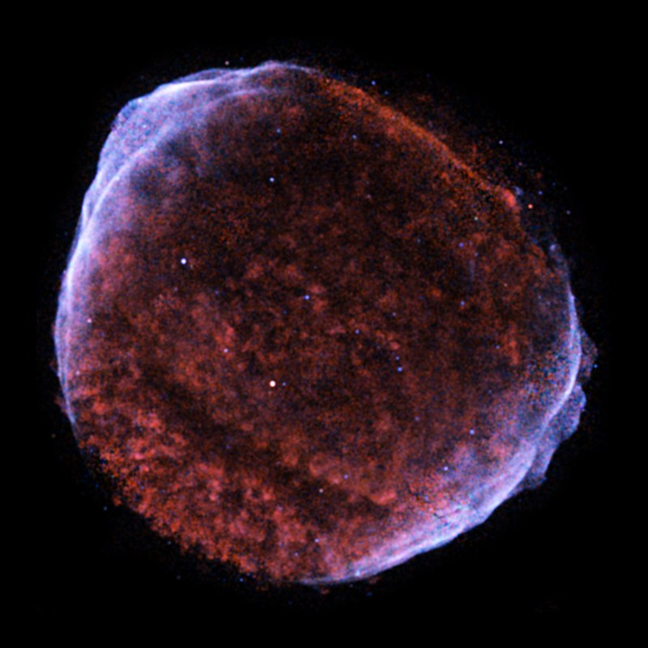
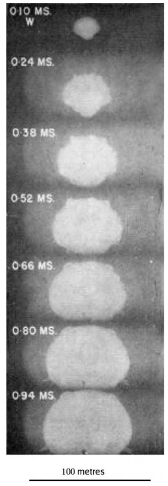
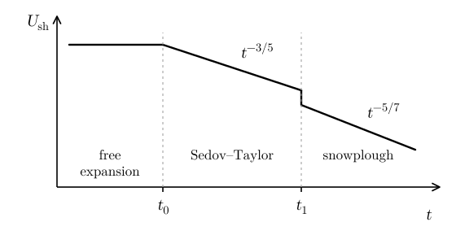
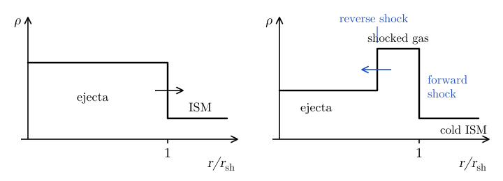
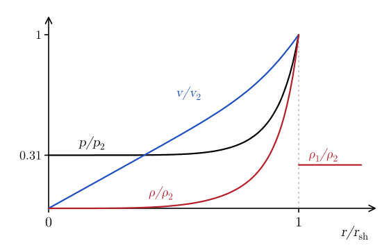
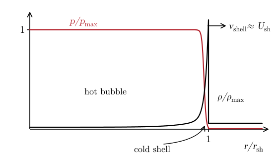
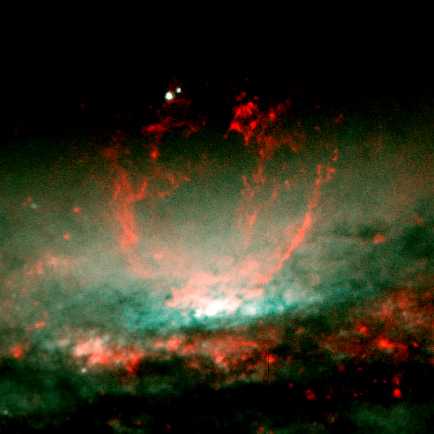

# Blast Waves {#sec-blast}

Supernova explosions sweep the interstellar medium (ISM), creating bubbles of superheated plasma, with $T \sim 10^7\,\mathrm{K}$ (@fig-blast-sn1006). These *supernova remnants* remain bright X-ray sources for about $10^5$ years before cooling down. In this chapter, we model supernova remnants as point explosions in the ISM, and derive the *Sedov–Taylor solution*. This is also an excuse to present an example of *similarity analysis*, which has many applications, but is seldom discussed in (astro)physics courses.

{#fig-blast-sn1006 fig-alt="False-colour X-ray image of a roughly circular supernova remnant on a black background. The interior is filled with mottled red emission. The rim is brighter and bluish-white, especially along the upper left and lower right edges, where it forms thin filaments."}

## Similarity analysis {#sec-blast-similarity}

Consider an energy $E$ released at a point in a uniform gas with density $\rho_1$. The explosion drives a spherical shock with radius $r_{\mathrm{sh}}$, moving outwards with speed $U_{\mathrm{sh}}$. In the limit in which the pressure of the ambient gas can be neglected, that is for a strong shock (@eq-shock-strong), this problem is characterized by only two parameters: $E$ and $\rho_1$. No combination of them has the dimensions of a length or a time. So the problem has no characteristic length or time: the flow at a later time must look like a scaled-up copy of the flow at an earlier time. The solution behind the shock must be in the form
$$
q (t, r) = f_q \left( \xi \right), \qquad \xi = \frac{r}{r_0 (t)},
$$ {#eq-blast-1}
where $q$ is any of the fluid variables and $r_0$ is a characteristic length scale of the problem. $r_0$ can only depend on $E$, $\rho_1$, and $t$. We write $r_0 = \rho_1^{\alpha} E^{\beta} t^{\gamma}$, so that
$$
\begin{gathered}
\mathrm{m} = \left( \mathrm{kg\,m^{-3}} \right)^{\alpha} \left( \mathrm{kg\,m^2\,s^{-2}} \right)^{\beta} \mathrm{s}^{\gamma} \\
\Longrightarrow \quad \alpha + \beta = 0, \quad 2 \beta - 3 \alpha = 1, \quad \gamma - 2 \beta = 0 \\
\Longrightarrow \quad \alpha = - 1 / 5, \quad \beta = 1 / 5, \quad \gamma = 2 / 5 .
\end{gathered}
$$ {#eq-blast-2}
So the dimensionless radius is
$$
\xi = r \left( \frac{\rho_1}{E t^2} \right)^{1 / 5} .
$$ {#eq-blast-xi}
The shock must sit at a fixed value $\xi = \xi_0$, so
$$
\boxed{r_{\mathrm{sh}} = \xi_0 \left( \frac{E t^2}{\rho_1} \right)^{1 / 5} ,}
$$ {#eq-blast-radius}
and the shock velocity is
$$
U_{\mathrm{sh}} = \frac{\dd r_{\mathrm{sh}}}{\dd t} = \frac{2}{5} \xi_0 \left( \frac{E}{\rho_1 t^3} \right)^{1 / 5} = \frac{2}{5}  \frac{r_{\mathrm{sh}}}{t} .
$$ {#eq-blast-velocity}
$\xi_0$ is a number of order one, which we will compute in @sec-blast-sedov. Note that $U_{\mathrm{sh}} \propto t^{- 3 / 5}$ and $r_{\mathrm{sh}} \propto t^{2 / 5}$, so
$$
\rho_1 r_{\mathrm{sh}}^3 U_{\mathrm{sh}}^2 = \mathrm{const} .
$$ {#eq-blast-energy-conserving}
In other words, the kinetic energy of the swept-up gas is constant: the phase that is described by this similarity solution is *energy conserving*.

::: {.callout-tip icon=false}
## Example

The same scaling describes strong explosions in the atmosphere. @fig-blast-trinity shows the fireball of the first nuclear explosion. In the in-class worksheet (@sec-blast-worksheet), we use these data to estimate the energy of the explosion.

{#fig-blast-trinity width="40%" fig-alt="A column of seven black-and-white frames, labelled 0.10, 0.24, 0.38, 0.52, 0.66, 0.80, and 0.94 milliseconds. Each shows a bright, roughly hemispherical fireball sitting on the ground, which grows from a small blob in the first frame to a dome about 150 metres across in the last. A 100 metre scale bar is at the bottom."}
:::

## Supernova remnants {#sec-blast-snr}

A supernova ejects a mass $M_{\mathrm{ej}} \sim M_{\odot}$ with kinetic energy $E \sim 10^{51}\,\mathrm{erg} = 10^{44}\,\mathrm{J}$ into the ISM. The remnant goes through three phases, which we discuss in turn (@fig-blast-phases).

{#fig-blast-phases fig-alt="Sketch of the shock velocity U_sh against time t, both on logarithmic axes. In the free-expansion phase, up to t_0, U_sh is constant. In the Sedov–Taylor phase, between t_0 and t_1, it decreases as t to the power -3/5. At t_1 it drops, and in the snowplough phase it decreases as t to the power -5/7."}

### Free expansion

At early times, the ejecta expand ballistically into the ISM, with velocity
$$
v \sim \sqrt{\frac{2 E}{M_{\mathrm{ej}}}} \sim 10^4\,\mathrm{km\,s^{-1}} .
$$ {#eq-blast-free}
The ejecta drive a shock into the ISM, the *forward shock*. When the ejecta have swept up a mass of ISM comparable to their own, $(4 \pi / 3) \rho_1 r^3 \sim M_{\mathrm{ej}}$, they are slowed down, and a second shock, the *reverse shock*, forms (@fig-blast-free). During the free expansion the ejecta have cooled adiabatically, so their sound speed is small, and the deceleration can only be communicated to them by a shock. The reverse shock moves inwards with respect to the gas and heats the ejecta. For $\rho_1 = 2 \times 10^{-24}\,\mathrm{g\,cm^{-3}} = 2 \times 10^{-21}\,\mathrm{kg\,m^{-3}}$, that is about one proton per $\mathrm{cm}^3$, this happens at $r \sim 2\,\mathrm{pc}$, after $t \sim r / v \sim 200\,\mathrm{yr}$. This marks the end of the free-expansion phase, $t_0$ in @fig-blast-phases.

{#fig-blast-free fig-alt="Two sketches of the density rho against r/r_sh. Left: at early times the supernova ejecta, a high plateau, end at r/r_sh = 1 and move outwards into the interstellar medium, a low plateau. Right: at later times a reverse shock, moving inwards with respect to the gas, separates the ejecta from a higher plateau of shocked gas, which ends at the forward shock at r/r_sh = 1; beyond it is the cold interstellar medium."}

### Is hydrodynamics applicable?

The ejecta are mostly ionized hydrogen moving at $v \sim 10^4\,\mathrm{km\,s^{-1}}$. What is the mean free path $\lambda$ of the protons? Each proton has an energy
$$
\begin{aligned}
\varepsilon_p &= \frac{1}{2} m_p v^2 = \frac{1}{2} \left( \frac{v}{c} \right)^2 m_p c^2 \\
&\approx 5 \times 10^{-4} m_p c^2 \approx 0.5\,\mathrm{MeV} .
\end{aligned}
$$ {#eq-blast-8}
Protons are slowed down by ionizing hydrogen atoms (if the ISM is ionized, Coulomb collisions give an even longer mean free path). The cross section for this process is $\sigma_{\mathrm{ion}} \sim 10^{-17}\,\mathrm{cm^2} = 10^{-21}\,\mathrm{m^2}$, and the density of targets is $n_H \sim 1\,\mathrm{cm^{-3}} = 10^6\,\mathrm{m^{-3}}$. Assuming that $50\,\mathrm{eV}$ are lost in each ionization, we find
$$
\begin{aligned}
\lambda &\sim \left( \frac{0.5\,\mathrm{MeV}}{50\,\mathrm{eV}} \right) \frac{1}{n_H \sigma_{\mathrm{ion}}} \sim 10^{19}\,\mathrm{m} \\
&\approx 300\,\mathrm{pc} \gg r_{\mathrm{sh}} .
\end{aligned}
$$ {#eq-blast-9}
However, the protons are stuck on the magnetic field lines. For $B \sim 0.1\,\mathrm{nT}$ ($1\,\mu\mathrm{G}$), the Larmor radius (@eq-plasma-larmor) is $r_L \sim 10^9\,\mathrm{m}$. This makes the plasma behave like a fluid on the scales of interest, $r \sim 1\,\mathrm{pc} \approx 3 \times 10^{16}\,\mathrm{m}$ (@sec-plasma). Shocks in which the particles are coupled by the magnetic field, rather than by collisions, are called *collisionless shocks*.

### Sedov–Taylor phase

Once the swept-up mass is much larger than $M_{\mathrm{ej}}$, the remnant forgets the details of the ejecta, and it is described by the point explosion of @sec-blast-similarity. Radiative losses are still negligible, because the shocked gas is too hot and too tenuous to radiate efficiently. @tbl-blast-sedov gives typical numbers.

| $t\ (\mathrm{yr})$ | 100 | 1,000 | 10,000 | 100,000 |
|:---|---:|---:|---:|---:|
| $r_{\mathrm{sh}}\ (\mathrm{pc})$ | 2.0 | 5.1 | 13 | 32 |
| $U_{\mathrm{sh}}\ (\mathrm{km\,s^{-1}})$ | 8,000 | 2,000 | 510 | 130 |
| $T_2\ (\mathrm{K})$ | $9 \times 10^8$ | $5 \times 10^7$ | $3 \times 10^6$ | $2 \times 10^5$ |

: Sedov–Taylor solution for $E = 10^{51}\,\mathrm{erg}$, $\rho_1 = 2 \times 10^{-24}\,\mathrm{g\,cm^{-3}}$, $\xi_0 = 1.15$, and $\mu = 0.6$. {#tbl-blast-sedov}

The post-shock conditions can be found from the Rankine–Hugoniot conditions in the strong-shock limit (@sec-shock-rh). In the frame of the shock, the upstream velocity is $u_1 = U_{\mathrm{sh}}$, and, using @eq-shock-mass-flux with $p_1 = 0$,
$$
\begin{gathered}
\rho_2 = \frac{\Gamma + 1}{\Gamma - 1} \rho_1, \\
p_2 = j^2 (V_1 - V_2) = \rho_1 U_{\mathrm{sh}}^2 \left( 1 - \frac{V_2}{V_1} \right) .
\end{gathered}
$$ {#eq-blast-10}
The velocity of the gas behind the shock, in the rest frame of the ISM, is $v_2 = U_{\mathrm{sh}} - u_2 = U_{\mathrm{sh}} (1 - V_2 / V_1)$. Accordingly, the post-shock pressure and velocity are
$$
p_2 = \frac{2}{\Gamma + 1} \rho_1 U_{\mathrm{sh}}^2, \qquad v_2 = \frac{2}{\Gamma + 1} U_{\mathrm{sh}} .
$$ {#eq-blast-postshock}
The post-shock temperature is
$$
\begin{aligned}
T_2 &= \frac{\mu m_u p_2}{k_B \rho_2} = 2 \frac{\Gamma - 1}{(\Gamma + 1)^2}  \frac{\mu m_u}{k_B} U_{\mathrm{sh}}^2 \\
&= \frac{3}{16}  \frac{\mu m_u}{k_B} U_{\mathrm{sh}}^2 \qquad \left( \Gamma = \frac{5}{3} \right) .
\end{aligned}
$$ {#eq-blast-temperature}
For the ionized ISM, $\mu \approx 0.6$, so at $t \sim 1000\,\mathrm{yr}$ the temperature is $T_2 \approx 5 \times 10^7\,\mathrm{K}$. Since $U_{\mathrm{sh}} \propto t^{- 3 / 5}$, the temperature decreases as $T_2 \propto t^{- 6 / 5}$ (@tbl-blast-sedov).

### The Sedov solution {#sec-blast-sedov}

Behind the shock, we look for a similarity solution in the form
$$
\begin{gathered}
\rho (t, r) = \rho_2 \hat{\rho} (\xi), \qquad v (t, r) = v_2 \frac{r}{r_{\mathrm{sh}}} \hat{v} (\xi), \\
p (t, r) = p_2 \left( \frac{r}{r_{\mathrm{sh}}} \right)^2 \hat{p} (\xi),
\end{gathered}
$$ {#eq-blast-similarity}
where $\xi$ is given by @eq-blast-xi, and $\rho_2$, $v_2$, and $p_2$ are the post-shock values, which depend on time through $U_{\mathrm{sh}}$. The dimensionless density, velocity, and pressure satisfy
$$
\hat{\rho} (\xi_0) = \hat{v} (\xi_0) = \hat{p} (\xi_0) = 1 .
$$ {#eq-blast-14}
We can convert the time and radial derivatives into total derivatives with respect to $\xi$:
$$
\begin{aligned}
\frac{\partial}{\partial t} &= \frac{\partial \xi}{\partial t}  \frac{\dd}{\dd \xi} = - \frac{2}{5}  \frac{\xi}{t}  \frac{\dd}{\dd \xi}, \\
\frac{\partial}{\partial r} &= \frac{\partial \xi}{\partial r}  \frac{\dd}{\dd \xi} = \frac{\xi}{r}  \frac{\dd}{\dd \xi} .
\end{aligned}
$$ {#eq-blast-15}
Inserting these into the equations of hydrodynamics in spherical symmetry (@tbl-conserv-summary) yields
$$
\begin{aligned}
& - \xi \frac{\dd \hat{\rho}}{\dd \xi} + \frac{2}{\Gamma + 1} \left[ 3 \hat{\rho} \hat{v} + \xi \frac{\dd}{\dd \xi} (\hat{\rho} \hat{v}) \right] = 0, \\
& - \hat{v} - \frac{2}{5} \xi \frac{\dd \hat{v}}{\dd \xi} + \frac{4}{5 (\Gamma + 1)} \left( \hat{v}^2 + \hat{v} \xi \frac{\dd \hat{v}}{\dd \xi} \right) \\
& \qquad = - \frac{2}{5}  \frac{\Gamma - 1}{\Gamma + 1}  \frac{1}{\hat{\rho}} \left( 2 \hat{p} + \xi \frac{\dd \hat{p}}{\dd \xi} \right), \\
& - 2 (\hat{p} + \hat{\rho} \hat{v}^2) - \frac{2}{5} \xi \frac{\dd}{\dd \xi} (\hat{p} + \hat{\rho} \hat{v}^2) \\
& \qquad + \frac{4}{5 (\Gamma + 1)} \biggl\{ 5 \hat{v} (\Gamma \hat{p} + \hat{\rho} \hat{v}^2) \\
& \qquad \qquad + \xi \frac{\dd}{\dd \xi} \left[ \hat{v} (\Gamma \hat{p} + \hat{\rho} \hat{v}^2) \right] \biggr\} = 0 .
\end{aligned}
$$ {#eq-blast-sedov-odes}
These are three ordinary differential equations, which can be integrated numerically from the shock, $\xi = \xi_0$, towards the centre. Note that $\xi_0$ only enters through $\xi / \xi_0 = r / r_{\mathrm{sh}}$. Its value is set by the requirement of energy conservation:
$$
4 \pi \int_0^{r_{\mathrm{sh}}} \rho \left( \varepsilon + \frac{1}{2} v^2 \right) r^2 \dd r = E .
$$ {#eq-blast-17}
Using @eq-blast-postshock and @eq-blast-similarity, this requires
$$
\frac{32 \pi}{25 (\Gamma^2 - 1)} \int_0^{\xi_0} \left[ \hat{p} + \hat{\rho} \hat{v}^2 \right] \xi^4 \dd \xi = 1 .
$$ {#eq-blast-xi0}
For $\Gamma = 5 / 3$, we find $\xi_0 \approx 1.15$. The solution is shown in @fig-blast-sedov. Note that most of the mass is in a thin shell behind the shock, while the interior is filled with hot gas at low density and nearly uniform pressure. Since the shock compresses the gas by a factor $(\Gamma + 1) / (\Gamma - 1) = 4$, the swept-up mass would fill a uniform shell of thickness $r_{\mathrm{sh}} / 12$.

{#fig-blast-sedov fig-alt="Profiles of the Sedov solution for Gamma = 5/3 against r/r_sh, from 0 to 1.25. The pressure p/p_2, in black, is about 0.31 at the centre, rises slowly and then steeply to 1 at the shock. The velocity v/v_2, in blue, grows almost linearly from 0 at the centre to 1 at the shock. The density rho/rho_2, in red, is close to zero in most of the interior and rises steeply to 1 just behind the shock; outside the shock it drops to rho_1/rho_2 = 1/4."}

### Snowplough phase

As the remnant expands, its temperature decreases, and radiative cooling becomes important. An optically thin gas (@sec-shock-radiative) radiates an energy $n_H^2 \Lambda (T)$ per unit volume and unit time, where $\Lambda$ is called the *cooling function*. For the ISM at $T \sim 10^5$–$10^6\,\mathrm{K}$, $\Lambda \sim 10^{-35}$–$10^{-34}\,\mathrm{W\,m^3}$ ($10^{-22}$–$10^{-21}\,\mathrm{erg\,cm^3\,s^{-1}}$). So the energy radiated by $t \sim 10^5\,\mathrm{yr}$ is
$$
n_H^2 \Lambda t \left( \frac{4 \pi}{3} r_{\mathrm{sh}}^3 \right) \sim 10^{44}\text{–}10^{45}\,\mathrm{J} .
$$ {#eq-blast-19}
So the supernova blast wave radiates away all its energy in $t \sim 10^5\,\mathrm{yr}$. Cooling is fastest in the dense gas behind the shock, since the energy radiated per unit volume scales as $n_H^2$. So, at $t \gtrsim t_1 \sim 5 \times 10^4\,\mathrm{yr}$, when $r_{\mathrm{sh}} = r_1$, the swept-up gas condenses into a thin shell of cold material, pushed by the hot gas in the interior (@fig-blast-snowplough). The shell sweeps up the ISM like a snowplough.

{#fig-blast-snowplough fig-alt="Sketch of the pressure p/p_max, in red, and of the density rho/rho_max, in black, against r/r_sh. The pressure is constant in the hot bubble that fills the interior and drops at the shell. The density is low in the interior and rises to a narrow peak, the cold shell, just inside r/r_sh = 1, which moves outwards at speed v_shell, about U_sh. Outside the shell the density is that of the ISM."}

The hot bubble does not radiate efficiently, because of its low density, but it loses energy by doing work on the shell. Due to these adiabatic losses, $p_{\mathrm{hot}} V_{\mathrm{hot}}^{\Gamma} = \mathrm{const}$, so, for $\Gamma = 5 / 3$,
$$
\begin{gathered}
p_{\mathrm{hot}} \propto V_{\mathrm{hot}}^{- \Gamma} \propto r_{\mathrm{sh}}^{- 3 \Gamma} = r_{\mathrm{sh}}^{- 5} \\
\Longrightarrow \quad p_{\mathrm{hot}} = p_{\mathrm{hot}} (t_1) \left( \frac{r_{\mathrm{sh}}}{r_1} \right)^{- 5} .
\end{gathered}
$$ {#eq-blast-20}
The momentum of the shell changes because of the pressure of the hot gas:
$$
\begin{gathered}
\frac{\dd}{\dd t} \int_{\mathrm{shell}} \rho v_r \dd V = \oint_{\mathrm{shell}} p \dd A \\
\Longrightarrow \quad \frac{\dd}{\dd t} (M_{\mathrm{sh}} U_{\mathrm{sh}}) = 4 \pi r_{\mathrm{sh}}^2 p_{\mathrm{hot}},
\end{gathered}
$$ {#eq-blast-snowplough}
where $M_{\mathrm{sh}} = (4 \pi / 3) \rho_1 r_{\mathrm{sh}}^3$ is the swept-up mass. We assume $r_{\mathrm{sh}} \propto t^{\eta}$. Then $U_{\mathrm{sh}} \propto t^{\eta - 1}$, $M_{\mathrm{sh}} \propto t^{3 \eta}$, and
$$
\begin{gathered}
\frac{\dd}{\dd t} (M_{\mathrm{sh}} U_{\mathrm{sh}}) \propto t^{4 \eta - 2}, \qquad r_{\mathrm{sh}}^2 p_{\mathrm{hot}} \propto r_{\mathrm{sh}}^{- 3} \propto t^{- 3 \eta} \\
\Longrightarrow \quad \eta = \frac{2}{7} .
\end{gathered}
$$ {#eq-blast-22}
That is
$$
\begin{gathered}
\boxed{r_{\mathrm{sh}} = r_1 \left( \frac{t}{t_1} \right)^{2 / 7},} \\
U_{\mathrm{sh}} = \frac{2}{7}  \frac{r_{\mathrm{sh}}}{t} \propto t^{- 5 / 7}, \qquad p_{\mathrm{hot}} \propto t^{- 10 / 7} .
\end{gathered}
$$ {#eq-blast-snowplough-radius}
Note that $U_{\mathrm{sh}}$ drops by a factor $5 / 7$ at $t_1$ (@fig-blast-phases), because $U_{\mathrm{sh}} = (2 / 5) r_{\mathrm{sh}} / t$ just before $t_1$ (@eq-blast-velocity) and $U_{\mathrm{sh}} = (2 / 7) r_{\mathrm{sh}} / t$ just after. In reality, the transition is gradual. Eventually, the hot interior also cools, and the shell coasts with constant momentum, $M_{\mathrm{sh}} U_{\mathrm{sh}} = \mathrm{const}$, so that $r_{\mathrm{sh}} \propto t^{1 / 4}$. The remnant merges with the ISM when $U_{\mathrm{sh}}$ becomes comparable to the sound speed of the ISM.

### Breakout from the galactic disk

So far, we have assumed that the ISM is uniform. However, the gas of a galaxy is concentrated in a thin disk. Bubbles that grow larger than the thickness of the disk, for example because they are inflated by many supernovae in a star cluster, expand faster in the vertical direction, where the density drops. Eventually, they break out of the disk and vent their hot gas into the halo of the galaxy (@fig-blast-ngc3079 and @exr-blast-ionized-cavities).

{#fig-blast-ngc3079 fig-alt="Colour image of the edge-on disk of a galaxy, seen as a dusty greenish band across the lower part of the frame. Above its centre rises a bubble outlined by red filaments, which form a cone-shaped structure opening upwards."}

::: {.callout-note}
## Going further: Strömgren spheres

*To be written.*
:::

## In-class worksheet {#sec-blast-worksheet}

1.  **Atmospheric explosion.** These are experimental measurements of the expansion of a blast wave due to an atmospheric explosion.

    | $t\ (\mathrm{ms})$ | 0.09 | 0.24 | 0.38 | 0.52 | 0.66 | 0.80 | 0.94 |
    |:---|---:|---:|---:|---:|---:|---:|---:|
    | $R (\mathrm{m})$ | 24 | 42 | 51 | 60 | 66 | 70 | 77 |

    This data is plotted for your convenience in @fig-blast-fireball (log-log scale). The data file [`fireball.dat`](https://github.com/dradice/astrofluids/blob/main/code/blast-waves/fireball.dat) and the plotting script [`fireball.py`](https://github.com/dradice/astrofluids/blob/main/code/blast-waves/fireball.py) are available in the repository.

    {#fig-blast-fireball fig-alt="Log-log plot of the blast-wave radius R in metres against time t in milliseconds. Seven black points rise from 24 m at 0.09 ms to 77 m at 0.94 ms, with the slope decreasing at later times."}

    1.  Argue that the radius of the shock should scale as $R = \xi_0 \rho_1^{\alpha} E^{\beta} t^{\gamma}$, where $\rho_1$ is the atmospheric density, $E$ is the explosion energy, $t$ is the time, and $\xi_0$ is a dimensionless parameter of order one. Is this ansatz supported by the data? Compute $\alpha, \beta, \gamma$.

    2.  Show that the shock expansion speed is
        $$
        U_{\mathrm{sh}} = \frac{2}{5}  \frac{r_{\mathrm{sh}}}{t} .
        $$ {#eq-blast-24}

    3.  *Estimate* the explosion energy $E$. You can assume $\rho_1 = 1.25 \times 10^{- 3}\, \mathrm{g} \, \mathrm{cm}^{- 3} = 1.25\, \mathrm{kg} \, \mathrm{m}^{- 3}$ for the density of the atmosphere.

    4.  Estimate the temperature of the fireball 1 ms after the explosion. Use $\Gamma = \frac{7}{5}$ and $\mu \approx 29$ for air. Is this estimate an upper limit or a lower limit?

## Exercises {#sec-blast-exercises}

::: {#exr-blast-ionized-cavities}
## Ionized cavities around star clusters

A cluster of ionizing stars with total luminosity $L$ clears out a cavity in the interstellar medium, which has an undisturbed density $\rho_0$.

1.  Use the similarity-solution method to find how the cavity radius $r$ grows with time $t$. [Hint. Take $r \propto L^{\alpha} \rho_0^{\beta} t^{\gamma}$ and determine $\alpha$, $\beta$, $\gamma$.]

2.  Such bubbles stall once their expansion speed becomes comparable to the sound speed of the interstellar medium. Show that the area covered by a stalled bubble is proportional to $L$. Use this to discuss how the porosity of the interstellar medium (the fraction of the galaxy's area, seen from above the disk, that is covered by stalled bubbles) depends on the way in which ionizing stars of a given total luminosity are grouped into clusters.

3.  Suppose the galactic disk can be approximated by a uniform-density gas slab with a sharp edge at height $z$. Discuss how clusters with small $L$ and clusters with large $L$ behave differently.

Adapted from @clarke2007, Problem 28.
:::

::: {.content-visible when-profile="solutions"}
::: {.solution}
1.  We set $\xi = r / r_0$, where $r_0 = L^{\alpha} \rho_0^{\beta} t^{\gamma}$. Dimensional analysis gives:
    $$
    [r_0] = [L^{\alpha}]  [\rho_0^{\beta}]  [t]^{\gamma} =\mathrm{kg}^{\alpha
    + \beta}\,\mathrm{m}^{2 \alpha - 3 \beta}\,\mathrm{s}^{\gamma - 3 \alpha}
    \Longrightarrow \left\{\begin{array}{l}
    \alpha + \beta = 0\\
    2 \alpha - 3 \beta = 1\\
    \gamma - 3 \alpha = 0
    \end{array}\right. \Longrightarrow \left\{\begin{array}{l}
    \alpha = 1 / 5\\
    \beta = - 1 / 5\\
    \gamma = 3 / 5
    \end{array}\right. .
    $$
    So the radius of the cavity is
    $$
    r_b = \xi_0 L^{1 / 5} \rho_0^{- 1 / 5} t^{3 / 5}
    $$
    and the expansion velocity is
    $$
    v_b = \frac{3}{5} \xi_0 L^{1 / 5} \rho_0^{- 1 / 5} t^{- 2 / 5} .
    $$

2.  The bubble stalls when
    $$
    v_b = c_s \Longrightarrow t_s = \left( \frac{3}{5}  \frac{\xi_0}{c_s}
    \right)^{5 / 2} L^{1 / 2} \rho_0^{- 1 / 2} .
    $$
    At this point the radius of the bubble is
    $$
    r_{b, s} = \left( \frac{3}{5 c_s} \right)^{3 / 2} \xi_0^{5 / 2} L^{1 / 2}
    \rho_0^{- 1 / 2} .
    $$
    The cross-sectional area of the bubble is
    $$
    A_{b, s} = \pi r_{b, s}^2 = \frac{27 \pi \xi_0^5}{125 c_s^3}
    \frac{L}{\rho_0} \propto L.
    $$
    If stars are uniformly spaced, then the porosity of the ISM is
    $$
    \frac{N_s A_b}{A_{\mathrm{tot}}} \propto \Sigma_s L_s,
    $$
    where $A_b$ is the area of the stalled bubble formed by a single star, $A_{\mathrm{tot}}$ is the area of the galaxy disk, and $\Sigma_s$ is the surface density of stars.

    On the other hand, if all the stars are concentrated in a single location, then they form a single large bubble with area $A_{b, \mathrm{tot}} \propto N_s L_s$, so the porosity of the ISM is
    $$
    \frac{A_{b, \mathrm{tot}}}{A_{\mathrm{tot}}} \propto \frac{N_s
    L_s}{A_{\mathrm{tot}}} = \Sigma_s L_s .
    $$
    That is, the porosity of the ISM does not depend on the distribution of stars.

3.  The picture discussed so far is valid if $z > r_{b, s}$, because we can approximate the density in the ISM as constant. If $r_{b, s} > z$, then the bubbles will break out of the disk of the galaxy and will stall when $r_b = z$ and have a cross-sectional area $A_b \propto z^2$, independent of the luminosity of the clusters (as long as they are sufficiently bright to inflate bubbles with $r_{b, s} > z$). In this case, the porosity of the ISM will be much larger if the stars are evenly distributed than if they are concentrated in few luminous clusters.
:::
:::

## Further reading {#sec-blast-reading}

- @clarke2007, Chapter 8 (blast waves).
- @shu1992, for supernova remnants and the Sedov solution.
- @landau1987, for the Sedov solution in closed form.
