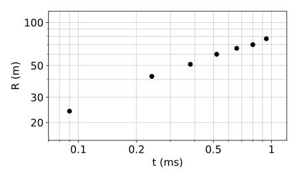

# Blast Waves {#sec-blast}

::: {.callout-note}
This chapter is in preparation.
:::

## In-class worksheet {#sec-blast-worksheet}

1.  **Atmospheric explosion.** These are experimental measurements of the expansion of a blast wave due to an atmospheric explosion.

    | $t\ (\mathrm{ms})$ | 0.09 | 0.24 | 0.38 | 0.52 | 0.66 | 0.80 | 0.94 |
    |:---|---:|---:|---:|---:|---:|---:|---:|
    | $R (\mathrm{m})$ | 24 | 42 | 51 | 60 | 66 | 70 | 77 |

    This data is plotted for your convenience in @fig-blast-fireball (log-log scale). The data file [`fireball.dat`](https://github.com/dradice/astrofluids/blob/main/code/blast-waves/fireball.dat) and the plotting script [`fireball.py`](https://github.com/dradice/astrofluids/blob/main/code/blast-waves/fireball.py) are available in the repository.

    {#fig-blast-fireball fig-alt="Log-log plot of the blast-wave radius R in metres against time t in milliseconds. Seven black points rise from 24 m at 0.09 ms to 77 m at 0.94 ms, with the slope decreasing at later times."}

    1.  Argue that the radius of the shock should scale as $R = \xi_0 \rho_1^{\alpha} E^{\beta} t^{\gamma}$, where $\rho_1$ is the atmospheric density, $E$ is the explosion energy, $t$ is the time, and $\xi_0$ is a dimensionless parameter of order one. Is this ansatz supported by the data? Compute $\alpha, \beta, \gamma$.

    2.  Show that the shock expansion speed is
        $$
        U_{\mathrm{sh}} = \frac{2}{5}  \frac{r_{\mathrm{sh}}}{t} .
        $$ {#eq-blast-1}

    3.  *Estimate* the explosion energy $E$. You can assume $\rho_1 = 1.25 \times 10^{- 3}\, \mathrm{g} \, \mathrm{cm}^{- 3} = 1.25\, \mathrm{kg} \, \mathrm{m}^{- 3}$ for the density of the atmosphere.

    4.  Estimate the temperature of the fireball 1 ms after the explosion. Use $\Gamma = \frac{7}{5}$ and $\mu \approx 29$ for air. Is this estimate an upper limit or a lower limit?

## Exercises {#sec-blast-exercises}

::: {#exr-blast-ionized-cavities}
## Ionized cavities around star clusters

A cluster of ionizing stars with total luminosity $L$ clears out a cavity in the interstellar medium, which has an undisturbed density $\rho_0$.

1.  Use the similarity-solution method to find how the cavity radius $r$ grows with time $t$. [Hint. Take $r \propto L^{\alpha} \rho_0^{\beta} t^{\gamma}$ and determine $\alpha$, $\beta$, $\gamma$.]

2.  Such bubbles stall once their expansion speed becomes comparable to the sound speed of the interstellar medium. Show that the area covered by a stalled bubble is proportional to $L$. Use this to discuss how the porosity of the interstellar medium (the fraction of the galaxy's area, seen from above the disk, that is covered by stalled bubbles) depends on the way in which ionizing stars of a given total luminosity are grouped into clusters.

3.  Suppose the galactic disk can be approximated by a uniform-density gas slab with a sharp edge at height $z$. Discuss how clusters with small $L$ and clusters with large $L$ behave differently.

Adapted from @clarke2007, Problem 28.
:::

::: {.content-visible when-profile="solutions"}
::: {.solution}
1.  We set $\xi = r / r_0$, where $r_0 = L^{\alpha} \rho_0^{\beta} t^{\gamma}$. Dimensional analysis gives:
    $$
    [r_0] = [L^{\alpha}]  [\rho_0^{\beta}]  [t]^{\gamma} =\mathrm{kg}^{\alpha
    + \beta}\,\mathrm{m}^{2 \alpha - 3 \beta}\,\mathrm{s}^{\gamma - 3 \alpha}
    \Longrightarrow \left\{\begin{array}{l}
    \alpha + \beta = 0\\
    2 \alpha - 3 \beta = 1\\
    \gamma - 3 \alpha = 0
    \end{array}\right. \Longrightarrow \left\{\begin{array}{l}
    \alpha = 1 / 5\\
    \beta = - 1 / 5\\
    \gamma = 3 / 5
    \end{array}\right. .
    $$
    So the radius of the cavity is
    $$
    r_b = \xi_0 L^{1 / 5} \rho_0^{- 1 / 5} t^{3 / 5}
    $$
    and the expansion velocity is
    $$
    v_b = \frac{3}{5} \xi_0 L^{1 / 5} \rho_0^{- 1 / 5} t^{- 2 / 5} .
    $$

2.  The bubble stalls when
    $$
    v_b = c_s \Longrightarrow t_s = \left( \frac{3}{5}  \frac{\xi_0}{c_s}
    \right)^{5 / 2} L^{1 / 2} \rho_0^{- 1 / 2} .
    $$
    At this point the radius of the bubble is
    $$
    r_{b, s} = \left( \frac{3}{5 c_s} \right)^{3 / 2} \xi_0^{5 / 2} L^{1 / 2}
    \rho_0^{- 1 / 2} .
    $$
    The cross-sectional area of the bubble is
    $$
    A_{b, s} = \pi r_{b, s}^2 = \frac{27 \pi \xi_0^5}{125 c_s^3}
    \frac{L}{\rho_0} \propto L.
    $$
    If stars are uniformly spaced, then the porosity of the ISM is
    $$
    \frac{N_s A_b}{A_{\mathrm{tot}}} \propto \Sigma_s L_s,
    $$
    where $A_b$ is the area of the stalled bubble formed by a single star, $A_{\mathrm{tot}}$ is the area of the galaxy disk, and $\Sigma_s$ is the surface density of stars.

    On the other hand, if all the stars are concentrated in a single location, then they form a single large bubble with area $A_{b, \mathrm{tot}} \propto N_s L_s$, so the porosity of the ISM is
    $$
    \frac{A_{b, \mathrm{tot}}}{A_{\mathrm{tot}}} \propto \frac{N_s
    L_s}{A_{\mathrm{tot}}} = \Sigma_s L_s .
    $$
    That is, the porosity of the ISM does not depend on the distribution of stars.

3.  The picture discussed so far is valid if $z > r_{b, s}$, because we can approximate the density in the ISM as constant. If $r_{b, s} > z$, then the bubbles will break out of the disk of the galaxy and will stall when $r_b = z$ and have a cross-sectional area $A_b \propto z^2$, independent of the luminosity of the clusters (as long as they are sufficiently bright to inflate bubbles with $r_{b, s} > z$). In this case, the porosity of the ISM will be much larger if the stars are evenly distributed than if they are concentrated in few luminous clusters.
:::
:::

## Further reading {#sec-blast-reading}

- @clarke2007, Chapter 8 (blast waves).
