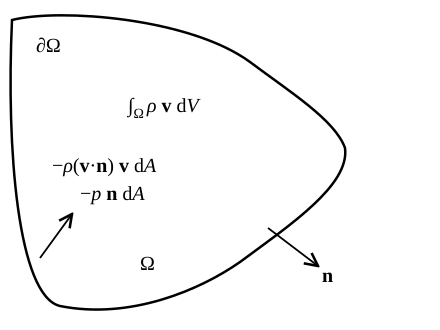
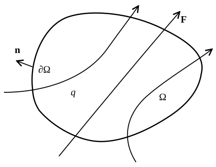
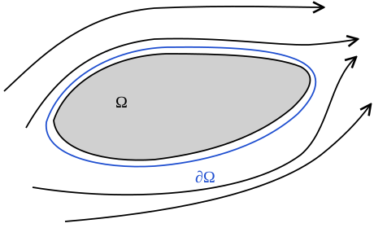

# Conservation Laws {#sec-conserv}

## Momentum equation in conservation form

In this chapter, we wish to reformulate the hydrodynamics equations in a way that makes conservation of momentum and energy manifest. These equations will also be useful later on, when we discuss shock waves (@sec-shock). We start with the equation for the momentum.

The starting point is the velocity equation (@eq-euler-general), which reads
$$
\rho \left[ \frac{\partial \vb{v}}{\partial t} + (\vb{v} \cdot
\nabla) \vb{v} \right] = \nabla \cdot \vb{T}+ \rho \vb{g}.
$$ {#eq-conserv-1}
We can bring $\rho$ inside the time derivative at the price of including new terms to the equation:
$$
\rho \frac{\partial \vb{v}}{\partial t} + \rho (\vb{v} \cdot \nabla)
\vb{v} = \frac{\partial (\rho \vb{v})}{\partial t} -\vb{v}
\frac{\partial \rho}{\partial t} + \rho (\vb{v} \cdot \nabla) \vb{v} .
$$ {#eq-conserv-2}
Using the continuity equation (@eq-lagrange-17) we find
$$
\begin{aligned}
\rho \frac{\partial \vb{v}}{\partial t} + \rho (\vb{v} \cdot \nabla)
\vb{v} &= \frac{\partial (\rho \vb{v})}{\partial t} +\vb{v}
\nabla \cdot (\rho \vb{v}) \\
&\qquad + \rho (\vb{v} \cdot \nabla) \vb{v}.
\end{aligned}
$$ {#eq-conserv-3}
Let's write down explicitly the last two terms in Cartesian coordinates:
$$
\begin{aligned}
& \vb{v} \nabla \cdot (\rho \vb{v}) + \rho (\vb{v} \cdot \nabla)
\vb{v} \\
& \quad = \vb{v} [\partial_x  (\rho v_x) + \partial_y  (\rho v_y)
+ \partial_z  (\rho v_z)] \\
& \qquad\qquad + \rho v_x \partial_x \vb{v}+ \rho v_y \partial_y \vb{v}+
\rho v_z \partial_z \vb{v} \\
& \quad = \partial_x  (\rho v_x \vb{v}) + \partial_y  (\rho v_y \vb{v})
+ \partial_z  (\rho v_z \vb{v})  \\
& \quad = \nabla \cdot [\rho \vb{v} \otimes \vb{v}],
\end{aligned}
$$ {#eq-conserv-4}
where we have recognized the second to last line as being the divergence of the tensor
$$
\vb{v} \otimes \vb{v} := \left(\begin{array}{ccc}
v_x v_x & v_x v_y & v_x v_z\\
v_y v_x & v_y v_y & v_y v_z\\
v_z v_x & v_z v_y & v_z v_z
\end{array}\right) .
$$ {#eq-conserv-5}
Putting everything together we can write the momentum equation
$$
\frac{\partial (\rho \vb{v})}{\partial t} + \nabla \cdot [\rho
\vb{v} \otimes \vb{v}-\vb{T}] = \rho \vb{g}.
$$ {#eq-conserv-6}
In the special case in which $\vb{T}= - p\vb{I}$ we obtain
$$
\boxed{\frac{\partial (\rho \vb{v})}{\partial t} + \nabla \cdot
[\rho \vb{v} \otimes \vb{v}+ p\vb{I}] = \rho \vb{g}.}
$$ {#eq-conserv-ch6-eq-momentum}
The meaning of this equation is more clear if we integrate over some fixed region $\Omega$ (not moving with the flow):
$$
\frac{\dd}{\dd t} \int_{\Omega} \rho \vb{v} \dd V +
\int_{\Omega} \nabla \cdot [\rho \vb{v} \otimes \vb{v}+ p\vb{I}]
\dd V = \int_{\Omega} \rho \vb{g} \dd V.
$$ {#eq-conserv-8}
Moving the second term to the RHS and using the divergence theorem, we find
$$
\frac{\dd}{\dd t} \int_{\Omega} \rho \vb{v} \dd V = -
\int_{\partial \Omega} [\rho (\vb{v} \cdot \vb{n}) \vb{v}+
p\vb{n}] \dd A + \int_{\Omega} \rho \vb{g} \dd V,
$$ {#eq-conserv-ch6-eq-momentum-integral}
where $\partial \Omega$ is the surface bounding $\Omega$ and $\vb{n}$ its outward directed normal.

{#fig-conserv-momentum-balance fig-alt="A closed region Omega bounded by a surface with outward normal n. Labels inside give the total momentum in the region, the momentum flux through the boundary, minus rho times v dot n times v dA, and the pressure force on the boundary, minus p n dA."}

In words, @eq-conserv-ch6-eq-momentum-integral states that the total momentum in some region changes due to the action of volumetric forces and because of the flux of momentum across the boundary. For example, if we take $\Omega$ to be the region with $x > 0$ and neglect gravity, then $\partial \Omega$ is the $y z$-plane. If we also assume that this region is isolated, so that no momentum flows in or out through the surface at infinity, then @eq-conserv-ch6-eq-momentum-integral becomes:
$$
\begin{aligned}
& \frac{\dd}{\dd t}  \int_{x > 0} \rho \left(\begin{array}{c}
v_x\\
v_y\\
v_z
\end{array}\right) \dd x \dd y \dd z \\
& \quad = \int_{x = 0} \biggl[ \rho v_x
\left(\begin{array}{c}
v_x\\
v_y\\
v_z
\end{array}\right) + p \left(\begin{array}{c}
1\\
0\\
0
\end{array}\right) \biggr] \dd y \dd z.
\end{aligned}
$$ {#eq-conserv-10}
Note that the pressure across the $x = 0$ surface only influences the $x$-component of the momentum.

The last equation also gives an alternative interpretation of pressure. We see that in the RHS the pressure has the same effect as the term $\rho v_x v_x$. This term describes the flow of momentum through the $y z$-plane and is also called the **ram pressure**. This suggests that we can think of pressure not only as force per unit area, but also as a flux of momentum per unit area. This is the same interpretation that we found in @sec-thermo, when we derived the pressure as the flux of momentum due to the random motion of the particles (@eq-thermo-4).

## Energy equation

The energy equation (@eq-thermo-energy-lagrangian) reads
$$
\rho \frac{\dd \varepsilon}{\dd t} = \rho \dot{q} - p \nabla \cdot
\vb{v}.
$$ {#eq-conserv-ch6-eq-energy-lagrangian}
We can expand the advective derivative in @eq-conserv-ch6-eq-energy-lagrangian to obtain the energy equation in the Eulerian frame (@eq-lagrange-energy):
$$
\rho \frac{\partial \varepsilon}{\partial t} + \rho (\vb{v} \cdot
\nabla) \varepsilon = \rho \dot{q} - p \nabla \cdot \vb{v}.
$$ {#eq-conserv-12}
Using a similar approach to what we have done before with the momentum equation, we bring the density into the time derivative to find
$$
\frac{\partial (\rho \varepsilon)}{\partial t} + \nabla \cdot (\rho
\varepsilon \vb{v}) = \rho \dot{q} - p \nabla \cdot \vb{v}.
$$ {#eq-conserv-ch6-eq-energy-eulerian}
The form of this equation is similar to that of the Eulerian continuity equation and to the momentum equation above. They are all examples of **balance laws**: equations describing the conservation of some quantity. A balance law reads:
$$
\frac{\partial U}{\partial t} + \nabla \cdot \vb{F}= S,
$$ {#eq-conserv-ch6-eq-balance}
where $U$, $\vb{F}$, and $S$ are called the conserved quantities, the fluxes, and the sources of the balance law, respectively. If $S = 0$, then @eq-conserv-ch6-eq-balance is said to be a **conservation law**. The name balance law is more clear if we convert the equation to integral form by integrating it over a fixed volume $\Omega$:
$$
\frac{\dd}{\dd t} \int_{\Omega} U \dd V + \int_{\Omega} \nabla
\cdot \vb{F} \dd V = \int_{\Omega} S \dd V.
$$ {#eq-conserv-15}
Using the divergence theorem, we obtain
$$
\frac{\dd}{\dd t} \int_{\Omega} U \dd V = \int_{\Omega} S \dd V
- \int_{\partial \Omega} \vb{F} \cdot \vb{n} \dd A.
$$ {#eq-conserv-16}
This equation signifies that the total amount of a quantity $U$ in the volume $\Omega$ changes by the amount of $U$ that flows in/out through the boundary $\partial \Omega$, plus the amount of $U$ created/destroyed by the source/sink term $S$ (see @fig-conserv-balance-law). Equations in the form of @eq-conserv-ch6-eq-balance are also said to be in **conservation form**.

{#fig-conserv-balance-law fig-alt="A closed region Omega with boundary and outward normal n contains the quantity U. Three flux lines F cross the boundary, entering or leaving the region."}

At this point, one might ask in what sense @eq-conserv-ch6-eq-energy-eulerian describes the conservation of the energy in the fluid. First, this equation does not contain any terms describing the work done on the system by external forces. Second, $\varepsilon$ is only part of the energy in the flow: we are not including kinetic and potential energy. The issue is that @eq-conserv-ch6-eq-energy-eulerian only describes the evolution of the internal energy. Mechanical work done by gravity, or other forces, can only directly affect the mechanical energy of the fluid (its kinetic energy). The conversion between internal and kinetic energy is operated by the pdV term. We postpone for the moment the issue of the gravitational energy of the system (@sec-grav), which will turn out to be more complex than expected, to focus on the interplay between kinetic and internal energy.

To derive an equation for the kinetic energy, we start from the Euler equation
$$
\rho \frac{\partial \vb{v}}{\partial t} + \rho (\vb{v} \cdot \nabla)
\vb{v}= - \nabla p +\vb{f}.
$$ {#eq-conserv-17}
We multiply this equation by $\vb{v}$ to find
$$
\frac{1}{2} \rho \left[ \frac{\partial v^2}{\partial t} + (\vb{v} \cdot
\nabla) v^2 \right] = - \nabla p \cdot \vb{v}+\vb{f} \cdot
\vb{v}.
$$ {#eq-conserv-18}
Once again, we can use the continuity equation to bring $\rho$ inside the time derivative to find
$$
\frac{\partial \left( \frac{1}{2} \rho v^2 \right)}{\partial t} + \nabla
\cdot \left( \tfrac{1}{2} \rho v^2 \vb{v} \right) = - \vb{v} \cdot \nabla
p+\vb{f} \cdot \vb{v}.
$$ {#eq-conserv-ch6-eq-kinene-eulerian}
Using the identity
$$
\nabla \cdot (p\vb{v}) =\vb{v} \cdot \nabla p + p \nabla \cdot
\vb{v},
$$ {#eq-conserv-20}
we can rewrite this equation as
$$
\frac{\partial \left( \frac{1}{2} \rho v^2 \right)}{\partial t} + \nabla
\cdot \left[ \left( \tfrac{1}{2} \rho v^2 + p \right) \vb{v} \right] = p
\nabla \cdot \vb{v}+\vb{f} \cdot \vb{v} .
$$ {#eq-conserv-21}
This is the wanted equation for the kinetic energy. We notice two things. First, this equation shows that pressure can be interpreted also as an energy density. Second, this equation has the same pdV term as the internal energy equation, but with opposite sign! This is the term describing the conversion of internal energy into kinetic energy and vice versa. Also note that the work done by external forces appears in the kinetic energy equation, but heating and cooling terms do not.

Adding @eq-conserv-ch6-eq-kinene-eulerian to @eq-conserv-ch6-eq-energy-eulerian gives the equation describing conservation of the total energy (internal + kinetic):
$$
\boxed{
\begin{aligned}
&\frac{\partial \left[ \rho \left( \frac{1}{2} v^2 + \varepsilon
\right) \right]}{\partial t} + \nabla \cdot \left[ \left(
\tfrac{1}{2} \rho v^2 + \rho \varepsilon + p \right) \vb{v}
\right] \\
&\qquad = \rho \dot{q} +\vb{f} \cdot \vb{v}.
\end{aligned}}
$$ {#eq-conserv-ch6-eq-energy-total}
This shows that the total energy in the fluid is conserved in absence of external forces and heating/cooling. If $\vb{f}$ is a conservative force, it is possible to rewrite the energy equation in a way that is manifestly conservative by including the potential inside the time derivative. For example, consider gravity, $\vb{f} = - \rho \nabla \Psi$, and assume that the potential $\Psi$ does not depend on time, as is the case for an external, static potential. Then, using the continuity equation,
$$
\vb{f} \cdot \vb{v} = - \rho \vb{v} \cdot \nabla \Psi = - \nabla \cdot (\rho \Psi \vb{v}) + \Psi \nabla \cdot (\rho \vb{v}) = - \nabla \cdot (\rho \Psi \vb{v}) - \frac{\partial (\rho \Psi)}{\partial t},
$$ {#eq-conserv-gravity-work}
so that @eq-conserv-ch6-eq-energy-total becomes
$$
\begin{aligned}
&\frac{\partial \left[ \rho \left( \frac{1}{2} v^2 + \varepsilon + \Psi
\right) \right]}{\partial t} \\
&\qquad + \nabla \cdot \left[ \left(
\tfrac{1}{2} \rho v^2 + \rho \varepsilon + p + \rho \Psi \right) \vb{v}
\right] = \rho \dot{q} .
\end{aligned}
$$ {#eq-conserv-energy-gravity}
If the gas is self-gravitating, instead, $\Psi$ depends on time through the density, and this simple manipulation does not work. We will come back to this in @sec-grav.

We can now summarize the equations of hydrodynamics in conservation form (@eq-conserv-ch6-eq-balance). In the absence of heating and cooling, and with a body force $\vb{f}$, we have:

| Conservation of | $U$ | $\vb{F}$ | $S$ |
|---|---|---|---|
| mass | $\rho$ | $\rho \vb{v}$ | $0$ |
| momentum | $\rho \vb{v}$ | $\rho \vb{v} \otimes \vb{v} + p \vb{I}$ | $\vb{f}$ |
| energy | $\rho \left( \frac{1}{2} v^2 + \varepsilon \right)$ | $\left( \frac{1}{2} \rho v^2 + \rho \varepsilon + p \right) \vb{v}$ | $\vb{f} \cdot \vb{v}$ |

: The equations of hydrodynamics in conservation form. {#tbl-conserv-summary}

We will use these equations in @sec-shock to derive the jump conditions across shock waves.

## Heat conduction

Heat conduction can be included in @eq-conserv-ch6-eq-energy-total by adding a heat flux $\vb{F}_{\mathrm{heat}}$:
$$
\begin{aligned}
&\frac{\partial \left[ \rho \left( \frac{1}{2} v^2 + \varepsilon \right)
\right]}{\partial t} \\
&\qquad + \nabla \cdot \left[ \left( \tfrac{1}{2} \rho
v^2 + \rho \varepsilon + p \right) \vb{v}+\vb{F}_{\mathrm{heat}} \right] \\
&\qquad = \rho \dot{q} +\vb{f} \cdot \vb{v}.
\end{aligned}
$$ {#eq-conserv-25}
In many astrophysical applications, energy is transported mostly by photons, and the heat flux can be approximated as
$$
\vb{F}_{\mathrm{heat}}= - \frac{c}{3 \rho \kappa_R} \nabla (aT^4),
$$ {#eq-conserv-ch6-eq-heat-flux}
where $c$ is the speed of light, $a$ the radiation constant (@eq-thermo-33), and $\kappa_R$ is the so-called *Rosseland mean opacity*. The term in parentheses is an energy density. Indeed, it is the energy density of radiation for a black body (@eq-thermo-32):
$$
u_{\mathrm{rad}} = aT^4 .
$$ {#eq-conserv-27}
The opacity has units of $\mathrm{m}^2 \, \mathrm{kg}^{- 1}$ (we quote it in $\mathrm{cm^2\,g^{-1}}$, as is customary), so $\lambda = 1 / (\rho \kappa_R)$ has units of a length. Indeed, $\lambda$ is the photon mean free path. Combining these two facts, we can write @eq-conserv-ch6-eq-heat-flux as
$$
\vb{F}_{\mathrm{heat}}= - \frac{1}{3} \lambda c \nabla u_{\mathrm{rad}} = -\mathcal{D} \nabla
u_{\mathrm{rad}}, \qquad \mathcal{D} = \frac{\lambda c}{3} .
$$ {#eq-conserv-ch6-eq-fick-law}
This is a special case of Fick's law of diffusion:
$$
\textbf{diffusive flux} = -\mathcal{D} \nabla \left(
\text{density of quantity being diffused} \right) .
$$ {#eq-conserv-29}
The diffusion coefficient has units of
$$
[\mathcal{D}] = \mathrm{m}^2 \cdot \mathrm{s}^{- 1} .
$$ {#eq-conserv-30}
The time needed to diffuse over a distance $R$ is $\sim R^2 / \mathcal{D}$, which is the diffusion time we found in @eq-sn-17 with the random-walk argument (up to a factor of 3).

If energy due to radiation was advected with velocity $\vb{v}_{\mathrm{eff}}$, then
$$
\vb{F}_{\mathrm{heat}}= u_{\mathrm{rad}} \vb{v}_{\mathrm{eff}} .
$$ {#eq-conserv-31}
Comparing this to @eq-conserv-ch6-eq-fick-law suggests that
$$
v_{\mathrm{eff}} \sim \left( \frac{\lambda}{3 H} \right) c,
$$ {#eq-conserv-32}
where $H$ is the radiation energy density scale-height:
$$
H = \frac{u_{\mathrm{rad}}}{| \nabla u_{\mathrm{rad}} |} .
$$ {#eq-conserv-33}
In the interior of stars $H \gg \lambda$, so radiation diffuses very slowly: the time it needs to cross the star is much longer than the light-crossing time.

::: {.callout-tip icon=false}
## Example

Consider the Sun. With an opacity $\kappa \approx 25\,\mathrm{cm^2\,g^{-1}} = 2.5\,\mathrm{m^2\,kg^{-1}}$ and the mean density of the Sun, $\bar{\rho} \approx 1.4\,\mathrm{g\,cm^{-3}} = 1.4 \times 10^3\,\mathrm{kg\,m^{-3}}$, the photon mean free path is $\lambda \approx 3 \times 10^{-4}\,\mathrm{m}$. Taking $H \sim R_{\odot}$, @eq-conserv-32 gives
$$
v_{\mathrm{eff}} \sim \frac{3 \times 10^{-4}\,\mathrm{m}}{3 \times 7 \times 10^{8}\,\mathrm{m}}\, c \approx 4 \times 10^{-5}\,\mathrm{m\,s^{-1}},
$$ {#eq-conserv-sun-veff}
or about $40\,\mu\mathrm{m\,s^{-1}}$. At this speed, energy takes $R_{\odot} / v_{\mathrm{eff}} \sim 5 \times 10^5$ years to reach the surface from the center, while light would cross the Sun in about $2\,\mathrm{s}$.
:::

Close to the surface of stars $H \lesssim \lambda / 3$ and @eq-conserv-ch6-eq-fick-law predicts that radiant energy propagates faster than the speed of light. This is a symptom that the diffusion approximation breaks down. More generally, the transport of energy by radiation can be described using @eq-conserv-ch6-eq-heat-flux only if photons and matter are in local thermodynamic equilibrium. If the diffusion approximation cannot be used, matter and radiation need to be treated separately using the equations of radiation-hydrodynamics[^conserv-1].

## In-class worksheet {#sec-conserv-worksheet}

1.  Show that the equation for energy conservation in the Eulerian frame can be written as
    $$
    \frac{\partial (\rho \varepsilon)}{\partial t} + \nabla \cdot (\rho
    \varepsilon \vb{v}) = \rho \dot{q} - p \nabla \cdot \vb{v}.
    $$ {#eq-conserv-ws1}
    Discuss the physical meaning of each term.

2.  *Ram pressure.* Consider the steady flow around a rigid body. Let $\partial \Omega$ be a closed surface in the fluid that encloses the body, with outward normal $\vb{n}$, as shown in @fig-conserv-flow-past-body.

    {#fig-conserv-flow-past-body fig-alt="Four streamlines flow from left to right around a shaded rigid body. A second outline just outside the body, labeled boundary of Omega, is the closed surface that encloses it."}

    1.  Use the momentum equation and the divergence theorem to show that the total force acting on the body is
        $$
        \vb{F}= - \oint_{\partial \Omega} [\rho (\vb{v} \cdot \vb{n})
        \vb{v}+ p\vb{n}] \dd A.
        $$ {#eq-conserv-momentum}

    2.  Assume that $p \approx \mathrm{const}$ and that the flow in the wake of the body is slower than on the front. What kind of force does the body experience?

## Exercises {#sec-conserv-exercises}

::: {#exr-conserv-angular-momentum}
## Angular momentum

The angular momentum of a fluid element of mass $\mathcal{M}$ is $\mathcal{M}\vb{r} \times \vb{v}$, so the angular momentum density for a fluid is (upon division by $\mathcal{V}$):
$$
\vb{j}= \rho \vb{r} \times \vb{v}.
$$ {#eq-conserv-angular-density}

1.  Starting from the momentum equation, derive a Lagrangian equation for the evolution of $\vb{r} \times \vb{v}$.

2.  Show that, in absence of external forces, $\vb{j}$ satisfies the conservation law
    $$
    \frac{\partial \vb{j}}{\partial t} + \nabla \cdot [\vb{j}
    \otimes \vb{v}+ p\vb{R}] = 0,
    $$ {#eq-conserv-angular-conservation}
    where
    $$
    \vb{R}= \left(\begin{array}{ccc}
    0 & - z & y\\
    z & 0 & - x\\
    - y & x & 0
    \end{array}\right) .
    $$ {#eq-conserv-angular-R}
    \[Hint. Write out explicitly the expression $\vb{r} \times \nabla p$.\]

3.  Consider a fluid that is subject to an external force per unit volume $\vb{f}$. How does
    $$
    \vb{J}= \int \vb{j} \dd V
    $$ {#eq-conserv-angular-total}
    evolve with time?

4.  Show that, for an isolated fluid in an axisymmetric potential $\Psi (R, z)$, the $z$-component of $\vb{J}$ is conserved.
:::

::: {.content-visible when-profile="solutions"}
::: {.solution}
1.  The momentum equation is
    $$
    \rho \frac{\dd \vb{v}}{\dd t} = - \nabla p +\vb{f}.
    $$
    Taking the cross product of both terms with $\vb{r}$ from the left, we obtain
    $$
    \rho \frac{\dd}{\dd t} (\vb{r} \times \vb{v}) = -\vb{r}
    \times \nabla p +\vb{r} \times \vb{f},
    $$
    where we have used the fact that
    $$
    \frac{\dd}{\dd t} (\vb{r} \times \vb{v}) =\vb{v} \times
    \vb{v}+\vb{r} \times \frac{\dd \vb{v}}{\dd t}
    =\vb{r} \times \frac{\dd \vb{v}}{\dd t} .
    $$

2.  We can obtain an Eulerian version of the last equation by expanding the advective derivative:
    $$
    \rho \partial_t  (\vb{r} \times \vb{v}) + \rho (\vb{v} \cdot
    \nabla) (\vb{r} \times \vb{v}) = -\vb{r} \times \nabla p
    +\vb{r} \times \vb{f}.
    $$
    We can bring $\rho$ inside the time derivative using the continuity equation:
    $$
    \partial_t \vb{j}= \partial_t (\rho \vb{r} \times \vb{v}) =
    \rho \partial_t (\vb{r} \times \vb{v}) + \partial_t \rho
    \vb{r} \times \vb{v}= \rho \partial_t (\vb{r} \times
    \vb{v}) - \nabla \cdot (\rho \vb{v})  (\vb{r} \times
    \vb{v}),
    $$
    so the LHS of the Eulerian equation becomes
    $$
    \begin{alignedat}{2}
    \rho \partial_t  (\vb{r} \times \vb{v}) + \rho (\vb{v} \cdot
    \nabla) (\vb{r} \times \vb{v}) &{}={} && \partial_t \vb{j}+ \nabla
    \cdot (\rho \vb{v}) (\vb{r} \times \vb{v}) + \rho (\vb{v}
    \cdot \nabla) (\vb{r} \times \vb{v}) \\
    &{}={} && \partial_t \vb{j}+ [\partial_x  (\rho v_x) + \partial_y  (\rho
    v_y) + \partial_z  (\rho v_z)] (\vb{r} \times \vb{v}) + \\
    & && \qquad \rho v_x \partial_x (\vb{r} \times \vb{v}) + \rho v_y
    \partial_y (\vb{r} \times \vb{v}) + \rho v_z \partial_z
    (\vb{r} \times \vb{v}) \\
    &{}={} && \partial_t \vb{j}+ \nabla \cdot [\vb{j} \otimes \vb{v}]
    .
    \end{alignedat}
    $$
    To compute the RHS of that equation, we write out explicitly
    $$
    \vb{r} \times \nabla p = \left(\begin{array}{c}
    y \partial_z p - z \partial_y p\\
    z \partial_x p - x \partial_z p\\
    x \partial_y p - y \partial_x p
    \end{array}\right) = \left(\begin{array}{c}
    \partial_x  [0] + \partial_y  [p (- z)] + \partial_z  [py]\\
    \partial_x  [pz] + \partial_y  [0] + \partial_z  [p (- x)]\\
    \partial_x  [p (- y)] + \partial_y  [px] + \partial_z  [0]
    \end{array}\right) .
    $$
    Remembering the definition of the divergence of a tensor (@eq-euler-14), we recognize that
    $$
    \vb{r} \times \nabla p = \nabla \cdot [p\vb{R}],
    $$
    where
    $$
    \vb{R}= \left(\begin{array}{ccc}
    0 & - z & y\\
    z & 0 & - x\\
    - y & x & 0
    \end{array}\right) .
    $$
    Putting everything together we find
    $$
    \frac{\partial \vb{j}}{\partial t} + \nabla \cdot [\vb{j} \otimes
    \vb{v}+ p\vb{R}] = 0.
    $$

3.  In the case of a fluid with an external force, the equation for conservation of angular momentum reads
    $$
    \frac{\partial \vb{j}}{\partial t} + \nabla \cdot [\vb{j} \otimes
    \vb{v}+ p\vb{R}] =\vb{r} \times \vb{f}.
    $$
    We can integrate this equation over the volume of the fluid to obtain
    $$
    \frac{\dd \vb{J}}{\dd t} = \int \vb{r} \times \vb{f}
    \dd V - \oint [(\vb{v} \cdot \vb{n}) \vb{j}+
    p\vb{r} \times \vb{n}] \dd A ,
    $$
    where we used $\vb{R} \vb{n} = \vb{r} \times \vb{n}$. The first term in the RHS represents the torque of the external force. The surface integrals represent the flux of angular momentum advected through the outer boundary, $(\vb{v} \cdot \vb{n}) \vb{j}$, and the torque exerted by the container of the fluid, $p \vb{r} \times \vb{n}$.

4.  For an isolated fluid there is no flux of angular momentum through the outer boundary and no container, so the surface integrals vanish. The external force is $\vb{f} = - \rho \nabla \Psi$, and the $z$-component of its torque is
    $$
    (\vb{r} \times \vb{f})_z = - \rho (x \partial_y \Psi - y \partial_x \Psi) = - \rho \frac{\partial \Psi}{\partial \phi} = 0,
    $$
    because $\Psi$ does not depend on the azimuthal angle $\phi$. So $\dd J_z / \dd t = 0$. The other components of $\vb{J}$ are not conserved in general, because the torque of the force has non-zero $x$- and $y$-components.
:::
:::

## Further reading {#sec-conserv-reading}

- @clarke2007, Chapter 2 (the fluid equations) and Chapter 4 (the energy equation).
- @mihalas1984 for the equations of radiation hydrodynamics.

[^conserv-1]: @mihalas1984.
