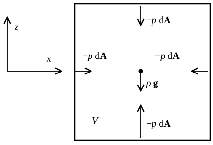

# The Euler Equation {#sec-euler}

## Internal stresses

Up to this point we have described the motion of fluids in which the velocity field is prescribed, or known. Now we derive the equation of motion for fluids. The acceleration of a fluid element $\mathcal{V}$ with mass $\mathcal{M}$ is given by Newton's law:
$$
\mathcal{M} \frac{\dd \vb{v}}{\dd t} =\vb{F},
$$ {#eq-euler-newton-law}
where $\vb{F}$ is the sum of all forces (the net force) acting on $\mathcal{V}$. To derive an equation that does not explicitly make reference to the fluid elements, we can divide @eq-euler-newton-law by the volume of $\mathcal{V}$ to find
$$
\rho \frac{\dd \vb{v}}{\dd t} =\vb{f},
$$ {#eq-euler-2}
where $\vb{f}$ is the force per unit volume acting on the fluid:
$$
[\vb{f}] = \mathrm{dyn} \mathrm{cm}^{- 3} =\mathrm{g} \mathrm{cm}^{- 2}
\mathrm{s}^{- 2},
$$ {#eq-euler-3}
where "$\mathrm{dyn}$" (dyne) is the unit of force in CGS units:
$$
1 \mathrm{dyn} = 1\mathrm{g} \mathrm{cm} \mathrm{s}^{- 2} .
$$ {#eq-euler-4}
There are two types of forces that can act on a fluid element: external and internal forces. In astrophysical applications, gravity is the most common external force. The force per unit volume (**body force**) due to gravity is
$$
\vb{f}_g = \rho \vb{g}= - \rho \nabla \Psi,
$$ {#eq-euler-5}
where $\vb{g}$ is the gravitational acceleration and $\Psi$ is the gravitational potential (@sec-grav). The internal forces are due to the interaction of $\mathcal{V}$ with other fluid elements.

Consider a container with water at rest on the surface of the Earth. The container has been left undisturbed for sufficiently long time that the velocity of all fluid elements is zero. Let $\mathcal{V}$ be a fluid element of water somewhere away from the edge of the container. Clearly, $\mathcal{V}$ is subject to the force of gravity. Since $\mathcal{V}$ is not in contact with the container, the gravitational force cannot be balanced by a contact force with the walls of the container. Instead, the force on $\mathcal{V}$ must be balanced by a force exchanged by $\mathcal{V}$ with the neighboring fluid elements. This shows that the equation of motion of a fluid must include the acceleration due to its internal forces. What is their nature?

We consider an infinitesimal fluid element $\mathcal{V}$ in a fluid at rest, as illustrated in @fig-euler-pressure-gradient. We can take the origin of the coordinate system to be the center of $\mathcal{V}$ and its extent in the three directions to be $\dd x$, $\dd y$, and $\dd z$. We also take the $z$ axis to point upwards, so that the gravitational acceleration is $\vb{g} = - g \hat{\vb{z}}$, with $g > 0$.

{#fig-euler-pressure-gradient fig-alt="A square fluid element V at rest. A pressure force of magnitude p dA pushes inward on each of the four faces drawn, perpendicular to the face, and a gravity force rho g points down from the center of the element. The x axis points right and the z axis points up."}

The fluid element is subject to forces applied by the rest of the fluid to its six square faces and to the force of gravity, which we can take to be applied to its center of mass, as shown in @fig-euler-pressure-gradient. Our goal is to determine these forces. What distinguishes a fluid from a solid is that a fluid at rest cannot sustain shear stresses: if we try to shear it, it flows. So, for a fluid at rest, the surface forces must be perpendicular to each face. In a moving fluid, instead, these surface forces can in principle have many possible magnitudes and directions, and we cannot make much progress without knowing more about the nature of the fluid.

However, there is a class of fluids, known as **perfect fluids**, for which the internal forces are particularly simple. In a perfect fluid the surface forces are assumed to be always directed along the perpendicular to each face, also when the fluid is in motion (as is the case in @fig-euler-pressure-gradient). The problem of finding the internal forces thus reduces to that of finding a scalar quantity, called the **pressure**, that gives the magnitude of the force per unit area across each face of the fluid element. One can show, by considering the forces acting on a small wedge of fluid, that this magnitude does not depend on the orientation of the face[^euler-2]:
$$
p = \text{``force per unit area''} \qquad [\mathrm{dyn} \mathrm{cm}^{- 2}] .
$$ {#eq-euler-6}
In particular, for a perfect fluid the force exerted by the fluid on an infinitesimal surface with outward-directed area element $\dd \vb{A}$ is
$$
\dd \vb{F}= - p \dd \vb{A}.
$$ {#eq-euler-7}
In most cases the pressure is positive $p > 0$, so a fluid element, or equivalently an object immersed in a fluid, is subject to compression.

The concept of perfect fluid is an idealization of reality, but, in practice, liquids and gases can be considered as perfect fluids to very good approximation in most situations. More generally, because the force needs to transform under basis change in the same way as a vector, it can be shown that internal forces can be written as
$$
\dd \vb{F}=\vb{T} \dd \vb{A},
$$ {#eq-euler-8}
where $\vb{T}$ is a matrix that depends on the properties of the fluid, the so-called **stress tensor** of the fluid. The perfect fluid is the special case of this general theory in which
$$
\vb{T}= - p\vb{I},
$$ {#eq-euler-9}
where $\vb{I}$ is the identity matrix. We will encounter examples of non-perfect fluids later in the course (@sec-turb and @sec-visc).

## Euler's equation

We can now consider the net acceleration of the fluid element in the vertical direction. There are three forces to consider: the force of gravity, and the forces at the bottom and at the top of $\mathcal{V}$. The forces from the side do not contribute, since they are orthogonal to the $z$-direction. Putting everything together we find:
$$
\mathcal{M} \frac{\dd v_z}{\dd t} = - \left[ p \left( z =
\tfrac{\dd z}{2} \right) - p \left( z = - \tfrac{\dd z}{2} \right)
\right] \dd A +\mathcal{M}g_z,
$$ {#eq-euler-10}
where $\dd A = \dd x \dd y$, and $\mathcal{M}= \rho V = \rho \dd x \dd y \dd z$. Dividing both terms by $V$ gives
$$
\rho \frac{\dd v_z}{\dd t} = - \frac{1}{\dd z}  \left[ p \left( z =
\tfrac{\dd z}{2} \right) - p \left( z = - \tfrac{\dd z}{2} \right)
\right] + \rho g_z = - \partial_z p + \rho g_z .
$$ {#eq-euler-acceleration-balance-vertical}
A similar derivation can be done for the momentum balance in the $x$- and $y$-directions to find
$$
\rho \frac{\dd \vb{v}}{\dd t} = - \nabla p + \rho \vb{g}.
$$ {#eq-euler-12}
In the more general case, in which we consider an arbitrary volume force applied onto the fluid, we obtain the so-called Euler, or momentum equation for a perfect fluid:
$$
\boxed{\rho \frac{\dd \vb{v}}{\dd t} = - \nabla p
+\vb{f}.}
$$ {#eq-euler}
Note that it is the *gradient* of the pressure, and not the pressure directly that determines the mechanical response of the fluid. We will see that this has important implications in a number of situations. Also note that $\dd \vb{v} / \dd t$ is the acceleration of the fluid element. In @sec-lagrange we will rewrite Euler's equation in terms of derivatives at fixed points in space.

In the case of non-perfect fluids, @eq-euler becomes
$$
\rho \frac{\dd \vb{v}}{\dd t} = \nabla \cdot
\vb{T}+\vb{f},
$$ {#eq-euler-general}
where we have introduced the divergence of a tensor, defined to be a vector with components
$$
\nabla \cdot \vb{T}  = \left(\begin{array}{c}
\partial_x T_{x x} + \partial_y T_{x y} + \partial_z T_{x z}\\
\partial_x T_{y x} + \partial_y T_{y y} + \partial_z T_{y z}\\
\partial_x T_{z x} + \partial_y T_{z y} + \partial_z T_{z z}
\end{array}\right) .
$$ {#eq-euler-15}
The momentum equation, @eq-euler-general, holds even for solids, which can rarely be described as perfect fluids, but for which the stress tensor can also be defined.

::: {.callout-tip icon=false}
## Example

Consider a liquid at rest ($\vb{v}= 0$) in a tank and subject to gravity. The tank is not pressurized, so the surface of the liquid is at the atmospheric pressure $p_0$, in order to be in mechanical equilibrium with the air. Liquids are nearly incompressible, so, if the tank is not too deep, we can neglect the change of the density with depth and take $\rho = \mathrm{const}$. What is the pressure at the bottom of the tank?

We can take $z$ to be the vertical coordinate, pointing upwards, with $z = 0$ being the bottom of the tank and $z = d > 0$ being the surface of the liquid. The force balance in the $z$-direction is
$$
\partial_z p = - \rho g,
$$ {#eq-euler-16}
where $g > 0$ is the gravitational acceleration. Integrating this equation from the surface, we find
$$
p (z) = p_0 + \int_z^d \rho g \dd z' = p_0 + \rho g (d - z).
$$ {#eq-euler-17}
The pressure at the bottom of the tank is $p_0 + \rho gd$. For water, $\rho \approx 1\,\mathrm{g\,cm^{-3}}$, so for $d = 10\,\mathrm{m}$ we find $\rho g d \approx 10^6\,\mathrm{dyn\,cm^{-2}}$, which is about one atmosphere. In other words, every $10\,\mathrm{m}$ of water add about one atmosphere of pressure.
:::

::: {.callout-tip icon=false}
## Example

Consider a body of volume $V$ fully immersed in a fluid at rest. What is the net force exerted by the fluid on the body?

The force is obtained by integrating @eq-euler-7 over the surface $\partial V$ of the body. Using a variant of the divergence theorem, $\oint_{\partial V} p \dd \vb{A} = \int_V \nabla p \dd V$, we find
$$
\vb{F}_b = - \oint_{\partial V} p \dd \vb{A} = - \int_V \nabla p \dd V .
$$ {#eq-euler-archimedes-1}
The pressure in the fluid does not know about the body: it is the same pressure that would be there if the body were replaced by fluid. So, from @eq-euler-12 with $\vb{v} = 0$, $\nabla p = \rho_f \vb{g}$, where $\rho_f$ is the density of the fluid. If $\rho_f$ is constant, we find
$$
\vb{F}_b = - \rho_f V \vb{g} = \rho_f V g \hat{\vb{z}} .
$$ {#eq-euler-archimedes-2}
The body is pushed upwards with a force equal to the weight of the fluid it displaces. This is Archimedes' principle. Note that only the gradient of $p$ enters in this result. For example, increasing the atmospheric pressure $p_0$ at the surface of the fluid does not change the force on the body.
:::

Let's recap our situation. We have started with the continuity equation (@eq-continua-15), which describes the evolution of the density $\rho$ given the velocity $\vb{v}$. To find the velocity we have now derived an equation of motion for it, Euler's equation, which however involves the pressure. As we have seen in @sec-thermo, the pressure is given by the **equation of state** of the fluid, which depends on its density, temperature or entropy, and composition
$$
p = p (\rho, T, \{ Y_i \}) .
$$ {#eq-euler-20}
This should not be surprising, because water and interstellar gas behave very differently, even though they satisfy the same equations. Their different dynamics is the result of the fact that they have different equations of state. To close the system, we also need an equation for the temperature, or the internal energy: this is the energy equation (@eq-thermo-energy-lagrangian). There are some special cases, however, in which the pressure can be taken to be a function of only the density:
$$
p = p (\rho) .
$$ {#eq-euler-21}
In this case we say that the equation of state is **barotropic**, and the continuity and Euler equations form a closed system, without the need for an energy equation. Some important cases that we will encounter in our course are

- pressureless fluids, in which $p = 0$;

- isothermal gases, in which $p = c_s^2 \rho$, where $c_s > 0$ is a constant, which we will see is equal to the speed of sound in the gas;

- polytropic gases, in which $p = K \rho^{\Gamma}$ (@eq-thermo-poly), where $K$ and $\Gamma$ are some known positive constants.

The pressureless approximation can sometimes be employed for highly supersonic flows, or for collisionless matter, such as dark matter or dust, when its velocity dispersion is small (that is, when it is cold). Note that collisionless matter can only be described as a fluid as long as it flows with a single velocity at each point. When different streams cross, the fluid approximation itself breaks down (@sec-continua). The isothermal and polytropic equations of state hold when temperature or entropy are constant in the gas, so the equation of state becomes barotropic. We will discuss this in more detail later.

## In-class worksheet {#sec-euler-worksheet}

1.  A tank of water, open at the top, is accelerated horizontally with constant acceleration $a$. Once the water has come to rest with respect to the tank, what is the shape of its free surface? Treat the water as incompressible.

2.  Core-collapse supernovae are triggered when the iron core of a massive star exceeds the Chandrasekhar mass. Initially, the core is in hydrostatic equilibrium:
    $$
    \partial_r p = - \frac{GM}{r^2} \rho,
    $$ {#eq-euler-hydrostatic-equilibrium}
    where $M = M (r)$ is the enclosed mass. After the core becomes unstable, it starts to contract. Show that, if $\Gamma \approx 4 / 3$, and if the collapse is homologous and adiabatic, then the iron core remains close to hydrostatic equilibrium as it contracts, meaning that @eq-euler-hydrostatic-equilibrium remains approximately true. \[Hint: compare how the two sides of @eq-euler-hydrostatic-equilibrium scale with the radius of the core.\] What happens if $\Gamma > 4/3$? And if $\Gamma < 4/3$? In reality, the flow is no longer adiabatic, once it becomes supersonic, so the homologous collapse only describes the region with $v < c_s$.

## Further reading {#sec-euler-reading}

- @clarke2007, Chapter 2 (the fluid equations, including the equation of motion).

[^euler-2]: Consider a small wedge-shaped fluid element of size $\ell$. The surface forces acting on its faces are proportional to their areas, so they scale as $\ell^2$, while body forces, such as gravity, and the inertia of the element are proportional to its volume, so they scale as $\ell^3$. As $\ell \to 0$, the surface forces must balance each other on their own. Because the areas of the faces of the wedge are related by geometry, this is only possible if the force per unit area is the same on all faces.
