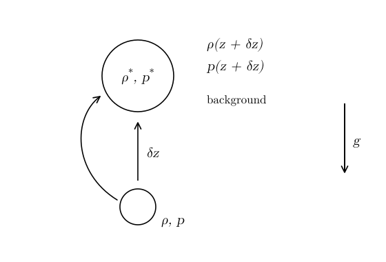
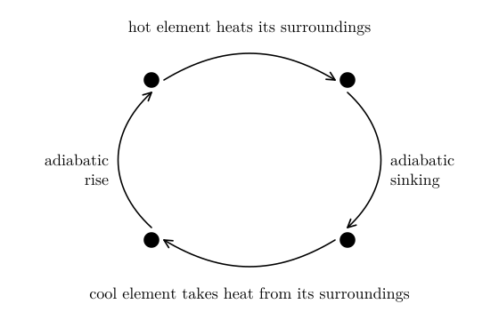
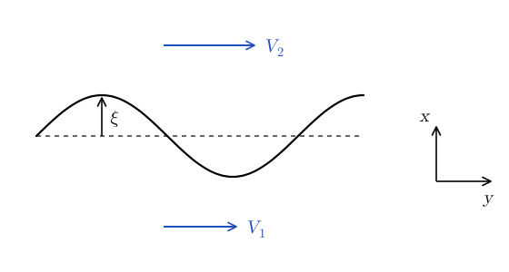
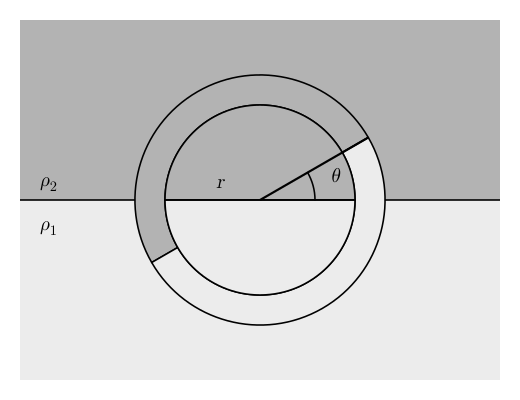

# Fluid Instabilities {#sec-inst}

::: {.callout-note}
This chapter is a draft. Sections on other instabilities, such as the thermal instability, are in preparation.
:::

A flow is **unstable** when small perturbations can grow exponentially. We have already seen in @sec-sound that the normal modes of a fluid at rest have real $\omega^2$ (@eq-sound-29), so each mode either oscillates or grows exponentially. We will see an example of the latter in @sec-inst-jeans. This is no longer true when the fluid is moving, as we will see for the Kelvin–Helmholtz instability. In this chapter we will look at a few examples of instabilities that are particularly useful in astrophysics. There are many more instabilities, each with its own dimensionless numbers. The definitive reference is @chandrasekhar1961.

## Convective instability {#sec-inst-convection}

Consider a stratified medium in a uniform gravitational field $\vb{g} = - g \hat{\vb{z}}$, in hydrostatic equilibrium, $\partial_z p = - \rho g$. We displace a small fluid element upwards by a distance $\delta z$, as shown in @fig-inst-displaced. Initially, the fluid element has the same density $\rho$ and pressure $p$ as its surroundings. After the displacement, its density and pressure are $\rho^*$ and $p^*$, while the background at the new location has density $\rho (z + \delta z)$ and pressure $p (z + \delta z)$. What will the fluid element do?

{#fig-inst-displaced fig-alt="A small circle at the bottom, labelled rho and p, is displaced upwards by a distance delta z to a larger circle labelled rho star and p star. Next to it, the background has density rho(z + delta z) and pressure p(z + delta z). An arrow pointing down is labelled g."}

As in @sec-strat-gravity, we assume that the displacement is slow enough for the fluid element to stay in pressure equilibrium with its surroundings, $p^* = p (z + \delta z)$, and that it is adiabatic. The force per unit volume experienced by the fluid element in the vertical direction is
$$
f_z = - \partial_z p - \rho^* g = g \left[ \rho (z + \delta z) - \rho^* \right] .
$$ {#eq-inst-buoyancy-force}
So, if $\rho^* < \rho (z + \delta z)$, the fluid element is lighter than its surroundings and it is pushed further upwards. In this case we say that the fluid is **convectively unstable**. Otherwise, the fluid element is pushed back down.

For an adiabatic displacement, $(\partial p / \partial \rho)_s = \Gamma p / \rho$, so, to linear order,
$$
\rho^* = \rho + \left( \frac{\partial \rho}{\partial p} \right)_s \frac{\dd p}{\dd z} \delta z = \rho \left[ 1 + \frac{1}{\Gamma p} \frac{\dd p}{\dd z} \delta z \right] .
$$ {#eq-inst-element-density}
On the other hand, the density of the background at the new location is
$$
\rho (z + \delta z) = \rho + \frac{\dd \rho}{\dd z} \delta z .
$$ {#eq-inst-background-density}
The fluid is stable if $\rho^* \geq \rho (z + \delta z)$ for $\delta z > 0$, that is if $(\rho / \Gamma p) \, \dd p / \dd z \geq \dd \rho / \dd z$. Since both the pressure and the density decrease with height, the condition for stability is
$$
\boxed{\frac{\rho}{\Gamma p} \left| \frac{\dd p}{\dd z} \right| \leq \left| \frac{\dd \rho}{\dd z} \right| .}
$$ {#eq-inst-stability}
Note that $\rho / \Gamma p = c_s^{- 2}$. In words, the density of the background has to decrease with height at least as fast as the density of a fluid element that is moved up adiabatically.

### The Schwarzschild criterion

For an ideal gas with uniform composition (constant $\mu$), $p = \rho k_B T / (\mu m_u)$, so
$$
\begin{aligned}
\rho = \frac{\mu m_u p}{k_B T} \Longrightarrow \dd \rho &= \frac{\mu m_u}{k_B T} \dd p - \frac{\mu m_u p}{k_B T^2} \dd T \\
&= \frac{\rho}{p} \dd p - \frac{\rho}{T} \dd T .
\end{aligned}
$$ {#eq-inst-ideal-gas}
Combining @eq-inst-element-density, @eq-inst-background-density, and @eq-inst-ideal-gas, we find
$$
\begin{aligned}
& \rho^* - \rho (z + \delta z) \\
& \quad = \left[ - \left( 1 - \frac{1}{\Gamma} \right) \frac{\rho}{p} \frac{\dd p}{\dd z} + \frac{\rho}{T} \frac{\dd T}{\dd z} \right] \delta z .
\end{aligned}
$$ {#eq-inst-density-difference}
So the condition for instability is that
$$
\frac{\dd T}{\dd z} < \left( 1 - \frac{1}{\Gamma} \right) \frac{T}{p} \frac{\dd p}{\dd z} .
$$ {#eq-inst-instability-T}
What is the meaning of the right-hand side? Suppose that the background is isentropic, $p = p_0 (\rho / \rho_0)^{\Gamma}$. Then $\dd \rho = \rho \, \dd p / (\Gamma p)$ and
$$
\begin{aligned}
\dd p &= \frac{k_B T}{\mu m_u} \dd \rho + \frac{\rho k_B}{\mu m_u} \dd T = \frac{1}{\Gamma} \dd p + \frac{p}{T} \dd T \\
\Longrightarrow \dd T &= \left( 1 - \frac{1}{\Gamma} \right) \frac{T}{p} \dd p .
\end{aligned}
$$ {#eq-inst-adiabatic-gradient}
So the right-hand side of @eq-inst-instability-T is the **adiabatic temperature gradient**, $(\dd T / \dd z)_{\mathrm{ad}}$, that is the temperature gradient that the fluid would have if it were isentropic, with the same pressure gradient. Since the temperature decreases with height, the condition for instability is
$$
\boxed{\left| \frac{\dd T}{\dd z} \right| > \left| \frac{\dd T}{\dd z} \right|_{\mathrm{ad}} .}
$$ {#eq-inst-schwarzschild}
This is the **Schwarzschild criterion**: a fluid is convectively unstable if its temperature decreases with height faster than it would in an isentropic fluid.

When the fluid is unstable, hot fluid elements rise, give heat to their surroundings, sink, and take heat from their surroundings at the bottom (@fig-inst-cycle). So convection transports heat upwards. The convective heat flux grows with the difference $|\dd T / \dd z| - |\dd T / \dd z|_{\mathrm{ad}}$; in the mixing-length theory used in stellar evolution codes, $F_{\mathrm{conv}} \propto (|\dd T / \dd z| - |\dd T / \dd z|_{\mathrm{ad}})^{3 / 2}$. Convection is very efficient, so a small excess over the adiabatic gradient is enough to carry a large heat flux. In well developed convection, the average temperature gradient is very close to the adiabatic one:
$$
\left\langle \left| \frac{\dd T}{\dd z} \right| \right\rangle \approx \left| \frac{\dd T}{\dd z} \right|_{\mathrm{ad}} .
$$ {#eq-inst-well-developed}

{#fig-inst-cycle fig-alt="Four points at the corners of a rectangle, joined by arrows that go around clockwise. On the left, a hot element rises adiabatically. At the top it heats its surroundings and moves to the right. On the right, the cool element sinks adiabatically. At the bottom it takes heat from its surroundings and moves back to the left."}

Convection transports energy in the cores of massive stars and in the envelopes of low-mass stars like the Sun. Three-dimensional simulations of convection in stars, such as those of @herwig2023, show a turbulent flow, with fluid elements moving on a wide range of scales. Convection is also important in core-collapse supernovae (@sec-sn). After core bounce, the gas behind the stalled shock is heated from below by the neutrinos emitted by the proto-neutron star, so it becomes convectively unstable. This *neutrino-driven convection* helps the shock to revive [@abdikamalov2020].

### The Brunt–Väisälä frequency

The equation of motion of the displaced fluid element is
$$
\begin{aligned}
\rho \frac{\dd^2 \delta z}{\dd t^2} &= - g \left[ \rho^* - \rho (z + \delta z) \right] \\
&= - g \rho \biggl[ - \left( 1 - \frac{1}{\Gamma} \right) \frac{1}{p} \frac{\dd p}{\dd z} \\
&\qquad {} + \frac{1}{T} \frac{\dd T}{\dd z} \biggr] \delta z ,
\end{aligned}
$$ {#eq-inst-element-motion}
where we have used @eq-inst-buoyancy-force and @eq-inst-density-difference. This can be written as
$$
\frac{\dd^2 \delta z}{\dd t^2} + N^2 \delta z = 0 ,
$$ {#eq-inst-oscillator}
where $N$ is the Brunt–Väisälä frequency
$$
\boxed{
\begin{aligned}
N^2 &= \frac{g}{T} \left[ \frac{\dd T}{\dd z} - \left( 1 - \frac{1}{\Gamma} \right) \frac{T}{p} \frac{\dd p}{\dd z} \right] \\
&= \frac{g}{T} \left[ \frac{\dd T}{\dd z} - \left( \frac{\dd T}{\dd z} \right)_{\mathrm{ad}} \right] .
\end{aligned}
}
$$ {#eq-inst-brunt-vaisala}
This generalizes @eq-strat-brunt-vaisala, which we derived for an isothermal atmosphere, to an arbitrary stratification.

- If $N^2 > 0$, the fluid element oscillates with frequency $N$:
  $$
  \delta z (t) = A \sin (N t) + B \cos (N t) .
  $$ {#eq-inst-stable-oscillation}
  The fluid is stable against convection.

- If $N^2 < 0$, the displacement grows exponentially:
  $$
  \delta z (t) = A \exp \left( \sqrt{- N^2} \, t \right) + B \exp \left( - \sqrt{- N^2} \, t \right) .
  $$ {#eq-inst-unstable-growth}
  The fluid is unstable against convection, and the growth rate of the instability is $\lambda = \sqrt{- N^2}$.

::: {.callout-tip icon=false}
## Example

Consider the atmosphere of the Earth, with $\mu \approx 29$ and $\Gamma = 7/5$ (@sec-strat), and neglect the water vapour. Using hydrostatic equilibrium, $\dd p / \dd z = - \rho g$, the adiabatic temperature gradient is
$$
\left( \frac{\dd T}{\dd z} \right)_{\mathrm{ad}} = - \left( 1 - \frac{1}{\Gamma} \right) \frac{\mu m_u g}{k_B} \approx - 9.8\,\mathrm{K\,km^{-1}} .
$$ {#eq-inst-earth-lapse}
The average temperature gradient in the lower atmosphere is about $- 6.5\,\mathrm{K\,km^{-1}}$, so the atmosphere is, on average, stable against convection. With $T \approx 288\,\mathrm{K}$, we find $N^2 \approx (g / T) \times 3.3\,\mathrm{K\,km^{-1}} \approx 1.1 \times 10^{-4}\,\mathrm{s^{-2}}$, so a displaced parcel of air oscillates with a period $2 \pi / N \approx 10\,\mathrm{min}$. On a sunny day, however, the ground heats the air above it, the temperature gradient near the ground becomes steeper than the adiabatic one, and the air starts to convect. The rising bubbles of warm air, called thermals, are used by birds and glider pilots to gain altitude.
:::

## The Rayleigh–Taylor instability {#sec-inst-rt}

Suppose now that the density changes over a distance much shorter than the pressure scale height, for example at the interface between two layers with different composition or temperature. Then the change in the density of the fluid element in @eq-inst-element-density, which is of order $\rho \, \delta z / (\Gamma H)$, with $H$ the pressure scale height, is negligible compared with the change in the density of the background in @eq-inst-background-density. The fluid element keeps its density as it moves, $\rho^* \approx \rho$, as if the fluid were incompressible, so $\rho^* - \rho (z + \delta z) = - (\dd \rho / \dd z) \, \delta z$, and
$$
\boxed{N^2 = - \frac{g}{\rho} \frac{\dd \rho}{\dd z} .}
$$ {#eq-inst-rt}
For an ideal gas with uniform composition, at nearly constant pressure, $\dd \rho / \rho \approx - \dd T / T$, so this agrees with @eq-inst-brunt-vaisala without the $\dd p / \dd z$ term. @eq-inst-rt tells us that a heavy fluid on top of a light fluid is unstable. This is the **Rayleigh–Taylor instability**. The heavy fluid sinks in fingers, while the light fluid rises in bubbles that take the shape of mushrooms (@fig-inst-rt-simulation). The fingers slide past the surrounding fluid, so their sides are in turn unstable to the Kelvin–Helmholtz instability (@sec-inst-kh), which rolls them up into vortices. In the in-class worksheet (@sec-inst-worksheet), we estimate the growth rate of the instability for a sharp interface between two fluids.

{#fig-inst-rt-simulation fig-alt="Three panels showing the tracer in the square region from minus 0.5 to 0.5 in x and z, at t equal to 0, 1.5 and 3. Red is the heavy fluid on top, blue the light fluid below. At t equal to 0 the interface is almost flat, with a small wave. At t equal to 1.5 the wave has grown: two troughs of heavy fluid push down and the light fluid bulges up between them. At t equal to 3 the heavy fluid falls in two long fingers that reach z equal to minus 0.35 and spread into mushroom caps, while the light fluid rises in bubbles up to z equal to 0.25. The sides of the fingers roll up into small swirling vortices."}

What matters is the gravitational acceleration felt by the fluid. In a fluid that is accelerated with acceleration $\vb{a}$, the effective gravity, in the frame of the fluid, is $\vb{g} - \vb{a}$. So a fluid that is stable in a gravitational field can become Rayleigh–Taylor unstable when it is accelerated. This happens in supernovae. When the shock launched by a core-collapse supernova (@sec-sn) passes through the layers of the star, it sets them in motion outwards. The gas behind the shock is then decelerated, for example when the shock reaches the hydrogen envelope and has to sweep up more mass. In the frame of the decelerating gas, the effective gravity points outwards, so the interfaces between layers with different composition, where the density drops outwards, have heavy fluid "on top" of light fluid and become unstable. The instability mixes the heavy elements produced in the explosion, including hot bubbles of radioactive $^{56}$Ni, into the outer layers of the star [@wongwathanarat2015]. When the acceleration is impulsive, as when a shock crosses the interface between two fluids (for example between the oxygen and the carbon layers of a star), the corresponding instability is called the **Richtmyer–Meshkov instability** [@richtmyer1960; @meshkov1969].

## The Kelvin–Helmholtz instability {#sec-inst-kh}

Consider an incompressible fluid with uniform density and a shear flow
$$
\vb{v}_0 (x) = V (x) \hat{\vb{y}} .
$$ {#eq-inst-shear-flow}
We perturb it with a small velocity field in the $(x, y)$ plane,
$$
\vb{v}_1 (t, x, y) = \hat{\vb{z}} \times \nabla \phi (t, x, y) = \partial_x \phi \, \hat{\vb{y}} - \partial_y \phi \, \hat{\vb{x}} ,
$$ {#eq-inst-stream-function}
where $\phi$ is called the *stream function*. Note that $\nabla \cdot \vb{v}_1 = - \partial_x \partial_y \phi + \partial_y \partial_x \phi = 0$, so the perturbation is automatically incompressible.

We study the stability of this flow using the vorticity equation (@eq-wind-vorticity-barotropic) together with $\nabla \cdot \vb{v}_1 = 0$:
$$
\frac{\partial \vb{\omega}}{\partial t} + \nabla \times (\vb{\omega} \times \vb{v}) = 0 .
$$ {#eq-inst-vorticity}
The vorticity of the background and of the perturbation are
$$
\begin{aligned}
\vb{\omega}_0 &= \nabla \times \vb{v}_0 = \frac{\dd V}{\dd x} \hat{\vb{z}} , \\
\vb{\omega}_1 &= \nabla \times \vb{v}_1 = (\partial_x^2 \phi + \partial_y^2 \phi) \, \hat{\vb{z}} = \nabla^2 \phi \, \hat{\vb{z}} .
\end{aligned}
$$ {#eq-inst-vorticities}
Inserting $\vb{\omega} = \vb{\omega}_0 + \vb{\omega}_1$ and $\vb{v} = \vb{v}_0 + \vb{v}_1$ in @eq-inst-vorticity and keeping only the terms of first order, we find
$$
\frac{\partial \vb{\omega}_1}{\partial t} + \nabla \times (\vb{\omega}_0 \times \vb{v}_1) + \nabla \times (\vb{\omega}_1 \times \vb{v}_0) = 0 .
$$ {#eq-inst-vorticity-linear}
The zeroth-order term vanishes: $\vb{\omega}_0 \times \vb{v}_0 = - V \, (\dd V / \dd x) \, \hat{\vb{x}}$ depends only on $x$, so its curl is zero. Since $\vb{\omega}_1$ is parallel to $\hat{\vb{z}}$, we need only the $z$-component of @eq-inst-vorticity-linear. We have
$$
\begin{aligned}
\vb{\omega}_1 \times \vb{v}_0 &= \nabla^2 \phi \, \hat{\vb{z}} \times V \hat{\vb{y}} \\
&= - V \nabla^2 \phi \, \hat{\vb{x}} , \\
\left\{ \nabla \times [\vb{\omega}_1 \times \vb{v}_0] \right\} \cdot \hat{\vb{z}} &= V \partial_y \nabla^2 \phi , \\
\vb{\omega}_0 \times \vb{v}_1 &= - \frac{\dd V}{\dd x} (\partial_x \phi \hat{\vb{x}} + \partial_y \phi \hat{\vb{y}}) , \\
\left\{ \nabla \times [\vb{\omega}_0 \times \vb{v}_1] \right\} \cdot \hat{\vb{z}} &= - \frac{\dd^2 V}{\dd x^2} \partial_y \phi .
\end{aligned}
$$ {#eq-inst-curls}
In the last line, the terms with $\partial_x \partial_y \phi$ cancel. So
$$
\partial_t \nabla^2 \phi + V \partial_y \nabla^2 \phi - \frac{\dd^2 V}{\dd x^2} \partial_y \phi = 0 .
$$ {#eq-inst-phi}
The coefficients of this equation depend only on $x$, so we look for solutions of the form
$$
\phi (t, x, y) = \Psi (x) \, \ee^{\ii (k y - \omega t)} ,
$$ {#eq-inst-ansatz}
with $k > 0$. Then $\partial_t \phi = - \ii \omega \phi$, $\partial_y \phi = \ii k \phi$, and $\nabla^2 \phi = (\dd^2 \Psi / \dd x^2 - k^2 \Psi) \, \ee^{\ii (k y - \omega t)}$. Inserting these in @eq-inst-phi and dividing by $- \ii k$, we obtain
$$
\boxed{(c - V) \left( \frac{\dd^2 \Psi}{\dd x^2} - k^2 \Psi \right) + \frac{\dd^2 V}{\dd x^2} \Psi = 0 ,}
$$ {#eq-inst-rayleigh}
where $c = \omega / k$, with boundary conditions $\Psi (\pm \infty) = 0$. This is *Rayleigh's stability equation*. It is an eigenvalue problem: for a given $V (x)$ and $k$, it has non-trivial solutions only for some values of $c$. The flow is unstable if one of these has a positive imaginary part. Writing $\omega = \omega_r + \ii \omega_i$, the perturbation grows as $\ee^{\omega_i t}$, so the growth rate of the instability is $\omega_i$.

### A vortex sheet

As an example, consider a shear layer of zero thickness, a *vortex sheet*, in which
$$
\vb{v}_0 (x) = V (x) \hat{\vb{y}} = \begin{cases}
V_1 \hat{\vb{y}}, & x < 0, \\
V_2 \hat{\vb{y}}, & x > 0 .
\end{cases}
$$ {#eq-inst-vortex-sheet}
Let $\xi (t, x, y) = X (x) \, \ee^{\ii (k y - \omega t)}$ be the displacement of the fluid elements in the $x$-direction (@fig-inst-sheet). The $x$-component of the velocity perturbation is the rate of change of $\xi$ following the fluid:
$$
v_{1 x} = \frac{\dd \xi}{\dd t} = \partial_t \xi + V (x) \, \partial_y \xi = \ii \left[ - \omega + V (x) k \right] \xi = - \ii k \phi ,
$$ {#eq-inst-sheet-velocity}
where the last equality follows from @eq-inst-stream-function. So
$$
\phi = \begin{cases}
(c - V_1) \, \xi, & x < 0, \\
(c - V_2) \, \xi, & x > 0 .
\end{cases}
$$ {#eq-inst-sheet-phi}

{#fig-inst-sheet fig-alt="A horizontal sinusoidal curve separates two regions. Above it the fluid moves to the right with velocity V_2, below it with velocity V_1. A vertical arrow from the unperturbed position of the sheet, a dashed line, to the crest of the curve is labelled xi. Axes in the corner: x points up and y to the right."}

Away from the vortex sheet, $V$ is constant, so $\dd^2 V / \dd x^2 = 0$, and @eq-inst-rayleigh becomes
$$
\frac{\dd^2 \Psi}{\dd x^2} - k^2 \Psi = 0 \Longrightarrow \Psi (x) = \begin{cases}
A_- \ee^{k x}, & x < 0, \\
A_+ \ee^{- k x}, & x > 0,
\end{cases}
$$ {#eq-inst-sheet-psi}
where we have used the boundary conditions at $\pm \infty$. Using @eq-inst-sheet-phi, with $X = X (0)$ the displacement of the sheet, which is the same on both sides (otherwise a gap would open between the two fluids), $A_- = (c - V_1) X$ and $A_+ = (c - V_2) X$. So, just below and just above the sheet,
$$
\frac{\dd \Psi}{\dd x} = \begin{cases}
k (c - V_1) X, & x = 0^-, \\
- k (c - V_2) X, & x = 0^+ .
\end{cases}
$$ {#eq-inst-sheet-dpsi}
To find the dispersion relation, we integrate @eq-inst-rayleigh across the vortex sheet. It is convenient to note that
$$
(c - V) \frac{\dd^2 \Psi}{\dd x^2} + \frac{\dd^2 V}{\dd x^2} \Psi = \frac{\dd}{\dd x} \left[ (c - V) \frac{\dd \Psi}{\dd x} + \frac{\dd V}{\dd x} \Psi \right] ,
$$ {#eq-inst-total-derivative}
so that
$$
\begin{aligned}
0 &= \int_{- \epsilon}^{\epsilon} \biggl[ (c - V) \left( \frac{\dd^2 \Psi}{\dd x^2} - k^2 \Psi \right) \\
&\qquad {} + \frac{\dd^2 V}{\dd x^2} \Psi \biggr] \dd x \\
&= \left[ (c - V) \frac{\dd \Psi}{\dd x} + \frac{\dd V}{\dd x} \Psi \right]_{- \epsilon}^{\epsilon} \\
&\qquad {} - k^2 \int_{- \epsilon}^{\epsilon} (c - V) \Psi \, \dd x \\
&\xrightarrow{\epsilon \to 0} - k X \left[ (c - V_1)^2 + (c - V_2)^2 \right] ,
\end{aligned}
$$ {#eq-inst-sheet-jump}
where we have used $\dd V / \dd x = 0$ at $x = \pm \epsilon$ and the fact that the last integral vanishes as $\epsilon \to 0$. So the dispersion relation is
$$
2 c^2 - 2 c (V_1 + V_2) + V_1^2 + V_2^2 = 0 \Longrightarrow
\boxed{c = \frac{1}{2} (V_1 + V_2) \pm \frac{\ii}{2} |V_1 - V_2| .}
$$ {#eq-inst-sheet-dispersion}
The real part of $c$ tells us that the perturbations are carried along at the average velocity of the two layers. One of the two solutions has a positive imaginary part, so the vortex sheet is always unstable. This is the **Kelvin–Helmholtz instability**. Its growth rate is
$$
\omega_i = \frac{k}{2} |V_1 - V_2| .
$$ {#eq-inst-kh-growth}
Note that smaller scales grow **faster**. If the shear layer has a finite thickness $\delta$, @eq-inst-kh-growth is valid only for $k \lesssim 1 / \delta$. The fastest-growing modes have $k \sim 1 / \delta$, and
$$
\omega_{i, \max} \sim \frac{|V_1 - V_2|}{\delta} \sim \left| \frac{\dd V}{\dd x} \right| .
$$ {#eq-inst-kh-max}
Viscosity can also damp the instability at large $k$.

We have assumed the fluid to be incompressible, which is a good approximation if $|V_1 - V_2|$ is much smaller than the sound speed. Compressibility reduces the growth rate. For two fluids with the same sound speed $c_s$, a vortex sheet is stable against perturbations along the flow if $|V_1 - V_2| > 2 \sqrt{2} \, c_s$ [@landau1987, §84]. A perturbation with a wave vector at an angle to the flow only feels the component of the velocity jump along $\vb{k}$, so in three dimensions a supersonic shear layer is never completely stable, but it is much less unstable than a subsonic one. This is one of the reasons why supersonic astrophysical jets can travel large distances without being disrupted.

### Effect of viscosity

With the inclusion of viscosity, which we will discuss in @sec-visc, the vorticity equation acquires a diffusion term, and Rayleigh's equation becomes the **Orr–Sommerfeld equation**:
$$
(c - V) \tilde{\nabla}^2 \Psi + \frac{\dd^2 V}{\dd x^2} \Psi = \frac{\ii}{k \mathrm{Re}} \tilde{\nabla}^4 \Psi , \qquad \tilde{\nabla}^2 = \frac{\dd^2}{\dd x^2} - k^2 .
$$ {#eq-inst-orr-sommerfeld}
Here we have measured lengths in units of a characteristic length $L$ of the flow (for example the thickness of the shear layer) and velocities in units of a characteristic velocity $U$ (for example $|V_1 - V_2|$), and introduced the **Reynolds number**
$$
\mathrm{Re} = \frac{U L}{\nu} ,
$$ {#eq-inst-reynolds}
where $\nu$ is the kinematic viscosity. The Reynolds number is the most important parameter describing the stability of a flow.

In the limit of small Reynolds number, viscosity dominates and we can neglect the terms with $V$. For a perturbation with $\tilde{\nabla}^2 \Psi \approx - k^2 \Psi$, @eq-inst-orr-sommerfeld gives
$$
\begin{aligned}
- c k^2 = \ii \frac{k^3}{\mathrm{Re}} &\Longrightarrow \omega = - \frac{\ii}{\mathrm{Re}} k^2 \\
&\Longrightarrow \phi (t, x, y) \sim \ee^{\ii k y} \ee^{- k^2 t / \mathrm{Re}} .
\end{aligned}
$$ {#eq-inst-viscous-damping}
The perturbation decays: viscosity has a stabilizing effect. In physical units, $\ee^{- k^2 t / \mathrm{Re}}$ is $\ee^{- \nu k^2 t}$, so the vorticity of the perturbation diffuses away in a time $1 / (\nu k^2)$. In general, a flow becomes unstable when the Reynolds number exceeds a critical value, $\mathrm{Re} > \mathrm{Re}_{\mathrm{crit}}$, which depends on the flow. As $\mathrm{Re}$ increases, the eigenvalues $\omega$ move upwards in the complex plane, and some of them cross into the upper half plane (@fig-inst-eigen, left). For a shear layer, all sufficiently long wavelengths are unstable. For small $k$ the modes behave as for the vortex sheet, with $\omega_r \propto k$ and $\omega_i \propto k$, while the modes with large $k$ are damped by viscosity (@fig-inst-eigen, right).

{#fig-inst-eigen fig-alt="Two panels, each with the real part of omega on the horizontal axis and the imaginary part on the vertical axis. Left: six crosses below the horizontal axis, in the region of stable modes, each with an arrow pointing upwards into the region of unstable modes, labelled Re increasing. Right: dots for modes with increasing wave number start at the origin and rise along a straight line, reach a maximum, and then bend down, crossing the horizontal axis; the last dots, below the axis, are labelled damped by viscosity. Arrows show the dots with large wave number moving upwards as the Reynolds number increases."}

The Kelvin–Helmholtz instability is everywhere: it produces the billows that we sometimes see in clouds, and it makes jets and the boundaries of astrophysical outflows turbulent. It also plays an important role in turbulence (@sec-turb): large eddies are destroyed by the Kelvin–Helmholtz instability and generate smaller eddies.

## The Jeans instability {#sec-inst-jeans}

We have already encountered the Jeans instability in @sec-hydro-jeans. Here, we re-derive the instability following the same argument as James Jeans. We consider an initially homogeneous, self-gravitating gas region, subject to a density perturbation. We expand density, velocity, and gravitational potential as
$$
    \rho = \rho_0 + \rho_1, \qquad \vb{v} = \vb{v}_0 + \vb{v}_1, \qquad \phi = \phi_0 + \phi_1.
$$ {#eq-inst-jeans-setup}
For a homogeneous background, we have $\rho_0 = \mathrm{const}$, $\vb{v}_0 = 0$, and $\phi_0 = \mathrm{const}$. Strictly speaking, this background is not consistent, because a constant potential does not satisfy the Poisson equation, $\nabla^2 \phi_0 = 4 \pi G \rho_0$. Following Jeans, we ignore this problem, which is why this argument is sometimes called the *Jeans swindle*. The swindle can be justified for perturbations on scales much smaller than the size of the region, or in an expanding universe. The continuity equation reads, to first order
$$
    \frac{\partial \rho_1}{\partial t} + \rho_0 \nabla \cdot \vb{v}_1 = 0.
$$ {#eq-inst-jeans-continuity}
The linearized momentum equation reads
$$
    \frac{\partial \vb{v}_1}{\partial t} = - \nabla \phi_1 - \frac{c_s^2}{\rho_0} \nabla \rho_1,
$$ {#eq-inst-jeans-momentum}
where we have used $\nabla p_1 = c_s^2 \nabla \rho_1$. For adiabatic perturbations $c_s$ is the adiabatic sound speed. For a gas that can efficiently cool, as in molecular clouds, the perturbations are isothermal, and we should use the isothermal sound speed $c_{\mathrm{iso}}$ instead.
Finally, the gravitational potential satisfies
$$
    \nabla^2 \phi_1 = 4 \pi G \rho_1.
$$ {#eq-inst-jeans-poisson}
If we take all perturbations to be proportional to $\exp\big[\ii (\vb{k}\cdot\vb{x}-\omega t ) \big]$, then we can solve for the potential perturbation as
$$
    \phi_1 = -\frac{4 \pi G}{k^2} \rho_1.
$$ {#eq-inst-jeans-potential}
Inserting this into the momentum equation gives
$$
    \vb{v}_1 = \frac{\vb{k}}{\omega} \left( - \frac{4\pi G}{k^2} + \frac{c_s^2}{\rho_0} \right) \rho_1.
$$ {#eq-inst-jeans-velocity}
Using @eq-inst-jeans-continuity, we obtain
$$
    \omega^2 \rho_1 = k^2 \left( - \frac{4\pi G \rho_0}{k^2} + c_s^2 \right) \rho_1.
$$ {#eq-inst-jeans-density}
The dispersion relation is thus
$$
    \omega^2 = c_s^2 k^2 - 4 \pi G \rho_0 .
$$ {#eq-inst-jeans-dispersion}
This dispersion relation is formally very similar to the dispersion relation of electromagnetic waves in cold plasma, which we will derive in @eq-plasma-52:
$$
    \omega^2 = c^2 k^2 + \omega_p^2 , \qquad \omega_p^2 = \frac{n e^2}{\epsilon_0 m_e} ,
$$ {#eq-inst-jeans-plasma-preview}
with the important difference of the minus sign, which swaps electrostatic repulsion for gravitational attraction.

From @eq-inst-jeans-dispersion we infer that modes with large wavenumbers $k$ (small scales) behave like sound waves. However, modes with wavenumber smaller than
$$
    k_J = \frac{\sqrt{4 \pi G \rho_0}}{c_s},
$$ {#eq-inst-jeans-kj}
that is, with wavelength larger than
$$
    R_J = \frac{2 \pi}{k_J} = c_s \sqrt{\frac{\pi}{G \rho_0}},
$$ {#eq-inst-jeans-jeans}
have $\omega^2 < 0$, so they are unstable and grow exponentially. For $k \ll k_J$, the growth rate is $\lambda = - \ii \omega \simeq \sqrt{4 \pi G \rho_0}$, which is of the order of the inverse of the free-fall time of the gas. Apart from factors of order unity, this is the same Jeans length we found in @eq-hydro-33.

## In-class worksheet {#sec-inst-worksheet}

1.  Is an isothermal atmosphere stable against convection? Why?

2.  A heavy fluid with density $\rho_2$ is layered on top of a lighter fluid with density $\rho_1$ in a constant vertical gravitational field $g$ ($\rho_2 > \rho_1$). The system is perturbed by rotating a cylinder of fluid of radius $r$, as shown in @fig-inst-rotated-cylinder.

    {#fig-inst-rotated-cylinder fig-alt="A darker upper region (heavy fluid, density rho_2) lies above a lighter lower region (light fluid, density rho_1), separated by a horizontal line. A circular region of radius r is centred on the line; the heavy fluid fills its upper half and the light fluid its lower half. A thin ring around the circle has been rotated counterclockwise by an angle theta: heavy fluid has moved down on the left, light fluid has moved up on the right."}

    Assume that the fluid is incompressible and that the fluid ring rotates rigidly.

    1.  Derive an equation for $\ddot{\theta}$.

    2.  Show that the growth rate of the instability is
        $$
        \lambda \sim \sqrt{\frac{Ag}{r}},
        $$ {#eq-inst-rt-growth-ws}
        where $A$ is the Atwood number
        $$
        A = \frac{\rho_2 - \rho_1}{\rho_2 + \rho_1} .
        $$ {#eq-inst-atwood}

## Exercises {#sec-inst-exercises}

::: {#exr-inst-thin-disk}
## Vertical structure and convective stability of a thin disk

A thin disk of gas orbits an object of mass $M$. In the vertical ($z$) direction, the disk is held up by a balance between the pressure gradient and the $z$-component of the gravitational force exerted by the central object.

1.  Write down the equation of hydrostatic equilibrium in the $z$-direction.

2.  Suppose that the density profile is $\rho (z) \propto (z_m^2 - z^2)^2$. Determine the corresponding pressure profile and the polytropic index $n$ of the disk.

3.  Is the disk stable against convection if it consists of ionized hydrogen?

Adapted from @clarke2007, Problem 40.
:::

::: {.content-visible when-profile="solutions"}
::: {.solution}
1.  In the $z$-direction the gravitational acceleration is given by
    $$
    g_z =\vb{g} \cdot \hat{\vb{z}} = - \frac{GM}{r^3} \vb{r}
    \cdot \hat{\vb{z}} = - \frac{GM}{r^3} z.
    $$
    The hydrostatic equilibrium condition is
    $$
    \frac{\dd p}{\dd z} = \rho g_z = - \frac{GM}{r^3} \rho z.
    $$

2.  Define $\xi^2 = z_m^2 - z^2$. Then $\rho (\xi) \propto \xi^4$. Note that
    $$
    \frac{\dd}{\dd z} = \frac{\partial \xi}{\partial z}
    \frac{\dd}{\dd \xi} = - \frac{z}{\sqrt{z_m^2 - z^2}}
    \frac{\dd}{\dd \xi} = - \frac{z}{\xi}  \frac{\dd}{\dd \xi},
    $$
    so the hydrostatic equilibrium equation becomes
    $$
    - \frac{z}{\xi}  \frac{\dd p}{\dd \xi} = - \frac{GM}{r^3} \rho z
    \Longrightarrow \frac{\dd p}{\dd \xi} = \frac{GM}{r^3} \rho \xi
    \propto \xi^5 \Longrightarrow p (\xi) \propto \xi^6 .
    $$
    We conclude that $p \propto \rho^{3 / 2}$. The polytropic index $n$ is defined by
    $$
    p = K \rho^{1 + \frac{1}{n}},
    $$
    so $1 + \frac{1}{n} = \frac{3}{2}$ and $n = 2$.

3.  If the disk is composed of ionized hydrogen, then the adiabatic index is $\Gamma = 5 / 3$. The criterion for instability, formulated in terms of $\xi$, is[^inst-1]
    $$
    \frac{\rho}{\Gamma p}  \frac{\dd p}{\dd \xi} > \frac{\dd
    \rho}{\dd \xi} .
    $$
    We can rewrite the LHS as
    $$
    \frac{\rho}{\Gamma p}  \frac{\dd p}{\dd \xi} = \frac{\rho}{\Gamma
    p}  \frac{\dd p}{\dd \rho}  \frac{\dd \rho}{\dd \xi},
    $$
    where the derivative of $p$ wrt $\rho$ is performed using the hydrostatic equilibrium condition:
    $$
    \frac{\dd p}{\dd \rho} = \left( 1 + \tfrac{1}{n} \right)
    \frac{p}{\rho} \Longrightarrow \frac{\rho}{\Gamma p}  \frac{\dd
    p}{\dd \xi} = \frac{\left( 1 + \frac{1}{n} \right)}{\Gamma}
    \frac{\dd \rho}{\dd \xi} .
    $$
    The instability condition is then
    $$
    \left( 1 + \frac{1}{n} \right)  \frac{\dd \rho}{\dd \xi} > \Gamma
    \frac{\dd \rho}{\dd \xi} \Longrightarrow 1 + \frac{1}{n} > \Gamma .
    $$
    Since $1 + \frac{1}{n} = \frac{3}{2} < \frac{5}{3} = \Gamma$ the disk is stable against convection.

[^inst-1]: Note that $\xi$ increases downwards in the disk, so the direction of the inequality in the stability condition is flipped.
:::
:::

::: {#exr-inst-pipe}
## Instability in a pipe

A smooth pipe of square cross-section, with side $a$, lies on a horizontal surface in a uniform vertical gravitational field $g$. The pipe is filled with incompressible fluid: the upper half of the pipe contains fluid of density $\rho_1$ and the lower half contains fluid of density $\rho_0$, with $\rho_1 > \rho_0$.

1.  Name the instability that develops, and identify the energy source that powers it.

2.  Compute the energy $E_1$ per unit length of the pipe that is available to the instability.

Adapted from @clarke2007, Problem 41.
:::

::: {.content-visible when-profile="solutions"}
::: {.solution}
1.  The fluid in the pipe is unstable against the Rayleigh–Taylor instability. It is powered by the gravitational potential energy released when the heavy fluid sinks and the light fluid rises.

2.  Before the instability sets in, the gravitational potential energy per unit length of the fluid in the pipe is
    $$
    E_{\mathrm{before}} = a \int_{- a / 2}^0 \rho_0 gz \dd z + a \int_0^{a /
    2} \rho_1 gz \dd z = \frac{a^3}{8}  (\rho_1 - \rho_0) g.
    $$
    The instability will exchange the heavy and light fluids, so the potential energy per unit length of the fluid once the flow has settled is
    $$
    E_{\mathrm{after}} = \frac{a^3}{8}  (\rho_0 - \rho_1) g.
    $$
    The total energy available to the instability per unit length is then
    $$
    E_1 = E_{\mathrm{before}} - E_{\mathrm{after}} = \frac{a^3}{4} (\rho_1 -
    \rho_0) g.
    $$
:::
:::

::: {#exr-inst-slab}
## Thermal balance of a slab

A slab of gas held together by its own gravity is heated by cosmic rays, at a constant rate per unit mass. It cools by optically thin thermal bremsstrahlung, with a cooling rate per unit mass proportional to $\rho T^{1 / 2}$.

1.  Analyse the thermal stability of the slab. [Hint. Let $\dot{Q}$ be the net cooling rate per unit mass, that is the cooling rate minus the heating rate. A gas in thermal equilibrium, $\dot{Q} = 0$, is thermally unstable if $(\partial \dot{Q} / \partial T)_p < 0$. This is the Field criterion, which is discussed in @clarke2007, Section 10.4.]

2.  Is the slab stable against the Rayleigh–Taylor instability?

Adapted from @clarke2007, Problem 36.
:::

::: {.content-visible when-profile="solutions"}
::: {.solution}
1.  The net cooling rate is:
    $$
    \dot{Q} = A \rho T^{1 / 2} - C.
    $$
    We can use the Field criterion for instability:
    $$
    \left. \frac{\partial \dot{Q}}{\partial T} \right|_p =
    \frac{\partial}{\partial T}  \left[ A \frac{\mu m_u p}{k_B} T^{- 1 / 2}
    \right] = - \tfrac{1}{2} A \frac{\mu m_u p}{k_B} T^{- 3 / 2} < 0,
    $$
    so the slab is unstable to the thermal instability.

2.  Thermal equilibrium implies:
    $$
    \dot{Q} = 0 \Longrightarrow T = \left( \frac{C}{A \rho} \right)^2 .
    $$
    So the pressure is
    $$
    p = \frac{\rho}{\mu m_u} k_B T = K \frac{1}{\rho} .
    $$
    Hydrostatic equilibrium yields:
    $$
    - \rho g = \frac{\dd p}{\dd z} = - \frac{K}{\rho^2} \frac{\dd
    \rho}{\dd z} \Longrightarrow \frac{\dd \rho}{\dd z} = K^{- 1}
    \rho^3 g,
    $$
    where we have taken $z$ to be increasing upwards, so that $g > 0$. The last equation implies that the density increases upwards, so the slab is also unstable to the Rayleigh–Taylor instability.
:::
:::

## Further reading {#sec-inst-reading}

- @clarke2007, Chapter 10 (fluid instabilities).
- @chandrasekhar1961, the classic reference on hydrodynamic stability.
