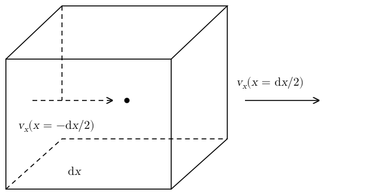
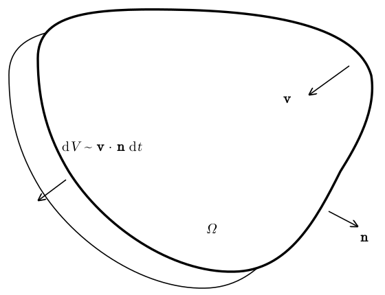
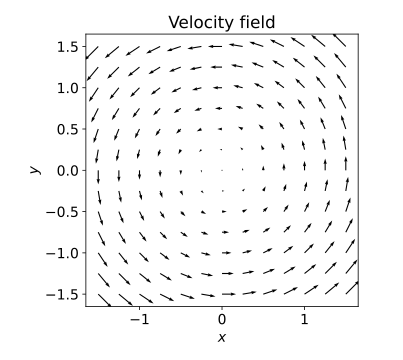
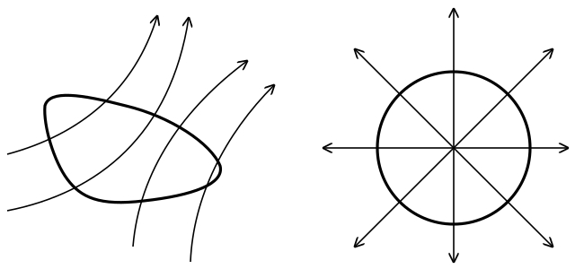

# Fluids as Continua {#sec-continua}

## Fluid elements

Astrophysical systems contain very large numbers of elementary particles. However, for most applications, we are only interested in the dynamics of the gas or plasma on scales that are large compared to the typical length scale of interaction between its constituents particles. In this context, it is convenient to treat matter as a continuum. That is, instead of keeping track of the momentum and position of each particle in the system, we describe it using equations for the evolution of macroscopic, average quantities.

We imagine matter as being composed of **fluid elements**. These are parcels of gas, or plasma, that have a characteristic size that is much smaller than the scales in which we are interested, but that still contain a large enough number of fluid constituents, molecules, or ions, so that it makes sense to talk about their properties, such as temperature. In other words, we require a fluid element $\mathcal{V}$ to be a parcel of matter that can be considered to be in thermodynamic equilibrium. We will call **fluid** a system that is composed of fluid elements. As we will see later, the equations of motion for fluids do not explicitly depend on the size or shape of the fluid elements, so we will not attempt to define them more precisely. The only requirement is that fluid elements should exist. We will also discuss later what happens when the concept of fluid element breaks down. For the moment, we will assume that the system we are studying can be decomposed in fluid elements and we will derive equation of motion for these fluid elements.

We define the **number density** of a fluid element $\mathcal{V}$ to be
$$
n = \frac{\text{``number of particles in $\mathcal{V}$''}}{\text{``volume
$\mathcal{V}$''}} \qquad [\operatorname{cm}^{- 3}] .
$$ {#eq-continua-1}
As the system evolves, the number of particles inside the volume element $\mathcal{V}$ remains constant, but the size of the volume changes, so $n$ depends on both $\mathcal{V}$ and the time $t$.

An associated concept is that of the **mass density** (or simply density)
$$
\rho = \frac{\text{``mass contained in $\mathcal{V}$''}}{\text{``volume of
$\mathcal{V}$''}} \qquad [\mathrm{g} \operatorname{cm}^{- 3}] .
$$ {#eq-continua-2}
If the gas is composed of identical particles of mass $m$, then $\rho = mn$. For mixtures with many constituents
$$
\rho = \sum_{i = 1}^N m_i n_i = \sum_{i = 1}^N m_i Y_i n = \mu n,
$$ {#eq-continua-3}
where we have introduced the particle number fractions $Y_i = n_i / n$ and the mean molecular weight $\mu$. We can also decompose $\rho$ in terms of the mass densities of the different species $\rho_i = m_i n_i$:
$$
\rho = \sum_{i = 1}^N \rho_i = \sum_{i = 1}^N X_i \rho .
$$ {#eq-continua-4}
The $X_i = \rho_i / \rho$ are the mass fractions. $Y_i$ measures the relative contribution of each species to the number density, while $X_i$ measures the relative contribution to the mass density. In general, $X_i \neq Y_i$, unless all particle species have the same mass.

We also assume that each element has fixed velocity
$$
\vb{v}= \text{``velocity of $\mathcal{V}$''} \qquad [\operatorname{cm}
\mathrm{s}^{- 1}]
$$ {#eq-continua-5}
and temperature
$$
T = \text{``temperature of $\mathcal{V}$''} \qquad [\mathrm{K}] .
$$ {#eq-continua-6}
With these definitions in place, we are now ready to state explicitly the assumptions that we are making when we treat a gas or a plasma as a fluid. Consider region $\mathcal{R}$ filled with matter. We say that this system can be treated as a fluid if the following assumption holds.

::: {#cnj-continua-fluid}
## Fluid assumption

Every point $P \in \mathcal{R}$ belongs to one fluid element, with given values of density $\rho$, composition $\{ Y_i \}$, velocity $\vb{v}$, and temperature $T$.
:::

This assumption tells us that it makes sense to say that there is a single value of density, temperature, and velocity at each point. This assumption is violated, for example, in systems in which different particle species move independently. Such systems can sometimes be described as **multi-fluids**, that is systems in which there are different kinds of fluid elements that interact with each other. Plasmas in weakly collisional regimes can sometimes be treated as multi-fluids. A gas of photons in vacuum, instead, cannot be treated as a (multi-)fluid, since at each point in space there are photons traveling in infinitely many different directions.

The assumption also implies that sufficiently small parcels of material are in thermodynamic equilibrium, so that fluid elements have a well defined temperature. This is also called **local thermodynamic equilibrium (LTE)** condition. This condition is violated in some impulsive phenomena, such as in shock waves. Violations of LTE can sometimes be included in the fluid model. We will see two examples later: the effect of viscosity and heat conduction and the treatment of shocks. In other cases, it is necessary to describe non-LTE effects using a combination of fluid and non-fluid models. For example, to simulate the effect of cosmic rays on the dynamics of clouds in the interstellar medium it is necessary to solve separate equations for the cosmic rays, which cannot be treated as a fluid, and for the rest of the matter, for which the fluid approximation holds very well.

It is important to note that whether or not the fluid assumption holds is not an absolute statement, but also depends on the time and length scale of interest. For example, the dynamics of dark matter in the Bullet cluster (@fig-continua-bullet-cluster) cannot be described using the fluid approximation. This is because dark matter does not flow with a single velocity. On the other hand, on cosmological scales, dark matter dynamics can be reasonably well described using a pressure-less fluid model: this is the so-called Zel'dovich approximation.

; not covered by the license of these notes.](../figures/fluids-as-continua/bullet-cluster.jpg){#fig-continua-bullet-cluster fig-alt="Composite image of the Bullet cluster: a field of galaxies on a black background, with two pink regions of hot X-ray-emitting gas in the middle and two blue regions, showing where the dark matter is, on either side of them, ahead of the gas."}

## The continuity equation

We now assume to have a system that can be described as a fluid. We wish to derive equations to predict how $\rho$, $\vb{v}$, and $T$ evolve for all fluid elements. To this aim, we will use three fundamental laws in classical physics: 1) the law of conservation of mass; 2) Newton's second law; and 3) the first law of thermodynamics. The law of conservation of mass gives rise to the continuity equation, which we will now derive.

{#fig-continua-stretching-along-x fig-alt="A cube of side dx. A dashed arrow at the left face points to the right and is labelled with the velocity v_x at x equal to minus dx over 2; a longer solid arrow beyond the right face is labelled with v_x at x equal to dx over 2, showing that the element is stretched along x."}

Consider the infinitesimal fluid element $\mathcal{V}$ shown in @fig-continua-stretching-along-x. Let $\dd x$ be the size of the fluid element along the $x$-direction at some time $t$. Let $v_x$ be the $x$-component of the velocity. If we take the origin to be the center of the fluid element, the velocity with which the left face is moving is $v_x \left( - \tfrac{\dd x}{2} \right)$, while the velocity of the right face is $v_x \left( \tfrac{\dd x}{2} \right)$. For the moment, we assume $v_y = v_z = 0$. The initial volume of $\mathcal{V}$ is $V = \dd x \dd y \dd z$. At time $t + \dd t$, $\mathcal{V}$ is deformed and has volume
$$
V' = \left( \dd x + \left[ v_x \left( \tfrac{\dd x}{2} \right) - v_x
\left( - \tfrac{\dd x}{2} \right) \right] \dd t \right) \dd y
\dd z = \left( \dd x + \frac{\partial v_x}{\partial x} \dd x \dd
t \right) \dd y \dd z,
$$ {#eq-continua-7}
so the relative rate in the change of volume of $\mathcal{V}$ is
$$
\frac{1}{V}  \frac{\dd V}{\dd t} = \frac{1}{V}  \frac{V' - V}{\dd
t} = \frac{\partial v_x}{\partial x} .
$$ {#eq-continua-8}
In an analogous way, we can find the rate of change of an infinitesimal volume $V$ if $v_y$ and $v_z$ are nonzero:
$$
\frac{1}{V}  \frac{\dd V}{\dd t} = \frac{\partial v_x}{\partial x} +
\frac{\partial v_y}{\partial y} + \frac{\partial v_z}{\partial z} = \nabla
\cdot \vb{v}.
$$ {#eq-continua-volume}
We have derived this equation for a cubical fluid element. However, it turns out that this equation holds in general. The extension of this result to finite (as opposed to infinitesimal) fluid elements is known as the **Reynolds theorem**, which states that

$$
\frac{\dd V}{\dd t} = \int_{\partial \Omega} \vb{v} \cdot
\vb{n} \dd S = \int_{\Omega} \nabla \cdot \vb{v} \dd V,
$$ {#eq-continua-10}
where $\Omega$ is some extended region comoving with the flow, $\partial \Omega$ is the surface enclosing $\Omega$, and $\vb{n}$ is the outwards pointing normal to it.

A proof of this theorem is outside the scope of this course, but it can be found in any book on continuum mechanics. Its geometrical interpretation is illustrated in @fig-continua-reynolds-theorem. The first equality means that the rate of change of the volume of $\Omega$ is equal to the surface integral of the component of the velocity normal to the volume. This makes sense, because the tangent part of the velocity does not alter the shape of the volume, but corresponds locally to a rotation, while the normal components corresponds to an expansion/contraction of $\Omega$. The second equality follows from the Gauss divergence theorem. Because $\nabla \cdot \vb{v}$ determines the rate of change of the fluid element volumes, it is also called the **expansion**.

{#fig-continua-reynolds-theorem fig-alt="A closed region Omega with a thick outline, and the slightly displaced outline of the same region a short time later. Arrows labelled v show the velocity of the boundary and n the outward normal. The thin sliver between the two outlines has volume dV of order v dot n dt per unit area."}

If we denote by $\mathcal{M}$ the mass of a fluid element $\mathcal{V}$, and use the fact that $\mathcal{M}$ is conserved, then we find
$$
\rho = \frac{\mathcal{M}}{V} \Longrightarrow \frac{\dd \rho}{\dd t} =
- \frac{\mathcal{M}}{V^2}  \frac{\dd V}{\dd t} = -
\frac{\mathcal{M}}{V}  \frac{1}{V}  \frac{\dd V}{\dd t} = - \rho
\nabla \cdot \vb{v} .
$$ {#eq-continua-11}
We can rearrange the terms to obtain
$$
\boxed{\frac{1}{\rho}  \frac{\dd \rho}{\dd t} = - \nabla \cdot
\vb{v}}
$$ {#eq-continua-12}
This is the **continuity equation**. The first of the fundamental equations of motion for fluids. Note that this equation can also be written in terms of $n$:
$$
\frac{1}{n}  \frac{\dd n}{\dd t} = - \nabla \cdot \vb{v}.
$$ {#eq-continua-13}
The continuity equation also holds separately for the $n_i$ and $\rho_i$ of each species in the fluid, as long as there are no chemical reactions converting between the species, i.e., $\dot{X}_i = \dot{Y}_i = 0$.

::: {.callout-tip icon=false}
## Example

A flow in which all fluid elements have the same velocity has $\nabla \cdot \vb{v}= 0$, since $\vb{v}$ is a constant, so $\rho = \operatorname{const}$.
:::

::: {.callout-tip icon=false}
## Example

Consider a planar flow $\vb{v}= (- y, x, 0)$ \[arbitrary units\]. This is an example of a rotating flow, as shown in the visualization below:

{#fig-continua-velocity-field fig-alt="Grid of arrows for the planar flow v = (-y, x). The arrows circulate counter-clockwise around the origin, with length proportional to the distance from the origin; at the origin the velocity vanishes."}

This flow also has $\rho = \operatorname{const}$:
$$
\nabla \cdot \vb{v}= \frac{\partial v_x}{\partial x} + \frac{\partial
v_y}{\partial y} = \frac{\partial (- y)}{\partial x} + \frac{\partial
(x)}{\partial y} = 0.
$$ {#eq-continua-14}
:::

::: {.callout-tip icon=false}
## Example

In cylindrical coordinates $(\varpi, z, \phi)$, a generic rotating flow with rotational axis along $z$ takes the form
$$
\vb{v}= v_{\phi}  \hat{\vb{\phi}} .
$$ {#eq-continua-15}
Rotating flows preserve the volume of fluid elements if
$$
\nabla \cdot \vb{v}= \frac{1}{\varpi}  \frac{\partial (\varpi
v_{\varpi})}{\partial \varpi} + \frac{1}{\varpi}  \frac{\partial
v_{\phi}}{\partial \phi} + \frac{\partial v_z}{\partial z} =
\frac{1}{\varpi}  \frac{\partial v_{\phi}}{\partial \phi} = 0.
$$ {#eq-continua-16}
That is, as long as all fluid elements with fixed $(\varpi, z)$ rotate with the same angular frequency.
:::

Flows for which $\nabla \cdot \vb{v}= 0$ everywhere are said to be **incompressible**. An important property of incompressible flows is that the net flux of the velocity field across any closed surface should vanish:
$$
\int_{\partial \Omega} \vb{v} \cdot \vb{n} \dd \Sigma =
\int_{\Omega} \nabla \cdot \vb{v} \dd \Omega = 0.
$$ {#eq-continua-17}
We can interpret this result graphically by introducing the velocity field lines, also called **streamlines**. These are curves $(x (s), y (s), z (s))$ satisfying
$$
\frac{\dd x}{\dd s} = v_x, \quad \frac{\dd y}{\dd s} = v_y,
\quad \frac{\dd z}{\dd s} = v_z .
$$ {#eq-continua-18}
In an incompressible flow streamlines cross each closed surface at least twice and there are no sources or sinks for the streamlines (@fig-continua-streamlines).

{#fig-continua-streamlines fig-alt="Left: four curved streamlines sweep from the lower left to the upper right, each crossing a closed curve once on entry and once on exit. Right: eight straight streamlines radiate outward from the centre of a circle, each crossing it once, so the centre is a source."}

## Radial flows {#sec-continua-homologous}

Most astrophysical transients are the result of explosions that generate approximately radial outflows. As such, an important class of flows are those for which the gas is flowing in the radial direction:
$$
\vb{v}= v_r  \hat{\vb{r}} .
$$ {#eq-continua-19}
These are called **radial flows**. In the previous equation, $v_r$ could in principle depend on both radial $r$, but also on the direction $\theta, \varphi$.

From the continuity equation, we find that radial flows are generically compressible:
$$
\begin{alignedat}{2}
\nabla \cdot \vb{v} &{}={} && \frac{1}{r^2}  \frac{\partial}{\partial r}
(r^2 v_r) + \frac{1}{r \sin \theta}  \frac{\partial}{\partial \theta} (\sin
\theta v_{\theta}) \\
&&& + \frac{1}{r \sin \theta}  \frac{\partial
v_{\varphi}}{\partial \varphi}  \\
&{}={} && \frac{1}{r^2}  \frac{\partial}{\partial r}  (r^2 v_r) \\
&{}={} && \frac{\partial v_r}{\partial r} + \frac{2}{r} v_r \neq 0.
\end{alignedat}
$$ {#eq-continua-20}
Note that, the radial direction, $\hat{\vb{r}}$, is not well defined at the origin, since all directions are radial there. This implies that $v_r (r = 0) = 0$. This regularity condition also ensures that the fluid element at the origin is not "broken" (transported in different directions), but only stretched.

An important example of radial flow is that of an *homologously expanding* (or contracting) sphere of gas. Here, "homologous" means that the relative rate of change of the volume of each fluid element, $\frac{1}{V} \frac{\dd V}{\dd t}$, is equal for all fluid elements. To see how this works, we consider a sphere of gas that at time $t = 0$ has a constant density $\rho_0$. The assumption of constant density is not necessary, as all calculations will remain valid even for variable density, but it will make the results more transparent.

In an homologous flow, the velocity of fluid elements that are at $r = p$ at $t = 0$ is given by
$$
v_r (r = p, t = 0) = Hp,
$$ {#eq-continua-21}
where $H$ is a constant. At later times, we assume that each fluid elements continues to move with the velocity it had *initially*. In other words, we are assuming that fluid elements are not subject to any force and they coast at their original velocity. This is Newton's first law applied to the fluid elements.

To find the change in density in the system, we could be tempted to write
$$
\nabla \cdot \vb{v}= \frac{1}{r^2}  \frac{\partial}{\partial r}  (r^2
v_r) \overset{!!!}{=} \frac{1}{r^2}  \frac{\partial}{\partial r}  (r^3 H) = 3 H,
$$ {#eq-continua-22}
but this is **incorrect**. The issue is that at any time $t \neq 0$, the velocity of a fluid element at the location $r$ is not $Hr$. Instead, its velocity is $Hp$, where $p$ is the position that that fluid element had at time $t = 0$.

To find it, we consider the equation of motion of the fluid element originally located at $r = p$:
$$
\frac{\dd r (t ; p)}{\dd t} = Hp, \qquad r (0 ; p) = p.
$$ {#eq-continua-23}
This can be integrated to find
$$
r (t ; p) = p + Hpt.
$$ {#eq-continua-24}
Solving for $p$ gives
$$
p = \frac{r}{1 + Ht} .
$$ {#eq-continua-25}
This means that
$$
v_r (r, t) = \frac{rH}{1 + Ht} \neq rH.
$$ {#eq-continua-26}
The continuity equation gives
$$
\frac{1}{\rho}  \frac{\dd \rho}{\dd t} = - \nabla \cdot \vb{v}= -
3 \frac{H}{1 + Ht} .
$$ {#eq-continua-homologous}
Note that the expansion (or compression if $H < 0$) rates depend only on $H$ and $t$ and not on the initial position of the fluid element $p$. In other words, all fluid elements are expanding/contracting at the same rate.

To make this result more transparent, we define $R (t)$ to be the radius of the expanding/contracting gas sphere at time $t$. Evidently, $\dot{R} (t) = HR_0$ and $R (t) = R_0 (1 + Ht)$. So @eq-continua-homologous can be written as
$$
\boxed{\frac{\dot{\rho}}{\rho} = - 3 \frac{\dot{R}}{R}}
$$ {#eq-continua-28}
The flows produced by many types of astronomical explosions can be described well as homologously expanding flows at sufficiently late times. Typically, once the gas has expanded to twice its initial radius. This is because as the gas expands, it rearranges to reach pressure equilibrium. Afterwards, the fluid elements are not subject to any net force, so they coast at a fixed velocity. As we will see later, among all possible coasting flows, homologous expansion is the only one that preserves pressure equilibrium, so it is an attractive solution.

## In-class worksheet {#sec-continua-worksheet}

1.  Consider a gas with particle number density $n$ and particle fractions $\{ Y_i \}$. Let $\{ m_i \}$ be the masses of the different atomic species in the gas. Write an explicit expression for

    1.  The mean molecular weight $\mu$;

    2.  The particle mass fractions $\{ X_i \}$.

2.  Consider a gas composed of atomic hydrogen $\mathrm{H}$ and helium $\mathrm{He}$. The particle fraction of hydrogen is 70%.

    1.  What is the mean molecular weight of this gas?

    2.  What is the mass fraction of $\mathrm{He}$?

3.  Consider a radial flow $\vb{v}= v_r \hat{\vb{r}}$.

    1.  Find $\nabla \cdot \vb{v}$ using the expression for the divergence of $\vb{v}$ in spherical coordinates:
        $$
        \begin{aligned}
        \nabla \cdot \vb{v} = {} & \frac{1}{r^2}  \frac{\partial}{\partial
        r}  (r^2 v_r) \\
        & + \frac{1}{r \sin \theta}  \frac{\partial}{\partial
        \theta} (\sin \theta v_{\theta}) \\
        & + \frac{1}{r \sin \theta}
        \frac{\partial v_{\varphi}}{\partial \varphi},
        \end{aligned}
        $$ {#eq-continua-ws-divergence}

    2.  Is the flow incompressible if $v_r = \operatorname{const}$?

## Exercises {#sec-continua-exercises}

::: {#exr-continua-differential-rotation}
## Differential rotation of a star

A spherical star of radius $R$ is differentially rotating with angular velocity
$$
\Omega (r) = \frac{\Omega_0}{1 + \left( \frac{r}{R} \right)^2},
$$ {#eq-continua-differential-rotation}
where $r$ is the cylindrical radius.

1.  Is the flow incompressible? Why?

2.  What is the velocity of the surface of the star as a function of the latitude angle $\theta$?
:::

::: {.content-visible when-profile="solutions"}
::: {.solution}
1.  The velocity is
    $$
    \vb{v}= \Omega (r) r \hat{\vb{\theta}},
    $$
    so its divergence is
    $$
    \frac{1}{r}  \frac{\partial [\Omega (r) r]}{\partial \theta} = 0.
    $$
    The flow is incompressible.

2.  The cylindrical radius $r$ of a surface point with latitude $\theta$ is $r = R \sin \theta$, so the angular velocity profile is
    $$
    \Omega (\theta) = \frac{\Omega_0}{1 + \sin^2 \theta} .
    $$
:::
:::

## Further reading {#sec-continua-reading}

- @clarke2007, Chapter 1 (introduction to concepts) and Chapter 2 (the fluid equations, including conservation of mass).
