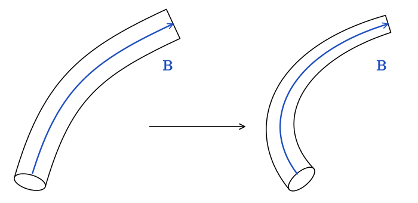
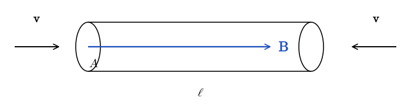
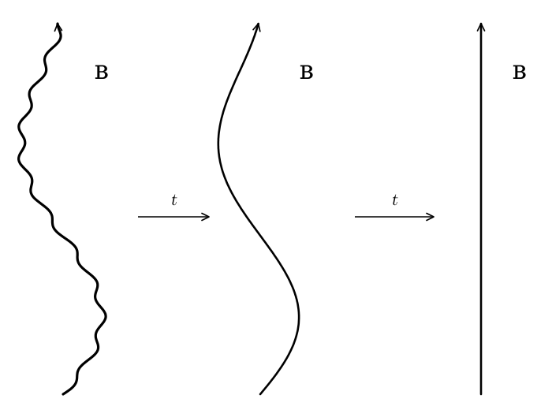
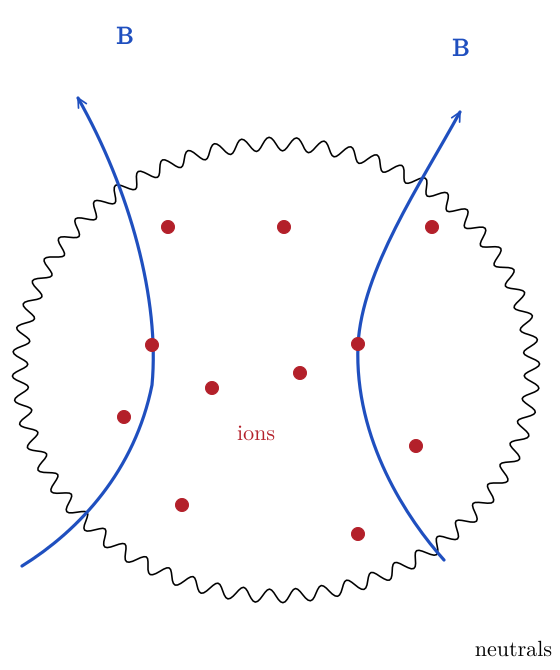
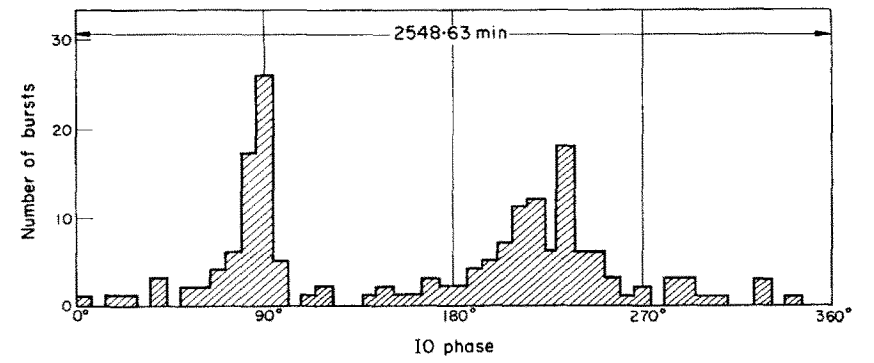
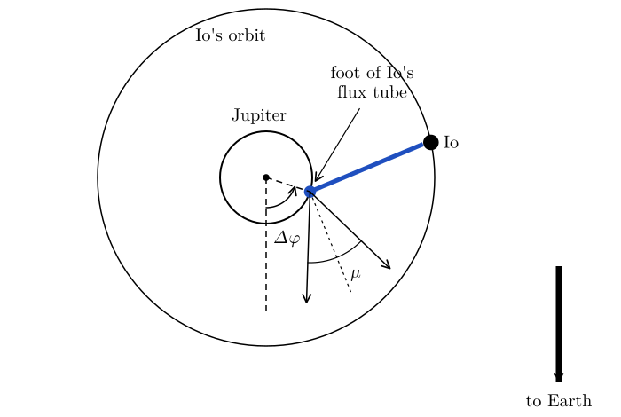
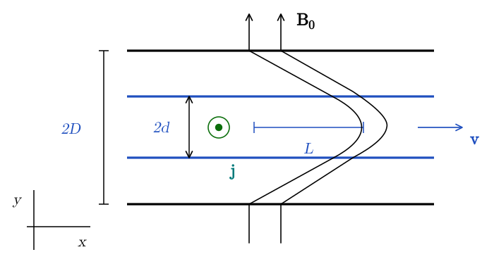
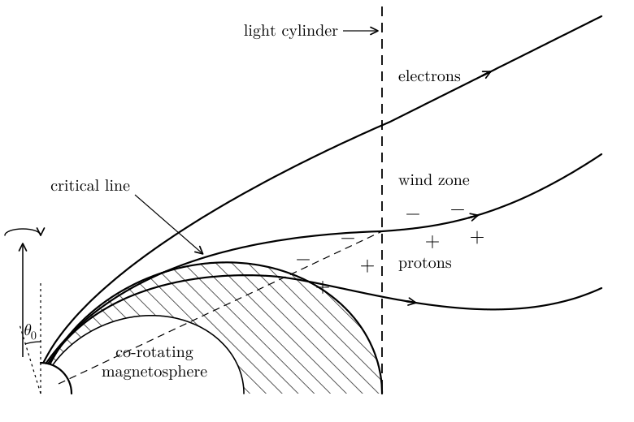
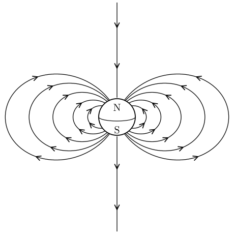

# Flux Freezing {#sec-flux}

Flux freezing is an important phenomenon in highly conducting plasmas. In these notes, we derive flux freezing in ideal magnetohydrodynamics (MHD), however it is important to remark that flux freezing also applies beyond ideal MHD, at least in an approximate way. We also discuss the role of flux freezing in the context of some important astrophysical systems. The key equation we will consider is the induction equation (or Faraday's Law), which reads (when $\eta = \mathrm{const}$, see @eq-mhd-19):
$$
\frac{\partial \vb{B}}{\partial t} = \nabla \times (\vb{v} \times
\vb{B}) + \eta \nabla^2 \vb{B}.
$$ {#eq-flux-1}

## The Ideal-MHD Limit

Let $L$ and $V$ be characteristic length and velocity scales for the plasma. We can introduce the dimensionless time and space coordinates and velocity
$$
\hat{t} = t \frac{V}{L}, \qquad \hat{x} = \frac{x}{L}, \qquad
\hat{\vb{v}} = \frac{\vb{v}}{V} .
$$ {#eq-flux-2}
Faraday's law can be written as
$$
\frac{V}{L}  \frac{\partial \vb{B}}{\partial \hat{t}} = \frac{V}{L}
\hat{\nabla} \times (\hat{\vb{v}} \times \vb{B}) + \frac{\eta}{L^2}  \hat{\nabla}^2 \vb{B}.
$$ {#eq-flux-3}
That is
$$
\frac{\partial \vb{B}}{\partial \hat{t}} = \hat{\nabla} \times
(\hat{\vb{v}} \times \vb{B}) + \left( \frac{\eta}{LV}
\right)  \hat{\nabla}^2 \vb{B}= \hat{\nabla} \times (\hat{\vb{v}}
\times \vb{B}) + \frac{1}{\mathrm{R}_M}  \hat{\nabla}^2 \vb{B}.
$$ {#eq-flux-4}
We have introduced the *magnetic Reynolds number*, by analogy with the Reynolds number of @eq-turb-10,
$$
\mathrm{R}_M = \frac{LV}{\eta} .
$$ {#eq-flux-5}
The magnetic Reynolds number measures the relative importance of advection and resistivity in the evolution of the magnetic field. It is analogous to the "usual" Reynolds number, which measures the ratio of inertial to viscous forces in a fluid. When $\mathrm{R}_M \gg 1$, we say that we are in the *ideal-MHD limit*. As we have seen in @sec-mhd, $\mathrm{R}_M$ is enormous in most astrophysical systems, for example $\mathrm{R}_M \sim 6 \times 10^{17}$ in the warm interstellar medium.

In the ideal-MHD limit, the Faraday law simplifies to
$$
\frac{\partial \vb{B}}{\partial t} = \nabla \times (\vb{v} \times
\vb{B}) \Longrightarrow \frac{\partial \vb{B}}{\partial t} + \nabla
\times (\vb{B} \times \vb{v}) = 0.
$$ {#eq-flux-6}
Remarkably, this is identical to the vorticity equation for a barotropic, inviscid fluid (@eq-wind-vorticity-barotropic):
$$
\frac{\partial \vb{\omega}}{\partial t} + \nabla \times (\vb{\omega}
\times \vb{v}) = 0.
$$ {#eq-flux-7}
The analogy between vorticity and magnetic field plays an important role in our understanding of MHD phenomena such as dynamos and is sometimes known as the Batchelor's analogy.

Consider now a surface $S (t)$ that moves with the fluid, and the magnetic flux across it
$$
\Phi (t) = \int_{S (t)} \vb{B} \cdot \dd \vb{A} .
$$ {#eq-flux-8}
The flux can change for two reasons: because $\vb{B}$ changes with time, and because the surface moves. In a time $\dd t$, each element $\dd \vb{l}$ of the boundary $C (t)$ of the surface sweeps an area $\vb{v} \dd t \times \dd \vb{l}$, so the boundary adds a flux $\vb{B} \cdot (\vb{v} \dd t \times \dd \vb{l}) = - (\vb{v} \times \vb{B}) \cdot \dd \vb{l} \, \dd t$. Using Stokes' theorem, we find
$$
\boxed{
\begin{aligned}
\frac{\dd \Phi}{\dd t} &= \int_{S (t)} \frac{\partial \vb{B}}{\partial t} \cdot \dd \vb{A} - \oint_{C (t)} (\vb{v} \times \vb{B}) \cdot \dd \vb{l} \\
&= \int_{S (t)} \left[ \frac{\partial \vb{B}}{\partial t} - \nabla \times (\vb{v} \times \vb{B}) \right] \cdot \dd \vb{A} = 0,
\end{aligned}
}
$$ {#eq-flux-9}
where we have used @eq-flux-6 in the last step. In other words, the magnetic flux across any surface co-moving with the flow is constant in ideal MHD. The same argument applied to the vorticity gives Kelvin's circulation theorem (@eq-wind-kelvin): the circulation $\mathcal{C} = \oint_{C (t)} \vb{v} \cdot \dd \vb{l} = \int_{S (t)} \vb{\omega} \cdot \dd \vb{A}$ around a curve moving with a barotropic, inviscid fluid is conserved.

This fact is called **flux freezing** and is one of the most important properties of MHD. To understand this consider a magnetic flux tube. As the name suggests, a flux tube is an imaginary bundle of magnetic field lines dragged by the plasma. This is illustrated in @fig-flux-tube.

{#fig-flux-tube fig-alt="A curved flux tube with a blue field line along its axis, followed by an arrow to the same tube after it has been carried by the flow: it is now more strongly bent and narrower, and the field line is still inside it."}

Consider the surface bounding the flux tube on the sides. This surface is such that the magnetic flux across it is zero, since there is no component of the field perpendicular to it. If we let this surface move with the plasma velocity, the flux freezing condition requires the magnetic field to deform to stay always parallel to it, as illustrated in @fig-flux-tube. In other words, **the magnetic field is dragged by the plasma as if it was painted on the fluid elements.** As we will see shortly, flux freezing has other important consequences.

At the microscopic level, the reason why flux freezing occurs in highly conducting plasmas is that the charged particles are "stuck" to the magnetic field lines[^flux-1]. Another way to think about flux freezing is in terms of induced currents. In order for the magnetic field lines to drift with respect to the plasma with velocity $\vb{v}_d$, one would need to induce an electric field (in the plasma frame)
$$
\vb{E}' = \vb{v}_d \times \vb{B}
$$ {#eq-flux-10}
which corresponds to a current $\vb{j}' = \sigma \vb{E}'$. However, $\sigma \rightarrow \infty$ (that is, $\eta \rightarrow 0$) in the ideal-MHD limit, meaning that an infinite current is required to cause the field lines to slip.

### Magnetic Field Amplification

Flux freezing also implies that, if a flux tube is compressed by the flow, then its magnetic field intensity is amplified. To see this, consider the situation illustrated in @fig-flux-compression-perpendicular.

{#fig-flux-compression-perpendicular fig-alt="A wide horizontal flux tube of cross-section A1 with a blue arrow B1 along its axis. Arrows labelled v above and below it point towards the axis. Below, the same tube squeezed into a much thinner tube of cross-section A2, with a longer blue arrow B2 along its axis."}

When a flux tube is compressed and its area changes from $A_1$ to $A_2$, the B-field strength needs to change in such a way so that the magnetic flux remains unchanged:
$$
A_1 B_1 = A_2 B_2 .
$$ {#eq-flux-11}
So the magnetic field strength must be amplified:
$$
B_2 = \frac{A_1}{A_2} B_1 .
$$ {#eq-flux-12}
It is instructive to compare this with the rate at which the plasma density is changed during the same process. In this case, the quantity that is conserved is the mass of the plasma in the flux tube, so
$$
\rho A \ell = \mathrm{const} \Longrightarrow \rho_1 A_1 \ell = \rho_2 A_2 \ell
\Longrightarrow \rho_2 = \frac{A_1}{A_2} \rho_1 .
$$ {#eq-flux-13}
In this situation, we find that the ratio of magnetic field strength to density in the plasma stays constant:
$$
\frac{B}{\rho} = \mathrm{const} .
$$ {#eq-flux-14}
Things are very different if the magnetic flux tube is compressed in the direction parallel to the magnetic field, as illustrated in @fig-flux-compression-parallel.

{#fig-flux-compression-parallel fig-alt="A horizontal flux tube of length l and cross-section A with the magnetic field B pointing along its axis to the right. Arrows labelled v at both ends point inwards: the tube is compressed along the field and its cross-section does not change."}

In this case, the density of the plasma changes according to
$$
\rho A \ell = \mathrm{const} \Longrightarrow \frac{\rho_2}{\rho_1} =
\frac{\ell_1}{\ell_2} .
$$ {#eq-flux-15}
However, $B$ remains constant, because the cross-section of the flux tube, $A$, is unchanged.

::: {.callout-tip icon=false}
## Example: Stellar collapse

A star with radius $r_1 \sim 10^9\,\mathrm{m}$ collapses to form a neutron star with radius $r_2 \sim 10\,\mathrm{km}$, and all its magnetic flux ends up in the neutron star.

- By what factor does the magnetic field increase?

- By what factor does the density increase?

- If the initial field is $B_1 \sim 10^{-2}\,\mathrm{T}$ ($100\,\mathrm{G}$), what will be the field of the neutron star?

**Answer.** The density evolves according to $\rho r^3 = \mathrm{const}$, while the magnetic field evolves according to $Br^2 = \mathrm{const}$ (assuming the field to be approximately radial), this means that
$$
\begin{gathered}
B_2 = \left( \frac{r_1}{r_2} \right)^2 B_1, \qquad \rho_2 = \left(
\frac{r_1}{r_2} \right)^3 \rho_1, \\
B \sim \rho^{2 / 3} .
\end{gathered}
$$ {#eq-flux-16}
For example, an initial field of $10^{-2}\,\mathrm{T}$ ($100\,\mathrm{G}$) is amplified to $10^{8}\,\mathrm{T}$ ($10^{12}\,\mathrm{G}$) as result of the collapse of the star. The strong amplification of the magnetic field during the collapse of a star is the reason why neutron stars have extremely strong magnetic fields, up to $10^{11}\,\mathrm{T}$ ($10^{15}\,\mathrm{G}$).
:::

### Resistive Evolution

If the resistivity $1/\sigma$ is finite, $\eta > 0$, then the magnetic field lines are not stuck to the plasma, but can drift. To understand how this process operates, we consider the evolution of a magnetic field under the sole influence of Ohmic diffusion:
$$
\frac{\partial \vb{B}}{\partial t} = \eta \nabla^2
\vb{B}.
$$ {#eq-flux-b-field-diffusion}
If the typical curvature radius of the field lines is $L$, then we can approximate the previous equation as
$$
\frac{\partial B}{\partial t} \sim \frac{\eta}{L^2} B =
\frac{1}{T_{\mathrm{decay}}} B, \qquad T_{\mathrm{decay}} = \frac{L^2}{\eta} .
$$ {#eq-flux-18}
For many astrophysical applications $L$ is very large, so $T_{\mathrm{decay}}$ is very long. We will put actual numbers for $\eta$ and $L$ when we discuss the problem of star formation below. If the magnetic field has more than one characteristic scale, then the smaller scales will be dissipated more rapidly by the resistivity. This has the effect of "smoothing" the field lines. To quantify this, we can use the Fourier transform. Accordingly, we represent the magnetic field as a superposition of plane waves
$$
\vb{B} (t, \vb{x}) = \int \dd^3 \vb{k}
\hat{\vb{B}}_{\vb{k}} (t) \ee^{\ii \vb{k} \cdot \vb{x}},
\qquad \hat{\vb{B}}_{\vb{k}} = \frac{1}{(2 \pi)^3} \int \vb{B} (t, \vb{x}) \ee^{- \ii \vb{k} \cdot
\vb{x}} \dd V .
$$ {#eq-flux-b-field-fourier}
Note that the $\vb{k}= 0$ mode of the B-field is proportional to the average value of the field in the volume $V$:
$$
\hat{\vb{B}}_0 = \frac{1}{(2 \pi)^3} \int \vb{B} (t,
\vb{x}) \dd V = \frac{V}{(2 \pi)^3} \langle \vb{B} \rangle .
$$ {#eq-flux-20}
Inserting @eq-flux-b-field-fourier into @eq-flux-b-field-diffusion, we obtain:
$$
\int \dd^3 \vb{k}\ee^{\ii \vb{k} \cdot \vb{x}}  \left[
\frac{\dd \hat{\vb{B}}_{\vb{k}}}{\dd t} + \eta k^2  \hat{\vb{B}}_{\vb{k}} \right] = 0
$$ {#eq-flux-21}
The integral vanishes for all $\vb{x}$ only if the quantity in square brackets vanishes for every $\vb{k}$:
$$
\frac{\dd \hat{\vb{B}}_{\vb{k}}}{\dd t} = - \eta k^2  \hat{\vb{B}}_{\vb{k}} .
$$ {#eq-flux-22}
So we have transformed @eq-flux-b-field-diffusion into a simple system having an infinite number of decoupled equations, with solutions
$$
\hat{\vb{B}}_{\vb{k}} (t) = \hat{\vb{B}}_{\vb{k}} (0) \exp
\left( - \eta k^2 t \right) .
$$ {#eq-flux-23}
We can see that different modes of the B-field decay exponentially and that large $k$ modes are damped exponentially more quickly than smaller $k$ modes. On the other hand, the $k = 0$ mode is not affected at all and stays constant for all times. This means that the action of the resistivity is not really to make the field decay, but rather to straighten out all field lines, as illustrated in @fig-flux-resistive-smoothing.

{#fig-flux-resistive-smoothing fig-alt="Three snapshots of one magnetic field line pointing upwards, with arrows labelled t between them. At first the line is bent and has small-scale wiggles; then the wiggles are gone and only a smooth large-scale bend remains; finally the line is straight."}

## Star Formation

One situation in which flux freezing must be violated is star formation. Consider the collapse of a region of a molecular cloud to form a star. If flux freezing were to hold, using the same approach as for the stellar collapse example, we would find
$$
\begin{array}{clcc}
\rho : & 10^{- 24}\,\mathrm{g\,cm^{-3}} & \to &
1\,\mathrm{g\,cm^{-3}}\\
B : & 10^{- 10}\,\mathrm{T}\ (1\,\mu\mathrm{G}) & \to & 10^{6}\,\mathrm{T}\ (10^{10}\,\mathrm{G})
\end{array}
$$ {#eq-flux-24}
That is, the protostar would be embedded with a pulsar-like magnetic field. This is actually impossible. Indeed, the gravitational binding energy of the protostar would be
$$
W \sim - \frac{3 GM^2}{5 R} \sim 2 \times 10^{48} M_1^2\,\mathrm{erg},
$$ {#eq-flux-25}
where $M_1$ is the protostar mass in solar masses. The magnetic energy would be
$$
U_B \sim \frac{4}{3} \pi R^3 \cdot \frac{B^2}{2 \mu_0} \sim 8 \times 10^{51}\,
\mathrm{erg} \gg | W | !
$$ {#eq-flux-26}
The protostar would be unbound, meaning that the magnetic stresses would tear it apart. In reality, the magnetic field halts the collapse of an ideal-MHD cloud well before these levels of magnetic field strength can be achieved. To see why, note that both the gravitational binding energy and the magnetic energy scale as $1 / R$ during the collapse (see the in-class worksheet). So, if flux freezing holds, the ratio $U_B / | W |$ does not change during the collapse. With the numbers above, the cloud already has $U_B \gg | W |$ before it starts to collapse. In other words, if flux freezing holds, a cloud for which the magnetic energy exceeds the binding energy can never collapse. To form a star, the cloud must get rid of most of its magnetic flux. Obviously, Nature has a way to form stars from magnetized clouds, so how does it defeat flux freezing?

It turns out that resistivity is not sufficient to do the trick. The magnetic diffusivity $\eta = 1/(\mu_0 \sigma)$ of ionized hydrogen plasma depends weakly on density and can be approximated as [@kulsrud2005]
$$
\eta \approx \frac{420}{T_{\mathrm{eV}}^{3 / 2}}\,
\mathrm{m^2\,s^{-1}}.
$$ {#eq-flux-27}
For a star $T_{\mathrm{eV}} \approx 10^2$ and $L \sim R_{\odot} \approx 7 \times 10^8\,\mathrm{m}$, so the decay time is
$$
T_{\mathrm{decay}} = \frac{L^2}{\eta} \approx 1.2 \times 10^{18}\,\mathrm{s} \approx
40\,\mathrm{Gyr} .
$$ {#eq-flux-28}
This is longer than the age of the Universe, so the magnetic fields of stars are also frozen in the plasma. For a molecular cloud core, with $T \approx 10\,\mathrm{K}$ and $L \approx 0.1\,\mathrm{pc}$, the decay time is even longer, $\sim 10^{16}\,\mathrm{yr}$. So resistivity is clearly not sufficient to release the magnetic flux and allow stars to form.

The mechanism currently thought to be responsible for the drift between magnetic fields and the plasma is *ambipolar diffusion*. The details go beyond the scope of this course, but the key observation is that molecular clouds are only weakly ionized. The neutral component of the gas is not affected by the Lorentz force, so it can flow perpendicular to field lines. The Lorentz force on the ions, on the other hand, is orders of magnitude larger than gravity, so the ions are stuck on the field lines. The mutual friction between ions and neutrals has the effect of regulating the rate of collapse and determines the time for the formation of protostars. This physics is illustrated in @fig-flux-ambipolar-diffusion.

{#fig-flux-ambipolar-diffusion fig-alt="A roughly circular region of neutral gas, drawn as a wavy circle, containing a few ions drawn as dots. Two magnetic field lines labelled B cross the region from bottom to top, bowing inwards; the ions are stuck on the field lines while the neutrals can move across them."}

Magnetic fields do not just regulate the collapse of clouds into protostars. They also play a key role enabling it. Indeed, magnetic fields allow the protostar to lose angular momentum and prevent the gas from getting stuck at the centrifugal barrier (see @exr-mhdwaves-torsional-alfven). This happens because the collapsing cloud forces a large column of gas, parallel to the mean magnetic field, to corotate with it. This allows the forming protostar to dissipate angular momentum. We explore this in a more quantitative way in @exr-mhd-solar-wind, for the case of the solar wind.

## Io and Jupiter

The unipolar-inductor model for the interaction between Jupiter and its moon Io is one of the early successes of plasma astrophysics. This model has also been adopted to explain a variety of other astrophysical systems, including the launching of electromagnetic waves by black holes moving through plasma. The main idea of this model is that the motion of a conductor, in this case Io, in an external magnetic field, in this case Jupiter's field, generates an electric current.

The original motivation for this model was the discovery in the 1960s of radio flares from Jupiter in phase with the rise and setting of Io. More precisely, Jupiter has a rotation period of about 10 hours, while Io has an orbital period of about 42 hours. Radio flares are preferentially detected when Io has a longitude of $90^{\circ}$ or $240^{\circ}$ with respect to Jupiter, as shown in @fig-flux-duncan, taken from @duncan1965.

{#fig-flux-duncan fig-alt="Histogram of the number of radio bursts against the phase of Io, from 0 to 360 degrees. The counts are low at most phases, with a tall narrow peak near 90 degrees and a broader peak around 230 to 250 degrees."}

In 1969, Goldreich and Lynden-Bell [@goldreich1969io] proposed a model to explain:

1.  the mechanism generating the radiation;

2.  the reason for the phase difference between the rising and setting of Io and the radiation bursts.

We explain this model in a qualitative way and then build a semi-quantitative simplified model below.

Io is primarily composed of silicates and iron, so it has a good electrical conductivity. This means that there is no electric field inside Io, in Io's frame of reference, and the magnetic field lines of Jupiter are stuck to it (flux freezing). However, because in Jupiter's frame of reference Io completes a revolution every 13 hours, the field lines cannot be frozen everywhere, otherwise the magnetic energy in the magnetosphere would grow without bound[^flux-2]. This means that the field lines must slip somewhere. It turns out that this happens in Jupiter's atmosphere, where the gas resistivity is the highest, due to the presence of a neutral gas. The geometry of the magnetic flux tube connecting Jupiter and Io is illustrated in @fig-flux-io-jupiter-tube.

{#fig-flux-io-jupiter-tube fig-alt="Jupiter and Io's circular orbit seen from above the rotation axis. A thick blue line joins Io to the foot of its flux tube on Jupiter. Dashed lines from Jupiter's centre to the foot and to the direction of Earth enclose the angle delta-phi. Two arrows leaving the foot, at an angle mu on either side of a dotted line perpendicular to the flux tube, show the beamed radio emission, and a large arrow points to Earth."}

The slippage of the field lines on Jupiter's surface drives a current along the flux tube connecting the planet to the moon. Electrons gyrate in the field lines producing cyclotron radiation, which is beamed primarily in the direction perpendicular to the field lines, explaining the offset between Io's rises and settings and the radio bursts. This is illustrated in more detail in @fig-flux-io-footprint.

{#fig-flux-io-footprint fig-alt="Left: an ellipse with semi-axes X along x and Y along y, surrounded by a thin shaded boundary layer of width 2 epsilon, with blue field lines passing above and below it. Right: Jupiter of radius R_J with a vertical rotation axis, Io at distance a, and a thin loop of two field lines from the planet at angle theta_i from the axis out to Io, with arrows labelled I showing the current flowing out along one side and back along the other."}

A strong electric field is created in the direction perpendicular to the $B$-field, in the $Y$-direction shown in the figure. The potential difference across the flux tube is $\Delta \Phi \sim v B D$, where $v \approx 57\,\mathrm{km\,s^{-1}}$ is the velocity of Io with respect to Jupiter's corotating magnetic field, $B \approx 2\,\mu\mathrm{T}$ ($0.02\,\mathrm{G}$) is the magnetic field at Io, and $D \approx 3600\,\mathrm{km}$ is the diameter of Io. This gives $\Delta \Phi \sim 4 \times 10^5\,\mathrm{V}$[^flux-3]. However, the motion of electrons perpendicular to the field lines is suppressed by the Lorentz force, so a current is driven along the field lines, through the moon, and back to the planet, as shown in the right panel of @fig-flux-io-footprint. The current intensity is $I \sim 10^6\,\mathrm{A}$, which is sufficient to produce cyclotron and synchrotron radiation.

Here, we consider a toy model in which we see how the electric field is created by the slippage of the field lines. We consider a conductor moving in an external B-field anchored in a wall with infinite conductivity, as shown in @fig-flux-toy-model.

{#fig-flux-toy-model fig-alt="Two thick horizontal walls at y equal to plus and minus D, with a conductor of half-width d, the region between two blue lines, moving to the right with velocity v. A magnetic field line, anchored in the walls and initially vertical (B0), is dragged by the conductor into a bent shape extending a distance L in the x direction. A current j points out of the page inside the conductor."}

In our analogy, the conductor is Jupiter's atmosphere, while the wall represents Io. We imagine that initially the field is vertical and the conductor is at rest. At $t = 0$, we start moving the conductor with velocity $\vb{v}$ in the $x$-direction. The field is dragged up to a distance $L$ and then starts to slip, realizing the configuration shown in @fig-flux-toy-model.

There is no external electric field, so the electric field in the frame of the conductor is
$$
\vb{E}' =\vb{E}+ \vb{v} \times \vb{B} =
\vb{v} \times \vb{B} = v_x B_y
\hat{\vb{z}},
$$ {#eq-flux-29}
and the associated current is $\vb{j}= \sigma (\vb{v} \times \vb{B}) = \sigma v_x B_y \hat{\vb{z}}$. The current is responsible for the creation of the $x$-component of the $B$-field (with $\eta = 1 / \mu_0 \sigma$):
$$
\nabla \times \vb{B}= \mu_0 \vb{j} \Longrightarrow - \partial_y B_x
= \mu_0 j_z \Longrightarrow B_x = - \mu_0 j_z y = - \frac{1}{\eta} v_x
B_y y.
$$ {#eq-flux-30}
On the other hand, from the geometry of the system, we have:
$$
B_x = \left. \frac{B_y L}{D} \right|_{y = d} \Longrightarrow L = \frac{v_x
Dd}{\eta} = v_x T_{\mathrm{decay}} ,
$$ {#eq-flux-31}
where now $T_{\mathrm{decay}}$ is computed as in @eq-flux-18, with $L^2$ replaced by $D d$.

This shows the two key features of the system. The relative motion of the conductor and the walls generates an electric field (a consequence of Faraday's law). The electric field drives a current in the system. The current, in turn, causes the field lines to bend and slip (from Ampère's law).

::: {.callout-note}
## Going further: Pulsars

Pulsars were discovered by Jocelyn Bell Burnell and Antony Hewish in 1967. It was later realized that pulsars are rotating neutron stars endowed with strong magnetic fields. In 1969, Goldreich and Julian [@goldreich1969pulsar] developed the first model of a pulsar. Like the unipolar induction model, Goldreich and Julian's model applies to a variety of astrophysical systems and shows another key physical effect associated with flux freezing. Namely, the fact that rotating neutron stars fill their surroundings with a dense plasma, creating the so-called magnetosphere.

{#fig-flux-pulsar fig-alt="Half of an aligned pulsar magnetosphere with the star at the lower left. Closed field lines form a hatched co-rotating magnetosphere reaching the dashed vertical light cylinder. Open field lines from the polar cap, within angle theta-0 of the rotation axis, run out into the wind zone; the upper one carries electrons, the lower one protons, and the critical line lies between them. A thin dashed line with minus and plus signs ends where the critical line meets the light cylinder."}

In this model, shown in @fig-flux-pulsar, we neglect the misalignment between magnetic North pole and rotational axis, which would be needed to produce the pulsed emission. However, this model contains all required physical ingredients. We assume at first that the pulsar is a neutron star with a dipole magnetic field in vacuum. The magnetic field is then given by
$$
\vb{B}= B_0  \left( \tfrac{R}{r} \right)^3  (2 \cos \theta
\hat{\vb{r}} + \sin \theta \hat{\vb{\theta}}) .
$$ {#eq-flux-32}
The angular velocity of the star is given by
$$
\vb{\Omega}= \Omega \hat{\vb{z}}, \qquad \hat{\vb{z}} = \cos
\theta \hat{\vb{r}} - \sin \theta \hat{\vb{\theta}} .
$$ {#eq-flux-33}
In the previous equation $\hat{\vb{z}}$ is the unit vector in the $z$-direction. Since neutron stars are essentially perfect conductors, there should be no electric field in their frame $\vb{E}' = 0$. This means that in the inertial frame there is an electric field inside the star given by
$$
\vb{E}= - \vb{v} \times \vb{B} = -
(\vb{\Omega} \times \vb{r}) \times \vb{B}= B_0 \Omega
r  \left( \frac{R}{r} \right)^3 (\sin^2 \theta \hat{\vb{r}} - 2 \cos
\theta \sin \theta \hat{\vb{\theta}}) .
$$ {#eq-flux-34}
In the previous equation we have used the fact that
$$
\vb{\Omega} \times \vb{r}= \Omega r \sin \theta
\hat{\vb{\phi}}
$$ {#eq-flux-35}
and
$$
\hat{\vb{\phi}} \times (2 \cos \theta \hat{\vb{r}} + \sin \theta
\hat{\vb{\theta}}) = 2 \cos \theta \hat{\vb{\theta}} - \sin \theta
\hat{\vb{r}} .
$$ {#eq-flux-36}
If there is vacuum in the exterior (and assuming axisymmetry), then the external electric potential is
$$
\Phi (r, \theta) = \sum_{\ell = 0}^{\infty} \frac{\phi_{\ell}}{r^{\ell + 1}}
P_{\ell} (\cos \theta), \qquad r > R
$$ {#eq-flux-37}
where $\phi_{\ell}$ are fixed by the fact that the tangential component of the electric field should be continuous on the surface of the star[^flux-4]
$$
[\![ \vb{E}_{\parallel} ]\!] = 0 \Longrightarrow E_{\theta} (r =
R) = - \frac{1}{R} \partial_{\theta} \Phi (r = R) .
$$ {#eq-flux-e-field-bc}
Inside the star, $E_{\theta} \propto \sin \theta \cos \theta \propto \partial_{\theta} P_2 (\cos \theta)$, so only the $\ell = 2$ term can match it (the $\ell = 0$ term is fixed by the total charge of the star, which we assume to be zero). So the external field is quadrupolar, meaning that
$$
\Phi (r, \theta) = \frac{\phi_2}{r^3} P_2 (\cos \theta),
$$ {#eq-flux-39}
then @eq-flux-e-field-bc implies
$$
\boxed{\Phi = - \frac{2 B_0 \Omega R^5}{3 r^3} P_2 (\cos \theta) .}
$$ {#eq-flux-40}
So we find that there is an enormous electrostatic potential at the surface of the star:
$$
| \Phi | \approx 4
\times 10^{16}  (B_8 R^2_4 / P)\,\mathrm{V},
$$ {#eq-flux-41}
where $B_8 = B_0 / 10^8\,\mathrm{T}$ ($10^{12}\,\mathrm{G}$), $R_4 = R / 10^4\,\mathrm{m}$, and $P = 2 \pi / \Omega$ is the period in seconds. For example, the ratio of electrostatic to gravitational force for a neutron star with $M = 1.4\,M_{\odot}$ is
$$
\frac{| \vb{F}_{\mathrm{EM}} |}{| \vb{F}_{\mathrm{G}} |} \sim
\frac{\Phi e}{\frac{GM}{R} m} = \left\{\begin{array}{ll}
2 \times 10^8, & \text{protons},\\
4 \times 10^{11}, & \text{electrons} .
\end{array}\right. \gg 1.
$$ {#eq-flux-42}
The electromagnetic forces are strong enough to pull charges out of the surface of the neutron star and fill all the region around it with plasma. The field is so strong that electron-positron cascade production is triggered once the first particles are extracted. This is the so-called *magnetosphere*. The magnetosphere creates currents that to leading order short out the electric potential to infinity.

In the extreme conditions found in pulsar or black-hole magnetospheres, the electromagnetic energy density is so large compared to the plasma inertia that the plasma is forced to move in such a way as to cancel the Lorentz force, $q \vb{E} + \vb{j} \times \vb{B} = 0$. This is the so-called *force-free electrodynamics* approximation. Electrons, positrons, and ions can flow freely along the $B$-field lines, so they short out any electric field along $\vb{B}$. If, in addition, the plasma moves with velocity $\vb{v}$, the electric field is given by the ideal-MHD condition:
$$
\vb{E} \cdot \vb{B}= 0, \qquad \vb{E}+ \vb{v}
\times \vb{B}= 0.
$$ {#eq-flux-43}
From the first condition, if the system is axisymmetric, we have that
$$
\vb{E}= E_0  \hat{\vb{\phi}} \times \vb{B} \Longrightarrow
\vb{E}= - \Omega r \sin \theta  \hat{\vb{\phi}} \times
\vb{B}.
$$ {#eq-flux-44}
From the last two equations, we find
$$
0 = (\vb{v}- \Omega r \sin \theta \hat{\vb{\phi}}) \times \vb{B}
\Longrightarrow \vb{v}= \Omega r \sin \theta \hat{\vb{\phi}}
+ v_d  \hat{\vb{B}} .
$$ {#eq-flux-45}
So the plasma velocity has two components. The plasma is forced to co-rotate with the pulsar (first term in the first equation). However, when $\Omega r \sin \theta \geq c$, the drift velocity $v_d$ of plasma along the field lines must be non-zero so that $| \vb{v} | < c$. The region at which $\Omega r \sin \theta = c$ is called the light cylinder. It is the boundary of the region in which magnetic field lines can be closed. Outside the light cylinder, the $B$-field lines bend and reach infinity so that plasma can flow away from/to the pulsar (depending on its charge) creating a current.

The plasma charge density is given by Gauss' law of electrodynamics:
$$
q = \epsilon_0 \nabla \cdot \vb{E} .
$$ {#eq-flux-46}
Note that
$$
\frac{q}{\epsilon_0} = \nabla \cdot \vb{E}= \nabla \cdot \left[ -
\vb{v} \times \vb{B} \right] = - \vb{B} \cdot
(\nabla \times \vb{v}) + \vb{v} \cdot (\nabla \times
\vb{B}) .
$$ {#eq-flux-47}
This can be computed using
$$
\nabla \times \vb{v}= \nabla \times (\vb{\Omega} \times
\vb{r}) =\vb{\Omega} (\nabla \cdot \vb{r}) -
(\vb{\Omega} \cdot \nabla) \vb{r}= 2\vb{\Omega}
$$ {#eq-flux-48}
and
$$
\nabla \times \vb{B}= \mu_0 \vb{j}= \mu_0 q \vb{v}
$$ {#eq-flux-49}
So the charge density is
$$
\frac{q}{\epsilon_0} = - 2 \vb{B} \cdot \vb{\Omega}+ \frac{q}{\epsilon_0}
\frac{v^2}{c^2} \Longrightarrow q_{\mathrm{GJ}} = - 2 \epsilon_0 \vb{\Omega}
\cdot \vb{B}  \frac{1}{1 - v^2 / c^2} .
$$ {#eq-flux-50}
Note that $\vb{\Omega} \cdot \vb{B}$ changes sign across a critical line in the magnetosphere. This means that there is charge separation in the magnetosphere.

The *minimum* electron number density is the so-called Goldreich–Julian density
$$
n_{\mathrm{GJ}} = \frac{| q_{\mathrm{GJ}} |}{e} \approx 7 \times 10^{10}  (B_8 / P)\,\mathrm{cm}^{-
3} .
$$ {#eq-flux-51}
This is $\sim 10$ orders of magnitude larger than the typical density of electrons in the ISM. More recent theoretical models show that the plasma number density can be several orders of magnitude larger than the Goldreich-Julian density. This is because the plasma is rich in electron-positron pairs and $n_{\mathrm{GJ}}$ only measures the *net* density of charges. For example, see @fig-flux-philippov.

{#fig-flux-philippov fig-alt="Two colour maps, of electron density and of positron density, in the plane containing the rotation axis of a pulsar, out to a few light-cylinder radii. The densities, in units of the Goldreich–Julian density, are highest near the star and along a thin current sheet that extends outward from the equator beyond the light cylinder, and are lower in the polar regions."}

:::

## In-class worksheet {#sec-flux-worksheet}

**Spherical Collapse.** A spherical distribution of plasma (a star or a molecular cloud) is endowed with a dipolar magnetic field, as shown in @fig-flux-dipole.

{#fig-flux-dipole fig-alt="Field lines of a dipole around a sphere with north (N) and south (S) poles on the vertical axis. Outside the sphere the lines leave at S, loop around the equator and enter at N; arrows show that direction."}

The sphere contracts from an initial radius $R_0$ to a new radius $R_1 < R_0$.

1.  How do the gravitational binding energy $W$ and the magnetic energy $U_B$ change? What does this imply for the collapse of a magnetized cloud?

2.  In the process of forming a neutron star, an object with mass $M \sim 10^{31}\,\mathrm{kg}$ contracts from an initial radius $R_0 \sim 10^9\,\mathrm{m}$ to $R_1 \sim 10\,\mathrm{km}$. By what factor is the magnetic field amplified? If the typical magnetic field strength for a star is $B \sim 10^{-2}\,\mathrm{T}$ ($100\,\mathrm{G}$), what is the field strength expected for a neutron star?

3.  Gas in a molecular cloud with density $\rho \sim 10^{- 24}\,\mathrm{g\,cm^{-3}}$ and typical magnetic field $B \sim 0.1\,\mathrm{nT}$ ($1\,\mu\mathrm{G}$) contracts to form a star with $\rho \sim 1\,\mathrm{g\,cm^{-3}}$. What is the strength of the resulting field if flux freezing holds?

## Exercises {#sec-flux-exercises}

::: {#exr-flux-alfven-wave}
## Flux freezing in an Alfvén wave

In this exercise we check, for a simple wave, that the magnetic field lines move together with the plasma. Consider a plasma with uniform density $\rho$ and pressure $p$, in the uniform magnetic field $B_0 \hat{\vb{z}}$. We perturb it with a transverse wave travelling along the field, with velocity and magnetic field
$$
\vb{v}= \epsilon v_A \sin (kz - \omega t)  \hat{\vb{x}}, \qquad
\vb{B}= B_0  \hat{\vb{z}} - \epsilon B_0 \sin (kz - \omega t)
\hat{\vb{x}} ,
$$ {#eq-flux-hw1}
where $\epsilon \ll 1$ and $v_A = B_0 / \sqrt{\mu_0 \rho}$.

1.  Show that @eq-flux-hw1 solves the ideal-MHD equations to first order in $\epsilon$, provided that $\omega = k v_A$. In other words, we neglect all terms of order $\epsilon^2$ and higher.

2.  The ideal-MHD equations neglect the displacement current. Use the ideal-MHD electric field to compute the displacement current of this wave, and compare it with the term $\mu_0 \vb{j}$ in Ampère's law. Show that the displacement current is negligible when $v_A \ll c$.

3.  Now consider a plasma with finite resistivity, that is, with magnetic diffusivity $\eta > 0$. Compare the resistive term in the induction equation with the term $\nabla \times (\vb{v} \times \vb{B})$, and show that the resistive term is negligible when $\omega T_{\mathrm{decay}} \gg 1$, where $T_{\mathrm{decay}} = 1 / (k^2 \eta)$ is the decay time of @eq-flux-18 for $L = 1/k$.

4.  To first order in $\epsilon$, the field lines are the curves $x (z)$ that solve
    $$
    \frac{\dd x}{\dd z} = \frac{B_x}{B_0} .
    $$ {#eq-flux-hw2}
    Find these curves. Then compute the displacement of the fluid elements,
    $$
    x (z, t) = \int v_x \dd t ,
    $$ {#eq-flux-hw3}
    and show that it gives the same curves. This is what we expect if the field lines are frozen into the plasma.

Adapted from @kulsrud2005, Problem 3.1.
:::

::: {.content-visible when-profile="solutions"}
::: {.solution}
1.  The ideal-MHD equations are
    $$
    \begin{alignedat}{2}
    \frac{1}{\rho}  \frac{\dd \rho}{\dd t} = - \nabla \cdot \vb{v}, & && \frac{\partial \vb{B}}{\partial t} = \nabla \times (\vb{v}
    \times \vb{B}), \\
    \rho \frac{\dd \vb{v}}{\dd t} =\vb{j} \times \vb{B}-
    \nabla p, & && \nabla \times \vb{B}= \mu_0 \vb{j}.
    \end{alignedat}
    $$
    The continuity equation is satisfied, since $\nabla \cdot \vb{v}= 0$.

    The $x$-component of the induction (or Faraday) equation becomes
    $$
    \epsilon B_0 \omega \cos (kz - \omega t) = \epsilon B_0 v_A k \cos (kz -
    \omega t) .
    $$
    This is satisfied if $\omega = kv_A$. The other components of the induction equation vanish at first order in $\epsilon$.

    The current is
    $$
    \mu_0 \vb{j}= \nabla \times \vb{B}= \left(\begin{array}{c}
    \partial_y B_z - \partial_z B_y\\
    \partial_z B_x - \partial_x B_z\\
    \partial_x B_y - \partial_y B_x
    \end{array}\right) = \left(\begin{array}{c}
    0\\
    - \epsilon B_0 k \cos (kz - \omega t)\\
    0
    \end{array}\right) .
    $$
    To linear order in $\epsilon$ we can write
    $$
    \rho \frac{\dd \vb{v}}{\dd t} = \rho \frac{\partial
    \vb{v}}{\partial t},
    $$
    since $(\vb{v} \cdot \nabla) \vb{v}= O (\epsilon^2) .$

    The only nonzero component of the momentum equation (to first order in $\epsilon$) is the $x$-component:
    $$
    - \rho \epsilon v_A \omega \cos (kz - \omega t) = - \frac{1}{\mu_0}
    \epsilon B_0^2 k \cos (kz - \omega t) .
    $$
    Using $\omega = kv_A$, we find
    $$
    v_A^2 = \frac{B_0^2}{\mu_0 \rho} .
    $$

2.  The electric field is given by
    $$
    \vb{E}= - \vb{v} \times \vb{B} = \epsilon
    v_A B_0 \sin (kz - \omega t)  \hat{\vb{y}} .
    $$
    The displacement-current term in Ampère's law is given by
    $$
    \frac{1}{c^2}  \frac{\partial \vb{E}}{\partial t} = - \epsilon
    \frac{v_A}{c^2} \omega B_0 \cos (kz - \omega t)  \hat{\vb{y}} .
    $$
    So, using $\omega = kv_A$, we obtain
    $$
    \left| \frac{1}{c^2}  \frac{\partial \vb{E}}{\partial t} \right| / | \mu_0
    \vb{j} | = \left( \frac{v_A}{c} \right)^2 .
    $$

3.  The resistive correction is (in the $x$-direction)
    $$
    \left[ \eta \nabla^2 \vb{B} \right]_x = \eta \epsilon B_0 k^2 \sin (kz - \omega t) .
    $$
    In comparison, the $\nabla \times (\vb{v} \times \vb{B})$ term in the induction equation is
    $$
    \epsilon B_0 \omega \cos (kz - \omega t),
    $$
    so resistive effects can be neglected as long as
    $$
    \frac{k^2 \eta}{\omega} \ll 1 \Longleftrightarrow \omega
    T_{\mathrm{decay}} \gg 1.
    $$

4.  The lines of force satisfy (to leading order)
    $$
    \frac{\dd x}{\dd z} = \frac{B_x}{B_0} = - \epsilon \sin (kz - \omega
    t) \Longrightarrow x (t, z) = \frac{\epsilon}{k} \cos (kz - \omega t) .
    $$
    If we integrate the velocity we find
    $$
    x (t, z) = \int v_x (t, z) \dd t = \epsilon v_A  \int \sin (kz -
    \omega t) \dd t = \frac{\epsilon v_A}{\omega} \cos (kz - \omega t) .
    $$
    The two agree because $kv_A = \omega$.
:::
:::

## Further reading {#sec-flux-reading}

- @clarke2007, Chapter 13 (plasmas).
- @kulsrud2005

[^flux-1]: More precisely, they are forced by the Lorentz force to move on circles around the field lines, with the Larmor radius (@eq-plasma-larmor), while they drift along them.

[^flux-2]: Imagine a single flux tube wound around Jupiter multiple times. The magnetic flux in the tube must be conserved, so the intensity of the field is constant. However, as the flux tube is wound around, more and more of the magnetosphere is filled by the coils of the flux tube, so the integrated magnetic energy ($B^2 / 2 \mu_0$) grows linearly with time over the winding timescale.

[^flux-3]: Goldreich and Lynden-Bell estimated $\Delta \Phi \approx 7 \times 10^5\,\mathrm{V}$, with the values of Jupiter's magnetic field known at the time.

[^flux-4]: In other words, we are matching the interior solution with the exterior solution.
