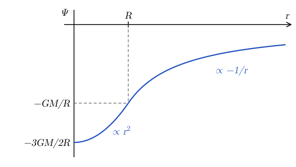
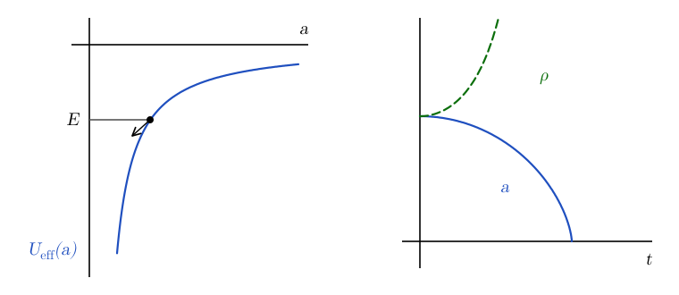

# The Gravitational Potential {#sec-grav}

## The gravitational potential {#sec-grav-potential}

In many astrophysical systems, gravity is the dominant force acting on the fluid. Gravity enters the Euler equation through the force density $\vb{f} = \rho \vb{g}$ (@eq-euler-general). In some cases, for example for the atmosphere of a planet, $\vb{g}$ is generated by an external body and can be considered as given. In other cases, for example for stars and molecular clouds, the gravitational field is generated by the fluid itself, so we need an additional equation relating $\vb{g}$ to the density. In this chapter, we discuss how to compute the gravitational field and the gravitational energy of a fluid.

According to Newtonian mechanics, the gravitational acceleration can be written as the gradient of the gravitational potential $\Psi$:
$$
\vb{g} = - \nabla \Psi .
$$ {#eq-grav-g-from-potential}
The potential can be interpreted as encoding the work needed to carry a particle of mass $m$ from the position $\vb{r}$ to infinity:
$$
\begin{aligned}
W_{\mathrm{ext}} &= - m \int_{\vb{r}}^{\infty} \vb{g} \cdot \dd \vb{\ell} = m \int_{\vb{r}}^{\infty} \nabla \Psi \cdot \dd \vb{\ell} \\
&= m [\Psi (\infty) - \Psi (\vb{r})] .
\end{aligned}
$$ {#eq-grav-work}
Note that the potential is unique only up to an additive constant, typically chosen so that $\Psi(\infty) = 0$. In this case, $W_{\mathrm{ext}} = -m \Psi(\vb{r})$.

::: {.callout-tip icon=false}
## Example

The potential of a point mass $M$ is
$$
\Psi = - \frac{GM}{r} .
$$ {#eq-grav-point-mass}
Its gradient is
$$
\nabla \Psi = \frac{GM}{r^2} \nabla r = \frac{GM}{r^3} \vb{r} = \frac{GM}{r^2} \hat{\vb{r}} = - \vb{g},
$$ {#eq-grav-point-mass-gradient}
where we have used
$$
\begin{aligned}
& r = (x^2 + y^2 + z^2)^{1 / 2} \\
& \quad \Longrightarrow \frac{\partial r}{\partial x} = \frac{1}{2} \frac{2 x}{(x^2 + y^2 + z^2)^{1 / 2}} = \frac{x}{r} \\
& \quad \Longrightarrow \nabla r = \frac{1}{r} (x, y, z) = \frac{\vb{r}}{r} = \hat{\vb{r}} .
\end{aligned}
$$ {#eq-grav-grad-r}
:::

::: {.callout-tip icon=false}
## Example

The gravitational potential generated by $N$ point particles with masses $m_i$ at positions $\vb{r}_i$ is
$$
\begin{aligned}
& \Psi = - \sum_{i = 1}^N \frac{G m_i}{| \vb{r} - \vb{r}_i |} \\
& \quad \Longrightarrow \vb{g} = - \sum_{i = 1}^N \frac{G m_i}{| \vb{r} - \vb{r}_i |^3} (\vb{r} - \vb{r}_i) .
\end{aligned}
$$ {#eq-grav-point-particles}
:::

## Poisson equation {#sec-grav-poisson}

The gravitational potential is related to the mass density by the Poisson equation:
$$
\boxed{\nabla^2 \Psi = 4 \pi G \rho .}
$$ {#eq-grav-poisson}
See @clarke2007 for a derivation, or @griffiths2023 [Secs. 2.2–2.3] for the derivation of the analogous equation for the electrostatic potential.

In other words, mass is the source of the gravitational potential. @eq-grav-poisson has to be solved together with a boundary condition, typically $\Psi (\infty) = 0$. Note the difference in sign compared to the equation for the electrostatic potential, $\nabla^2 \Phi = - q / \epsilon_0$, where $q$ is the charge density. This makes sense, because charges with the same sign repel each other, while masses attract each other.

This difference in sign has very important consequences. Since $\rho \geq 0$, @eq-grav-poisson implies that $\nabla^2 \Psi \geq 0$, so $\Psi$ can have a minimum wherever there is mass. For example, the center of a uniform sphere is a minimum of the potential (@fig-grav-uniform-sphere). In other words, matter is attracted towards regions where there is more matter, and *a self-gravitating fluid can hold itself together*. If gravity is balanced by pressure, the fluid can be in equilibrium, as is the case for stars, and we will see in @sec-hydro that this equilibrium is stable if $\Gamma > 4 / 3$. The situation is very different in electrostatics. In a region filled with positive charge, $q > 0$, the potential satisfies $\nabla^2 \Phi < 0$, so $\Phi$ can have a maximum, but not a minimum. A positive charge is pushed away from regions with more positive charge, and a cloud of charges with the same sign cannot hold itself together: it disperses, unless it is confined by some other force. Note that in empty space $\nabla^2 \Psi = 0$, so $\Psi$ cannot have a minimum there either. A test mass cannot be in stable equilibrium in vacuum, which is the gravitational analogue of Earnshaw's theorem in electrostatics.

### Gauss theorem

Consider a region $\Omega$ with boundary $\partial \Omega$. Integrating @eq-grav-poisson over $\Omega$ we find
$$
\int_{\Omega} \nabla^2 \Psi \dd V = 4 \pi G \int_{\Omega} \rho \dd V = 4 \pi G M,
$$ {#eq-grav-gauss-1}
where $M$ is the mass contained in $\Omega$. Using the divergence theorem,
$$
\int_{\Omega} \nabla \cdot [\nabla \Psi] \dd V = \oint_{\partial \Omega} \nabla \Psi \cdot \dd \vb{S} = 4 \pi G M,
$$ {#eq-grav-gauss-2}
so that
$$
\boxed{- \oint_{\partial \Omega} \vb{g} \cdot \dd \vb{S} = 4 \pi G M .}
$$ {#eq-grav-gauss}
Note that the flux of $\vb{g}$ through $\partial \Omega$ depends only on the mass enclosed in $\Omega$. This result is Gauss theorem for gravitation and is analogous to the Gauss law for electrostatics. As you may already know from electrostatics, the Gauss theorem is very useful to find the gravitational field for mass distributions that are symmetric.

::: {.callout-tip icon=false}
## Example

Consider a spherically symmetric mass distribution and take $\partial \Omega$ to be a sphere of radius $r$. By symmetry, $\vb{g} = - g \hat{\vb{r}}$, so
$$
- \oint_{\partial \Omega} \vb{g} \cdot \dd \vb{S} = 4 \pi r^2 g \Longrightarrow g = \frac{G M (r)}{r^2},
$$ {#eq-grav-gauss-sphere}
where $M (r)$ is the enclosed mass.
:::

::: {.callout-tip icon=false}
## Example

Consider a thin spherical shell of mass $M$ and radius $R$. For $r > R$, @eq-grav-gauss-sphere gives $g = G M / r^2$: the shell attracts external bodies as if all of its mass were concentrated at its center. For $r < R$, the enclosed mass is zero, so $g = 0$: a body inside the shell feels no gravitational force from it. These two results are known as Newton's shell theorems. Note that the potential inside the shell is not zero. Since $\vb{g} = - \nabla \Psi = 0$, the potential is constant, and it is equal to its value on the shell, $\Psi = - G M / R$.

Any spherically symmetric body can be thought of as a collection of concentric shells. The shells inside radius $r$ act as a point mass $M (r)$ at the center, while the shells outside radius $r$ do not contribute to $\vb{g}$. This is another way to derive @eq-grav-gauss-sphere.
:::

### Spherically symmetric bodies

For a spherically symmetric body, we can integrate the Poisson equation with the boundary condition $\Psi (\infty) = 0$:
$$
\begin{aligned}
& \frac{1}{r^2} \frac{\partial}{\partial r} \left( r^2 \frac{\partial \Psi}{\partial r} \right) = 4 \pi G \rho \\
& \quad \Longrightarrow \int_0^r \frac{\partial}{\partial x} \left( x^2 \frac{\partial \Psi}{\partial x} \right) \dd x = \int_0^r 4 \pi G \rho x^2 \dd x,
\end{aligned}
$$ {#eq-grav-poisson-spherical}
which gives
$$
r^2 \frac{\partial \Psi}{\partial r} = G M (r) .
$$ {#eq-grav-dpsi-dr}
Here we have used the definition of the enclosed mass, $M (r) = \int_0^r 4 \pi \rho x^2 \dd x$, and the fact that $r^2 \partial \Psi / \partial r$ vanishes at $r = 0$, because the gravitational acceleration is finite at the center. Since $g = \partial \Psi / \partial r$, this is the same result we found with the Gauss theorem (@eq-grav-gauss-sphere).
Integrating again, from $r$ to infinity, and using $\Psi (\infty) = 0$, we obtain
$$
\Psi (r) = - \int_r^{\infty} \frac{G M (x)}{x^2} \dd x \neq - \frac{G M (r)}{r} .
$$ {#eq-grav-psi-spherical}
In words, it is not true that the potential depends only on the enclosed mass, when we are inside of a body. Of course, if $r \geq R$, then $M (x) = M = \mathrm{const}$ for all $x > r$ and we recover the same potential as for a point particle
$$
\Psi (r) = - \int_r^{\infty} \frac{G M}{x^2} \dd x = \frac{G M}{x} \bigg|_r^{\infty} = - \frac{G M}{r} .
$$ {#eq-grav-psi-outside}
The fact that the potential at radius $r$ depends on the mass at radii $x > r$ is often a source of confusion, because it appears to be contradicting Gauss theorem, which states that the flux of the gravitational acceleration through a closed surface depends only on the enclosed mass. However, there is no contradiction, because gravitational acceleration and potential measure different things. The potential is related to the amount of work needed to carry a parcel of matter to infinity, so it necessarily depends on the mass distribution everywhere. This distinction is particularly important when computing the gravitational binding energy.

## Gravitational binding energy {#sec-grav-binding}

The gravitational energy of a fluid element of mass $\rho \dd V$, that is, minus the work required to bring this fluid element to infinity, is $[\Psi (\vb{r}) - \Psi (\infty)] \rho \dd V = \Psi (\vb{r}) \rho \dd V$. As such, the gravitational energy of a mass of fluid in a potential well with *prescribed* potential $\Psi_{\mathrm{ext}}$, that is, minus the work necessary to transport it to infinity, is
$$
W = \int \rho \Psi_{\mathrm{ext}} \dd V.
$$ {#eq-grav-binding-energy-ext-potential}
However, in the case in which the potential is generated by the fluid itself, that is if the fluid is self-gravitating, the gravitational energy $W$ has an additional factor $1 / 2$:
$$
W = \frac{1}{2} \int \rho \Psi \dd V .
$$ {#eq-grav-binding-energy-1}
The origin of the factor $1 / 2$ is explained by the following example.

::: {.callout-tip icon=false}
## Example

Consider two point particles of mass $m$, $A$ at $x = a$ and $B$ at $x = - a$. The potential is
$$
\Psi = - \frac{G m}{| \vb{r} - a \hat{\vb{x}} |} - \frac{G m}{| \vb{r} + a \hat{\vb{x}} |} .
$$ {#eq-grav-two-particles}
The work done to carry $A$ to infinity along the $x$-axis, in the field of $B$, is
$$
\begin{aligned}
W_{\mathrm{ext}, A} &= - m \int_{\vb{r}_A}^{\infty} \vb{g} \cdot \dd \vb{\ell} = \int_a^{\infty} \frac{G m^2}{| x + a |^2} \dd x \\
&= \frac{G m^2}{2 a} = - m \Psi_B (\vb{r}_A),
\end{aligned}
$$ {#eq-grav-work-a}
where $\Psi_B$ is the potential generated by $B$. Similarly, $W_{\mathrm{ext}, B} = - m \Psi_A (\vb{r}_B)$.

What is the total work needed to unbind the system? Once $A$ has been carried to infinity, $B$ is free, so the work needed is only $W_{\mathrm{ext}, A} = (W_{\mathrm{ext}, A} + W_{\mathrm{ext}, B}) / 2$. The gravitational energy of the system is then
$$
W = - W_{\mathrm{ext}, A} = - \frac{1}{2} (W_{\mathrm{ext}, A} + W_{\mathrm{ext}, B}) = - \frac{G m^2}{2 a} .
$$ {#eq-grav-two-particles-energy}
:::

Generalizing the previous example to a system of $N$ particles with masses $\{ m_j \}$, we have
$$
W = - \frac{1}{2} \sum_{i \neq j} \frac{G m_i m_j}{| \vb{r}_i - \vb{r}_j |} 
= - \frac{1}{2} \sum_{i \neq j} \underbrace{\rho_i \dd V_i}_{\rho \dd V} \underbrace{\frac{G m_j}{| \vb{r}_i - \vb{r}_j |}}_{- \Psi} .
$$ {#eq-grav-binding-pairs}
In the continuum limit, the masses $m_j$ are replaced by a mass density $\rho$ and the summation becomes an integral:
$$
\boxed{W = \frac{1}{2} \int_V \rho (\vb{r}) \Psi (\vb{r}) \dd V .}
$$ {#eq-grav-binding-energy}
The quantity $- W > 0$ is called the gravitational binding energy, because it is the energy that has to be supplied to the system to disperse all of its mass to infinity. We will encounter $W$ again in @sec-hydro, when we discuss the virial theorem.

::: {.callout-tip icon=false}
## Example

Consider a sphere of mass $M$, radius $R$, and constant density $\rho$. What is the value of the gravitational potential $\Psi$?

From @eq-grav-psi-spherical, for $r \geq R$
$$
\Psi (r) = - \int_r^{\infty} \frac{G M (x)}{x^2} \dd x = - \frac{G M}{r},
$$ {#eq-grav-sphere-psi-outside}
while for $r < R$
$$
\Psi (r) = - \int_r^R \frac{G M (x)}{x^2} \dd x - \int_R^{\infty} \frac{G M}{x^2} \dd x .
$$ {#eq-grav-sphere-psi-inside}
The last integral is equal to $G M / R$. Inside the sphere $M (x) = \frac{4}{3} \pi \rho x^3$, so
$$
- \int_r^R \frac{4}{3} \pi G \rho x \dd x = - \frac{1}{2} \left[ \frac{4}{3} \pi G \rho x^2 \right]_r^R = \frac{G M (r)}{2 r} - \frac{G M}{2 R} .
$$ {#eq-grav-sphere-inner-integral}
So, for $r < R$,
$$
\boxed{\Psi (r) = - \frac{3 G M}{2 R} + \frac{G M (r)}{2 r} .}
$$ {#eq-grav-sphere-psi}
This potential is shown in @fig-grav-uniform-sphere. Note that $\partial \Psi / \partial r = 0$ at the center, so that $g = 0$ there. This makes sense, because at the center the attraction of the mass in all directions cancels out. Also note that both $\Psi$ and $g = G M (r) / r^2$ are continuous at $r = R$, even if the density jumps from $\rho$ to zero there.

{#fig-grav-uniform-sphere fig-alt="The potential Psi as a function of r. It starts at minus 3 G M over 2 R at the center, grows like r squared inside the sphere, reaches minus G M over R at r = R, and then approaches zero like minus one over r outside."}

The gravitational energy is
$$
\begin{aligned}
W &= 2 \pi \int_0^R \rho (r) \Psi (r) r^2 \dd r \\
&= 2 \pi \int_0^R \left[ - \frac{3 G M}{2 R} \rho r^2 + \frac{1}{2} \frac{4}{3} \pi G \rho^2 r^4 \right] \dd r \\
&= - \frac{G M}{R} \pi \rho R^3 + \frac{1}{10} (2 \pi) \left( \frac{4}{3} \pi \right) G \rho^2 R^5 \\
&= - \frac{3}{4} \frac{G M^2}{R} + \frac{3}{20} \left( \frac{4 \pi}{3} \rho R^3 \right)^2 \frac{G}{R} \\
&= \frac{G M^2}{R} \left[ - \frac{3}{4} + \frac{3}{20} \right] = - \frac{G M^2}{R} \left[ \frac{15 - 3}{20} \right] \\
&= - \frac{G M^2}{R} \frac{3 \cdot 4}{5 \cdot 4} = - \frac{3 G M^2}{5 R},
\end{aligned}
$$ {#eq-grav-sphere-binding}
where we have used $2 \pi = \frac{4}{3} \pi \cdot \frac{3}{2}$. We would have gotten the wrong result without the factor $1 / 2$!
:::

## In-class worksheet {#sec-grav-worksheet}

1.  **Gravitational binding energy.**

    1.  Consider a spherically-symmetric body of mass $M$ and radius $R$. How much work $\dd W$ is required to carry the outer shell of mass $m = 4 \pi \rho R^2 \dd \ell$ to infinity?

    2.  Show that the gravitational binding energy of a spherical body with constant density, mass $M$ and radius $R$ is
        $$
        W = - \frac{3 GM^2}{5 R} .
        $$ {#eq-grav-28}

    3.  The iron core of a massive star, with mass $M = 1.4\,M_{\odot}$ and radius $R \approx 5000\,\mathrm{km}$, collapses to form a protoneutron star with a radius $R \approx 10\,\mathrm{km}$. How much gravitational energy is liberated in the process?

## Exercises {#sec-grav-exercises}

::: {#exr-grav-homologous}
## Homologous collapse and the Friedmann equation

A homogeneous gas sphere is collapsing under its self-gravity. Assume the velocity to be given by
$$
\vb{v} (t, \vb{r}) = H (t) \vb{r},
$$ {#eq-grav-29}
where $\vb{r}$ is the displacement of the fluid element from the center of the cloud.

1.  Argue that the density remains constant throughout the sphere (although it is changing with time) and show that the momentum equation implies
    $$
    \dot{H} (t) + H (t)^2 = - \frac{4 \pi G \rho (t)}{3} .
    $$ {#eq-grav-30}
    Assume the gas to be described by a barotropic EOS $p = p (\rho)$.

2.  Introduce the scale factor $a (t)$ defined so that
    $$
    \frac{\dot{a} (t)}{a (t)} = H (t) .
    $$ {#eq-grav-31}
    Show that
    $$
    \frac{\dd}{\dd t} \left( H^2 a^2 - \frac{8 \pi}{3} G \rho a^2
    \right) = 2 Ha^2  \left( \dot{H} + H^2 + \frac{4 \pi G}{3} \rho \right)
    = 0
    $$ {#eq-grav-32}
    and show that this implies that the dynamics is described by Friedmann equation
    $$
    \dot{a} (t)^2 - \frac{8 \pi G \rho (t)}{3} a (t)^2 = - k,
    $$ {#eq-grav-33}
    where $k$ is a constant of motion.

3.  Show that $\rho (t) \propto a (t)^{- 3}$ using the continuity equation. Use this to cast the Friedmann equation into the equation of a particle rolling down an effective potential
    $$
    \frac{1}{2}  \dot{a} (t)^2 + U_{\mathrm{eff}} (a) =\mathcal{E}.
    $$ {#eq-grav-34}
    Sketch a graph for $\rho (t)$ and $a (t)$ as a function of time.
:::

::: {.content-visible when-profile="solutions"}
::: {.solution}
1.  The continuity equation reads
    $$
    \frac{1}{\rho}  \frac{\dd \rho}{\dd t} = - \nabla \cdot \vb{v}=
    - 3 H (t) \Longrightarrow \frac{\dot{\rho}}{\rho} = - 3 H (t),
    $$
    so if $\rho = \mathrm{const}$ at the initial time it remains constant at all times (the RHS does not depend on the position).

    The momentum equation reads
    $$
    \frac{\dd \vb{v}}{\dd t} = - \frac{GM (r)}{r^2}
    \hat{\vb{r}},
    $$
    note that the pressure gradient vanishes because
    $$
    \nabla p = \frac{\dd p}{\dd \rho} \nabla \rho = 0.
    $$
    The term on the RHS can be simplified as
    $$
    M (r) = \frac{4}{3} \pi \rho r^3 \Longrightarrow
    \frac{GM (r)}{r^2} \hat{\vb{r}} = \frac{4}{3} \pi G \rho r
    \hat{\vb{r}} = \frac{4}{3} \pi G \rho \vb{r}.
    $$
    The LHS of the momentum equation reads
    $$
    \frac{\dd}{\dd t}  [H (t) \vb{r}] = \dot{H} (t) \vb{r}+ H
    (t)  \dot{\vb{r}} = \dot{H} (t) \vb{r}+ H (t) \vb{v}=
    [\dot{H} (t) + H^2 (t)] \vb{r}.
    $$
    Combining everything, we find that
    $$
    \dot{H} (t) + H^2 (t) = - \frac{4 \pi G \rho (t)}{3} .
    $$

2.  The derivative
    $$
    \begin{alignedat}{2}
    \frac{\dd}{\dd t} \left( H^2 a^2 - \frac{8 \pi}{3} G \rho a^2
    \right) &{}={} && 2 H \dot{H} a^2 + 2 H^2  \dot{a} a - \frac{8 \pi}{3} G
    \dot{\rho} a^2 - \frac{16 \pi}{3} G \rho a \dot{a} \\
    &{}={} && 2 Ha^2  \left( \dot{H} + H^2 + \frac{4 \pi G}{3} \rho \right) = 0.
    \end{alignedat}
    $$
    This implies that
    $$
    H^2 - \frac{8 \pi G \rho}{3} = - \frac{k}{a^2} .
    $$
    Multiplying both terms by $a^2$ and using the definition of the scale factor, we find
    $$
    \dot{a}^2 - \frac{8 \pi G \rho}{3} a^2 = - k.
    $$

3.  The continuity equation can be written in terms of the scale factor as
    $$
    \frac{\dot{\rho}}{\rho} = - 3 \frac{\dot{a}}{a} \Longrightarrow
    \frac{\dd \rho}{\rho} = - 3 \frac{\dd a}{a} \Longrightarrow \rho =
    \rho_0 \left( \frac{a_0}{a} \right)^3 .
    $$
    Inserting this into Friedmann equation we find
    $$
    \dot{a}^2 - \frac{8 \pi G \rho_0 a_0^3}{3}  \frac{1}{a} = - k.
    $$
    This equation can be written in the form
    $$
    \frac{1}{2}  \dot{a}^2 + U_{\mathrm{eff}} (a) =\mathcal{E}= - \frac{k}{2},
    \qquad U_{\mathrm{eff}} (a) = - \frac{4 \pi G \rho_0 a_0^3}{3}  \frac{1}{a}
    \sim - \frac{1}{a} .
    $$

    {#fig-grav-homologous fig-alt="Left: the effective potential U_eff(a), proportional to minus 1/a, rising towards zero as a grows, with the horizontal line of constant energy E below zero and an arrow showing the point moving to smaller a. Right: the scale factor a decreases to zero in a finite time while the density rho grows without bound."}
:::
:::

::: {#exr-grav-free-fall}
## Free fall onto a point mass and a uniform sphere

A particle is released from rest at a distance $R_0$ from the centre of a body of mass $M$. In each of the two cases listed below, find

1.  the initial acceleration of the particle, and

2.  the time the particle takes to fall to the centre.

The two cases are:

1.  the body is a point mass;

2.  the body is a uniform sphere of radius $R_0$.

Adapted from @clarke2007, Problem 9.
:::

::: {.content-visible when-profile="solutions"}
::: {.solution}
The initial acceleration is the same in both cases and equal to $- GM / R^2_0$.

1.  We can find the time to infall using separation of variables:
    $$
    \frac{\dd r}{\dd t} = v (r) \Longrightarrow T = \int_{R_0}^0
    \frac{\dd r}{v (r)} = - \int_0^{R_0} \frac{\dd r}{v (r)}
    $$
    where $v (r)$ is given by conservation of energy:
    $$
    v (r) = - \sqrt{\frac{2 GM}{r} - \frac{2 GM}{R_0}} = - \sqrt{2 GM \left(
    \frac{R_0 - r}{rR_0} \right)} .
    $$
    The integral can be evaluated to give
    $$
    T = \int_0^{R_0} \sqrt{\frac{rR_0}{2 GM (R_0 - r)}} \dd r = \sqrt{\frac{R_0^3}{2
    GM}}  \int_0^1 \sqrt{\frac{\xi}{1 - \xi}} \dd \xi = \frac{\pi}{2
    \sqrt{2}}  \sqrt{\frac{R_0^3}{GM}} .
    $$
    The last integral was evaluated using the change of variables $\xi = \cos^2 \theta$, which gives
    $$
    \int_0^1 \sqrt{\frac{\xi}{1 - \xi}} \dd \xi = 2 \int_0^{\pi / 2}
    \cos^2 \theta \dd \theta = \frac{\pi}{2} .
    $$

2.  In this case, the acceleration is given by the enclosed mass:
    $$
    \frac{\dd^2 r}{\dd t^2} = - \frac{GM (r)}{r^2} = - \frac{GM}{R_0^3}
    r.
    $$
    In the previous equation we have used
    $$
    M (r) = M \left( \frac{r}{R_0} \right)^3 .
    $$
    The solution is in the form
    $$
    r (t) = R_0 \cos \left( \frac{\pi t}{2 T} \right) .
    $$
    Plugging this into the differential equation and solving for $T$ gives
    $$
    T = \frac{\pi}{2}  \sqrt{\frac{R_0^3}{GM}} .
    $$
    This is a factor $\sqrt{2}$ longer time than for the case in which the mass is concentrated in a point, as could have been expected.
:::
:::

::: {#exr-grav-cluster-collapse}
## Collapse of a stellar cluster

A cluster consists initially of stars at rest, distributed in a uniform sphere. Find how long it takes a star to reach the center as a function of its initial radius in the cluster and comment on your results.
:::

::: {.content-visible when-profile="solutions"}
::: {.solution}
Consider a cluster of stars with initial radius $R$ and mass $M$ and star at initial position $r (0) = R_0$. As all the stars are infalling towards the center, the mass enclosed by a sphere of radius $r (t)$ remains constant for all times and is equal to
$$
M_0 = M \left( \frac{R_0}{R} \right)^3
$$
To find the time needed for the star to arrive at the center, we can use the free-fall time of the point-mass case in @exr-grav-free-fall, with $M$ replaced by $M_0$, to find
$$
T = \pi \sqrt{\frac{R^3}{8 GM}} .
$$
Note that all the stars arrive at the center at the same time, independently of their initial radius. Perhaps, this should not surprise us, because we have already solved this problem in a slightly different form in @exr-grav-homologous (homologous collapse)!
:::
:::
## Further reading {#sec-grav-reading}

- @clarke2007, Chapter 3 (gravitation).
