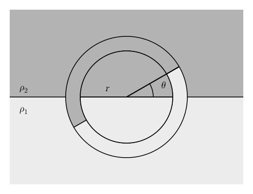

# Fluid Instabilities II: Rayleigh–Taylor and Kelvin–Helmholtz {#sec-rtkh}

::: {.callout-note}
This chapter is in preparation.
:::

## In-class worksheet {#sec-rtkh-worksheet}

1.  A heavy fluid with density $\rho_2$ is layered on top of a lighter fluid with density $\rho_1$ in a constant vertical gravitational field $g$ ($\rho_2 > \rho_1$). The system is perturbed by rotating a cylinder of fluid of radius $r$, as shown in @fig-rtkh-rotated-cylinder.

    {#fig-rtkh-rotated-cylinder fig-alt="A darker upper region (heavy fluid, density rho_2) lies above a lighter lower region (light fluid, density rho_1), separated by a horizontal line. A circular region of radius r is centred on the line; the heavy fluid fills its upper half and the light fluid its lower half. A thin ring around the circle has been rotated counterclockwise by an angle theta: heavy fluid has moved down on the left, light fluid has moved up on the right."}

    Assume that the fluid is incompressible and that the fluid ring rotates rigidly.

    1.  Derive an equation for $\ddot{\theta}$.

    2.  Show that the growth rate of the instability is
        $$
        \Gamma \sim \sqrt{\frac{Ag}{r}},
        $$ {#eq-rtkh-1}
        where $A$ is the Atwood number
        $$
        A = \frac{\rho_2 - \rho_1}{\rho_2 + \rho_1} .
        $$ {#eq-rtkh-2}

## Exercises {#sec-rtkh-exercises}

::: {#exr-rtkh-pipe}
## Instability in a pipe

A smooth pipe of square cross-section, with side $a$, lies on a horizontal surface in a uniform vertical gravitational field $g$. The pipe is filled with incompressible fluid: the upper half of the pipe contains fluid of density $\rho_1$ and the lower half contains fluid of density $\rho_0$, with $\rho_1 > \rho_0$.

1.  Name the instability that develops, and identify the energy source that powers it.

2.  Compute the energy $E_1$ per unit length of the pipe that is available to the instability.

Adapted from @clarke2007, Problem 41.
:::

::: {.content-visible when-profile="solutions"}
::: {.solution}
1.  The fluid in the pipe is unstable against the Rayleigh-Taylor instability.

2.  Before the instability sets in, the gravitational potential energy per unit length of the fluid in the pipe is
    $$
    E_{\operatorname{before}} = a \int_{- a / 2}^0 \rho_0 gz \dd z + a \int_0^{a /
    2} \rho_1 gz \dd z = \frac{a^3}{8}  (\rho_1 - \rho_0) g.
    $$
    The instability will exchange the heavy and light fluids, so the potential energy per unit length of the fluid once the flow has settled is
    $$
    E_{\operatorname{after}} = \frac{a^3}{8}  (\rho_0 - \rho_1) g.
    $$
    The total energy available to the instability per unit length is then
    $$
    E_1 = E_{\operatorname{before}} - E_{\operatorname{after}} = \frac{a^3}{4} (\rho_1 -
    \rho_0) g.
    $$
:::
:::

## Further reading {#sec-rtkh-reading}

- @clarke2007, Chapter 10 (fluid instabilities).
