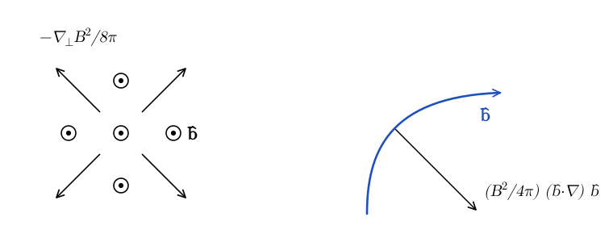
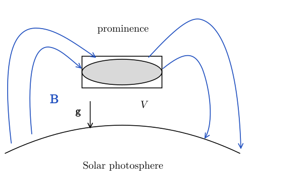
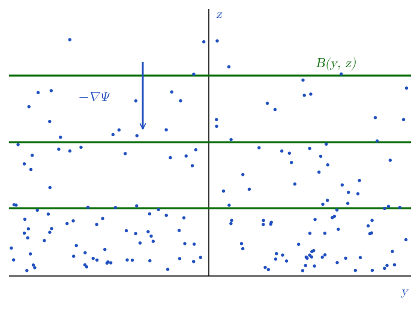
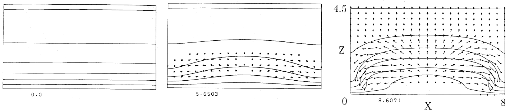
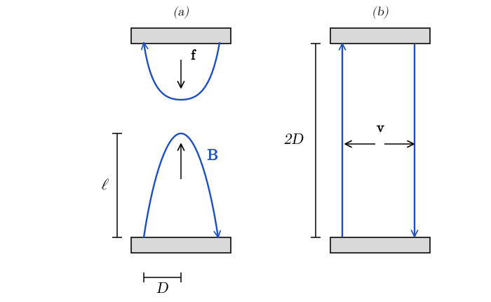

# Magnetic Tension and Hydromagnetic Equilibria {#sec-tension}

Up to now we have been primarily concerned with the consequences of the induction equation (Faraday's law). We have seen that, in the ideal-MHD limit, the magnetic field lines are frozen in the flow and explored some of the consequences of this fact. Now, we consider the feedback of the magnetic field on the plasma, that is the impact of the $\vb{j} \times \vb{B}$ term in the momentum equation.

## Magnetic Tension Force

A first somewhat obvious, but important remark is that the magnetic force $\vb{j} \times \vb{B}$ is always perpendicular to the magnetic field, as is obvious from the cross product. In other words, there is no impediment to the plasma flow along field lines. On the other hand, the field might resist or drive plasma motion perpendicular to the field lines. The latter, in turn, causes the field lines to move, in accordance with the induction equation. It is important to keep this in mind, because we are now going to rewrite the Lorentz force in a form in which this constraint is not manifest. Using the vector identity
$$
\nabla (\vb{A} \cdot \vb{B}) =\vb{A} \times (\nabla \times
\vb{B}) +\vb{B} \times (\nabla \times \vb{A}) + (\vb{A}
\cdot \nabla) \vb{B}+ (\vb{B} \cdot \nabla) \vb{A}
$$ {#eq-tension-1}
(see also @eq-mhd-curl-identity) and Ampère's law ($\mu_0 \vb{j}= \nabla \times \vb{B}$), we can rewrite the Lorentz force as
$$
\vb{j} \times \vb{B}= \frac{(\nabla \times \vb{B}) \times
\vb{B}}{\mu_0} = \frac{(\vb{B} \cdot \nabla) \vb{B}}{\mu_0} -
\nabla \frac{B^2}{2 \mu_0} .
$$ {#eq-tension-lorentz-force}
The second term is often improperly referred to as the magnetic pressure, because it is reminiscent of the $- \nabla p$ term in the momentum equation, while the first term is improperly referred to as magnetic tension. However, remember that magnetic pressure is only effective perpendicular to the field lines, as we have already remarked. To better understand the nature of the Lorentz force in MHD, we factor
$$
\vb{B}= B \hat{\vb{b}},
$$ {#eq-tension-3}
where $\hat{\vb{b}}$ is a unit vector. Accordingly, we can write
$$
\begin{aligned}
(\vb{B} \cdot \nabla) \vb{B} &= B (\hat{\vb{b}} \cdot \nabla)
(B \hat{\vb{b}}) \\
&= B^2  (\hat{\vb{b}} \cdot \nabla) \hat{\vb{b}}
+ B \hat{\vb{b}}  (\hat{\vb{b}} \cdot \nabla) B \\
&= B^2  (\hat{\vb{b}} \cdot \nabla)  \hat{\vb{b}} + \frac{1}{2}
\hat{\vb{b}}  (\hat{\vb{b}} \cdot \nabla) B^2 .
\end{aligned}
$$ {#eq-tension-4}
The last term on the RHS is, apart from a factor 1/2, the projection of $\nabla B^2$ parallel to $\vb{B}$:
$$
[\hat{\vb{b}}  (\hat{\vb{b}} \cdot \nabla) B^2]_i = \sum_{j = 1}^3
\hat{b}_i  \hat{b}_j \partial_j  (B^2) = [(\hat{\vb{b}} \otimes
\hat{\vb{b}}) \nabla (B^2)]_i =: \nabla_{\parallel} B^2 .
$$ {#eq-tension-5}
Plugging this back into @eq-tension-lorentz-force yields
$$
\vb{j} \times \vb{B}= \frac{B^2}{\mu_0}  (\hat{\vb{b}} \cdot
\nabla)  \hat{\vb{b}} - [\vb{I}- \hat{\vb{b}} \otimes
\hat{\vb{b}}]  \frac{\nabla B^2}{2 \mu_0} = \frac{B^2}{\mu_0}
(\hat{\vb{b}} \cdot \nabla)  \hat{\vb{b}} - \nabla_{\perp}
\frac{B^2}{2 \mu_0} .
$$ {#eq-tension-lorentz-force-decomposed}
The last term is the component of $\nabla (B^2 / 2 \mu_0)$ perpendicular to the field lines. This is the correct form of the magnetic pressure, while the first term on the RHS is the proper form of the magnetic tension.

We remark that $u_B = B^2 / 2 \mu_0$ is the energy density of the magnetic field, so the magnetic pressure is
$$
p_B = (\Gamma_B - 1) u_B,
$$ {#eq-tension-7}
which has the same form as the equation of state of an ideal gas (@eq-thermo-16), with an effective adiabatic index $\Gamma_B = 2$. This makes sense, because, if we compress a flux tube perpendicular to the field, flux freezing (@sec-flux) gives $B \propto \rho$, so $p_B \propto \rho^2$. For ionized hydrogen $\Gamma = 5 / 3$, so magnetic energy is more effective at resisting compression than gas internal energy. Of course, magnetic pressure can only resist compression perpendicular to the field lines.

To understand the meaning of the first term on the RHS of @eq-tension-lorentz-force-decomposed, note that
$$
(\hat{\vb{b}} \cdot \nabla)  \hat{\vb{b}} =\vb{\kappa},
$$ {#eq-tension-8}
where $1 / | \vb{\kappa} |$ is the curvature radius of the field lines and $\vb{\kappa}$ points towards the centre of curvature. In other words, $\vb{\kappa}= 0$ for straight field lines. For a circular field line, $1 / | \vb{\kappa} |$ is the radius of the circle spanned by the line. This means that the magnetic field lines back-react on the plasma as if they were elastic strings under a tension $B^2 / \mu_0$ per unit area.

Summarizing, we find that there are two components of the Lorentz force. The first is the magnetic pressure, according to which the magnetic field lines resist being bundled together. The second is the magnetic tension, according to which the magnetic field lines resist bending. This situation is illustrated in @fig-tension-pressure-tension. We will see that magnetic tension is the restoring force for Alfvén waves (@sec-mhdwaves) and the driver of the magnetorotational instability (@sec-mri).

{#fig-tension-pressure-tension fig-alt="Left panel: a bundle of field lines pointing out of the page, drawn as circled dots with unit vector b-hat; four arrows pointing diagonally outward show the magnetic pressure force, minus the perpendicular gradient of B squared over 2 mu-zero. Right panel: a curved field line in blue with direction b-hat; an arrow from the curve towards its centre of curvature shows the tension force B squared over mu-zero times (b-hat dot nabla) b-hat."}

As we have already anticipated (see @eq-mhd-23), the Lorentz force can be rewritten as the divergence of the magnetic stresses:
$$
\frac{(\vb{B} \cdot \nabla) \vb{B}}{\mu_0} - \nabla \frac{B^2}{2
\mu_0} = \nabla \cdot \left[ \frac{\vb{B} \otimes \vb{B}}{\mu_0} -
\frac{B^2}{2 \mu_0} \vb{I} \right] =: \nabla \cdot
\vb{T}_{\mathrm{EM}} .
$$ {#eq-tension-9}
This follows from @eq-mhd-bb-divergence. Including both the fluid stresses $\vb{T}$ and the magnetic stresses, the momentum equation reads:
$$
\rho \frac{\dd \vb{v}}{\dd t} = \nabla \cdot
[\vb{T}+\vb{T}_{\mathrm{EM}}] .
$$ {#eq-tension-10}
For an ideal fluid $\vb{T}= - p\vb{I}$, however shear and bulk viscosity can also be included in $\vb{T}$ to obtain the viscous MHD equations. In conservation form, the momentum equation reads
$$
\frac{\partial (\rho \vb{v})}{\partial t} + \nabla \cdot [\rho
\vb{v} \otimes \vb{v}-\vb{T}-\vb{T}_{\mathrm{EM}}] = 0,
$$ {#eq-tension-11}
where $\rho \vb{v} \otimes \vb{v}$ is the flux of momentum carried by the flow[^tension-1].

::: {.callout-tip icon=false}
## Example: Solar prominence

Solar prominences are plasma arches which rise above the solar photosphere and are supported by the magnetic tension, as illustrated by @fig-tension-prominence-photo and @fig-tension-prominence. Prominences are made of cool gas, $T \sim 10^4\,\mathrm{K}$, with densities $n \sim 10^{10}$–$10^{11}\,\mathrm{cm^{-3}}$, about 100 times denser than the surrounding corona, which has $T \sim 10^6\,\mathrm{K}$ and $n \sim 10^9\,\mathrm{cm^{-3}}$. The scale height of a gas at $10^4\,\mathrm{K}$ in the gravity of the Sun is only a few hundred km, while prominences extend for tens of thousands of km above the photosphere. So the gas pressure alone cannot support them against gravity.

); not covered by the license of these notes.](../figures/magnetic-tension/solar-prominence-nasa.jpg){#fig-tension-prominence-photo fig-alt="Ultraviolet image of the edge of the Sun, glowing orange, with a huge arch of bright plasma looping out from the surface into the dark sky. A small picture of the Earth is shown for scale; the arch is many times larger than the Earth."}

{#fig-tension-prominence fig-alt="A grey ellipse, the prominence, inside a rectangular control volume V above the curved solar photosphere. Blue magnetic field lines rise from the photosphere, arch over the prominence and come back down, entering the volume above and at the sides of the prominence. The gravitational acceleration g points down, towards the photosphere."}

To understand how prominences are supported against gravity, let us consider the balance of forces on the region in the volume $V$ with boundary surface $S$:
$$
\begin{aligned}
0 &= \frac{\dd}{\dd t} \int_V \rho \vb{v} \dd V \\
&= - \int_V \nabla \cdot [\rho \vb{v} \otimes
\vb{v}-\vb{T}-\vb{T}_{\mathrm{EM}}] \dd V \\
& \quad + \int_V \rho \vb{g} \dd V \\
&= - \int_S \rho \vb{v}\vb{v} \cdot \dd \vb{S} \\
& \quad - \int_S \left( p + \frac{B^2}{2 \mu_0} \right) \dd \vb{S} \\
& \quad + \int_S \frac{\vb{B}}{\mu_0} \vb{B} \cdot \dd \vb{S}+ \int_V \rho
\vb{g} \dd V.
\end{aligned}
$$ {#eq-tension-12}
For a prominence at rest, $\vb{v} = 0$ and the first term vanishes. Note that the field lines enter $V$ going down on the left and leave it going up on the right. In other words, the prominence sits in a dip of the field lines, like a weight on a hammock. The main force balancing gravity is the magnetic tension, arising from the $\vb{B}\vb{B} \cdot \dd \vb{S}$ term. On the left, $\vb{B}$ points into $V$, so $\vb{B} \cdot \dd \vb{S} < 0$ and the force is opposite to $\vb{B}$. Since $\vb{B}$ points down, the force points up. On the right, $\vb{B}$ points out of $V$, so $\vb{B} \cdot \dd \vb{S} > 0$ and the force is along $\vb{B}$, which also points up. The horizontal components cancel. The magnetic pressure, arising from the squeezing of the field lines below the prominence, also contributes, but is subdominant. We work out a simple model of this configuration in @exr-tension-prominence.

The attentive reader might have noticed that the term $\vb{B}\vb{B} \cdot \dd \vb{S}$ gives a force along $\vb{B}$, with magnitude $B^2 | \hat{\vb{b}} \cdot \dd \vb{S} | / \mu_0$. How can this be possible? We have seen that the magnetic force is always perpendicular to $\vb{B}$. The point is that this term represents the net force from the magnetic tension on the whole volume $V$, not the force at a specific point. In other words, we should not confuse the force on individual fluid elements, which is always perpendicular to $\vb{B}$, with the net force on a control volume, which can be in any direction.
:::

## Hydromagnetic Equilibria

Consider the hydrostatic equilibrium of a plane-parallel, magnetized atmosphere in a gravitational potential $\Psi (z)$, as illustrated in @fig-tension-atmosphere. This equilibrium configuration could be representative of the disk in a spiral galaxy, or of the photosphere of the Sun.

{#fig-tension-atmosphere fig-alt="Axes y (horizontal) and z (vertical). Three horizontal green lines represent the magnetic field B(y, z), parallel to the y axis. Blue dots represent the gas, which is denser at the bottom than at the top. A blue arrow pointing down is labelled minus nabla Psi, the direction of gravity."}

The force-balance equation for hydromagnetic equilibrium is
$$
- \nabla p - \rho \nabla \Psi + \frac{1}{\mu_0} (\nabla \times \vb{B})
\times \vb{B}= 0.
$$ {#eq-tension-13}
We will make two simplifying assumptions.

1.  The gas is isothermal, so $p = c_{\mathrm{iso}}^2 \rho$. This means that, in absence of magnetic fields,
    $$
    \rho (z) = \rho_0 \exp (- \Psi / c_{\mathrm{iso}}^2) .
    $$ {#eq-tension-14}

2.  We assume that the magnetic field is planar and does not depend on $x$, meaning that
    $$
    \vb{B}= B_y (y, z)  \hat{\vb{y}} + B_z (y, z)  \hat{\vb{z}} .
    $$ {#eq-tension-15}
    This means that there exists a vector potential $\vb{A}= A (y, z) \hat{\vb{x}}$ such that $\nabla \times \vb{A}=\vb{B}$. In particular,
    $$
    B_y = \partial_z A, \quad B_z = - \partial_y A \qquad \Longleftrightarrow
    \qquad \vb{B}= \nabla A \times \hat{\vb{x}} .
    $$ {#eq-tension-16}
    Note that $\vb{A} \perp \vb{B}$ and that the function $A (y, z)$ is constant along the field lines, because $\vb{B} \cdot \nabla A = 0$. So the isocontours of $A (y, z)$ are the field lines.

To compute the Lorentz force we use
$$
\nabla \times \vb{B}= \nabla \times (\nabla \times \vb{A}) = -
\nabla^2 \vb{A}+ \nabla (\nabla \cdot \vb{A}) = - \hat{\vb{x}}
\nabla^2 A
$$ {#eq-tension-17}
and
$$
(\nabla \times \vb{B}) \times \vb{B}= - (\nabla^2 A)
\hat{\vb{x}} \times (- \hat{\vb{x}} \times \nabla A) = - (\nabla^2
A) \nabla A.
$$ {#eq-tension-18}
For reasons that will be more clear later, we rewrite
$$
\nabla p + \rho \nabla \Psi = \ee^{- \Psi / c_{\mathrm{iso}}^2} \nabla q, \qquad q = p\,\ee^{\Psi
/ c_{\mathrm{iso}}^2} .
$$ {#eq-tension-19}
The force equation finally reduces to
$$
\boxed{- \frac{1}{\mu_0} (\nabla^2 A) \nabla A = \ee^{- \Psi / c_{\mathrm{iso}}^2} \nabla
q.}
$$ {#eq-tension-20}
The last equation shows that $\nabla q \parallel \nabla A$, which means that $q = q (A)$. Since $\nabla q = (\dd q / \dd A) \nabla A$, the force equation becomes
$$
\nabla^2 A = - \mu_0 \ee^{- \Psi / c_{\mathrm{iso}}^2} \frac{\dd q}{\dd A} .
$$ {#eq-tension-grad-shafranov}
This is a nonlinear Poisson equation for $A$, analogous to the Grad–Shafranov equation used to model the magnetic equilibria of tokamaks and of pulsar magnetospheres. One can then find equilibrium configurations by specifying $q = q (A)$, which encodes the amount of matter enclosed by the field lines $A$ and $A + \dd A$, and solving @eq-tension-grad-shafranov for $A$. We shall not follow this line of reasoning here, instead we will make two more simplifying assumptions, following @parker1966.

1.  We assume that the magnetic field lines are horizontal, $\vb{B}= B (z) \hat{\vb{y}}$.

2.  We assume that the ratio of magnetic to gas pressure is constant
    $$
    \frac{B^2}{2 \mu_0 p} = \alpha_0 .
    $$ {#eq-tension-22}

With these simplifications, the equation for equilibrium becomes
$$
(1 + \alpha_0)  \frac{\dd p}{\dd z} = - \frac{p}{c_{\mathrm{iso}}^2}  \frac{\dd
\Psi}{\dd z} .
$$ {#eq-tension-23}
Apart from the additional factor $1 + \alpha_0$, this is the usual equation for hydrostatic equilibrium of a plane-parallel isothermal atmosphere (@eq-strat-2). The solution is
$$
\begin{gathered}
p (z) = p_0 \exp \left( - \frac{\Psi (z)}{(1 + \alpha_0) c_{\mathrm{iso}}^2} \right),
\\ B (z) = B_0 \exp \left( - \frac{\Psi (z)}{2 (1 + \alpha_0) c_{\mathrm{iso}}^2}
\right) .
\end{gathered}
$$ {#eq-tension-24}
For a uniform gravitational field, $\Psi = g z$, the scale height of the gas is $H = (1 + \alpha_0) c_{\mathrm{iso}}^2 / g$. In other words, the magnetic field makes the atmosphere thicker, because part of the weight of the gas is supported by the magnetic pressure. The inverse of $\alpha_0$,
$$
\beta = \frac{2 \mu_0 p}{B^2},
$$ {#eq-tension-plasma-beta}
is called the *plasma beta*. Plasmas with $\beta \gg 1$ are dominated by the gas pressure, while plasmas with $\beta \ll 1$ are dominated by the magnetic field.

::: {.callout-tip icon=false}
## Example: Magnetic support of the Galactic disk

Consider the gas in the disk of the Milky Way near the Sun. The magnetic field is $B \approx 0.5\,\mathrm{nT}$ ($5\,\mu\mathrm{G}$), so the magnetic pressure is $B^2 / 2 \mu_0 \approx 1 \times 10^{-13}\,\mathrm{Pa}$. The thermal pressure of the gas is $p / k_B \approx 3000\,\mathrm{K\,cm^{-3}}$, that is $p \approx 4 \times 10^{-14}\,\mathrm{Pa}$. So $\alpha_0 \approx 2$, or $\beta \approx 0.4$. In other words, the magnetic field is as important as the gas pressure in supporting the disk against the gravity of the stars[^tension-2]. In the model of @eq-tension-24, the field increases the scale height of the gas by a factor $1 + \alpha_0 \approx 3$.
:::

Remarkably, the solution in @eq-tension-24 turns out to be unstable for any $\alpha_0 > 0$ to long-wavelength perturbations, if the perturbations are also isothermal. This is the so-called *Parker instability* [@parker1966]. Note that, if the perturbations have adiabatic index $\Gamma$ and are allowed to vary across the field lines, the atmosphere is unstable for $\Gamma < 1 + \alpha_0$ [@newcomb1961]. Without magnetic field, $\alpha_0 = 0$, this is the condition $N^2 < 0$ for the onset of convection in an isothermal atmosphere (@sec-strat-gravity). In other words, an isothermal atmosphere is marginally stable to isothermal perturbations, $N = 0$, and the magnetic field makes it unstable. The Parker instability is demonstrated in the MHD simulations shown in @fig-tension-parker.

{#fig-tension-parker fig-alt="Three panels showing horizontal magnetic field lines in a vertical slice of a stratified atmosphere at three times. In the first panel the field lines are straight and horizontal. In the second they start to bend, rising in the middle. In the third they form a large arch, with velocity arrows showing gas sliding down along the field lines into the valleys on either side."}

Imagine starting from horizontal field lines, like in the left panel of the figure, and adding a small bend to them. The gas in the regions where the field lines are inclined can now slide down along them, because the magnetic force has no component along the field. In doing so, the gas loses gravitational potential energy and collects in the valleys, as shown by the arrows in the middle panel. The crests of the field lines are now lighter, so they are pushed further up by the magnetic pressure below them, the gas drains more efficiently, and the perturbation grows. This instability is responsible, for example, for the emergence of magnetic flux tubes from the solar interior, which gives rise to the type of prominence we have discussed previously.

In the case of the solar corona, the field lines at the foot of the prominences are anchored in the outer convection layers of the Sun. The motion of plasma in this region moves the field lines in random ways and builds enormous tension in the field. When field lines of opposite polarities find themselves sufficiently close they can annihilate in a so-called *reconnection event*. This might seem in contradiction with flux freezing, since the magnetic Reynolds number in the corona is enormous (@sec-flux). However, reconnection takes place in thin current sheets, in which the field changes direction over a very short distance. The magnetic Reynolds number computed with this length is small, so the field lines can diffuse through the plasma. Reconnection suddenly releases the magnetic tension and generates solar flares and coronal mass ejections. Solar eruptions can significantly impact satellites and space communication and can be hazardous for astronauts. The prediction of solar eruptions using ground- and space-based observations, in conjunction with MHD simulations, is a field of its own: *space weather modeling*.

## In-class worksheet {#sec-tension-worksheet}

**Explosive Reconnection.** Plasma is contained in a region bounded by two perfectly conducting plates. Two magnetic flux tubes are anchored on the plates and stretched by the application of an external force $\vb{f}$ as shown in panel (a) of @fig-tension-reconnection.

{#fig-tension-reconnection fig-alt="Panel (a): two grey conducting plates, one above the other, a distance 2D apart. Two field lines B in blue are anchored on the plates and bowed towards each other, with height l; black arrows labelled f show the external force that stretches them, and the horizontal extent of each arc is D. Panel (b): after reconnection the field lines run straight between the plates, and arrows labelled v show the plasma moving outwards."}

When $\ell \approx D$, the field lines reconnect and snap to a new configuration shown in panel (b). This process releases energy stored in the magnetic tension of the field to accelerate the plasma to a velocity $\vb{v}$, which reaches a maximum when the field lines are perfectly straight. Assume that the ideal-MHD approximation holds at all times, except when reconnection takes place.

1.  Show that, apart from geometric factors of order unity, the force per unit volume necessary to hold the field lines bent to a height $\ell$ is
    $$
    | \vb{f} | \approx \frac{B^2}{\mu_0}  \frac{\ell}{D^2} .
    $$ {#eq-tension-ws1}

2.  Show that, apart from factors of order unity, the maximum velocity of the plasma after the reconnection event is
    $$
    v \approx v_A,
    $$ {#eq-tension-ws2}
    where $v_A$ is the Alfvén velocity
    $$
    v_A = \frac{B}{\sqrt{\mu_0 \rho}} .
    $$ {#eq-tension-ws3}

3.  Magnetic fields in solar active regions have strengths $B \sim 0.03\,\mathrm{T}$ ($300\,\mathrm{G}$) and extend over regions of size $L \sim 3 \times 10^4\,\mathrm{km}$. Estimate the magnetic energy available. Compare it with the energy released by a large solar flare, $\sim 10^{32}\,\mathrm{erg} = 10^{25}\,\mathrm{J}$.

## Exercises {#sec-tension-exercises}

::: {#exr-tension-prominence}
## A model for solar prominences

Consider the model of a solar prominence of @kippenhahn1957. The prominence is a vertical sheet of isothermal gas, with isothermal sound speed $c_{\mathrm{iso}}$ (@eq-sound-isothermal), in a uniform gravitational field $\vb{g} = - g \hat{\vb{z}}$. The magnetic field is
$$
\vb{B} = B_x \hat{\vb{x}} + B_z (x) \hat{\vb{z}},
$$ {#eq-tension-ks-field}
where $B_x$ is a constant, and all quantities depend only on $x$.

1.  Show that $\nabla \cdot \vb{B} = 0$ and that the horizontal component of the force balance gives
    $$
    p + \frac{B_z^2}{2 \mu_0} = \mathrm{const} .
    $$ {#eq-tension-ks-horizontal}

2.  Show that the vertical component of the force balance is
    $$
    \rho g = \frac{B_x}{\mu_0} \frac{\dd B_z}{\dd x} .
    $$ {#eq-tension-ks-vertical}
    Which component of the Lorentz force holds the gas up?

3.  Assume that $p \to 0$ and $B_z \to \pm B_{\infty}$ for $x \to \pm \infty$. Show that
    $$
    B_z = B_{\infty} \tanh (x / w), \qquad w = \frac{2 B_x}{B_{\infty}} \frac{c_{\mathrm{iso}}^2}{g},
    $$ {#eq-tension-ks-solution}
    and find $\rho (x)$. Sketch the field lines.

4.  Show that the mass per unit area of the sheet is
    $$
    \Sigma = \int_{- \infty}^{\infty} \rho \, \dd x = \frac{2 B_x B_{\infty}}{\mu_0 g} .
    $$ {#eq-tension-ks-mass}
    Evaluate $w$, the central number density $n (0)$ and $\Sigma$ for $B_x = 1\,\mathrm{mT}$ ($10\,\mathrm{G}$), $B_{\infty} = 0.2\,\mathrm{mT}$ ($2\,\mathrm{G}$), $T = 7000\,\mathrm{K}$, mean molecular weight $\mu = 0.6$, and $g = 270\,\mathrm{m\,s^{-2}}$. Compare with observed prominences, which have widths of a few thousand km and densities $n \sim 10^{10}$–$10^{11}\,\mathrm{cm^{-3}}$.
:::

::: {.content-visible when-profile="solutions"}
::: {.solution}
1.  We have $\nabla \cdot \vb{B} = \partial_x B_x + \partial_z B_z = 0$, because $B_x$ is constant and $B_z$ depends only on $x$. The force balance is
    $$
    - \nabla p + \rho \vb{g} + \frac{(\vb{B} \cdot \nabla) \vb{B}}{\mu_0} - \nabla \frac{B^2}{2 \mu_0} = 0 .
    $$
    The tension term is $(\vb{B} \cdot \nabla) \vb{B} = B_x \frac{\dd}{\dd x} (B_x \hat{\vb{x}} + B_z \hat{\vb{z}}) = B_x \frac{\dd B_z}{\dd x} \hat{\vb{z}}$, so it has no horizontal component. The $x$ component of the force balance is then $\frac{\dd}{\dd x} \left( p + \frac{B^2}{2 \mu_0} \right) = 0$. Since $B^2 = B_x^2 + B_z^2$ and $B_x$ is constant, this gives @eq-tension-ks-horizontal. In other words, the gas pressure and the magnetic pressure balance each other across the sheet.

2.  The $z$ component of the force balance is $- \rho g + \frac{B_x}{\mu_0} \frac{\dd B_z}{\dd x} = 0$, which is @eq-tension-ks-vertical. The magnetic pressure does not depend on $z$, so the gas is held up by the magnetic tension. This requires $\dd B_z / \dd x > 0$ (for $B_x > 0$), so the field lines go down on the left of the sheet and up on the right. In other words, the gas sits in a dip of the field lines.

3.  With $p \to 0$ and $B_z^2 \to B_{\infty}^2$ at infinity, @eq-tension-ks-horizontal gives $p = (B_{\infty}^2 - B_z^2) / 2 \mu_0$ and $\rho = p / c_{\mathrm{iso}}^2$. Substituting in @eq-tension-ks-vertical, we find
    $$
    \frac{\dd B_z}{\dd x} = \frac{g}{2 B_x c_{\mathrm{iso}}^2} (B_{\infty}^2 - B_z^2) .
    $$
    By symmetry, $B_z (0) = 0$. Separating the variables,
    $$
    \int_0^{B_z} \frac{\dd b}{B_{\infty}^2 - b^2} = \frac{1}{B_{\infty}} \mathrm{artanh} \frac{B_z}{B_{\infty}} = \frac{g x}{2 B_x c_{\mathrm{iso}}^2},
    $$
    which gives @eq-tension-ks-solution. The density is
    $$
    \rho (x) = \frac{B_{\infty}^2}{2 \mu_0 c_{\mathrm{iso}}^2} \frac{1}{\cosh^2 (x / w)} .
    $$
    The field lines satisfy $\dd z / \dd x = B_z / B_x = (B_{\infty} / B_x) \tanh (x / w)$, so
    $$
    z = \frac{B_{\infty} w}{B_x} \ln \cosh (x / w) = \frac{2 c_{\mathrm{iso}}^2}{g} \ln \cosh (x / w) .
    $$
    The field lines have the shape of a hammock. They are curved inside the sheet, $| x | \lesssim w$, and become straight lines with slope $\pm B_{\infty} / B_x$ outside of it.

4.  Integrating @eq-tension-ks-vertical,
    $$
    \Sigma = \frac{B_x}{\mu_0 g} [B_z]_{- \infty}^{\infty} = \frac{2 B_x B_{\infty}}{\mu_0 g} .
    $$
    In other words, the weight of the sheet per unit area, $\Sigma g$, is balanced by the jump of the magnetic stress $B_x B_z / \mu_0$ across the sheet. Note that the result does not depend on the temperature.

    For the given numbers, $c_{\mathrm{iso}}^2 = k_B T / \mu m_u \approx 9.7 \times 10^{7}\,\mathrm{m^2\,s^{-2}}$, so $c_{\mathrm{iso}}^2 / g \approx 360\,\mathrm{km}$ and $w = 10\, c_{\mathrm{iso}}^2 / g \approx 3600\,\mathrm{km}$. The central number density is
    $$
    n (0) = \frac{\rho (0)}{\mu m_u} = \frac{B_{\infty}^2}{2 \mu_0 k_B T} \approx 1.6 \times 10^{17}\,\mathrm{m^{-3}} = 1.6 \times 10^{11}\,\mathrm{cm^{-3}},
    $$
    and $\Sigma \approx 1.2 \times 10^{-3}\,\mathrm{kg\,m^{-2}} = 1.2 \times 10^{-4}\,\mathrm{g\,cm^{-2}}$, corresponding to a column density $\Sigma / \mu m_u \approx 1.2 \times 10^{20}\,\mathrm{cm^{-2}}$. Both the width and the density are close to those of observed prominences. So this simple model captures the essential physics of how prominences are supported.
:::
:::

## Further reading {#sec-tension-reading}

- @clarke2007, Chapter 13 (plasmas).

[^tension-1]: This term is not a real force. It appears only because we are writing the equations in the Eulerian frame.
[^tension-2]: The turbulent motions of the gas and the cosmic rays also contribute pressures of the same order, so in reality the disk is supported by all of these components together.
