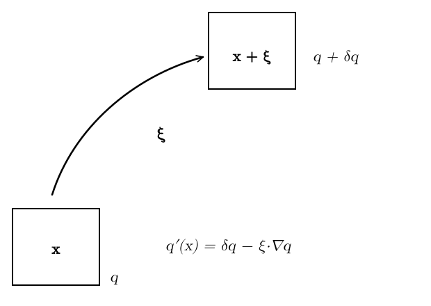
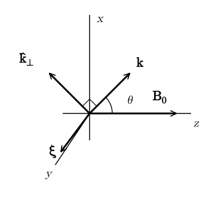
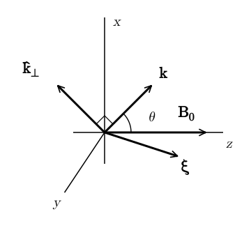
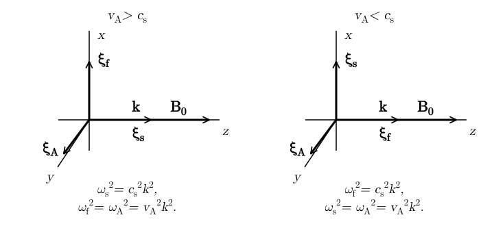
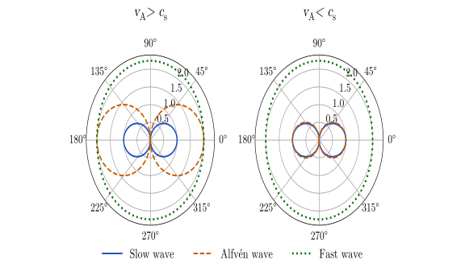
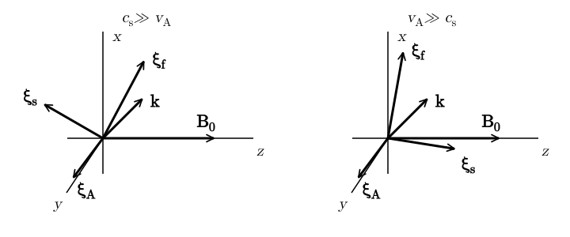
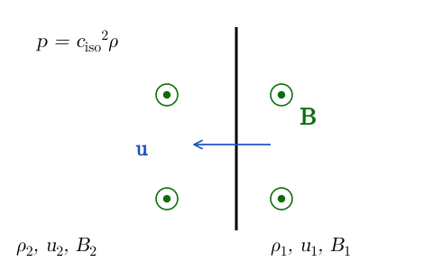

# MHD Waves {#sec-mhdwaves}

Waves play a very important role in the dynamics of magnetized plasmas. Particle-wave interaction with the interstellar medium regulates the propagation of cosmic rays in the galaxy. In strong MHD turbulence, the non-linear interaction between Alfvén waves acts as the main driver of the turbulence cascade. Torsional Alfvén waves extract angular momentum from proto-stellar cores allowing them to collapse and form stars. These are just a few examples. In these notes, we discuss the phenomenology of waves in compressible MHD.

## Waves in a Homogeneous Plasma

We consider a homogeneous plasma described by the ideal-MHD equations with
$$
\rho_0 = \operatorname{const}, \qquad \vb{v}_0 = 0, \qquad \vb{B}_0 = B_0
\hat{\vb{z}} .
$$ {#eq-mhdwaves-1}
We proceed in the same way as when we derived the dispersion relation for sound waves in unmagnetized media (@sec-sound). However, as we will see shortly, the phenomenology of MHD waves is significantly more complex than that of sound waves. As before, we introduce a perturbation with a Lagrangian displacement $\vb{\xi}$, shown in @fig-mhdwaves-lagrangian.

{#fig-mhdwaves-lagrangian fig-alt="A small square fluid element at position x, where a quantity has the value q, is displaced by the vector xi, drawn as a curved arrow, to the position x plus xi, where the quantity has the value q plus delta q. The Eulerian perturbation at x is q prime of x equals delta q minus xi dot nabla q."}

The pressure and density perturbations in the Lagrangian frame are
$$
\delta \rho = - \rho_0 \nabla \cdot \vb{\xi}, \qquad \delta p =
\frac{\Gamma p_0}{\rho_0} \delta \rho = - \Gamma p_0 \nabla \cdot
\vb{\xi}.
$$ {#eq-mhdwaves-2}
The magnetic field perturbations can be computed from the linearized induction equation:
$$
\frac{\partial \delta \vb{B}}{\partial t} = \nabla \times \left(
\frac{\partial \vb{\xi}}{\partial t} \times \vb{B}_0 \right)
\Longrightarrow \delta \vb{B}= \nabla \times (\vb{\xi} \times
\vb{B}_0) .
$$ {#eq-mhdwaves-3}
The linearized momentum equation becomes (note that the unperturbed current vanishes $\vb{j}_0 = 0$):
$$
\rho \frac{\dd \vb{v}}{\dd t} = - \nabla p +\vb{j} \times
\vb{B} \Longrightarrow \rho_0  \frac{\partial^2 \vb{\xi}}{\partial
t^2} = - \nabla \delta p + \delta \vb{j} \times \vb{B}_0 .
$$ {#eq-mhdwaves-4}
The perturbed current is
$$
\delta \vb{j}= \frac{1}{4 \pi} \nabla \times \delta \vb{B}=
\frac{1}{4 \pi} \nabla \times [\nabla \times (\vb{\xi} \times
\vb{B}_0)],
$$ {#eq-mhdwaves-5}
so putting everything together we get the oscillation equation
$$
\boxed{
\begin{aligned}
\rho_0  \frac{\partial^2 \vb{\xi}}{\partial t^2} = {} & \Gamma p_0
\nabla (\nabla \cdot \vb{\xi}) \\
& + \frac{1}{4 \pi} \{ \nabla \times
[\nabla \times (\vb{\xi} \times \vb{B}_0)] \} \times \vb{B}_0 .
\end{aligned}}
$$ {#eq-mhdwaves-6}
Of course, if $\vb{B}_0$=0, this equation reduces to the equation for sound waves. All the new physics is in the last term on the RHS. To derive a dispersion relation, we take the usual ansatz
$$
\vb{\xi} (t, \vb{x}) =\vb{\xi}_1 e^{\ii (\vb{k} \cdot
\vb{x}- \omega t)},
$$ {#eq-mhdwaves-7}
which we plug into the oscillation equation. This yields
$$
\begin{aligned}
- \rho_0 \omega^2 \vb{\xi}_1 = {} & - \Gamma p_0 \vb{k} (\vb{k} \cdot
\vb{\xi}_1) \\
& - \frac{1}{4 \pi}  \{ \vb{k} \times [\vb{k} \times
(\vb{\xi}_1 \times \vb{B}_0)] \} \times \vb{B}_0 .
\end{aligned}
$$ {#eq-mhdwaves-8}
As expected from the general perturbation theory, the oscillation equation give rise to an eigenvalue problem in the form
$$
- \rho_0 \omega^2 \vb{\xi}_1 =\vb{F} (\vb{k}) \vb{\xi}_1,
$$ {#eq-mhdwaves-eigenvalue-problem}
where $\vb{F} (\vb{k})$ is a matrix. This equation has solutions with $\vb{\xi}_1 \neq 0$ if and only if
$$
\det [\vb{F} (\vb{k}) + \rho_0 \omega^2 \vb{I}] = 0.
$$ {#eq-mhdwaves-10}
The last equation is defines the dispersion relation $\omega = \omega (\vb{k})$. The eigenvectors of $\vb{F} (\vb{k})$ define the polarization vector $\vb{\xi}_1$ of the wave.

## Families of MHD Waves

In general, there are three solutions to the eigenvalue problem @eq-mhdwaves-eigenvalue-problem, corresponding to three different modes. In the unmagnetized case, the three modes are degenerate (in a uniform medium), so we find only sound waves. In the magnetized case, there are always three types of waves: Alfvén waves, slow-, and fast-magnetosonic waves. We consider these separately below.

### Alfvén Waves

We consider at first the situation depicted in @fig-mhdwaves-alfven-geometry:

- $\vb{B}_0$ is along $z$

- $\vb{k}$ is in the $x z$-plane

- $\vb{\xi}$ is along $y$

Note that $\vb{k} \cdot \vb{\xi}= 0$, meaning that $\delta \rho = \delta p = 0$.

{#fig-mhdwaves-alfven-geometry fig-alt="Axes: x up, z to the right, y towards the lower left. The background field B0 lies along z. The wave vector k lies in the xz-plane at an angle theta from z; the unit vector k-perp is perpendicular to k in the same plane. The displacement xi points along y, perpendicular to both k and B0."}

To compute the Lorentz force we proceed as follows. First we note that
$$
\vb{\xi} \times \vb{B}_0 {= \xi_y}  B_0  \hat{\vb{x}} .
$$ {#eq-mhdwaves-11}
Next, we compute the magnetic field perturbation as
$$
\vb{k} \times (\vb{\xi} \times \vb{B}_0) = k \xi_y B_0 \cos
\theta \hat{\vb{y}} = \delta \vb{B}.
$$ {#eq-mhdwaves-12}
The current is given by
$$
\vb{k} \times [\vb{k} \times (\vb{\xi} \times \vb{B}_0)] = -
k^2 \xi_y B_0 \cos \theta \hat{\vb{k}}_{\perp} = 4 \pi \delta
\vb{j}.
$$ {#eq-mhdwaves-13}
Finally, the Lorentz force is
$$
4 \pi \delta \vb{j} \times \vb{B}_0 = k^2 B_0^2 \cos^2 \theta \xi_y
\hat{\vb{y}} = (\vb{k} \cdot \vb{B}_0)^2 \vb{\xi}.
$$ {#eq-mhdwaves-14}
So $\vb{\xi}$ evolves as a mass attached to an elastic spring with spring constant $(\vb{k} \cdot \vb{B}_0)^2$. In formulas,
$$
\begin{aligned}
- \rho_0 \omega^2 \xi_y &= \tfrac{1}{4 \pi} k^2 B_0^2 \cos^2 \theta \xi_y \\
\Longrightarrow \quad & \boxed{\omega = \pm \frac{B_0}{\sqrt{4 \pi \rho_0}} k
\cos \theta = kv_A \cos \theta .}
\end{aligned}
$$ {#eq-mhdwaves-15}
This type of waves are called Alfvén waves from Alfvén [-@alfven1942] (Physics Nobel Prize in 1970). Some comments are in order.

1.  If  $\theta = 0$, these waves propagate along the field lines with velocity (Alfvén velocity):
    $$
    v_A = \frac{B_0}{\sqrt{4 \pi \rho_0}} .
    $$ {#eq-mhdwaves-16}
    If $\theta > 0$, the waves can still propagate (as long as $\theta \neq 90^{\circ}$ or $270^{\circ}$), but at a reduced speed.

2.  The displacement $\vb{\xi}$ is perpendicular to the background field $\vb{B}_0$, so these waves are transverse. More precisely, Alfvén waves behave as transverse waves in an elastic string (the magnetic field). Indeed, the restoring force for these waves is magnetic tension.

3.  As already mentioned $\delta \rho = \delta p = 0$ for these waves. As such, Alfvén waves are incompressible and exist also in incompressible flows.

Although we have derived Alfvén waves as small perturbations, it turns out that Alfvén waves are an exact solution to the full non-linear equations. This means that MHD flows can support arbitrarily strong waves.

### Magnetosonic Waves

We consider at first the situation depicted in @fig-mhdwaves-magnetosonic-geometry:

- $\vb{B}_0$ is along $z$

- $\vb{k}$ is in the $x z$-plane

- $\vb{\xi}$ is also in the $x z$-plane

Note that $\delta p, \delta \rho$ are no longer necessarily zero.

{#fig-mhdwaves-magnetosonic-geometry fig-alt="Same axes as for the Alfvén wave: x up, z to the right, y towards the lower left, B0 along z, k in the xz-plane at an angle theta from z and k-perp perpendicular to it. The displacement xi now lies in the xz-plane, pointing slightly below the z axis."}

We can compute the current using the following vector identity
$$
\vb{a} \times (\vb{b} \times \vb{c}) =\vb{b} (\vb{a}
\cdot \vb{c}) -\vb{c} (\vb{a} \cdot \vb{b})
$$ {#eq-mhdwaves-17}
and the fact that $\vb{k} \perp \vb{\xi} \times \vb{B}_0$, since the latter is in the $y$-direction, we can write
$$
\vb{k} \times [\vb{k} \times (\vb{\xi} \times \vb{B}_0)]
=\vb{k} [\vb{k} \cdot (\vb{\xi} \times \vb{B}_0)] - k^2
(\vb{\xi} \times \vb{B}_0) = - k^2 (\vb{\xi} \times
\vb{B}_0) .
$$ {#eq-mhdwaves-18}
Plugging this into the expression for the Lorentz force gives
$$
\delta \vb{j} \times \vb{B}_0 = \frac{1}{4 \pi}  \{ \vb{k}
\times [\vb{k} \times (\vb{\xi} \times \vb{B}_0)] \} \times
\vb{B}_0 = - \frac{k^2}{4 \pi}  (\vb{\xi} \times \vb{B}_0)
\times \vb{B}_0 = - \frac{k^2 B_0^2 \xi_x}{4 \pi}  \hat{\vb{x}} .
$$ {#eq-mhdwaves-19}
The pressure force is
$$
- \Gamma p_0 \vb{k} (\vb{k} \cdot \vb{\xi}) = - k^2 \Gamma p_0
(\xi_x \sin \theta + \xi_z \cos \theta)  (\sin \theta \hat{\vb{x}} +
\cos \theta \hat{\vb{z}}) .
$$ {#eq-mhdwaves-20}
Using $c_s^2 = \Gamma p_0 / \rho_0$ and $v_A = B_0 / \sqrt{4 \pi \rho_0}$, we find
$$
\omega^2  \left(\begin{array}{c}
\xi_x\\
\xi_z
\end{array}\right) = k^2 \left(\begin{array}{cc}
c_s^2 \sin^2 \theta + v_A^2 & c_s^2 \sin \theta \cos \theta\\
c_s^2 \sin \theta \cos \theta & c_s^2 \cos^2 \theta
\end{array}\right) \left(\begin{array}{c}
\xi_x\\
\xi_z
\end{array}\right) .
$$ {#eq-mhdwaves-eigenvalue-magnetosonic}
The dispersion relation is (after a long calculation):
$$
\boxed{
\begin{aligned}
\left( \frac{\omega}{k} \right)^2 = {} & \frac{v_A^2 + c_s^2}{2} \\
& \pm \frac{1}{2} \sqrt{(v_A^2 - c_s^2)^2 + 4 c_s^2 v_A^2 \sin^2 \theta} .
\end{aligned}}
$$ {#eq-mhdwaves-22}
So there are two solutions and two corresponding polarization vectors $\vb{\xi}_s$ and $\vb{\xi}_f$. Note that $\vb{\xi}_s \perp \vb{\xi}_f$, since the matrix $\vb{F} (\vb{k})$ in @eq-mhdwaves-eigenvalue-magnetosonic is self-adjoint. Conventionally, $\vb{\xi}_s$ is taken to be the polarization corresponding to the smaller group velocity. This is the so-called slow magnetosonic wave. Conversely, $\vb{\xi}_f$ is called the fast magnetosonic wave. As we will see shortly, these have a mixed character of sound and magnetic waves.

## Effect of Propagation Direction

We can get additional insight into the nature of the three modes by considering the properties of waves propagating along the magnetic field lines, or perpendicular to them. The general case will turn out to be intermediate between these two limits.

### Parallel Propagating Waves ($\theta = 0$)

Let us consider the case of waves propagating along the background magnetic field lines, that is $\theta = 0$. In this case, the dispersion relation for Alfvén, slow, and fast modes are
$$
\left( \frac{\omega}{k} \right)^2 = v_A^2, \qquad \left( \frac{\omega}{k}
\right)^2 = \frac{1}{2}  [v_A^2 + c_s^2 \pm |v_A^2 - c_s^2 |] .
$$ {#eq-mhdwaves-23}
There are two different cases, depending on whether $v_A > c_s$ or $v_A < c_s$, shown in @fig-mhdwaves-parallel.

{#fig-mhdwaves-parallel fig-alt="Two panels with axes x up, z right and y to the lower left; B0 and k both lie along z. Left, for v_A greater than c_s: the fast mode is polarized along x, the slow mode along z and the Alfvén mode along y, with omega_s squared equal to c_s squared k squared and omega_f squared equal to omega_A squared equal to v_A squared. Right, for v_A less than c_s the fast and slow modes exchange polarizations: the slow mode is along x and the fast mode along z, with omega_f squared equal to c_s squared k squared and omega_s squared equal to omega_A squared equal to v_A squared."}

- If $v_A > c_s$, then

  - The slow mode polarization is along the magnetic field, the mode propagate at speed $c_s$ and its restoring force is pressure.

  - Fast and Alfvén modes are orthogonal to the magnetic field and to each other and both have the character of Alfvén waves propagating with speed $v_A$. Magnetic tension is their restoring force.

- If $v_A < c_s$, then the situation is similar as before, but slow and fast mode exchange character: the fast mode is now a sound wave, while the slow mode is an Alfvén wave.

### Perpendicularly Propagating Waves ($\theta = 90^{\circ}$)

Let us consider the case of waves propagating perpendicular to the field lines. In this case, Alfvén and slow modes cannot propagate (they have $\omega_{A, s} = 0$). The fast-magnetosonic wave satisfies the dispersion relation
$$
\left( \frac{\omega}{k} \right)^2 = v_A^2 + c_s^2 .
$$ {#eq-mhdwaves-24}
In this case $\vb{\xi}_f$ is parallel to $\vb{k}$. The restoring force for the mode is the sum of both magnetic tension and pressure, which explains why this mode is called the "magnetosonic" mode.

### Friedrichs Diagrams

Friedrichs diagrams show the propagation velocity of the different MHD modes as a function of a generic propagation angle $\theta$. The special cases of $\theta = 0, 90^{\circ}$ discussed above correspond to the $x$- and $y$-axis in @fig-mhdwaves-friedrichs. In general, slow and fast modes have a mixed character between sound waves and Alfvén waves.

{#fig-mhdwaves-friedrichs fig-alt="Two polar plots of the phase speeds of the slow (solid), Alfvén (dashed) and fast (dotted) modes as a function of the angle from the magnetic field (0 degrees to the right). Left, v_A greater than c_s: the fast mode is almost circular with radius about 2.2, the Alfvén mode is a pair of lobes reaching 2 along the field and the slow mode a pair of smaller lobes reaching 1. Right, v_A less than c_s: the fast mode is again almost circular, and the Alfvén and slow modes are two nearly identical lobes reaching 1 along the field."}

## Weak and Strong Field Limits

Finally, it is also instructive to compare slow- and fast-magnetosonic waves in the limits of weak magnetic field ($c_s \gg v_A$) and strong magnetic field $(v_A \gg c_s)$, as illustrated in @fig-mhdwaves-limits. Note that when $v_A$ becomes a sizable fraction of the speed of light, we can no longer use Newtonian MHD, because the displacement current becomes important. In this limit, one needs to use the (significantly more complex) equations of relativistic magnetohydrodynamics.

{#fig-mhdwaves-limits fig-alt="Two panels with axes x up, z right and y to the lower left, B0 along z and k in the xz-plane at 45 degrees from z. Left, weak field (c_s much larger than v_A): the fast displacement lies close to k, slightly steeper, and the slow displacement points up and to the left, nearly perpendicular to k. Right, strong field (v_A much larger than c_s): the fast displacement is close to the x axis, almost perpendicular to B0, and the slow displacement is nearly parallel to B0. In both panels the Alfvén displacement points along y."}

- *Left panel:* the fast mode is $\sim$ a sound wave and the slow mode is nearly perpendicular to $\vb{k}$.

- *Right panel:* the fast mode is $\sim$ an Alfvén wave and the slow mode is nearly parallel to $\vb{B}_0$.

## Shock Waves

As for non-magnetized gasses, MHD waves can steepen into shock waves. Alfvén waves can steepen into *rotational discontinuities*, in which the magnetic field direction suddenly changes across an interface. Slow- and fast-magnetosonic waves can give rise to (slow and fast) shocks and rarefaction waves. The theory of MHD shocks is very complex and beyond the scope of this course. A good overview is given in Bazer and Ericson [-@bazer1959]. It is important to be aware of that, even in the case of shocks propagating along magnetic field lines, MHD effects can be important. For example, hydrodynamics shocks can split into a slow and a fast shock, separated by a region in which a perpendicular component of the $B$-field is created. These are sometimes called *switch on* and *switch off* discontinuities.

We treat in detail only one case that is relevant for the interstellar medium: a shock propagating in an isothermal flow with perpendicular magnetic field, as illustrated in @fig-mhdwaves-shock.

{#fig-mhdwaves-shock fig-alt="A vertical line marks the shock. The gas ahead of it (right) has density rho1, velocity u1 and field B1; the gas behind it (left) has density rho2, velocity u2 and field B2. The magnetic field points out of the page on both sides, and the flow u moves leftwards through the shock. The gas is isothermal, p equals a squared rho."}

The shock conditions for the shock shown in @fig-mhdwaves-shock are:
$$
[\![ \rho u ]\!] = 0, \quad [\![ Bu ]\!] = 0,
\quad \left[\!\left[ p + \rho u^2 + \frac{B^2}{8 \pi} \right]\!\right]
= 0,
$$ {#eq-mhdwaves-25}
where $[\![ \cdot ]\!]$ denotes the jump across the shock.

We remind that, in the absence of a magnetic field, the compression factor of an isothermal shock is
$$
\frac{\rho_2}{\rho_1} = \left( \frac{u_1}{a} \right)^2,
$$ {#eq-mhdwaves-26}
which can become arbitrarily large for large upstream Mach numbers. This is dramatically different when a magnetic field is present, as long as it is sufficiently strong:
$$
u_1 \gg v_A = \frac{B_1}{\sqrt{4 \pi \rho_1}} \gg a.
$$ {#eq-mhdwaves-27}
In this case, from $[\![ \rho u ]\!] = [\![ Bu ]\!] = 0$, we conclude that
$$
\frac{B_1}{\rho_1} = \frac{B_2}{\rho_2} .
$$ {#eq-mhdwaves-28}
From the conservation of momentum, we have (using $u_1 \gg v_{A, 1} \gg a$)
$$
\begin{aligned}
\frac{\rho_2}{\rho_1} &= \frac{a^2 + u_1^2 + \frac{1}{2} v_A^2}{a^2 + u_2^2 +
\frac{B_2^2}{8 \pi \rho_2}} \\
&\approx \frac{u_1^2}{a^2 + u_2^2 +
\frac{B_2^2}{8 \pi \rho_2^2} \rho_2} \\
&= \frac{u_1^2}{a^2 + u_2^2 +
\frac{B_1^2}{8 \pi \rho_1}  \frac{\rho_2}{\rho_1}} \\
&\approx \frac{u_1^2}{\frac{v_A^2}{2}  \frac{\rho_2}{\rho_1}} .
\end{aligned}
$$ {#eq-mhdwaves-29}
Solving for $\rho_2 / \rho_1$, we obtain
$$
\boxed{\frac{\rho_2}{\rho_1} = \sqrt{2}  \frac{u_1}{v_A} .}
$$ {#eq-mhdwaves-30}
This shows that the compression ratio now scales with the Alfvénic Mach number, instead of the Mach number squared, of the upstream gas. This is another example showing that magnetic fields play an important role in the dynamics of the interstellar medium and in star formation.

## In-class worksheet {#sec-mhdwaves-worksheet}

**Fast Magnetosonic Waves.** Consider a homogeneous plasma described by the ideal-MHD equations with
$$
\rho_0 = \mathrm{const}, \qquad \vb{v}_0 = 0, \qquad \vb{B}_0 =
B_0  \hat{\vb{z}} .
$$ {#eq-mhdwaves-ws1}

1.  Introduce a small perturbation in the form of a displacement $\vb{\xi} (t, \vb{x})$ of the fluid elements and show that the oscillation equation is
    $$
    \begin{aligned}
    & \rho_0  \frac{\partial^2 \vb{\xi}}{\partial t^2} = \Gamma p_0 \nabla
    (\nabla \cdot \vb{\xi}) \\
    & \quad + \frac{1}{4 \pi} \{ \nabla \times [\nabla
    \times (\vb{\xi} \times \vb{B}_0)] \} \times \vb{B}_0 .
    \end{aligned}
    $$ {#eq-mhdwaves-two}

2.  Introduce the ansatz $\vb{\xi} (t, \vb{x}) = e^{\ii (\vb{k} \cdot \vb{x}- \omega t)}$ and show that @eq-mhdwaves-two reduces to
    $$
    \begin{aligned}
    & - \rho_0 \omega^2 \vb{\xi}_1 = - \Gamma p_0 \vb{k} (\vb{k}
    \cdot \vb{\xi}_1) \\
    & \quad - \frac{1}{4 \pi}  \{ \vb{k} \times
    [\vb{k} \times (\vb{\xi}_1 \times \vb{B}_0)] \} \times
    \vb{B}_0 .
    \end{aligned}
    $$ {#eq-mhdwaves-ws3}
    \[Hint. Use $\partial_t \rightarrow \ii \omega$ and $\nabla \rightarrow \ii \vb{k}$.\]

3.  Consider waves with $\vb{k} \parallel \hat{\vb{x}}$ and $\vb{\xi} \parallel \vb{k}$. Find the dispersion relation $\omega = \omega (\vb{k})$ and compute group and phase velocities for these waves.

## Exercises {#sec-mhdwaves-exercises}

::: {#exr-mhdwaves-torsional-alfven}
## Torsional Alfvén waves

1.  Show that in cylindrical coordinates the toroidal Alfvén wave
    $$
    \begin{aligned}
    \vb{v} &= \epsilon v_A g (R) f (z - v_A t)  \hat{\vb{\phi}}, \\
    \vb{B} &= B_0  \hat{\vb{z}} - \epsilon B_0 g (R) f (z - v_A t)
    \hat{\vb{\phi}},
    \end{aligned}
    $$ {#eq-mhdwaves-hw1}
    satisfies the ideal-MHD equations to order $\epsilon$, where $f$ and $g$ are arbitrary functions.

2.  Consider a region filled with uniform plasma at rest and introduce an infinitely conducting, thin disk of radius $a$ at the origin in the $x y$-plane. Suddenly the disk starts rotating with the small constant angular velocity $\omega$. Use the above solution and the condition that the tangential velocity at the disk is continuous to show that at any later time $t$ all the plasma with $R < a$, $| z | < v_A t$ is rotating with angular velocity $\omega$ and that the rest of the plasma is still at rest.

3.  If the disk has surface density $\Sigma$, how long will it be before it "starts" to slow down?
:::

::: {.content-visible when-profile="solutions"}
::: {.solution}
1.  The relevant MHD equations are
    $$
    \begin{alignedat}{2}
    \frac{1}{\rho}  \frac{\dd \rho}{\dd t} = - \nabla \cdot \vb{v}, & && \frac{\partial \vb{B}}{\partial t} = \nabla \times (\vb{v}
    \times \vb{B}), \\
    \rho \frac{\dd \vb{v}}{\dd t} =\vb{j} \times \vb{B}-
    \nabla p, & && 4 \pi \vb{j}= \nabla \times \vb{B}.
    \end{alignedat}
    $$
    Since we are working at linear order, $\frac{\dd}{\dd t} = \frac{\partial}{\partial t}$.

    In cylindrical coordinates
    $$
    \nabla \cdot \vb{v}= \frac{1}{R} \partial_R  (Rv_R) + \frac{1}{R}
    \partial_{\phi} v_{\phi} + \partial_z v_z = 0,
    $$
    since $v_{\phi}$ does not depend on $\phi$. As such, $\rho = \operatorname{const}$ and $\nabla p = 0$.

    To first order in $\epsilon$, we have
    $$
    \vb{v} \times \vb{B}= \epsilon B_0 v_A g (R) f (z - v_A t)
    \hat{\vb{r}}, \quad \nabla \times (\vb{v} \times \vb{B}) =
    \epsilon B_0 v_A g (R) f' (z - v_A t)  \hat{\vb{\phi}} .
    $$
    The LHS of the induction equation is
    $$
    \frac{\partial \vb{B}}{\partial t} = \epsilon B_0 v_A g (R) f' (z -
    v_A t)  \hat{\vb{\phi}},
    $$
    so this equation is satisfied.

    The current is
    $$
    4 \pi \vb{j}= \nabla \times \vb{B}= \epsilon B_0 g (R) f' (z -
    v_A t)  \hat{\vb{r}} - \epsilon B_0 \left[ \frac{1}{R} g (R) f (z -
    v_A t) + g' (R) f (z - v_A t) \right]  \hat{\vb{z}} .
    $$
    The RHS of the momentum equation is
    $$
    \vb{j} \times \vb{B}= - \frac{1}{4 \pi} \epsilon B_0^2 g (R) f'
    (z - v_A t)  \hat{\vb{\phi}} .
    $$
    The LHS is (to first order)
    $$
    \rho \frac{\dd \vb{v}}{\dd t} = - \rho \epsilon v_A^2 g (R) f'
    (z - v_A t)  \hat{\vb{\phi}} .
    $$
    So the momentum equation is satisfied, provided that $v_A = B_0 / \sqrt{4 \pi \rho}$.

2.  Since the angular velocity $\omega$ is small, we can use it instead of $\epsilon$ in the toroidal Alfvén wave solution of point 1. This shows that the plasma above the disk is set into motion. Because the toroidal Alfvén wave propagates with velocity $v_A$ only the plasma with $| z | < v_A t$ will corotate.

3.  Assuming that the kinetic energy is conserved, we have
    $$
    K = \frac{1}{2} I_{\operatorname{disk}} \Omega^2 (t) + \frac{1}{2} I_{\operatorname{cyl}}
    (t) \Omega^2 (t) = \operatorname{const},
    $$
    where $I_{\operatorname{disk}}$ is the moment of inertia of the disk,
    $$
    I_{\operatorname{disk}} = \frac{\pi}{2} \Sigma a^4,
    $$
    and $I_{\operatorname{cyl}}$ is the (time-dependent) moment of inertia of a plasma cylinder of height $2 v_A t$:
    $$
    I_{\operatorname{cyl}} (t) = \pi \rho v_A ta^4 .
    $$
    This shows that the disk starts to slow down when
    $$
    \Sigma \sim \rho v_A t = \Sigma_{\operatorname{cyl}} .
    $$
:::
:::

## Further reading {#sec-mhdwaves-reading}

- @clarke2007, Chapter 13 (plasmas).
- @bazer1959.
