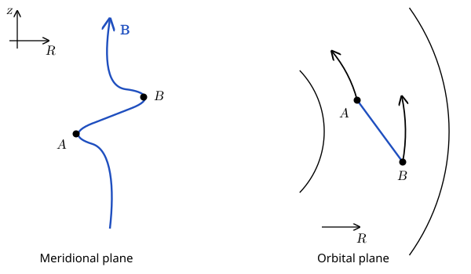
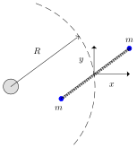

# The Magnetorotational Instability {#sec-mri}

The magnetorotational instability (MRI) was first discovered in the context of plasma fusion reactors by @velikhov1959 and @chandrasekhar1961 and then rediscovered in the context of accretion disks by @balbus1991. This is the instability thought to be responsible for the $\alpha$-viscosity in many astrophysical systems: from X-ray binaries to AGN disks. It is one of the most important, among the many instabilities operating in plasmas, so we will cover it in detail in these notes.

It was long known that a way to transport angular momentum in the disk is through magnetic stresses, that is the $B_r B_{\theta} / 4 \pi$ term in the momentum equation. However, to explain the observed luminosities from accretion disks, the magnetic stresses must be similar in magnitude to the pressure in the disk $p$ (the proportionality constant being the $\alpha$-viscosity coefficient). Given a small component of the field in the radial direction, flux freezing can grow $B_{\theta}$ linearly in time. However, since $B_r$ is small, this mechanism can transport angular momentum efficiently only if $B_{\theta}^2 \gg p$. Such a strong toroidal field cannot be contained in the disk. The requirement for the magnetic stresses to do the job of transporting angular momentum is that $B_r^2 \approx B_{\theta}^2 \approx 4 \pi \rho c_s^2$. Detailed simulations have shown that MRI is a mechanism that naturally produces the required field strengths over a short timescale.

## Qualitative Picture

{#fig-mri-mechanism fig-alt="Two-panel sketch. Left, the meridional plane with R to the right and z up: a vertical magnetic field line is bent so that fluid element A is displaced inward, to smaller R, and fluid element B outward. Right, the orbital plane: A sits on an inner circular orbit and B on an outer one, joined by the stretched field line; curved arrows show both moving along their orbits, with A's arrow longer because inner orbits are faster."}

Consider an accretion disk with Keplerian angular velocity profile
$$
\Omega (R) = \Omega_0  \left( \frac{R_0}{R} \right)^{3 / 2},
$$ {#eq-mri-1}
initially threaded by a vertical magnetic field $B_0 \hat{\vb{z}}$. Let $A$ and $B$ be two fluid elements connected by a magnetic field line (initially vertical) and displace their positions according to $\xi_r = \epsilon \cos k z$, as shown in @fig-mri-mechanism. The fluid elements $A$ and $B$ immediately accelerate to match the local angular velocity. However, as a result of the change in angular velocity, a toroidal component of the field, $B_{\theta}$ is generated by the stretching of the original field line.

The magnetic tension then creates an attractive force between $A$ and $B$, which has the effect of transporting angular momentum from $A$ to $B$. This causes $A$ to lose angular momentum and sink further inwards, while $B$ gains angular momentum and starts moving outwards. In turn, because the angular velocity decreases with radius, $A$ increases its angular velocity, while $B$ slows down, further separating the two points. This in turn enhances the magnetic tension force. The cycle we have just described is unstable, so the initial perturbation grows exponentially in time, until the system becomes nonlinear.

The mechanism we have just described involves the magnetic tension force, so it is natural to expect a characteristic growth rate of
$$
\gamma \approx kv_A, \qquad v_A = \frac{B_z}{\sqrt{4 \pi \rho}} .
$$ {#eq-mri-2}
In our derivation, we have assumed the field to be sufficiently weak, so that the displaced fluid elements can acquire the angular velocity of their surroundings. This should be valid as long as
$$
\omega_A = kv_A \lesssim \Omega .
$$ {#eq-mri-3}
We will find that the exact condition for instability is $kv_A < \sqrt{3} \Omega$, so the maximum growth rate is achieved by taking $k$ sufficiently large, so that $\gamma \approx kv_A \approx \Omega$. This is a very short timescale: the MRI grows over the orbital time scale! Moreover, the growth rate is independent of the field strength, as long as $v_A$ is not so large that the required $k$ to satisfy $kv_A < \sqrt{3} \Omega$ corresponds to perturbation with characteristic size larger than the vertical size of the disk.

## Detailed Calculation

The starting point is the Euler equation, which we write in the usual form in cylindrical coordinates $(R, \theta, z)$:
$$
\rho \left[ \frac{\partial \vb{v}}{\partial t} + (\vb{v} \cdot
\nabla) \vb{v} \right] = - \nabla \left( p + \frac{B^2}{8 \pi} \right) +
\frac{(\vb{B} \cdot \nabla) \vb{B}}{4 \pi} +\vb{g} \rho .
$$ {#eq-mri-4}
We consider a disk that is Keplerian and threaded by a vertical magnetic field:
$$
\vb{v}= R \Omega \hat{\vb{\theta}} +\vb{u}, \qquad \vb{B}=
B_0  \hat{\vb{z}} +\vb{b}, \qquad p + \frac{B^2}{8 \pi} = P_0 + P.
$$ {#eq-mri-5}
We will treat $\vb{u}$ and $\vb{b}$ as (small) Eulerian perturbations. We will only consider modes that are axisymmetric (no $\theta$ dependence) and incompressible
$$
\nabla \cdot \vb{u}= \frac{1}{R}  \frac{\partial (Ru_r)}{\partial R} +
\frac{\partial u_z}{\partial z} = 0.
$$ {#eq-mri-6}
To leading order in $\vb{u}$ (using Kepler's law)
$$
\begin{alignedat}{2}
(\vb{v} \cdot \nabla) \vb{v} &{}\rightarrow{} && (R \Omega)
\hat{\vb{\theta}} \cdot \nabla \vb{u}+\vb{u} \cdot \nabla (R
\Omega \hat{\vb{\theta}}) =  \\
& && - 2 \Omega u_{\theta}  \hat{\vb{R}} + \left( R \frac{\dd
\Omega}{\dd R} + 2 \Omega \right) u_R \hat{\vb{\theta}} = \\
& && \frac{1}{2} \Omega u_R  \hat{\vb{\theta}} - 2 \Omega u_{\theta}
\hat{\vb{R}} .
\end{alignedat}
$$ {#eq-mri-7}
Similarly,
$$
\begin{alignedat}{2}
(\vb{B} \cdot \nabla) \vb{B} &{}\rightarrow{} && B_0  \hat{\vb{z}}
\cdot \nabla \vb{b}+\vb{b} \cdot \nabla (B_0  \hat{\vb{z}}) =
\\
& && B_0  \dfrac{\partial b_R}{\partial z}  \hat{\vb{R}} + B_0
\frac{\partial b_{\theta}}{\partial z}  \hat{\vb{\theta}} + B_0
\frac{\partial b_z}{\partial z}  \hat{\vb{z}} .
\end{alignedat}
$$ {#eq-mri-8}
So the linearized momentum equation reads
$$
\frac{\partial \vb{u}}{\partial t} + \frac{1}{2} \Omega u_R
\hat{\vb{\theta}} - 2 \Omega u_{\theta}  \hat{\vb{R}} = -
\frac{1}{\rho} \nabla P + B_0  \dfrac{\partial b_R}{\partial z}
\hat{\vb{R}} + B_0  \frac{\partial b_{\theta}}{\partial z}
\hat{\vb{\theta}} + B_0  \frac{\partial b_z}{\partial z}
\hat{\vb{z}} .
$$ {#eq-mri-9}
The induction equation can be linearized in a similar way:
$$
\begin{aligned}
& \nabla \times (\vb{v} \times \vb{B}) \\
& \quad \rightarrow \nabla \times \bigl[(R \Omega \hat{\vb{\theta}}) \times (b_R \hat{\vb{R}} + b_{\theta} \hat{\vb{\theta}} + b_z \hat{\vb{z}}) \\
& \qquad\qquad + (u_R \hat{\vb{R}} + u_{\theta} \hat{\vb{\theta}} + u_z \hat{\vb{z}}) \times (B_0 \hat{\vb{z}})\bigr] \\
& \quad = \nabla \times [- R \Omega b_R \hat{\vb{z}} + R \Omega b_z \hat{\vb{R}} \\
& \qquad\qquad - u_R B_0 \hat{\vb{\theta}} + u_{\theta} B_0 \hat{\vb{R}}] \\
& \quad = \nabla \times [ (R \Omega b_z + u_{\theta} B_0) \hat{\vb{R}} \\
& \qquad\qquad - u_R B_0 \hat{\vb{\theta}} - R \Omega b_R \hat{\vb{z}}] \\
& \quad = \left( \frac{\partial u_R}{\partial z} B_0 \right) \hat{\vb{R}} + \biggl( R \Omega \frac{\partial b_z}{\partial z} + \frac{\partial u_{\theta}}{\partial z} B_0 \\
& \qquad\qquad - \frac{3}{2} \Omega b_R + \Omega \frac{\partial (Rb_R)}{\partial R} \biggr) \hat{\vb{\theta}} \\
& \qquad\qquad - \frac{1}{R} \left[ \frac{\partial (Ru_R B_0)}{\partial R} \right] \hat{\vb{z}} \\
& \quad = \left( \frac{\partial u_R}{\partial z} B_0 \right) \hat{\vb{R}} + \left( \frac{\partial u_{\theta}}{\partial z} B_0 - \frac{3}{2} \Omega b_R \right) \hat{\vb{\theta}} \\
& \qquad\qquad - \frac{1}{R} \left[ \frac{\partial (Ru_R B_0)}{\partial R} \right] \hat{\vb{z}} .
\end{aligned}
$$ {#eq-mri-10}
In the last equation we have also used the condition that $\nabla \cdot \vb{b}= 0$.

We will consider a small patch of the disk, so that we can use the Fourier (WKB) ansatz:
$$
\vb{u}=\vb{u}_0 e^{\lambda t + \ii (k_R R + k_z z)}, \qquad
\vb{b}=\vb{b}_0 e^{\lambda t + \ii (k_R R + k_z z)}
$$ {#eq-mri-11}
with the additional assumption that $k_z \gg k_R$. Substituting this into the linearized equations of motions yields
$$
\begin{alignedat}{2}
\lambda u_r - 2 \Omega u_{\theta} &{}={} && - \ii k_R  \frac{P}{\rho} +
\frac{\ii k_z B_0 b_r}{4 \pi \rho},  \\
\lambda u_{\theta} + \frac{\Omega}{2} u_r &{}={} && \frac{\ii k_z B_0
b_{\theta}}{4 \pi \rho}, \\
\lambda u_z &{}={} && - \ii k_z  \frac{P}{\rho} + \frac{\ii k_z B_0 b_z}{4
\pi \rho} .
\end{alignedat}
$$ {#eq-mri-12}
We can eliminate $P / \rho$ from the last equation and insert it into the first to obtain (in the limit $k_z \gg k_R$):
$$
\lambda u_r - 2 \Omega u_{\theta} = \ii k_z  \frac{B_0 b_r}{4 \pi \rho} .
$$ {#eq-mri-13}
The linearized induction equation yields
$$
\begin{alignedat}{2}
\lambda b_R &{}={} && \ii k_z B_0 u_R  \\
\lambda b_{\theta} &{}={} && - \frac{3}{2} \Omega b_R + \ii k_z B_0
u_{\theta} .
\end{alignedat}
$$ {#eq-mri-14}
Eliminating $b_R$ in the second equation yields
$$
\lambda b_{\theta} = - \frac{3}{2}  \frac{\ii k_z B_0 \Omega}{\lambda}
u_R + \ii k_z B_0 u_{\theta} .
$$ {#eq-mri-15}
Eliminating $b_{\theta}$ and $b_R$ in the momentum equations above and introducing $\omega_A^2 = k_z^2 B_0^2 / 4 \pi \rho$ yields
$$
\begin{alignedat}{2}
(\lambda^2 + \omega_A^2) u_R &{}={} && 2 \lambda \Omega u_{\theta},  \\
(\lambda^2 + \omega_A^2) u_{\theta} &{}={} && \left( - \frac{\lambda}{2} \Omega
+ \frac{3}{2}  \frac{\omega_A^2 \Omega}{\lambda} \right) u_R .
\end{alignedat}
$$ {#eq-mri-momentum-reduced}
Introducing
$$
\mu^2 = \lambda^2 + \omega_A^2,
$$ {#eq-mri-17}
the dispersion relation becomes
$$
f (\mu^2) = \mu^4 + \Omega^2 \mu^2 - 4 \Omega^2 \omega_A^2 = 0.
$$ {#eq-mri-18}
The instability is present when the second root of $f (\mu^2)$ occurs for $\mu^2 > \omega_A^2$. This occurs if
$$
f (\omega_A^2) = \omega_A^4 - 3 \Omega^2 \omega_A^2 < 0 \Longrightarrow
\boxed{\frac{k_z B_0}{\sqrt{4 \pi \rho}} = \omega_A < \sqrt{3} \Omega .}
$$ {#eq-mri-condition}
We find that if $k_z$ is sufficiently small (sufficiently large wavelength of the perturbation), then the mode is unstable. However, if the background field is too large, then the condition in @eq-mri-condition might only be satisfied for $k_z$ that corresponds to modes larger than the disk size, so the system is stable.

The growth rate of the instability is found by solving the dispersion relation to find
$$
\lambda^2 = \frac{\Omega}{2}  \left( - \Omega + \sqrt{\Omega^2 + 16
\omega_A^2} \right) - \omega_A^2,
$$ {#eq-mri-20}
which is maximized when
$$
\omega_A = \frac{\sqrt{15}}{4} \Omega \approx \Omega,
$$ {#eq-mri-21}
which corresponds to
$$
k_{\max} \approx \frac{\sqrt{4 \pi \rho}}{B_0} \Omega .
$$ {#eq-mri-22}
The growth rate of the most unstable mode is
$$
\boxed{\lambda_{\max} = \frac{3}{4} \Omega .}
$$ {#eq-mri-23}
It is instructive to check the limit of our analysis when $B_0 \rightarrow 0$, which corresponds to $\omega_A \rightarrow 0$. If $\omega_A \equiv 0$, then @eq-mri-momentum-reduced reduces to
$$
\lambda^2 u_R = - \Omega^2 u_R, \qquad \lambda^2 u_{\theta} = - \Omega^2
u_{\theta} .
$$ {#eq-mri-24}
That is the perturbations oscillate with the epicyclic frequency $\Omega$.

In the limit of $0 < \omega_A \ll \Omega$ (long wavelength perturbations, or weak magnetic field), we can drop all the $\omega_A$ terms in @eq-mri-momentum-reduced, with the exception of the term multiplied by $\Omega$ to obtain
$$
\begin{alignedat}{2}
\lambda^2 u_R &{}={} && 2 \lambda \Omega u_{\theta},  \\
\lambda^2 u_{\theta} &{}={} && \left( - \frac{\lambda}{2} \Omega + \frac{3}{2}
\frac{\omega_A^2 \Omega}{\lambda} \right) u_R .
\end{alignedat}
$$ {#eq-mri-25}
Eliminating $u_{\theta}$, we obtain:
$$
\lambda^2 u_R = \left( \frac{3 \omega_A^2 \Omega^2}{\lambda^2} - \Omega^2
\right) u_R,
$$ {#eq-mri-26}
which has unstable solutions with $\lambda^2 > 0$ as long as $\omega_A > 0$.

## In-class worksheet {#sec-mri-worksheet}

There is a simple mechanical equivalent of the magnetorotational instability (MRI) in a disk with vertical magnetic field. This model is concerned with two particles of mass $m$ orbiting a central object with angular velocity $\Omega = \Omega (R)$ (not necessarily Keplerian). The particles are connected by a spring with spring constant $mK$, as shown in @fig-mri-spring.

{#fig-mri-spring fig-alt="A central object on the left and a dashed circular orbit of radius R around it. On the orbit, two masses m, drawn as dots, are joined by a spring that passes through their common centre of mass. Local axes are drawn at the centre of mass: x points radially outward and y along the orbit."}

The coordinates $x$ and $y$ denote the displacement of one of the two masses from the common center of mass.

1.  Assuming $0 \leq x, y \ll R$, show that the displacement satisfies the differential equations
    $$
    \begin{alignedat}{2}
    \ddot{x} - 2 \Omega \dot{y} &{}={} && - \left( K + \frac{\dd
    \Omega^2}{\dd \log R} \right) x, \\
    \ddot{y} + 2 \Omega \dot{x} &{}={} && - Ky.
    \end{alignedat}
    $$ {#eq-mri-ws1}
    Note that these are the same equations as those obtained for the MRI in a disk threaded by a vertical magnetic field, $k_R = 0$, and $K = (v_A k_z)^2 = \omega_A^2$.

2.  Look for solutions in the form $x (t) = x_0 e^{\lambda t},$ $y (t) = y_0 e^{\lambda t}$. Find $\lambda$.

3.  Under what conditions is the system unstable?

::: {.content-visible when-profile="solutions"}
::: {.solution}
1.  Work in a frame that rotates with the angular velocity $\Omega = \Omega(R)$ of the centre of mass, which moves on a circular orbit of radius $R$. Write the position of the mass as $R + x$ in the radial direction and $y$ along the orbit, so that its polar coordinates are $(R + x, \Omega t + y/R)$. Without the spring, the radial and azimuthal equations of motion in the inertial frame are
    $$
    \ddot{r} - r \dot{\phi}^2 = - r \Omega^2(r), \qquad r \ddot{\phi} + 2 \dot{r} \dot{\phi} = 0,
    $$
    where $r \Omega^2(r)$ is the gravitational acceleration that keeps circular orbits at radius $r$. To first order in $x, y \ll R$,
    $$
    \ddot{x} - x \Omega^2 - 2 \Omega \dot{y} = - x \Omega^2 - x R \frac{\dd \Omega^2}{\dd R},
    \qquad
    \ddot{y} + 2 \Omega \dot{x} = 0 .
    $$
    The spring adds a restoring force per unit mass $-K (x, y)$ towards the centre of mass (the factor relating the displacement from the centre of mass to the spring's extension is absorbed in $K$). Adding it gives the equations in the statement, with $R \, \dd \Omega^2 / \dd R = \dd \Omega^2 / \dd \log R$.

2.  Let $D = \dd \Omega^2 / \dd \log R$. Substituting $x = x_0 e^{\lambda t}$, $y = y_0 e^{\lambda t}$ gives the linear system
    $$
    (\lambda^2 + K + D) \, x_0 - 2 \Omega \lambda \, y_0 = 0, \qquad
    2 \Omega \lambda \, x_0 + (\lambda^2 + K) \, y_0 = 0,
    $$
    which has non-trivial solutions only if its determinant vanishes:
    $$
    \lambda^4 + (2 K + \kappa^2) \lambda^2 + K (K + D) = 0,
    \qquad \kappa^2 = 4 \Omega^2 + D ,
    $$
    where $\kappa$ is the epicyclic frequency. Hence
    $$
    \lambda^2 = \frac{1}{2} \left[ - (2 K + \kappa^2) \pm \sqrt{\kappa^4 + 16 K \Omega^2} \right] .
    $$

3.  The discriminant $\kappa^4 + 16 K \Omega^2$ is positive, so both roots for $\lambda^2$ are real. Their sum, $-(2K + \kappa^2)$, is negative for a disk with $\kappa^2 > 0$, so a positive root (a growing mode) exists if and only if their product is negative, $K (K + D) < 0$:
    $$
    0 < K < - \frac{\dd \Omega^2}{\dd \log R} .
    $$
    The system is unstable when the angular velocity decreases outward and the spring is weak enough. For a Keplerian disk $\dd \Omega^2 / \dd \log R = - 3 \Omega^2$, so the condition is $K = \omega_A^2 < 3 \Omega^2$, the same as @eq-mri-condition. The largest growth rate, $\lambda = \frac{3}{4} \Omega$, is reached for $K = \frac{15}{16} \Omega^2$, as for the MRI.
:::
:::

## Further reading {#sec-mri-reading}

- @clarke2007, Chapter 13, for the MHD equations used here.
- @balbus1991, the paper that established the MRI as the origin of turbulence in accretion disks.
- @balbus1998, a comprehensive review of the MRI and angular-momentum transport in disks.
