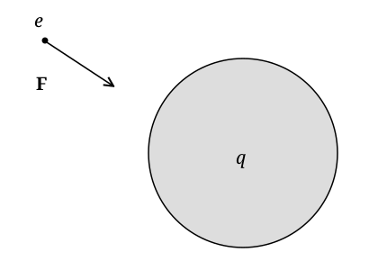
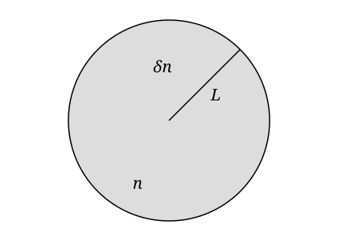
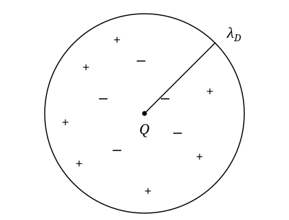
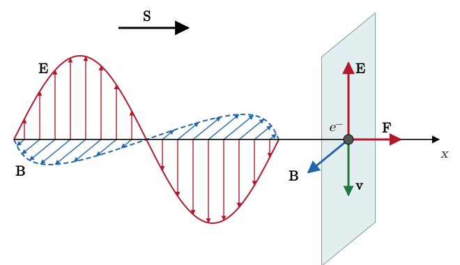
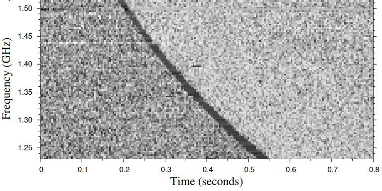

# Introduction to Plasma {#sec-plasma}

## Electromagnetism Refresher

### Lorentz Force and Maxwell Equations

Most of the baryonic matter in the Universe is in the form of plasma, a state of matter characterized by large electrical conductivity and charge mobility. Not surprisingly, plasma physics plays an important role in many astrophysical systems. Before we are ready to discuss plasmas, or even before we can precisely state what plasma is, it is a good idea to refresh some key concepts from electromagnetism. In the process, we will also introduce CGS units, which are ubiquitous in astronomy.

The starting point for electromagnetism is the observation that some particles, electrons and protons, are endowed with electric charge, which is an intrinsic property, like mass. When two lumps of matter with net charge $Q_1$ and $Q_2$ are placed at a distance $r$, the two experience a force, which we write in CGS units as
$$
F = \frac{Q_1 Q_2}{r^2} .
$$ {#eq-plasma-coulomb}
The force is repulsive if $Q_1 Q_2 > 0$ and attractive if $Q_1 Q_2 < 0$. Note that there is no Coulomb constant in the previous equation. This is not a typo, but a feature of CGS units. In these units, charge, which is measured in Statcoulomb, is not a fundamental unit, but can be defined in terms of $\mathrm{g}$, $\mathrm{cm}$, and $\mathrm{s}$ using @eq-plasma-coulomb:
$$
[Q]^2 = [F] L^2 = [M]  [L]  [T]^{- 2}  [L]^2 \Longrightarrow [Q]
=\mathrm{g}^{1 / 2} \mathrm{cm}^{3 / 2} \mathrm{s}^{- 1} = : \mathrm{statC} .
$$ {#eq-plasma-2}
The charge of the electron is
$$
e = 4.8032047 \times 10^{- 10} \mathrm{statC} .
$$ {#eq-plasma-3}
The Coulomb force on particle 2 can also be thought as the effect on particle 2 of an electrostatic field produced by particle 1. In a system of coordinates centered on particle 1, the electrostatic field produced by particle 1 is
$$
\vb{E}= \frac{Q_1}{r^2}  \hat{\vb{r}}
$$ {#eq-plasma-4}
and the force on particle 2 is given by
$$
\vb{F}= \frac{Q_1 Q_2}{r^2}  \hat{\vb{r}} = Q_2 \vb{E}.
$$ {#eq-plasma-5}
In general, a charged particle with charge $Q$ moving in an electromagnetic field experiences the so-called Lorentz force:
$$
\vb{F}= Q \left( \vb{E}+ \frac{\vb{v} \times \vb{B}}{c}
\right),
$$ {#eq-plasma-lorentz-force}
where $c$ is the speed of light. In CGS units, the electric $\vb{E}$ and magnetic $\vb{B}$ fields are *defined* by @eq-plasma-lorentz-force. They also have the same units, as can be easily checked:
$$
[\vb{E}] = [\vb{B}] = \mathrm{cm}^{- 1 / 2} \mathrm{g}^{1 / 2}
\mathrm{s}^{- 1} .
$$ {#eq-plasma-7}
The fact that $\vb{E}$ and $\vb{B}$ have the same units in CGS is the main reason why these units are still widely used. Indeed, electric and magnetic fields are different manifestations of a single field: the electromagnetic field, as is revealed by special relativity. The electromagnetic field can be found as solution of the Maxwell's field equations
$$
\begin{array}{lll}
\nabla \cdot \vb{E}= 4 \pi q, &  & \nabla \cdot \vb{B}= 0,\\
\nabla \times \vb{E}= - \frac{1}{c}  \frac{\partial
\vb{B}}{\partial t}, &  & \nabla \times \vb{B}= \frac{4 \pi}{c}
\vb{j}+ \frac{1}{c}  \frac{\partial \vb{E}}{\partial t} .
\end{array}
$$ {#eq-plasma-maxwell}
In the previous equation, $q$ is the charge density and $\vb{j}$ the current density. The equations in the first row are called the Gauss law for electric and magnetic fields. The second two equations are the Faraday, or induction, equation (left column), and the Ampère–Maxwell law (right column).

### Electrostatics

If the fields do not depend on time, the Maxwell equations for $\vb{E}$ simplify to
$$
\nabla \cdot \vb{E}= 4 \pi q,  \nabla \times \vb{E}= 0,
$$ {#eq-plasma-9}
The second equation tells us that $\vb{E}= - \nabla \Phi$, where $\Phi$ is the electrostatic potential. The latter satisfies the Poisson equation
$$
\nabla^2 \Phi = - 4 \pi q.
$$ {#eq-plasma-10}
Apart from a minus sign and the constant $G$, this is the same equation satisfied by the gravitational potential (@sec-grav).

The force experienced by a charge $Q$ in an electrostatic field is
$$
\vb{F}= Q\vb{E}= - Q \nabla \Phi .
$$ {#eq-plasma-11}

::: {.callout-tip icon=false}
## Example

Consider the electrostatic potential generated by a spherical distribution of charge density $q$ and the force experienced by an electron outside the sphere, as illustrated in @fig-plasma-sphere.

{#fig-plasma-sphere fig-alt="A grey sphere carrying charge q. An electron e outside the sphere, up and to the left, has an arrow F pointing from it towards the sphere."}

The radial component of the force experienced by an electron, which has charge $- e$, at a distance $r$ from a charged sphere, with charge density $q$, is given by:
$$
F_r = e \partial_r \Phi .
$$ {#eq-plasma-12}
From the Poisson equation
$$
\nabla \cdot \nabla \Phi = - 4 \pi q.
$$ {#eq-plasma-13}
Integrating both sides over a sphere of radius $r$, we find
$$
- 4 \pi \int_V q \dd V = - 4 \pi Q = \int_V \nabla \cdot \nabla \Phi
\dd V,
$$ {#eq-plasma-14}
The RHS gives (using the divergence theorem)
$$
\int_V \nabla \cdot \nabla \Phi \dd V = \int_S \nabla \Phi \cdot
\hat{\vb{r}} \dd S = 4 \pi r^2 \partial_r \Phi \Longrightarrow
\partial_r \Phi = - \frac{Q}{r^2} \Longrightarrow F_r = - \frac{Qe}{r^2} .
$$ {#eq-plasma-15}
So the electron is attracted by the sphere if $Q > 0$, and repelled if $Q < 0$.
:::

Even though electrostatic and gravitational forces have a similar mathematical structure, these forces are very different for two reasons. First, gravity is always attractive, because no forms of matter are known to possess negative mass, while electric charge can be positive or negative and objects of similar charge repel each other. Second, gravity is a very weak force, as we explore with the next example.

::: {.callout-tip icon=false}
## Example

Consider a proton on the surface of the Sun. It is subject to an attractive gravitational force:
$$
F_g = - \frac{GM_{\odot} m_p}{R_{\odot }^2} .
$$ {#eq-plasma-16}
The proton is also subject to an electrostatic force:
$$
F_e = \frac{Q_{\odot} e}{R_{\odot}^2},
$$ {#eq-plasma-17}
where $Q_{\odot} \approx \frac{M_{\odot}}{m_p} \delta e$ is the net charge of the Sun, and $\delta = (N_p - N_e) / N_p$ is the fractional charge imbalance. Gravity and electrostatic forces balance each other when
$$
\delta = \frac{Gm_p^2}{e^2} \sim 10^{- 36} .
$$ {#eq-plasma-18}
The Sun must be very close to neutral, because even a small charge imbalance would cause particles of the same charge as the Sun to be evaporated from the surface.
:::

The argument we have just made for the Sun applies to most astrophysical systems. This implies that the charge imbalance in astronomical objects must be very small. In other words, they are *quasi-neutral*. As we will see shortly, quasi-neutrality is one of the key characteristics an ionized gas must have to be considered to be plasma. At this point, it is important to remark that, while we will be concerned only with systems that have zero net charge, these systems can still contain electric currents, which give rise to magnetic fields and internal stresses via the Lorentz force.

::: {.callout-note}
## Going further: Conservation Laws in Electrodynamics

If we take the divergence of Ampère's law we find
$$
\frac{\partial \nabla \cdot \vb{E}}{\partial t} + 4 \pi
\nabla \cdot \vb{j}= 0.
$$ {#eq-plasma-19}
Using Gauss' law
$$
\frac{\partial q}{\partial t} + \nabla \cdot \vb{j}= 0.
$$ {#eq-plasma-20}
So the charge density satisfies a continuity equation, just like the mass density for a fluid (@eq-continua-15). In other words, the Maxwell equations imply charge conservation.

It is also possible to show that the Maxwell equations imply conservation of the energy in the electromagnetic field. To see this, consider the work done by the electromagnetic field on a fluid with charge density $q$ and velocity $\vb{v}$. The Lorentz force per unit volume is
$$
\vb{f}= q \left( \vb{E}+ \frac{\vb{v} \times \vb{B}}{c}
\right) .
$$ {#eq-plasma-21}
So the work per unit volume is (using $\vb{j}= q\vb{v}$ and Ampère's law)
$$
w =\vb{f} \cdot \vb{v}= q\vb{E} \cdot \vb{v}=\vb{E}
\cdot \vb{j}= \frac{1}{4 \pi}  \left[ c (\nabla \times \vb{B}) \cdot
\vb{E}-\vb{E} \cdot \frac{\partial \vb{E}}{\partial t} \right] .
$$ {#eq-plasma-22}
Using the vector identity
$$
\vb{E} \cdot (\nabla \times \vb{B}) =\vb{B} \cdot (\nabla \times
\vb{E}) - \nabla \cdot (\vb{E} \times \vb{B})
$$ {#eq-plasma-23}
and
$$
\vb{E} \cdot \frac{\partial \vb{E}}{\partial t} = \frac{1}{2}
\dfrac{\partial E^2}{\partial t},
$$ {#eq-plasma-24}
we can write
$$
\vb{E} \cdot \vb{j}= \frac{1}{4 \pi}  \left\{ c [\vb{B} \cdot
(\nabla \times \vb{E}) - \nabla \cdot (\vb{E} \times \vb{B})] -
\frac{1}{2}  \frac{\partial E^2}{\partial t} \right\} .
$$ {#eq-plasma-25}
We can use Faraday's law to get rid of $c \nabla \times \vb{E}$ to rewrite the last equation as
$$
\frac{1}{8 \pi}  \frac{\partial (E^2 + B^2)}{\partial t} + \nabla \cdot
\left( \frac{c}{4 \pi} \vb{E} \times \vb{B} \right) = -\vb{E}
\cdot \vb{j}.
$$ {#eq-plasma-poynting}
We can recognize that this is a conservation law in the form
$$
\frac{\partial u_{\mathrm{EM}}}{\partial t} + \nabla \cdot \vb{S}=
-\vb{E} \cdot \vb{j}.
$$ {#eq-plasma-27}
The last term is the work done by the electric field, so we can interpret $u_{\mathrm{EM}} = \tfrac{E^2 + B^2}{8 \pi}$ as the energy in the electromagnetic field and the vector $\vb{S}= \frac{c}{4 \pi} \vb{E} \times \vb{B}$, called the *Poynting flux*, as the flux of electromagnetic energy. @eq-plasma-poynting is also called the Poynting theorem. As we will see in @sec-mhd, the equation for energy conservation for a plasma is just the sum of the energy conservation equations for the matter, which we already know as the energy equation (@sec-conserv), and the energy conservation equation for the electromagnetic field.

:::

### Electromagnetic Waves

The propagation of electromagnetic waves **in vacuum** can be studied with a similar formalism as that used to study sound waves (@sec-sound). Actually, since Maxwell equations are linear, the derivation of the dispersion relation for electromagnetic waves is simpler than that for sound waves. The starting point are the Maxwell equations in vacuum:
$$
\begin{array}{lll}
\nabla \cdot \vb{E}= 0, &  & \nabla \cdot \vb{B}= 0,\\
\nabla \times \vb{E}= - \frac{1}{c}  \frac{\partial
\vb{B}}{\partial t}, &  & \nabla \times \vb{B}= \frac{1}{c}
\frac{\partial \vb{E}}{\partial t} .
\end{array}
$$ {#eq-plasma-maxwell-vacuum}
We look for solutions in the form
$$
\vb{E} (t, \vb{x}) = \hat{\vb{E}}_0 \ee^{\ii (\vb{k}
\cdot \vb{x}- \omega t)}, \qquad \vb{B} (t, \vb{x}) =
\hat{\vb{B}}_0 \ee^{\ii (\vb{k} \cdot \vb{x}- \omega t)} .
$$ {#eq-plasma-29}
Inserting this ansatz into the first row of @eq-plasma-maxwell-vacuum, we obtain
$$
\nabla \cdot \vb{E}= 0 \Longrightarrow \ii \vb{k} \cdot
\hat{\vb{E}}_0 \ee^{\ii (\vb{k} \cdot \vb{x}- \omega t)} = 0
\Longrightarrow \vb{k} \perp \hat{\vb{E}}_0
$$ {#eq-plasma-30}
and, similarly, $\vb{k} \perp \hat{\vb{B}}_0$. This means that, differently from sound waves, electromagnetic waves in vacuum are transverse, meaning that $\vb{E}$ and $\vb{B}$ are perpendicular to the direction of propagation of the wave.

From Faraday's law, we obtain that
$$
\frac{\ii \omega}{c}  \hat{\vb{B}}_0 \ee^{\ii (\vb{k} \cdot
\vb{x}- \omega t)} = \ii \vb{k} \times \hat{\vb{E}}_0
\ee^{\ii (\vb{k} \cdot \vb{x}- \omega t)} \Longrightarrow
\frac{\omega}{c}  \hat{\vb{B}}_0 =\vb{k} \times \hat{\vb{E}}_0 .
$$ {#eq-plasma-faraday-fourier}
This implies that $\hat{\vb{E}}_0 \perp \hat{\vb{B}}_0$. From Ampere's law, we obtain
$$
\vb{k} \times \hat{\vb{B}}_0 = - \frac{\omega}{c}
\hat{\vb{E}}_0 .
$$ {#eq-plasma-ampere-fourier}
Substituting @eq-plasma-ampere-fourier into @eq-plasma-faraday-fourier, we obtain (using the properties of the double vector product)
$$
\frac{\omega}{c}  \hat{\vb{B}}_0 = - \frac{c}{\omega} \vb{k} \times
(\vb{k} \times \hat{\vb{B}}_0) = \cancel{- \frac{c}{\omega} \vb{k}
(\vb{k} \cdot \hat{\vb{B}}_0)} + \frac{c}{\omega} k^2
\hat{\vb{B}}_0 = \frac{c}{\omega} k^2  \hat{\vb{B}}_0
\Longrightarrow \boxed{\omega^2 = c^2 k^2} .
$$ {#eq-plasma-33}
So electromagnetic waves satisfy the same dispersion relation as sound waves (@eq-sound-18), but with $c$, the speed of light, instead of the sound speed $c_s$.

## Plasma

### What is a Plasma?

Consider a quasi-neutral gas made of electrons and ions. Assume that, due to a thermal fluctuation, a small overdensity of electrons $\delta n$ is created in a region with characteristic size $L$. How large can this fluctuation be?

{#fig-plasma-overdensity fig-alt="A grey disc of radius L in which the electron density exceeds the background density n by an amount delta n."}

The electrostatic potential created by this overdensity is of order
$$
\delta \Phi \sim 4 \pi L^2 e \delta n.
$$ {#eq-plasma-34}
The potential energy of each electron is
$$
e \delta \Phi \sim 4 \pi L^2 e^2 \delta n .
$$ {#eq-plasma-35}
Their thermal energy is $\sim k_B T$ (in thermodynamic equilibrium). Thermal fluctuations should have potential energy comparable to the thermal energy, so
$$
4 \pi L^2 e^2 \delta n \sim k_B T \Longrightarrow \frac{\delta n}{n} \sim
\frac{1}{L^2}  \left( \frac{k_B T}{4 \pi ne^2} \right) =: \left(
\frac{\lambda_D}{L} \right)^2,
$$ {#eq-plasma-36}
where $n$ is the density of free electrons (we will also write it as $n_e$) and we have introduced the *Debye length*
$$
\boxed{\lambda_D = \sqrt{\frac{k_B T}{4 \pi ne^2}} .}
$$ {#eq-plasma-37}
The Debye length is a characteristic length scale for charge fluctuations in the gas. Over scales $L \gg \lambda_D$, one can assume that the medium is neutral, *if the density of the gas is sufficiently high*.

To see this, consider again a uniform gas of electrons and ions. The ion masses are of order $A m_p \approx 1836 A m_e$, so if ions and electrons have on average the same kinetic energy, as would be expected in equilibrium, $v_{\mathrm{ions}} \ll v_e$. To a first approximation, we can consider the ions to be static and immersed in a sea of electrons. If electrons are abundant, each ion will then be surrounded by a sea of electrons, which effectively shield its charge hiding it from the other ions, as shown in @fig-plasma-debye.

{#fig-plasma-debye fig-alt="A circle of radius lambda D centred on an ion of charge Q. Electrons (minus signs) are concentrated near the ion and other ions (plus signs) lie farther out, so the electrons screen the ion."}

It turns out that, in this situation, the electrostatic potential around the ion is
$$
\Phi (r) = \frac{Q}{r} \ee^{- r / \lambda_D},
$$ {#eq-plasma-38}
where $\lambda_D$ is the Debye length (see the box below). In other words, the Debye length is also the characteristic screening length. However, screening can only take place if electrons are sufficiently mobile to screen each ion. To quantify this, we define the *plasma parameter*:
$$
\Lambda = \frac{4}{3} \pi n \lambda_D^3 = \frac{1}{6 \sqrt{\pi} e^3}  (k_B
T)^{3 / 2} n^{- 1 / 2} .
$$ {#eq-plasma-39}
The plasma parameter is just the number of electrons in each Debye sphere. We say that an ionized gas for which $\lambda_D \ll L$ and $\Lambda \gg 1$ is a *plasma*. Typical plasma parameters for astrophysical systems are given in @tbl-plasma-parameters. As we can see, astrophysical plasmas span a tremendous range in scales.

| | $T$ [K] | $n_e^{\mathrm{free}}$ [cm$^{-3}$] | $\lambda_D$ [cm] | $\Lambda$ | plasma? |
|:--|:--|:--|:--|:--|:--|
| The Sun (core) | $10^7$ | $10^{26}$ | $2 \times 10^{-9}$ | $4.4$ | marginal |
| Warm ISM | $10^4$ | $1$ | $700$ | $1.4 \times 10^9$ | yes |
| Molecular clouds | $10$ | $10^{-4}$ | $2 \times 10^3$ | $4 \times 10^6$ | yes |
| Intracluster medium | $10^7$ | $10^{-3}$ | $7 \times 10^5$ | $1.4 \times 10^{15}$ | yes |
| Protoneutron star | $10^{11}$ | $2 \times 10^{38}$ | $1.5 \times 10^{-13}$ | $3.1$ | yes |
| White dwarf | $10^5$ | $6 \times 10^{29}$ | $3 \times 10^{-12}$ | $5.6 \times 10^{-5}$ | no |

: Temperature, free electron density, Debye length, and plasma parameters for various systems. The electrons in protoneutron stars and white dwarfs are degenerate (and, in protoneutron stars, relativistic), so for these systems the values computed with the classical formulas are only indicative. {#tbl-plasma-parameters}

::: {.callout-note}
## Going further: Debye Screening

We can derive @eq-plasma-38 as follows. Consider an ion of charge $Q$ at the origin, surrounded by electrons with temperature $T$ and average density $n_e$, and by other ions, which we assume to have uniform charge density $e n_e$, so that the plasma is neutral on average. In thermal equilibrium, the electrons follow the Boltzmann distribution. An electron has potential energy $- e \Phi$, so
$$
n (r) = n_e \ee^{e \Phi / k_B T} \approx n_e \left( 1 + \frac{e \Phi}{k_B T} \right),
$$ {#eq-plasma-boltzmann}
where we have assumed $| e \Phi | \ll k_B T$, which is true sufficiently far from the ion. The charge density is then
$$
q = e n_e - e n (r) = - \frac{n_e e^2}{k_B T} \Phi ,
$$ {#eq-plasma-debye-charge}
and the Poisson equation (@eq-plasma-10) becomes
$$
\nabla^2 \Phi = \frac{4 \pi n_e e^2}{k_B T} \Phi = \frac{\Phi}{\lambda_D^2} .
$$ {#eq-plasma-debye-poisson}
For a spherically symmetric potential, $\nabla^2 \Phi = \frac{1}{r} \frac{\dd^2 (r \Phi)}{\dd r^2}$, so $r \Phi$ satisfies $\frac{\dd^2 (r \Phi)}{\dd r^2} = \frac{r \Phi}{\lambda_D^2}$. The solution that does not grow at large $r$ is $r \Phi = A \ee^{- r / \lambda_D}$. Close to the ion, the potential must be that of the ion alone, $\Phi \approx Q / r$, so $A = Q$, and we recover @eq-plasma-38.
:::

### When is a Plasma a Fluid?

In @sec-continua we have seen that a gas can be treated as a fluid if the mean free path $\lambda$ of its particles is small compared to the scales of interest. In a plasma, the particles interact via the Coulomb force. Two particles are strongly deflected if they come so close that their electrostatic energy is comparable to their thermal energy, $e^2 / r \sim k_B T$. This gives a cross section $\sigma \sim \pi (e^2 / k_B T)^2$, and a mean free path $\lambda \sim 1 / (n \sigma)$. Many weak collisions at larger distances make the particles lose their direction somewhat faster, and a more careful calculation gives
$$
\lambda \approx 10^4\,\mathrm{cm} \left( \frac{T}{1\,\mathrm{K}} \right)^2 \left( \frac{n}{1\,\mathrm{cm^{-3}}} \right)^{-1} .
$$ {#eq-plasma-coulomb-mfp}
Note that $\lambda$ increases very quickly with temperature: hot plasmas are almost collisionless.

Magnetic fields change this picture. A particle with charge $Q$ and mass $m$ moving with velocity $v$ perpendicular to a magnetic field $B$ experiences a Lorentz force $|Q| v B / c$ perpendicular to its velocity. So it moves on a circle around the field lines, with radius $r_L$ given by
$$
\frac{m v^2}{r_L} = \frac{| Q | v B}{c} \Longrightarrow r_L = \frac{m v c}{| Q | B} .
$$ {#eq-plasma-larmor}
$r_L$ is called the *Larmor radius*, or *gyroradius*. In other words, particles cannot move freely across the magnetic field lines, even if they never collide. On scales much larger than $r_L$, a magnetized plasma behaves like a fluid in the directions perpendicular to the magnetic field. Along the field lines, instead, particles can travel a distance $\sim \lambda$. This is why magnetohydrodynamics (@sec-mhd) works well even in plasmas in which collisions are rare. However, processes along the field lines, such as heat conduction, can be very different from those in an ordinary gas.

::: {.callout-tip icon=false}
## Example

Consider the warm interstellar medium, with $T \sim 10^4\,\mathrm{K}$, $n \sim 1\,\mathrm{cm^{-3}}$, and $B \sim 3\,\mu\mathrm{G}$. From @eq-plasma-coulomb-mfp, $\lambda \sim 10^{12}\,\mathrm{cm}$, which is much smaller than the scales of interest, $\sim 1\,\mathrm{pc} \approx 3 \times 10^{18}\,\mathrm{cm}$. A thermal proton has velocity $v \sim \sqrt{k_B T / m_p} \approx 9\,\mathrm{km\,s^{-1}}$, so its Larmor radius is $r_L \approx 300\,\mathrm{km}$, even smaller.

The solar wind close to the Earth is different. It has $T \sim 10^5\,\mathrm{K}$ and $n \sim 5\,\mathrm{cm^{-3}}$, so $\lambda \sim 2 \times 10^{13}\,\mathrm{cm}$, about the distance between the Earth and the Sun. The solar wind is essentially collisionless! However, the magnetic field is $B \sim 5 \times 10^{-5}\,\mathrm{G}$, so a thermal proton has $r_L \approx 60\,\mathrm{km}$. On large scales, the solar wind can still be described as a magnetized fluid.
:::

### Cold Plasma Approximation

The cold plasma approximation is used to study the propagation of electromagnetic waves, particularly radio waves, in the interstellar medium. As the name suggests, in the cold plasma approximation we ignore the thermal motion of the electrons. We also take the ions to be stationary. Let's consider the propagation of an electromagnetic wave through such medium, as illustrated in @fig-plasma-em-wave.

{#fig-plasma-em-wave fig-alt="An electromagnetic wave travels to the right along the x axis, in the direction of the Poynting vector S. The electric field E oscillates in the vertical plane and the magnetic field B, in phase with it, in the horizontal plane. An electron in the wave, where E points up, is pushed down, giving it a velocity v; the magnetic force F, proportional to v cross B, then points to the right, along the direction of propagation."}

The Lorentz force experienced by an electron is (assuming $v \ll c$):
$$
\vb{F}= - e \left( \vb{E}+ \frac{\vb{v} \times \vb{B}}{c}
\right) \approx - e\vb{E}.
$$ {#eq-plasma-45}
So, if we take $\vb{E}= \hat{\vb{E}}_0 \ee^{\ii (\vb{k} \cdot \vb{x}- \omega t)}$ and $\vb{v}= \hat{\vb{v}}_0 \ee^{\ii (\vb{k} \cdot \vb{x}- \omega t)}$, we have
$$
\quad  \hat{\vb{v}}_0 = \frac{e \hat{\vb{E}}_0}{\ii \omega m_e} .
$$ {#eq-plasma-46}
The induced current density in the plasma is
$$
\hat{\vb{j}} = - ne \hat{\vb{v}}_0 = \left( \frac{\ii
ne^2}{\omega m_e} \right)  \hat{\vb{E}}_0 = : \sigma \hat{\vb{E}}_0,
$$ {#eq-plasma-47}
where we have introduced the conductivity $\sigma$. Charge conservation is
$$
\frac{\partial q}{\partial t} + \nabla \cdot \vb{j}= 0 \Longrightarrow -
\ii \omega \hat{q}_0 + \ii \vb{k} \cdot \hat{\vb{j}}_0 = 0
\Longrightarrow \hat{q}_0 = \frac{\vb{k} \cdot
\hat{\vb{j}}_0}{\omega} = \frac{\sigma}{\omega} \vb{k} \cdot
\hat{\vb{E}}_0 .
$$ {#eq-plasma-48}
Gauss' law reads
$$
\ii \vb{k} \cdot \hat{\vb{E}}_0 = 4 \pi \hat{q}_0 \Longrightarrow
\ii \vb{k} \cdot \left( 1 - \frac{4 \pi \sigma}{\ii \omega}
\right) \hat{\vb{E}}_0 = 0.
$$ {#eq-plasma-49}
Introducing the dielectric constant
$$
\begin{aligned}
\epsilon &= 1 - \frac{4 \pi \sigma}{\ii \omega} = 1 - \left(
\frac{\omega_p}{\omega} \right)^2, \\
\omega_p &= \sqrt{\frac{4 \pi
ne^2}{m_e}} \\
&\approx 5.6 \times 10^4\,\mathrm{s^{-1}} \left( \frac{n}{1\,\mathrm{cm}^{- 3}} \right)^{1 /
2} .
\end{aligned}
$$ {#eq-plasma-50}
The corresponding frequency is $f_p = \omega_p / 2 \pi \approx 9\,\mathrm{kHz}\,(n / 1\,\mathrm{cm^{-3}})^{1/2}$. $\omega_p$ is called the *plasma frequency*, and $\epsilon$ (not to be confused with the internal energy $\varepsilon$) is the dielectric constant. The plasma frequency has a simple physical meaning: if the electrons are displaced with respect to the ions, the electric field pulls them back, and they oscillate around their equilibrium positions with angular frequency $\omega_p$ (@exr-plasma-oscillations). Note also that $\lambda_D = v_{\mathrm{th}} / \omega_p$, where $v_{\mathrm{th}} = \sqrt{k_B T / m_e}$ is the thermal velocity of the electrons. In other words, the Debye length is the distance traveled by a thermal electron during one plasma oscillation.

With these definitions, we find that the Maxwell equations reduce to
$$
\begin{array}{lll}
\ii \vb{k} \cdot \epsilon \hat{\vb{E}}_0 = 0, &  & \ii
\vb{k} \cdot \hat{\vb{B}}_0 = 0,\\
\ii \vb{k} \times \hat{\vb{E}}_0 = \ii \frac{\omega}{c}
\hat{\vb{B}}_0, &  & \ii \vb{k} \times \hat{\vb{B}}_0 = -
\ii \frac{\omega}{c} \epsilon \hat{\vb{E}}_0 .
\end{array}
$$ {#eq-plasma-51}
These can be solved in the same way as the vacuum Maxwell equations to find the dispersion relation for electromagnetic waves in a cold plasma
$$
c^2 k^2 = \epsilon \omega^2 \Longrightarrow k = \frac{\omega}{c}  \sqrt{1 -
\left( \frac{\omega_p}{\omega } \right)^2} \Longrightarrow \boxed{k =
\frac{1}{c}  \sqrt{\omega^2 - \omega_p^2} .}
$$ {#eq-plasma-52}
For example, if the wave is propagating in the $z$-direction, $\vb{k}= k \hat{\vb{z}}$. Then

- If $\omega < \omega_p$, then $k$ is imaginary and the wave cannot propagate. Its amplitude decays exponentially over a distance $\sim c / \omega_p$:
  $$
  \vb{E}= \hat{\vb{E}}_0 \ee^{- \ii \omega t} \ee^{- \frac{z}{c}
  \sqrt{\omega_p^2 - \omega^2}} .
  $$ {#eq-plasma-53}
  Note that this is not due to dissipation. The electrons respond to the wave fast enough to cancel its electric field, so the wave is *reflected* by the plasma. This is the same mathematics we found for sound waves below the acoustic cutoff frequency (@eq-strat-acoustic-cutoff).

- If $\omega > \omega_p$ the wave can propagate, but different frequencies propagate at different speeds:
  $$
  v_g = \frac{\partial \omega}{\partial k} = c \sqrt{1 -
  \frac{\omega_p^2}{\omega^2}} .
  $$ {#eq-plasma-54}
  This leads to the phenomenon of dispersion, which can be used to measure the column density of free electrons between us and sources of radio pulses, such as pulsars and fast radio bursts, and hence to estimate their distance, as illustrated in @fig-plasma-frb.

  {#fig-plasma-frb fig-alt="Top: the radio amplitude summed over frequency against time, flat except for a single sharp pulse at about 0.34 seconds. Bottom: frequency, from 1.25 to 1.5 gigahertz, against time, from 0 to 0.8 seconds, in grey scale. A dark curved stripe runs from about 0.2 seconds at 1.5 gigahertz to about 0.55 seconds at 1.25 gigahertz: lower frequencies arrive later."}

::: {.callout-tip icon=false}
## Example

Consider the ionosphere of the Earth, which has $n_e \sim 10^6\,\mathrm{cm^{-3}}$. Its plasma frequency is $f_p \approx 9\,\mathrm{MHz}$. AM radio, with $f \sim 1\,\mathrm{MHz}$, is reflected by the ionosphere. This is why AM stations can be received beyond the horizon, especially at night. FM radio and TV, with $f \sim 100\,\mathrm{MHz}$, pass through the ionosphere. For the same reason, radio astronomy at frequencies below $\sim 10\,\mathrm{MHz}$ is only possible from space.
:::

## In-class worksheet {#sec-plasma-worksheet}

Fast radio bursts are thought to be millisecond-long broad-band radio flares, produced during particularly violent magnetar flares, and possibly other astrophysical events. As the radio waves propagate from the source to Earth through the interstellar medium, the signal is dispersed, as shown in @fig-plasma-frb-ws:

{#fig-plasma-frb-ws fig-alt="Frequency, from 1.25 to 1.5 gigahertz, against time, from 0 to 0.8 seconds, in grey scale. A dark curved stripe runs from about 0.2 seconds at 1.5 gigahertz to about 0.55 seconds at 1.25 gigahertz: the burst arrives later at lower frequencies."}

The time of arrival of the peak of the burst at *angular* frequency $\omega$, $t_p (\omega)$ is given by
$$
t_p = \int_0^d \frac{\dd s}{v_g (\omega)},
$$ {#eq-plasma-ws1}
where $d$ is the distance to the source and $v_g (\omega)$ is the group velocity at frequency $\omega$. The approximate arrival times for  FRB 010724 are tabulated below

| $t_p [\mathrm{s}]$ | 0.21 | 0.27 | 0.31 | 0.36 | 0.44 |
|:--|:--|:--|:--|:--|:--|
| $f [\mathrm{GHz}]$ | 1.50 | 1.44 | 1.39 | 1.35 | 1.30 |

1.  Assume that the interstellar medium is a cold plasma, with plasma frequency
    $$
    \omega_p = \sqrt{\frac{4 \pi ne^2}{m_e}},
    $$ {#eq-plasma-ws2}
    where $n$ is the number density of free electrons, and that $\omega \gg \omega_p$. Show that
    $$
    t_p (\omega) \approx \frac{d}{c} + \frac{1}{2 c \omega^2}  \int_0^d
    \omega_p^2 \dd s.
    $$ {#eq-plasma-ws3}

2.  Show that
    $$
    \frac{\dd t_p}{\dd \omega} = - \frac{4 \pi e^2}{cm_e \omega^3}
    \mathrm{DM},
    $$ {#eq-plasma-ws4}
    where DM is the dispersion measure:
    $$
    \mathrm{DM} = \int_0^d n \dd s.
    $$ {#eq-plasma-ws5}

3.  Compute the DM for FRB 010724. In the direction of this source, the DM due to free electrons within the Milky Way is estimated to be $\mathrm{DM} = 25 \mathrm{cm}^{- 3} \mathrm{pc}$. Is this source extragalactic? \[Remember that $\omega = 2 \pi f$. It is convenient to plot $t_p$ against $1 / f^2$.\]

## Exercises {#sec-plasma-exercises}

::: {#exr-plasma-oscillations}
## Plasma oscillations and the Debye length

Consider a slab of plasma with uniform electron density $n_e$. The ions are at rest and have uniform charge density $e n_e$. At $t = 0$, all electrons in the slab are displaced by a small distance $x$ in the direction perpendicular to the slab.

1.  Show that the displacement creates an electric field $E = 4 \pi n_e e x$ inside the slab.

2.  Show that the electrons oscillate around their equilibrium positions with angular frequency $\omega_p = \sqrt{4 \pi n_e e^2 / m_e}$.

3.  Show that $\lambda_D = v_{\mathrm{th}} / \omega_p$, where $v_{\mathrm{th}} = \sqrt{k_B T / m_e}$. Interpret this result.

4.  Compute $\omega_p$, $f_p = \omega_p / 2 \pi$, and $\lambda_D$ for the ionosphere of the Earth ($n_e \sim 10^6\,\mathrm{cm^{-3}}$, $T \sim 10^3\,\mathrm{K}$) and for the warm interstellar medium ($n_e \sim 1\,\mathrm{cm^{-3}}$, $T \sim 10^4\,\mathrm{K}$).
:::

::: {.content-visible when-profile="solutions"}
::: {.solution}
1.  The displacement uncovers a layer of ions of thickness $x$ on one side of the slab, with charge $e n_e x$ per unit area, and creates a layer of excess electrons with charge $- e n_e x$ per unit area on the other side. This is like a parallel-plate capacitor. Applying Gauss' law to a thin box crossing one of the layers, we find that the electric field between the layers is
    $$
    E = 4 \pi e n_e x,
    $$
    pointing from the ions to the electrons, that is, opposite to the displacement of the electrons.

2.  The force on each electron is $- e E = - 4 \pi n_e e^2 x$, so
    $$
    m_e \frac{\dd^2 x}{\dd t^2} = - 4 \pi n_e e^2 x \Longrightarrow \frac{\dd^2 x}{\dd t^2} = - \omega_p^2 x, \qquad \omega_p = \sqrt{\frac{4 \pi n_e e^2}{m_e}} .
    $$
    This is the equation of a harmonic oscillator with angular frequency $\omega_p$.

3.  We have
    $$
    \frac{v_{\mathrm{th}}}{\omega_p} = \sqrt{\frac{k_B T}{m_e}} \sqrt{\frac{m_e}{4 \pi n_e e^2}} = \sqrt{\frac{k_B T}{4 \pi n_e e^2}} = \lambda_D .
    $$
    The Debye length is the distance traveled by a thermal electron during one plasma oscillation, that is, in the time the electrons need to respond to a charge imbalance. On scales larger than $\lambda_D$, the electrons have time to rearrange themselves and screen any charge imbalance. On smaller scales, the thermal motion of the electrons wins.

4.  For the ionosphere, $\omega_p \approx 5.6 \times 10^7\,\mathrm{s^{-1}}$, $f_p \approx 9\,\mathrm{MHz}$, and $\lambda_D \approx 0.2\,\mathrm{cm}$. For the warm interstellar medium, $\omega_p \approx 5.6 \times 10^4\,\mathrm{s^{-1}}$, $f_p \approx 9\,\mathrm{kHz}$, and $\lambda_D \approx 7\,\mathrm{m}$.
:::
:::

## Further reading {#sec-plasma-reading}

- @clarke2007, Chapter 13 (plasmas).
