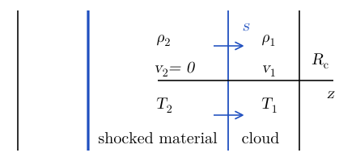

# Radiative Shocks {#sec-radshock}

::: {.callout-note}
This chapter is in preparation.
:::

## Exercises {#sec-radshock-exercises}

::: {#exr-radshock-colliding-clouds}
## Colliding clouds

Two identical clouds, each of radius $3 \times 10^{18} \operatorname{cm}$ and temperature $10\mathrm{K}$, collide with each other at a relative velocity of $4 \times 10^5 \operatorname{cm} \mathrm{s}^{- 1}$.

1.  *Estimate* the time $t_{\operatorname{coll}}$ that each cloud needs to run entirely into the shock.

2.  The shocked gas cools at a rate $\dot{Q} = 10^{- 3} \operatorname{erg} \cdot \mathrm{s}^{- 1} \cdot \mathrm{g}^{- 1}$. Decide whether the shock is approximately adiabatic or isothermal.

3.  Suppose the collision produces an isothermal shock. How thick is the shocked layer, $x$, at the moment when the whole of each cloud has been shocked?

4.  At later times the layer settles into a structure that can be approximated by a hydrostatic isothermal slab with column density $10^{- 2} \mathrm{g} \operatorname{cm}^{- 2}$. In this hydrostatic structure, what fraction of the clouds' mass lies within the thickness $x$? Neglect edge effects and variations of the column density across the plane of the slab. [Hint. The density profile of an isothermal slab is given in @clarke2007, Section 5.2.]

Adapted from @clarke2007, Problem 24.
:::

::: {.content-visible when-profile="solutions"}
::: {.solution}
We need to make some assumptions to be able to solve this problem. First, we consider an idealized geometry, which is sketched in @fig-radshock-geometry.

{#fig-radshock-geometry fig-alt="One-dimensional sketch along z: a thick blue line (edge of the shocked layer) and a thin blue line (the shock, moving right at speed s). Between them shocked material with density rho_2, velocity zero, temperature T_2; to the right the cloud with density rho_1, velocity v_1, temperature T_1, ending at radius R_c."}

Second, we will assume that the shock is strong ($T_1 \approx 0$), so that $\rho_2 = \frac{\Gamma + 1}{\Gamma - 1} \rho_1$.

1.  From the condition that the shock is strong, we find, similarly to @exr-shock-piston
    $$
    s = \frac{\Gamma - 1}{2} v_1 \sim 10^5 \operatorname{cm} \mathrm{s}^{- 1} .
    $$
    The time needed for the cloud to cross the shock is
    $$
    t_{\operatorname{coll}} = \frac{R_{\operatorname{cloud}}}{\left( \frac{\Gamma - 1}{2} + 1
    \right) v_1} = \frac{2}{\Gamma + 1}  \frac{R_{\operatorname{cloud}}}{v_1} \sim
    10^{13} \mathrm{s} \sim 300 \operatorname{kyr} .
    $$

2.  In the shock frame, the velocity upstream and downstream of the shock are
    $$
    u_1 = v_1 + s = \left( \frac{\Gamma + 1}{2} \right) v_1,  u_2 = - s =
    - \frac{\Gamma - 1}{2} v_1 .
    $$
    The enthalpy of the material downstream of the shock is
    $$
    h_2 = \frac{1}{2}  (u_1^2 - u_2^2) = \Gamma \frac{v_1^2}{2}
    \Longrightarrow \varepsilon_2 = \frac{v_1^2}{2} .
    $$
    This is not surprising: it is telling us that all kinetic energy is converted to internal energy at the shock. The typical time scale for cooling can be estimated as
    $$
    t_{\operatorname{cool}} = \frac{\rho_2 \varepsilon_2}{\rho_2  \dot{Q}} =
    \frac{v_1^2 / 2}{\dot{Q}} = \frac{2 \cdot 10^{10} \operatorname{cm}^2
    \mathrm{s}^{- 2}}{10^{- 3} \operatorname{cm}^2 \mathrm{s}^{- 3}} = 2 \cdot
    10^{13} \mathrm{s} \sim t_{\operatorname{coll}},
    $$
    so the **shock is efficiently radiating and can be considered as isothermal**.

3.  For an isothermal shock the compression factor is
    $$
    \frac{\rho_2}{\rho_1} = \left( \frac{u_2}{c_s} \right)^2 = \operatorname{Ma}^2,
    $$
    We can find the speed of the shock from the Rankine-Hugoniot conditions:
    $$
    s (\rho_2 - \rho_1) = v_1 \rho_1 \Longrightarrow s =
    \frac{v_1}{\operatorname{Ma}^2 - 1} .
    $$
    The speed of the cloud in the shock frame is given by
    $$
    u_1 = v_1 + s \Longrightarrow \operatorname{Ma} = \frac{u_2}{c_s} = \left(
    \frac{v}{c_s} \right)  \left( \frac{\operatorname{Ma}^2}{\operatorname{Ma}^2 - 1} \right)
    \Longrightarrow \operatorname{Ma} = \frac{\xi + \sqrt{\xi^2 + 4}}{2}, \qquad \xi
    = \frac{v}{c_s} .
    $$
    The parameter $\xi$ is the Mach number of the cloud (*not* the Mach number of the shock). However, if $\xi \gg 2$, then $\operatorname{Ma} \approx \xi$.
    $$
    c_s = \sqrt{\frac{k_B T}{\mu}} \approx 2.87 \cdot 10^4  \left(
    \frac{\mu}{m_p} \right)^{- 1 / 2} \operatorname{cm} \mathrm{s}^{- 1} \sim 2 \cdot
    10^4 \operatorname{cm} \mathrm{s}^{- 1} \Longrightarrow \xi \sim 10
    \Longrightarrow \operatorname{Ma} \sim 10.
    $$
    Assuming that the crossectional area $A$ stays constant, the conservation of mass implies
    $$
    \rho_1 AR_{\operatorname{cloud}} = \rho_2 Ax = \operatorname{Ma}^2 \rho_1 Ax
    \Longrightarrow x = \operatorname{Ma}^{- 2} R_{\operatorname{cloud}} \sim 3 \cdot 10^{16}
    \operatorname{cm} .
    $$

4.  After the cloud has relaxed [@clarke2007, Eq. 5.21],
    $$
    \rho (z) = \frac{\rho_0}{\cosh^2 \left( A \sqrt{\rho_0} z \right)},
    \qquad A = \sqrt{\frac{2 \pi G}{c_s^2}} .
    $$
    We can estimate the sound speed assuming the cloud to have cooled down to $T = 10 \mathrm{K}$, then $c_s \sim 2 \cdot 10^4 \operatorname{cm} \mathrm{s}^{- 1}$ and
    $$
    A \sim 3 \cdot 10^{- 8} \operatorname{cm}^{1 / 2} \mathrm{g}^{- 1 / 2} .
    $$
    To evaluate $\rho_0$ we use the fact that
    $$
    \int_0^{\infty} \rho (z) \dd z = \frac{\sqrt{\rho_0}}{A} = \sigma =
    0.5 \cdot 10^{- 2} \mathrm{g} \operatorname{cm}^{- 2} \Longrightarrow \rho_0 =
    A^2 \sigma^2 \sim 2.6 \cdot 10^{- 20} \mathrm{g} \operatorname{cm}^{- 3} .
    $$
    The fraction of material contained within a width of $x$ is
    $$
    f = \frac{1}{\sigma}  \int_0^x \frac{A^2 \sigma^2}{\cosh^2  (A^2 \sigma
    z)} \dd z = \int_0^{A^2 \sigma x} \frac{\dd \xi}{\cosh^2 \xi} =
    \tanh (A^2 \sigma x) \approx A^2 \sigma x = 0.135.
    $$
:::
:::

## Further reading {#sec-radshock-reading}

- @clarke2007, Chapter 7 (supersonic flows).
