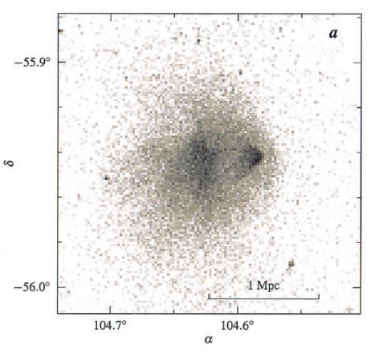
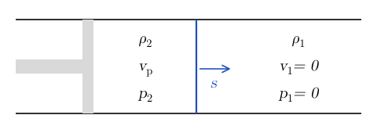

# Shock Waves {#sec-shock}

::: {.callout-note}
This chapter is in preparation.
:::

## In-class worksheet {#sec-shock-worksheet}

### Shock waves I

1.  Consider a shock wave in an ideal gas with adiabatic index $\Gamma$. Let $\rho_1, p_1$, and $T_1$ be the upstream (unshocked) gas density, pressure, and temperature. Let $\rho_2, p_2,$and $T_2$ be the corresponding downstream (post-shock) quantities.

    1.  Show that the ratio of downstream to upstream temperature across the shock is
        $$
        \frac{T_2}{T_1} = \frac{p_2}{p_1}  \frac{(\Gamma + 1) p_1 + (\Gamma - 1)
        p_2}{(\Gamma - 1) p_1 + (\Gamma + 1) p_2} .
        $$ {#eq-shock-1}

    2.  If $T_2 = 4 T_1$, what are $p_2$ and $\rho_2$ as a function of $\rho_1, p_1,$ and $T_1$?

### Shock waves II

1.  The Bullet Cluster (1E 0657-56) consists of two colliding clusters of galaxies. The name comes from the characteristic shape of a shock formed by the interaction of the gas from the two clusters, which is visible in X-ray. The image in @fig-shock-bullet-xray has been obtained with the Chandra X-ray space telescope.

    {#fig-shock-bullet-xray fig-alt="Grayscale X-ray image of the Bullet Cluster, with right ascension from about 104.75 to 104.55 degrees and declination from about minus 55.9 to minus 56.0 degrees, and a 1 megaparsec scale bar. A broad diffuse cloud of X-ray emission fills the centre; on its right side a small, dense bright clump, the bullet, is followed by a sharp edge, the bow shock, ahead of it to the right."}

    This data can be fitted to infer the following parameters for the upstream and downstream electron density and temperature:
    $$
    \begin{gathered}
    n_1 = 3.7 \times 10^{- 3} \operatorname{cm}^{- 3}, \quad T_1 = 9.3 \times 10^7
    \mathrm{K}, \\
    n_2 = 9.3 \cdot 10^{- 3} \operatorname{cm}^{- 3}, \quad T_2 =
    2.2 \cdot 10^8 \mathrm{K}.
    \end{gathered}
    $$ {#eq-shock-2}
    Estimate

    1.  the Mach number of the shock (defined as the Mach number of the upstream flow);

    2.  the relative velocity of approach of the two clusters of galaxies.

## Exercises {#sec-shock-exercises}

::: {#exr-shock-piston}
## Piston-driven shock

A piston drives a strong shock wave through a cold gas that is initially at rest; similar considerations are used to describe young supernova remnants. The piston moves at speed $v_p$ and has a mass per unit surface area $\sigma M_p$. The gas follows a gamma-law equation of state
$$
p = (\Gamma - 1) \rho \varepsilon .
$$ {#eq-shock-3}

1.  Express the shock speed $s$, and the downstream density $\rho_2$ and pressure $p_2$, in terms of the upstream density $\rho_1$. Keep $\Gamma$ general (do not set $\Gamma = 5/3$) and do not use the expression for $s$ given by Kulsrud, which contains a typo.

2.  Calculate the work that the piston does on the gas and estimate when the piston begins to decelerate. Compare the mass of the piston with the mass of the gas that the shock has swept up by that time. For this estimate, take the piston velocity to stay constant until the piston has lost a significant fraction of its kinetic energy.

Adapted from @kulsrud2005, Problem 4.6.
:::

::: {.content-visible when-profile="solutions"}
::: {.solution}
1.  We are considering the situation illustrated in @fig-shock-piston.

    {#fig-shock-piston fig-alt="A tube with a piston on the left moving right at speed v_p and a shock, a vertical line moving right at speed s. Between piston and shock: density rho_2, velocity v_p, pressure p_2. Ahead of the shock: density rho_1, velocity zero, pressure zero."}

    Upstream of the shock the density is $\rho_1$ and $v_1 = p_1 = 0$ (cold gas). Downstream of the shock, the flow is accelerated to $v_2 = v_p$ and compressed to density
    $$
    \rho_2 = \frac{\Gamma + 1}{\Gamma - 1} \rho_1
    $$
    and pressure $p_2$. We can find the velocity of the shock $s$ from the Rankine-Hugoniot condition of the continuity equation:
    $$
    s (\rho_2 - \rho_1) = \rho_2 v_p \Longrightarrow s = \left( \frac{\Gamma
    + 1}{\Gamma - 1} - 1 \right)^{- 1}  \left( \frac{\Gamma + 1}{\Gamma - 1}
    \right) v_p = \frac{\Gamma + 1}{2} v_p .
    $$
    The pressure downstream of the shock can be found from the Rankine-Hugonoit conditions in the shock frame:
    $$
    \rho_1 u_1 = \rho_2 u_2 = j  p_2 + j^2 V_2 = j^2 V_1,
    $$
    where we have introduced $V_i = 1 / \rho_i$ and $u_1, u_2$ are the fluid velocities in the shock frame. From these conditions, we find
    $$
    p_2 = j^2  (V_1 - V_2) = (\rho_1 s)^2  (V_1 - V_2) = s^2 \rho_1  \left( 1
    - \frac{\Gamma - 1}{\Gamma + 1} \right) = \frac{2}{\Gamma + 1} \rho_1 s^2
    .
    $$

2.  The work done by the piston per unit time and unit area is
    $$
    p_2 v_p = \frac{2}{\Gamma + 1} \rho_1  \left( \frac{\Gamma + 1}{2}
    \right)^2 v_p^3 = \frac{\Gamma + 1}{2} \rho_1 v_p^3 .
    $$
    The kinetic energy of the piston per unit area is $\frac{1}{2} \sigma M_p v_p^2$. The kinetic energy equals the work done by the piston up to time $t$ when
    $$
    \frac{1}{2} \sigma M_p v_p^2 = \frac{\Gamma + 1}{2} \rho_1 v_p^3 t
    \Longrightarrow \sigma M_p = (\Gamma + 1) v_p \rho_1 t = 2 s \rho_1 t.
    $$
    So the piston starts decelerating when $s \rho_1 \sim \sigma M_p$, that is once the shock has swept a mass of material comparable to the mass of the piston.
:::
:::

## Further reading {#sec-shock-reading}

- @clarke2007, Chapter 7 (supersonic flows).
- @landau1987, Sections 84--89 (shock waves).
