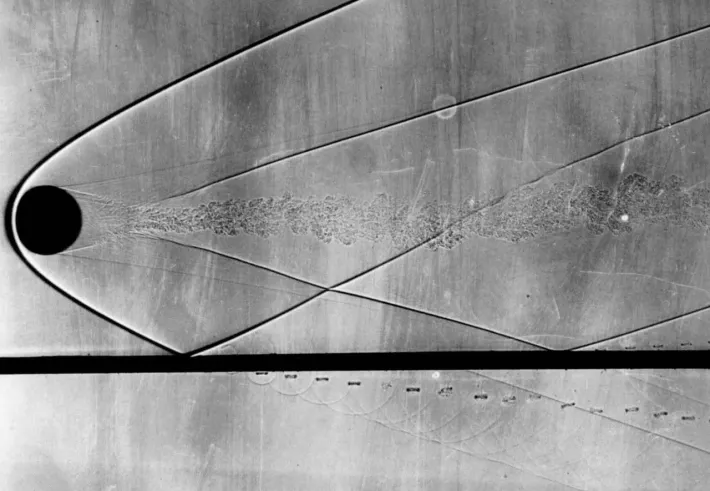
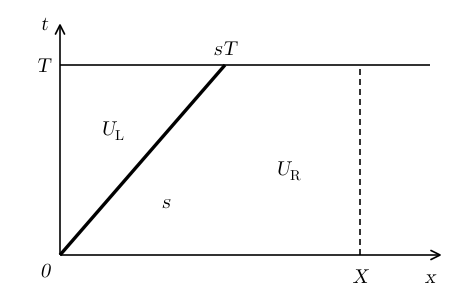
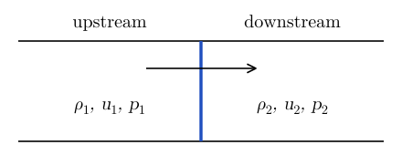
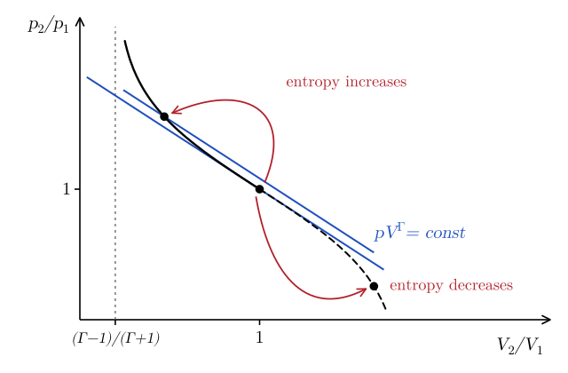
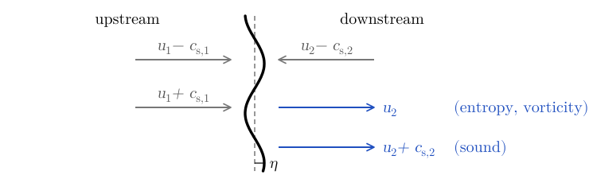
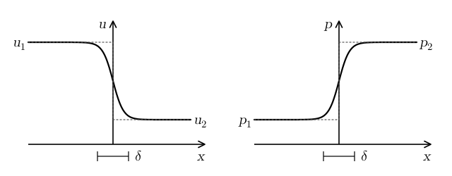
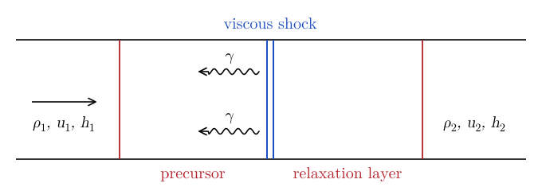
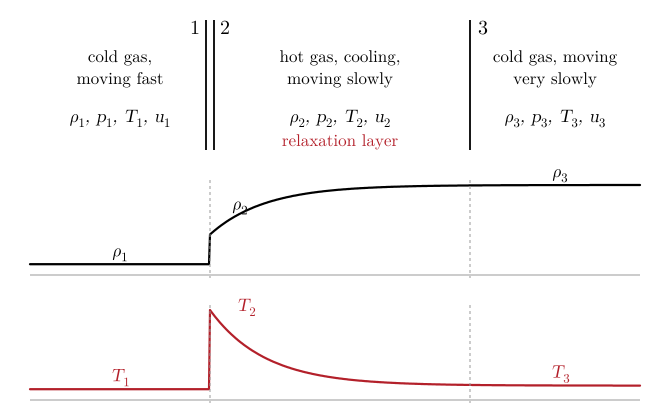
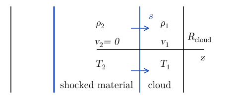

# Shock Waves {#sec-shock}

Shock waves are thin regions in which the density, pressure, and velocity of a fluid change abruptly. They form, for example, when sound waves steepen (@sec-sound), in front of supersonic objects (@fig-shock-sphere), and in explosions such as supernovae (@sec-sn). The thickness of a shock is of the order of the mean free path, so in the fluid approximation we can treat shocks as discontinuities.

{#fig-shock-sphere fig-alt="Black-and-white shadowgraph. A dark sphere on the left moves to the left at supersonic speed. A thin curved line, the bow shock, wraps around the front of the sphere and opens up to the right. Behind the sphere a turbulent wake extends to the right, and weaker oblique waves leave it. A horizontal dark band crosses the bottom of the image."}

## Discontinuous solutions {#sec-shock-discontinuous}

First, we need to learn how to deal with discontinuous solutions. Consider a conservation law in one dimension (see @tbl-conserv-summary),
$$
\partial_t U + \partial_x F (U) = 0 .
$$ {#eq-shock-1}
Suppose that $U$ has a discontinuity moving with speed $s$, so that $U = U_{\mathrm{L}}$ for $x < s t$ and $U = U_{\mathrm{R}}$ for $x > s t$ (@fig-shock-weak). The derivatives in @eq-shock-1 are not defined at the discontinuity, but we can still integrate the equation over the region $0 \leq t \leq T$, $0 \leq x \leq X$:
$$
\begin{aligned}
& \int_0^T \dd t \int_0^X \dd x \left[ \partial_t U + \partial_x F (U) \right] = 0 \\
\Longrightarrow \quad & \int_0^X \dd x \left[ U \right]_{t = 0}^{t = T} = - \int_0^T \dd t \left[ F (U) \right]_{x = 0}^{x = X} .
\end{aligned}
$$ {#eq-shock-2}
At $t = T$, $U = U_{\mathrm{L}}$ for $0 < x < s T$ and $U = U_{\mathrm{R}}$ for $s T < x < X$, while at $t = 0$, $U = U_{\mathrm{R}}$ everywhere. So
$$
\begin{aligned}
& U_{\mathrm{L}} s T + U_{\mathrm{R}} (X - s T) - U_{\mathrm{R}} X \\
& \qquad = T \left[ F (U_{\mathrm{L}}) - F (U_{\mathrm{R}}) \right],
\end{aligned}
$$ {#eq-shock-3}
that is
$$
\boxed{s (U_{\mathrm{L}} - U_{\mathrm{R}}) = F (U_{\mathrm{L}}) - F (U_{\mathrm{R}}) .}
$$ {#eq-shock-jump}
This is called a *jump condition*. In the frame of the discontinuity, $s = 0$, it reads $F (U_{\mathrm{L}}) = F (U_{\mathrm{R}})$. In other words, the flux is continuous across the discontinuity. This makes sense, because whatever flows into the discontinuity from one side must flow out of the other side.

{#fig-shock-weak fig-alt="Axes t, vertical, and x, horizontal. A thick line starts at the origin and reaches x = sT at time T: it is the discontinuity, moving with speed s. To its left the solution is U_L, to its right U_R. A horizontal line at t = T and a dashed vertical line at x = X bound the integration region."}

## Rankine–Hugoniot conditions {#sec-shock-rh}

The equations of hydrodynamics in one dimension, without external forces and heating or cooling, can be written as (@tbl-conserv-summary)
$$
\begin{gathered}
\partial_t \vb{U} + \partial_x \vb{F} (\vb{U}) = 0, \\
\vb{U} = \begin{pmatrix} \rho \\ \rho v \\ \rho \varepsilon + \frac{1}{2} \rho v^2 \end{pmatrix}, \qquad
\vb{F} (\vb{U}) = \begin{pmatrix} \rho v \\ \rho v^2 + p \\ \rho h v + \frac{1}{2} \rho v^3 \end{pmatrix},
\end{gathered}
$$ {#eq-shock-5}
where $h = \varepsilon + p / \rho$ is the specific enthalpy and $p = p (\rho, \varepsilon)$ is given by the equation of state. Each component of @eq-shock-5 satisfies the jump condition @eq-shock-jump. It is easiest to write them in the frame of the shock, where $s = 0$ and the fluid velocity is $u = v - s$ (@fig-shock-frame). We denote with $1$ the *upstream* state, from which the gas flows into the shock, and with $2$ the *downstream* state. We obtain the **Rankine–Hugoniot conditions**:
$$
\begin{aligned}
\rho_1 u_1 &= \rho_2 u_2, \\
\rho_1 u_1^2 + p_1 &= \rho_2 u_2^2 + p_2, \\
\rho_1 h_1 u_1 + \tfrac{1}{2} \rho_1 u_1^3 &= \rho_2 h_2 u_2 + \tfrac{1}{2} \rho_2 u_2^3 .
\end{aligned}
$$ {#eq-shock-rh}
These are three equations for seven quantities: $\rho_i$, $v_i$, $p_i$ ($i = 1, 2$), and $s$. So, given the upstream state, one more quantity, for example $p_2$ or $s$, determines the downstream state.

{#fig-shock-frame fig-alt="A tube crossed by a thick vertical line, the shock. An arrow shows the gas flowing from left to right. On the left, upstream, the gas has density rho_1, velocity u_1 and pressure p_1. On the right, downstream, it has density rho_2, velocity u_2 and pressure p_2."}

To manipulate @eq-shock-rh, we define the specific volume $V_i = 1 / \rho_i$ (not to be confused with a volume) and the mass flux through the shock
$$
j = \rho_1 u_1 = \rho_2 u_2 \Longrightarrow u_i = j V_i .
$$ {#eq-shock-7}
The momentum condition becomes $V_1 j^2 + p_1 = V_2 j^2 + p_2$, so that
$$
\boxed{j^2 = \frac{p_2 - p_1}{V_1 - V_2} .}
$$ {#eq-shock-mass-flux}
Note that, since $j^2 > 0$, pressure and density must both increase or both decrease across the shock. Dividing the left-hand side of the energy condition by $\rho_1 u_1$ and the right-hand side by $\rho_2 u_2$, which are both equal to $j$, we obtain
$$
h_1 + \frac{1}{2} j^2 V_1^2 = h_2 + \frac{1}{2} j^2 V_2^2 ,
$$ {#eq-shock-9}
and, using @eq-shock-mass-flux,
$$
\boxed{h_2 = h_1 + \frac{1}{2} (p_2 - p_1) (V_1 + V_2) .}
$$ {#eq-shock-adiabat}
This relation is called the *shock adiabat*, or Hugoniot adiabat. Note that it only involves the thermodynamic state of the gas on the two sides of the shock.

### Polytropic gas

For an ideal gas with a $\Gamma$-law equation of state (@eq-thermo-gamma-law)
$$
\begin{gathered}
h = \varepsilon + p V, \qquad \varepsilon = \frac{p V}{\Gamma - 1} \\
\Longrightarrow \quad h = \frac{\Gamma}{\Gamma - 1} p V = \Gamma \varepsilon,
\end{gathered}
$$ {#eq-shock-11}
so @eq-shock-adiabat becomes
$$
\begin{aligned}
\Gamma p_2 V_2 &= \Gamma p_1 V_1 \\
&\quad + \frac{1}{2} (\Gamma - 1) (p_2 - p_1) (V_1 + V_2) .
\end{aligned}
$$ {#eq-shock-12}
Solving for the pressure ratio or for the volume ratio, we find
$$
\begin{aligned}
\frac{p_2}{p_1} &= \frac{(\Gamma + 1) V_1 - (\Gamma - 1) V_2}{(\Gamma + 1) V_2 - (\Gamma - 1) V_1}, \\
\frac{V_2}{V_1} &= \frac{(\Gamma + 1) p_1 + (\Gamma - 1) p_2}{(\Gamma - 1) p_1 + (\Gamma + 1) p_2} .
\end{aligned}
$$ {#eq-shock-ratios}
We will use these relations in the in-class worksheet (@sec-shock-worksheet). Note that $V_2 / V_1$ decreases as $p_2 / p_1$ increases, and for a *strong shock*, $p_2 \gg p_1$,
$$
\frac{V_2}{V_1} \to \frac{\Gamma - 1}{\Gamma + 1} .
$$ {#eq-shock-strong}
In other words, a shock can heat the gas without limit, but it can compress it at most by a factor $(\Gamma + 1) / (\Gamma - 1)$.

::: {.callout-tip icon=false}
## Example

For a monoatomic gas, $\Gamma = 5 / 3$, the compression is $\rho_2 / \rho_1 \leq 4$. For a gas dominated by radiation or relativistic particles, $\Gamma = 4 / 3$, it is $\rho_2 / \rho_1 \leq 7$.
:::

The shock adiabat is shown in @fig-shock-hugoniot, together with the adiabats $p V^{\Gamma} = K = \mathrm{const}$. Recall that $K$ is a function of the entropy only (@eq-thermo-poly). For compressions, $V_2 < V_1$, the shock adiabat lies above the adiabat of the upstream gas, so the gas leaves the shock with a larger entropy. For expansions, $V_2 > V_1$, it lies below, so the entropy would decrease. Since the entropy of the gas crossing the shock cannot decrease, only compression shocks, with $p_2 > p_1$ and $\rho_2 > \rho_1$, are physical.

{#fig-shock-hugoniot fig-alt="Logarithmic plot of the pressure ratio p_2/p_1 against the volume ratio V_2/V_1 for Gamma = 5/3. The adiabats p V^Gamma = const are straight blue lines. The shock adiabat, in black, touches the adiabat through the point (1, 1) at that point. For compressions, V_2/V_1 < 1, it rises above it towards a vertical asymptote at V_2/V_1 = (Gamma - 1)/(Gamma + 1) = 1/4, and a compressed state lies on a higher adiabat, so its entropy is larger. For expansions, V_2/V_1 > 1, the shock adiabat is dashed and lies below the adiabat through (1, 1), so the entropy would be smaller."}

::: {.callout-note}
## Going further: Shocks with energy losses

So far, we have assumed that the composition of the gas does not change across the shock. However, the gas heated by a shock can be ionized, or its molecules or nuclei can be dissociated. These processes absorb an energy $\Delta \varepsilon$ per unit mass, which is no longer available to heat the gas. The conservation of mass and momentum is unchanged, while the energy condition, divided by $j$ as in @eq-shock-9, becomes
$$
h_1 + \frac{1}{2} u_1^2 = h_2 + \frac{1}{2} u_2^2 + \Delta \varepsilon .
$$ {#eq-shock-15}
For example, the ionization of atomic hydrogen requires an energy $\chi = 13.6\,\mathrm{eV} = 2.18 \times 10^{-18}\,\mathrm{J}$ per atom, so
$$
\Delta \varepsilon = \frac{\chi}{m_p} \approx 1.3 \times 10^9\,\mathrm{J\,kg^{-1}} .
$$ {#eq-shock-16}
The dissociation of iron nuclei into free nucleons requires about $8.8\,\mathrm{MeV}$ per nucleon, so $\Delta \varepsilon \approx 8.8\,\mathrm{MeV} / m_u \approx 8.5 \times 10^{14}\,\mathrm{J\,kg^{-1}}$. This is the energy lost by the shock of a core-collapse supernova as it moves through the iron core of the star (@sec-sn).

Consider now a strong shock in a cold gas, $p_1 = 0$ and $h_1 = 0$. The momentum condition gives $j^2 = p_2 / (V_1 - V_2)$, and the energy condition becomes
$$
\begin{aligned}
& \frac{1}{2} j^2 V_1^2 = h_2 + \Delta \varepsilon + \frac{1}{2} j^2 V_2^2 \\
\Longrightarrow \quad & h_2 = \frac{1}{2} p_2 (V_1 + V_2) - \Delta \varepsilon .
\end{aligned}
$$ {#eq-shock-17}
For a polytropic gas, $h_2 = \Gamma p_2 V_2 / (\Gamma - 1)$, so
$$
\boxed{\frac{V_2}{V_1} = \frac{\Gamma - 1}{\Gamma + 1} - \frac{2 (\Gamma - 1)}{\Gamma + 1} \frac{\Delta \varepsilon}{p_2 V_1} .}
$$ {#eq-shock-loss-compression}
In other words, energy losses increase the density jump across the shock, because the energy spent on ionization or dissociation does not contribute to the pressure. Conversely, if the reactions release energy, $\Delta \varepsilon < 0$, as in a detonation, the compression is reduced.
:::

### Mach numbers

From @eq-shock-mass-flux and @eq-shock-ratios,
$$
\begin{aligned}
j^2 &= \frac{p_2 - p_1}{V_1} \frac{1}{1 - V_2 / V_1} \\
&= \frac{p_2 - p_1}{V_1} \frac{(\Gamma - 1) p_1 + (\Gamma + 1) p_2}{2 (p_2 - p_1)} \\
&= \frac{1}{2 V_1} \left[ (\Gamma - 1) p_1 + (\Gamma + 1) p_2 \right] .
\end{aligned}
$$ {#eq-shock-19}
So the velocity upstream of the shock is
$$
\begin{aligned}
u_1^2 &= V_1^2 j^2 = \frac{V_1}{2} \left[ (\Gamma - 1) p_1 + (\Gamma + 1) p_2 \right] \\
&= \frac{\Gamma p_1 V_1}{2 \Gamma} \left[ \Gamma \left( 1 + \frac{p_2}{p_1} \right) + \left( \frac{p_2}{p_1} - 1 \right) \right],
\end{aligned}
$$ {#eq-shock-20}
where $c_{s, 1}^2 = \Gamma p_1 V_1$ is the upstream sound speed (@eq-sound-15). The upstream Mach number is then
$$
\begin{aligned}
\mathrm{Ma}_1^2 &= \frac{u_1^2}{c_{s, 1}^2} \\
&= \frac{1}{2 \Gamma} \left[ \Gamma \left( 1 + \frac{p_2}{p_1} \right) + \left( \frac{p_2}{p_1} - 1 \right) \right] \geq 1,
\end{aligned}
$$ {#eq-shock-mach-upstream}
since $p_2 \geq p_1$ for a physical shock. Similarly,
$$
\begin{aligned}
u_2^2 &= V_2^2 j^2 = \frac{V_2}{2} \frac{V_2}{V_1} \left[ (\Gamma - 1) p_1 + (\Gamma + 1) p_2 \right] \\
&= \frac{V_2}{2} \left[ (\Gamma + 1) p_1 + (\Gamma - 1) p_2 \right],
\end{aligned}
$$ {#eq-shock-22}
so that
$$
\begin{aligned}
\mathrm{Ma}_2^2 &= \frac{u_2^2}{c_{s, 2}^2} \\
&= \frac{1}{2 \Gamma} \left[ \Gamma \left( 1 + \frac{p_1}{p_2} \right) + \left( \frac{p_1}{p_2} - 1 \right) \right] \leq 1 .
\end{aligned}
$$ {#eq-shock-mach-downstream}
Therefore, the gas enters the shock with a supersonic velocity and leaves it with a subsonic velocity. In other words, *shocks separate supersonic from subsonic flows*. Note that, in the limit of a weak shock, $p_2 \to p_1$, both Mach numbers tend to one: a very weak shock is a sound wave.

::: {.callout-tip icon=false}
## Example

Stars and pulsars moving supersonically through the interstellar medium are surrounded by *bow shocks*, like the one in front of the sphere in @fig-shock-sphere. @fig-shock-j0437 shows the bow shock around the millisecond pulsar PSR J0437−4715 [@bell1995], made visible by the Hα emission of the shocked interstellar gas. In this case, the obstacle is the wind of the pulsar.

{#fig-shock-j0437 fig-alt="Grayscale H-alpha image with a 15 arcsecond scale bar. A faint, curved arc of emission opens towards the upper right, with its apex towards the lower left. An arrow at the lower left points in the direction of motion of the pulsar, towards the apex of the arc. A few stars are visible in the field."}
:::

## Stability of shocks {#sec-shock-stability}

The Rankine–Hugoniot conditions admit many solutions, but not all of them are realized in nature. A shock must also be stable with respect to small perturbations. Consider a shock in its rest frame and perturb it, so that it is displaced by a small amount $\eta$, which can vary along the shock (@fig-shock-evolutionary). The perturbation generates small-amplitude waves on both sides of the shock. In a uniform flow with velocity $u$, these are sound waves moving with velocities $u \pm c_s$ (@eq-sound-doppler) and entropy perturbations, which are carried by the flow with velocity $u$.

The waves moving towards the shock are given, while the waves moving away from it, together with $\eta$, have to be determined from the three (linearized) jump conditions. Upstream, the waves moving away from the shock have negative velocity. The sound wave with velocity $u_1 - c_{s, 1} < 0$ exists only if $u_1 < c_{s, 1}$. Downstream, the waves moving away from the shock have positive velocity. These are the entropy perturbation, with velocity $u_2$, and the sound wave with velocity $u_2 + c_{s, 2}$, and, if $u_2 > c_{s, 2}$, also the sound wave with velocity $u_2 - c_{s, 2}$.

If $u_1 > c_{s, 1}$ and $u_2 < c_{s, 2}$, we have three unknowns: $\eta$, the entropy perturbation, and one sound wave. These can be determined using the three jump conditions. If $\eta$ varies along the shock, the flow downstream also carries vorticity perturbations, with velocity $u_2$. However, there is also one more jump condition, for the velocity tangential to the shock, so the counting does not change. In all other cases, there are more unknowns than equations, so the evolution of a small perturbation is not determined. Such shocks cannot exist [@landau1987, Sec. 88]. So *the jump conditions can be solved only if $u_1 > c_{s, 1}$ and $u_2 < c_{s, 2}$*. This is the same result that we have obtained in @eq-shock-mach-upstream and @eq-shock-mach-downstream, but here we have not made any assumption on the equation of state.

{#fig-shock-evolutionary fig-alt="A shock in its rest frame, with the gas flowing from left to right. A thin dashed vertical line marks the unperturbed shock; the perturbed shock, a thick wavy line, oscillates around it, and its displacement is marked eta. On the upstream side, on the left, two gray arrows point towards the shock: the sound waves moving at u_1 - c_s,1 and u_1 + c_s,1, which are both positive. On the downstream side, on the right, a gray arrow points towards the shock: the sound wave moving at u_2 - c_s,2, which is negative. Two blue arrows point away from the shock: the entropy and vorticity perturbations, moving at u_2, and the sound wave moving at u_2 + c_s,2."}

## Structure of shocks {#sec-shock-structure}

The Rankine–Hugoniot conditions describe the conservation of mass, momentum, and energy across a shock, but they do not tell us anything about its internal structure. Inside a shock the velocity and the temperature change over very short distances, so viscosity and heat conduction cannot be neglected. In the shock frame, the steady one-dimensional equations become
$$
\begin{gathered}
\frac{\dd}{\dd x} (\rho u) = 0, \qquad \frac{\dd}{\dd x} \left( p + \rho u^2 - \sigma \right) = 0, \\
\frac{\dd}{\dd x} \left[ \rho u \left( h + \frac{u^2}{2} \right) - u \sigma + F_{\mathrm{heat}} \right] = 0,
\end{gathered}
$$ {#eq-shock-24}
where $\sigma \propto \dd u / \dd x$ is the viscous stress (@sec-visc) and $F_{\mathrm{heat}} \propto - \dd T / \dd x$ is the heat flux (@sec-conserv). Far upstream the flow is homogeneous, so the diffusive terms disappear, and we can integrate @eq-shock-24 to obtain
$$
\begin{aligned}
\rho u &= \rho_1 u_1, \\
p + \rho u^2 - \sigma &= p_1 + \rho_1 u_1^2, \\
\rho u \left( h + \frac{u^2}{2} \right) - u \sigma + F_{\mathrm{heat}} &= \rho_1 u_1 \left( h_1 + \frac{u_1^2}{2} \right) .
\end{aligned}
$$ {#eq-shock-25}
The solution of these equations determines the structure of the shock (@fig-shock-viscous). Far downstream the diffusive terms disappear again, and we recover the Rankine–Hugoniot conditions.

{#fig-shock-viscous fig-alt="Two panels. Left: the velocity u as a function of x decreases smoothly from u_1 to u_2 over a width delta; a dotted line shows the corresponding discontinuity. Right: the pressure p increases smoothly from p_1 to p_2 over the same width."}

The thickness $\delta$ of a strong shock is of the order of the mean free path of the particles that carry momentum and energy across it (weak shocks are thicker). Shocks in terrestrial applications are mediated by collisions between molecules, and in air $\delta \sim 100\,\mathrm{nm}$. Shocks in astrophysical applications are often mediated by photons (*radiation-mediated shocks*), or they are *collisionless*, that is mediated by interactions between particles and waves in a plasma (@sec-plasma). However, for many applications the nature of the shock is not important: the downstream state $\rho_2$, $u_2$, $h_2$ only depends on the upstream state and on the strength of the shock, through the Rankine–Hugoniot conditions. The most comprehensive reference on the physics of shocks is @zeldovich2002.

## Radiative shocks {#sec-shock-radiative}

So far, we have assumed that the gas does not exchange energy with the radiation. However, the gas behind a strong shock is hot, and it radiates. The structure of the shock then depends on whether the gas is optically thick or optically thin to its own radiation.

### Optically thick shocks

If the gas is optically thick, the photons emitted by the hot gas behind the shock diffuse upstream and heat the gas ahead of it, in a region called the *radiative precursor* (@fig-shock-thick). Behind the viscous shock, the gas and the radiation relax to equilibrium in a *relaxation layer*. Since no energy escapes, the Rankine–Hugoniot conditions still connect the states on the two sides of the whole structure, if we include the pressure and the energy of the radiation in $p$ and $h$.

{#fig-shock-thick fig-alt="A tube with the gas flowing from left to right. In the middle, a double blue line is the viscous shock. Wavy arrows labelled gamma show photons moving from the viscous shock upstream, to the left, into the precursor, which is bounded by a red line on the left. Downstream of the viscous shock, a relaxation layer ends at a second red line. Upstream of the precursor the gas has rho_1, u_1 and h_1; downstream of the relaxation layer it has rho_2, u_2 and h_2."}

In weak, *subcritical* shocks, the precursor heats the upstream gas to a temperature lower than the final temperature $T_2$. In strong, *supercritical* shocks, the precursor heats the upstream gas all the way to $T_2$. In both cases, the temperature just behind the viscous shock can exceed $T_2$ [@mihalas1984].

### Optically thin shocks

If the gas is optically thin, the radiation escapes and carries energy away. The structure of the shock is shown in @fig-shock-thin. Cold gas moving rapidly (1) crosses the viscous shock and is heated (2), as described by the Rankine–Hugoniot conditions. The hot gas then cools in a *radiative relaxation layer*, until it reaches thermal equilibrium (3). As the gas cools, it slows down and it is compressed further. The profile of the relaxation layer can be found by solving
$$
\begin{gathered}
\frac{\dd}{\dd x} (\rho u) = 0, \qquad \frac{\dd}{\dd x} \left( \rho u^2 + p \right) = 0, \\
\rho u \frac{\dd \varepsilon}{\dd x} = - p \frac{\dd u}{\dd x} - \rho \dot{Q},
\end{gathered}
$$ {#eq-shock-26}
where $\dot{Q}$ is the net cooling rate per unit mass. Note that energy is not conserved. Instead, the conditions downstream of the shock can be found from the conservation of mass and momentum, and from the condition of thermal equilibrium:
$$
\begin{gathered}
\rho_1 u_1 = \rho_3 u_3, \qquad p_1 + \rho_1 u_1^2 = p_3 + \rho_3 u_3^2, \\
\dot{Q} (\rho_3, T_3) = 0 .
\end{gathered}
$$ {#eq-shock-thin-jump}

{#fig-shock-thin fig-alt="Top: the gas flows from left to right. Region 1 is cold gas moving rapidly, with rho_1, p_1, T_1 and u_1. A double line, the viscous shock, separates it from region 2, hot gas moving slowly, with rho_2, p_2, T_2 and u_2. The gas then cools in a radiative relaxation layer, which ends in region 3, cold gas moving very slowly, with rho_3, p_3, T_3 and u_3. Below, two profiles aligned with the regions: the density jumps from rho_1 to rho_2 at the shock and then keeps increasing to rho_3 in the relaxation layer; the temperature jumps from T_1 to T_2 at the shock and then decreases to T_3, close to T_1."}

### Isothermal shocks {#sec-shock-isothermal}

For the interstellar medium, a good approximation is often $T_3 = T_1$: the gas cools back to the temperature set by the balance of heating and cooling. In this case the equation of state is $p = c_{\mathrm{iso}}^2 \rho$ (@eq-sound-isothermal), and @eq-shock-thin-jump becomes
$$
\begin{aligned}
\rho_3 u_3 &= \rho_1 u_1, \\
c_{\mathrm{iso}}^2 \rho_3 + \rho_3 u_3^2 &= c_{\mathrm{iso}}^2 \rho_1 + \rho_1 u_1^2 .
\end{aligned}
$$ {#eq-shock-28}
These can be solved to find
$$
\boxed{\frac{\rho_3}{\rho_1} = \left( \frac{u_1}{c_{\mathrm{iso}}} \right)^2 = \mathrm{Ma}_1^2 ,}
$$ {#eq-shock-isothermal-compression}
where the Mach number is now defined with the isothermal sound speed. Note the difference with adiabatic shocks. The compression is not limited to $(\Gamma + 1) / (\Gamma - 1)$ (@eq-shock-strong), but grows as the square of the Mach number. This is why radiative shocks can produce very dense layers of gas, for example when interstellar clouds collide (@exr-shock-colliding-clouds).

## In-class worksheet {#sec-shock-worksheet}

### Shock waves I

1.  Consider a shock wave in an ideal gas with adiabatic index $\Gamma$. Let $\rho_1, p_1$, and $T_1$ be the upstream (unshocked) gas density, pressure, and temperature. Let $\rho_2, p_2,$ and $T_2$ be the corresponding downstream (post-shock) quantities.

    1.  Show that the ratio of downstream to upstream temperature across the shock is
        $$
        \frac{T_2}{T_1} = \frac{p_2}{p_1}  \frac{(\Gamma + 1) p_1 + (\Gamma - 1)
        p_2}{(\Gamma - 1) p_1 + (\Gamma + 1) p_2} .
        $$ {#eq-shock-30}

    2.  If $T_2 = 4 T_1$, what are $p_2$ and $\rho_2$ as a function of $\rho_1, p_1,$ and $T_1$?

### Shock waves II

1.  The Bullet Cluster (1E 0657-56) consists of two colliding clusters of galaxies. The name comes from the characteristic shape of a shock formed by the interaction of the gas from the two clusters, which is visible in X-ray. The image in @fig-shock-bullet-xray has been obtained with the Chandra X-ray space telescope.

    {#fig-shock-bullet-xray fig-alt="Grayscale X-ray image of the Bullet Cluster, with right ascension from about 104.75 to 104.55 degrees and declination from about minus 55.9 to minus 56.0 degrees, and a 1 megaparsec scale bar. A broad diffuse cloud of X-ray emission fills the centre; on its right side a small, dense bright clump, the bullet, is followed by a sharp edge, the bow shock, ahead of it to the right."}

    This data can be fitted to infer the following parameters for the upstream and downstream electron density and temperature:
    $$
    \begin{gathered}
    n_1 = 3.7 \times 10^{- 3}\, \mathrm{cm}^{- 3}, \enspace T_1 = 9.3 \times 10^7
    \,\mathrm{K}, \\
    n_2 = 9.3 \times  10^{- 3}\, \mathrm{cm}^{- 3}, \enspace T_2 =
    2.2 \times  10^8 \,\mathrm{K}.
    \end{gathered}
    $$ {#eq-shock-31}
    Estimate

    1.  the Mach number of the shock (defined as the Mach number of the upstream flow);

    2.  the relative velocity of approach of the two clusters of galaxies.

## Exercises {#sec-shock-exercises}

::: {#exr-shock-piston}
## Piston-driven shock

A piston drives a strong shock wave through a cold gas that is initially at rest; similar considerations are used to describe young supernova remnants. The piston moves at speed $v_p$ and has a mass per unit surface area $\Sigma_p$. The gas follows a gamma-law equation of state
$$
p = (\Gamma - 1) \rho \varepsilon .
$$ {#eq-shock-32}

1.  Express the shock speed $s$, and the downstream density $\rho_2$ and pressure $p_2$, in terms of the upstream density $\rho_1$. Keep $\Gamma$ general (do not set $\Gamma = 5/3$) and do not use the expression for $s$ given by Kulsrud, which contains a typo.

2.  Calculate the work that the piston does on the gas and estimate when the piston begins to decelerate. Compare the mass of the piston with the mass of the gas that the shock has swept up by that time. For this estimate, take the piston velocity to stay constant until the piston has lost a significant fraction of its kinetic energy.

Adapted from @kulsrud2005, Problem 4.6.
:::

::: {.content-visible when-profile="solutions"}
::: {.solution}
1.  We are considering the situation illustrated in @fig-shock-piston.

    {#fig-shock-piston fig-alt="A tube with a piston on the left moving right at speed v_p and a shock, a vertical line moving right at speed s. Between piston and shock: density rho_2, velocity v_p, pressure p_2. Ahead of the shock: density rho_1, velocity zero, pressure zero."}

    Upstream of the shock the density is $\rho_1$ and $v_1 = p_1 = 0$ (cold gas). Downstream of the shock, the flow is accelerated to $v_2 = v_p$ and, since the shock is strong (@eq-shock-strong), compressed to density
    $$
    \rho_2 = \frac{\Gamma + 1}{\Gamma - 1} \rho_1
    $$
    and pressure $p_2$. We can find the velocity of the shock $s$ from the Rankine–Hugoniot condition of the continuity equation:
    $$
    s (\rho_2 - \rho_1) = \rho_2 v_p \Longrightarrow s = \left( \frac{\Gamma
    + 1}{\Gamma - 1} - 1 \right)^{- 1}  \left( \frac{\Gamma + 1}{\Gamma - 1}
    \right) v_p = \frac{\Gamma + 1}{2} v_p .
    $$
    The pressure downstream of the shock can be found from the Rankine–Hugoniot conditions in the shock frame:
    $$
    \rho_1 u_1 = \rho_2 u_2 = j, \qquad p_2 + j^2 V_2 = j^2 V_1,
    $$
    where we have introduced $V_i = 1 / \rho_i$ and $u_1, u_2$ are the fluid velocities in the shock frame. From these conditions, we find
    $$
    p_2 = j^2  (V_1 - V_2) = (\rho_1 s)^2  (V_1 - V_2) = s^2 \rho_1  \left( 1
    - \frac{\Gamma - 1}{\Gamma + 1} \right) = \frac{2}{\Gamma + 1} \rho_1 s^2
    .
    $$

2.  The work done by the piston per unit time and unit area is
    $$
    p_2 v_p = \frac{2}{\Gamma + 1} \rho_1  \left( \frac{\Gamma + 1}{2}
    \right)^2 v_p^3 = \frac{\Gamma + 1}{2} \rho_1 v_p^3 .
    $$
    The kinetic energy of the piston per unit area is $\frac{1}{2} \Sigma_p v_p^2$. The kinetic energy equals the work done by the piston up to time $t$ when
    $$
    \frac{1}{2} \Sigma_p v_p^2 = \frac{\Gamma + 1}{2} \rho_1 v_p^3 t
    \Longrightarrow \Sigma_p = (\Gamma + 1) v_p \rho_1 t = 2 s \rho_1 t.
    $$
    So the piston starts decelerating when $\rho_1 s t \sim \Sigma_p$, that is once the shock has swept a mass of material comparable to the mass of the piston.
:::
:::

::: {#exr-shock-colliding-clouds}
## Colliding clouds

Two identical clouds, each of radius $3 \times 10^{16}\, \mathrm{m}$ (about 1 pc) and temperature $10\,\mathrm{K}$, collide with each other at a relative velocity of $4\, \mathrm{km} \, \mathrm{s}^{- 1}$.

1.  *Estimate* the time $t_{\mathrm{coll}}$ that each cloud needs to run entirely into the shock.

2.  The shocked gas cools at a rate $\dot{Q} = 10^{- 7}\, \mathrm{W} \, \mathrm{kg}^{- 1}$. Decide whether the shock is approximately adiabatic or isothermal.

3.  Suppose the collision produces an isothermal shock. How thick is the shocked layer, $x$, at the moment when the whole of each cloud has been shocked?

4.  At later times the layer settles into a structure that can be approximated by a hydrostatic isothermal slab with column density $10^{- 2}\, \mathrm{g} \, \mathrm{cm}^{- 2} = 0.1\, \mathrm{kg} \, \mathrm{m}^{- 2}$. In this hydrostatic structure, what fraction of the clouds' mass lies within the thickness $x$? Neglect edge effects and variations of the column density across the plane of the slab. [Hint. The density profile of an isothermal slab is given in @clarke2007, Section 5.2.]

Adapted from @clarke2007, Problem 24.
:::

::: {.content-visible when-profile="solutions"}
::: {.solution}
We need to make some assumptions to be able to solve this problem. First, we consider an idealized geometry, which is sketched in @fig-shock-clouds. We work in the center-of-mass frame, in which the shocked gas is at rest and each cloud moves towards it at $v_1 = 2\, \mathrm{km} \, \mathrm{s}^{- 1}$, half the relative velocity.

{#fig-shock-clouds fig-alt="One-dimensional sketch along z: a thick blue line (edge of the shocked layer) and a thin blue line (the shock, moving right at speed s). Between them shocked material with density rho_2, velocity zero, temperature T_2; to the right the cloud with density rho_1, velocity v_1, temperature T_1, ending at radius R_cloud."}

Second, we will assume that the shock is strong ($T_1 \approx 0$), so that $\rho_2 = \frac{\Gamma + 1}{\Gamma - 1} \rho_1$.

1.  From the condition that the shock is strong, we find, similarly to @exr-shock-piston
    $$
    s = \frac{\Gamma - 1}{2} v_1 \sim 10^3\, \mathrm{m} \, \mathrm{s}^{- 1} .
    $$
    The time needed for the cloud to cross the shock is
    $$
    t_{\mathrm{coll}} = \frac{R_{\mathrm{cloud}}}{\left( \frac{\Gamma - 1}{2} + 1
    \right) v_1} = \frac{2}{\Gamma + 1}  \frac{R_{\mathrm{cloud}}}{v_1} \sim
    10^{13}\, \mathrm{s} \sim 300\, \mathrm{kyr} .
    $$

2.  In the shock frame, the velocity upstream and downstream of the shock are
    $$
    u_1 = v_1 + s = \left( \frac{\Gamma + 1}{2} \right) v_1, \qquad u_2 = - s =
    - \frac{\Gamma - 1}{2} v_1 .
    $$
    The enthalpy of the material downstream of the shock is
    $$
    h_2 = \frac{1}{2}  (u_1^2 - u_2^2) = \Gamma \frac{v_1^2}{2}
    \Longrightarrow \varepsilon_2 = \frac{v_1^2}{2} .
    $$
    This is not surprising: it is telling us that all kinetic energy is converted to internal energy at the shock. The typical time scale for cooling can be estimated as
    $$
    t_{\mathrm{cool}} = \frac{\rho_2 \varepsilon_2}{\rho_2  \dot{Q}} =
    \frac{v_1^2 / 2}{\dot{Q}} = \frac{2 \times  10^6\, \mathrm{m}^2
    \,\mathrm{s}^{- 2}}{10^{- 7}\, \mathrm{m}^2\,\mathrm{s}^{- 3}} = 2 \times
     10^{13}\, \mathrm{s} \sim t_{\mathrm{coll}},
    $$
    so the gas radiates away its internal energy over the duration of the collision. In other words, the **shock is not adiabatic**. Since cooling brings the gas back towards its initial temperature, we can treat it, as a first approximation, as **isothermal**. This is the assumption we make in the next part.

3.  For an isothermal shock the compression factor is given by @eq-shock-isothermal-compression:
    $$
    \frac{\rho_2}{\rho_1} = \left( \frac{u_1}{c_{\mathrm{iso}}} \right)^2 = \mathrm{Ma}^2 .
    $$
    We can find the speed of the shock from the Rankine–Hugoniot conditions:
    $$
    s (\rho_2 - \rho_1) = v_1 \rho_1 \Longrightarrow s =
    \frac{v_1}{\mathrm{Ma}^2 - 1} .
    $$
    The speed of the cloud in the shock frame is given by
    $$
    u_1 = v_1 + s \Longrightarrow \mathrm{Ma} = \frac{u_1}{c_{\mathrm{iso}}} = \left(
    \frac{v_1}{c_{\mathrm{iso}}} \right)  \left( \frac{\mathrm{Ma}^2}{\mathrm{Ma}^2 - 1} \right)
    \Longrightarrow \mathrm{Ma} = \frac{\xi + \sqrt{\xi^2 + 4}}{2}, \qquad \xi
    = \frac{v_1}{c_{\mathrm{iso}}} .
    $$
    The parameter $\xi$ is the Mach number of the cloud (*not* the Mach number of the shock). However, if $\xi \gg 2$, then $\mathrm{Ma} \approx \xi$.
    $$
    c_{\mathrm{iso}} = \sqrt{\frac{k_B T}{\mu m_u}} \approx 288 \, \mu^{- 1 / 2}\, \mathrm{m} \, \mathrm{s}^{- 1} \sim 200\,
     \mathrm{m} \, \mathrm{s}^{- 1} \Longrightarrow \xi \sim 10
    \Longrightarrow \mathrm{Ma} \sim 10.
    $$
    Assuming that the cross-sectional area $A$ stays constant, the conservation of mass implies
    $$
    \rho_1 AR_{\mathrm{cloud}} = \rho_2 Ax = \mathrm{Ma}^2 \rho_1 Ax
    \Longrightarrow x = \mathrm{Ma}^{- 2} R_{\mathrm{cloud}} \sim 3 \times  10^{14}\,
    \mathrm{m} .
    $$

4.  After the cloud has relaxed [@clarke2007, Eq. 5.21],
    $$
    \rho (z) = \frac{\rho_0}{\cosh^2 \left( A \sqrt{\rho_0} z \right)},
    \qquad A = \sqrt{\frac{2 \pi G}{c_{\mathrm{iso}}^2}} .
    $$
    We can estimate the sound speed assuming the cloud to have cooled down to $T = 10\, \mathrm{K}$, then $c_{\mathrm{iso}} \sim 200\, \mathrm{m} \, \mathrm{s}^{- 1}$ and
    $$
    A \sim 1.0 \times  10^{- 7}\, \mathrm{m}^{1 / 2}\,\mathrm{kg}^{- 1 / 2} .
    $$
    To evaluate $\rho_0$ we use the fact that
    $$
    \begin{aligned}
    & \int_0^{\infty} \rho (z) \dd z = \frac{\sqrt{\rho_0}}{A} = \Sigma =
    0.5 \times  10^{- 2}\, \mathrm{g} \, \mathrm{cm}^{- 2} = 0.05\, \mathrm{kg} \, \mathrm{m}^{- 2} \\
    & \quad \Longrightarrow \rho_0 = A^2 \Sigma^2 \sim 2.5 \times  10^{- 17}\, \mathrm{kg} \,
    \mathrm{m}^{- 3} = 2.5 \times  10^{- 20}\, \mathrm{g} \, \mathrm{cm}^{- 3} .
    \end{aligned}
    $$
    The fraction of material contained within a width of $x$ is
    $$
    f = \frac{1}{\Sigma}  \int_0^x \frac{A^2 \Sigma^2}{\cosh^2  (A^2 \Sigma
    z)} \dd z = \int_0^{A^2 \Sigma x} \frac{\dd y}{\cosh^2 y} =
    \tanh (A^2 \Sigma x) \approx A^2 \Sigma x \approx 0.15.
    $$
:::
:::

## Further reading {#sec-shock-reading}

- @clarke2007, Chapter 7 (supersonic flows).
- @landau1987, Sections 84--89 (shock waves).
- @naca1135, for the shock relations and tables of shock properties for air.
- @mihalas1984, for radiative shocks.
- @zeldovich2002, the most comprehensive reference on the physics of shocks.
