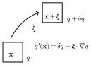
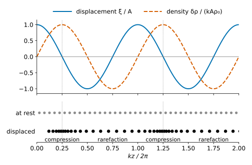
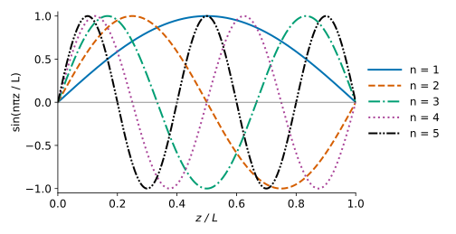

# Sound Waves and the Doppler Effect {#sec-sound}

## Oscillation Equation

The equations of fluid mechanics are nonlinear and only few analytic solutions are known. However, significant insight into astrophysical systems can be obtained by considering small perturbations around a background flow. Typically the background is chosen to be a hydrostatic solution, e.g., the density profile of an atmosphere. However, this method can be applied to more general situations. This is the key working principle of *asteroseismology* (*helioseismology* in the case of the Sun). Sound waves are also one of the key tools to learn about the early Universe, as they generate the baryon acoustic oscillations seen in the CMB and in the distribution of galaxies.

To set the stage, consider a gas flow with density, pressure, and velocity
$$
\rho_0 (t ; \mathcal{V}), \quad p_0 (t ; \mathcal{V}), \quad \vb{v}_0 (t
; \mathcal{V}) .
$$ {#eq-sound-1}
We describe its perturbation in terms of a small displacement vector $\vb{\xi} (t ; \mathcal{V})$ describing the offset of each fluid element from its background state.

{#fig-sound-displacement fig-alt="A fluid element drawn as a box at position x, where a quantity has the value q. A curved arrow labelled xi carries it to a second box at position x plus xi, where the quantity has the value q plus delta q. Next to the boxes is the relation q prime of x equals delta q minus xi dot gradient of q."}

The density, pressure, and velocity *of each fluid element* change according to
$$
\rho (t ; \mathcal{V}) = \rho_0 (t ; \mathcal{V}) + \delta \rho (t ;
\mathcal{V}), \quad p (t ; \mathcal{V}) = p_0 (t ; \mathcal{V}) + \delta p
(t ; \mathcal{V}), \quad \vb{v} (t ; \mathcal{V}) =\vb{v}_0 (t ;
\mathcal{V}) + \frac{\dd \vb{\xi} (t ; \mathcal{V})}{\dd t} .
$$ {#eq-sound-2}
The quantities with the $\delta$ in front are the Lagrangian perturbations[^sound-1]. The Eulerian perturbation of a quantity is given by
$$
q' (t, \vb{x}) = q_0 (t, \vb{x}-\vb{\xi}) + \delta q (t,
\vb{x}) - q_0 (t, \vb{x}) = \delta q (t, \vb{x}) -\vb{\xi}
\cdot \nabla q_0 .
$$ {#eq-sound-3}
The difference between Lagrangian and Eulerian perturbations is that the Lagrangian perturbations are specific to individual fluid elements, while the Eulerian perturbations record the difference in the flow at a fixed position. This distinction turns out to be crucial when perturbing non-homogeneous backgrounds, for which $\nabla q_0 \neq 0$, as we will see in @sec-strat.

For the moment, we consider a homogeneous medium in which $\rho_0$, $p_0$, and $\vb{v}_0 = 0$ are constant. We perturb it by displacing the fluid elements by a small amount $\vb{\xi}$ and let it evolve freely. How do the perturbations evolve? To find out, we need to insert the *Lagrangian* perturbations into the *Lagrangian* equations (@sec-lagrange).

The continuity equation (@eq-continua-15) reads
$$
\frac{\dd \rho}{\dd t} = - \rho \nabla \cdot \vb{v}
\longrightarrow \frac{\dd (\rho_0 + \delta \rho )}{\dd t} = - (\rho_0
+ \delta \rho) \nabla \cdot \left( \frac{\dd \vb{\xi}}{\dd t}
\right) .
$$ {#eq-sound-4}
Dropping quantities that are quadratic or higher order in the perturbation, and integrating in time with the condition that $\delta \rho = 0$ when $\vb{\xi} = 0$, we obtain
$$
\frac{\dd \delta \rho}{\dd t} = - \rho_0 \nabla \cdot \frac{\dd
\vb{\xi}}{\dd t} \longrightarrow \boxed{\delta \rho = - \rho_0
\nabla \cdot \vb{\xi}} .
$$ {#eq-sound-continuity}
To find the perturbed momentum equation, first note that
$$
\frac{\dd \vb{\xi}}{\dd t} = \frac{\partial \vb{\xi}}{\partial
t} + (\vb{v} \cdot \nabla) \vb{\xi}= \frac{\partial
\vb{\xi}}{\partial t} + (\vb{v}_0 \cdot \nabla) \vb{\xi}+ \left(
\frac{\dd \vb{\xi}}{\dd t} \cdot \nabla \right) \vb{\xi}=
\frac{\partial \vb{\xi}}{\partial t} + O (| \vb{\xi} |^2),
$$ {#eq-sound-6}
so
$$
\vb{v}= \frac{\partial \vb{\xi}}{\partial t}, \qquad \frac{\dd
\vb{v}}{\dd t} = \frac{\partial \vb{v}}{\partial t} +
(\vb{v}_0 \cdot \nabla) \vb{v}+ \left( \frac{\dd
\vb{\xi}}{\dd t} \cdot \nabla \right) \vb{v}= \frac{\partial^2
\vb{\xi}}{\partial t^2} + O (| \vb{\xi} |^2) .
$$ {#eq-sound-7}
The momentum equation (@eq-euler) becomes
$$
\rho \frac{\dd \vb{v}}{\dd t} = - \nabla p \rightarrow
\frac{\partial^2 \vb{\xi}}{\partial t^2} = - \frac{1}{\rho_0} \nabla p =
- \frac{1}{\rho_0} \nabla \delta p.
$$ {#eq-sound-8}
Here we have used the fact that, for a homogeneous background, the Eulerian and Lagrangian perturbations are the same, $p' = \delta p$ (@eq-sound-3). This is not true in a stratified atmosphere, as we will see in @sec-strat.

We will consider only the case of adiabatic perturbations, for which
$$
p = p (\rho) .
$$ {#eq-sound-9}
In other words, we are taking the pressure at constant entropy. For example, for an ideal gas, we have already seen that for adiabatic processes (@eq-thermo-poly)
$$
p = (\Gamma - 1) \rho \varepsilon \longrightarrow p = K \rho^{\Gamma} ,
$$ {#eq-sound-10}
with $K = (\Gamma - 1) \rho^{1 - \Gamma} \varepsilon$.

Why should sound waves be adiabatic? A sound wave compresses some regions of the fluid and expands others, so the compressed regions become hotter. Heat flows from the hot to the cold regions, but this takes time. Heat needs to diffuse over a distance comparable to the wavelength $\lambda_w$ of the wave, which takes a time $t_{\mathrm{diff}} \sim \lambda_w^2 / D$, where $D \sim \lambda v_{\mathrm{th}}$ and $\lambda$ is the mean free path (@sec-conserv). The period of the wave is $\sim \lambda_w / c_s$, where $c_s$ is the sound speed defined below, which is comparable to the thermal velocity of the particles $v_{\mathrm{th}}$. So we have
$$
\frac{t_{\mathrm{diff}}}{\lambda_w / c_s} \sim \frac{\lambda_w}{\lambda} \gg 1,
$$ {#eq-sound-adiabatic}
whenever the fluid description is valid. In other words, heat does not have time to leave the compressed regions during one period, and the perturbations are adiabatic. The opposite limit, isothermal perturbations, happens when the gas can cool very quickly, for example by radiation. This is the case in cold molecular clouds (@sec-hydro, @sec-radshock).

In this case, we can use the chain rule to rewrite $\nabla \delta p$ in terms of $\nabla \delta \rho$:
$$
\frac{\partial^2 \vb{\xi}}{\partial t^2} = - \frac{1}{\rho_0}
\frac{\dd p}{\dd \rho} \nabla \delta \rho = \frac{\dd p}{\dd
\rho} \nabla \nabla \cdot \vb{\xi}.
$$ {#eq-sound-12}
Defining the *sound speed* $c_s = \sqrt{\dd p / \dd \rho}$, we obtain the **oscillation equation**:
$$
\boxed{\frac{\partial^2 \vb{\xi}}{\partial t^2} - c_s^2 \nabla
\nabla \cdot \vb{\xi}= 0.}
$$ {#eq-sound-oscillation}
In general, the sound speed needs to be evaluated at constant entropy, that is
$$
\boxed{c_s = \sqrt{\left( \frac{\partial p}{\partial \rho} \right)_s} .}
$$ {#eq-sound-14}

::: {.callout-tip icon=false}
## Example

For an ideal gas, with $p = (\Gamma - 1) \rho \varepsilon = \frac{\rho}{\mu m_u} k_B T$, the sound speed is
$$
c_s^2 = \left( \frac{\partial p}{\partial \rho} \right)_s = \Gamma K
\rho^{\Gamma - 1} = (\Gamma - 1) \Gamma \varepsilon = \frac{\Gamma k_B
T}{\mu m_u} .
$$ {#eq-sound-15}
:::

If, instead, the perturbations are isothermal, we need to take the derivative of the pressure at constant temperature. For an ideal gas, this gives the **isothermal sound speed**
$$
c_{\mathrm{iso}} = \sqrt{\left( \frac{\partial p}{\partial \rho} \right)_T} = \sqrt{\frac{k_B T}{\mu m_u}} = \frac{c_s}{\sqrt{\Gamma}} .
$$ {#eq-sound-isothermal}
This is the sound speed that appears in the equation of state of an isothermal gas, $p = c_{\mathrm{iso}}^2 \rho$ (@sec-euler, @sec-hydro).

::: {.callout-tip icon=false}
## Example

Consider air at room temperature, $T = 293\,\mathrm{K}$. Air is mostly made of $\mathrm{N}_2$ and $\mathrm{O}_2$, so $\mu \approx 29$ and $\Gamma = 7/5$. From @eq-sound-15 we find $c_s \approx 343\,\mathrm{m\,s^{-1}}$, which is the measured value. Newton was the first to compute the speed of sound, but he assumed that the perturbations were isothermal. He found $c_{\mathrm{iso}} \approx 290\,\mathrm{m\,s^{-1}}$, about 15% too small. The discrepancy was only explained a century later by Laplace, who realized that sound waves are adiabatic.

In astrophysics, sound speeds span a large range. In a cold molecular cloud with $T = 10\,\mathrm{K}$ and $\mu \approx 2.3$, we have $c_s \approx 0.2\,\mathrm{km\,s^{-1}}$. At the center of the Sun, $T \approx 1.6 \times 10^7\,\mathrm{K}$ and $\mu \approx 0.85$, so $c_s \approx 500\,\mathrm{km\,s^{-1}}$. This means that sound takes about one hour to cross the Sun (@exr-sound-helioseismology).
:::

The oscillation @eq-sound-oscillation is the fundamental equation to describe sound waves. Taking the divergence on both sides and using @eq-sound-continuity, we find that the density perturbation $\delta \rho$ satisfies the wave equation:
$$
\frac{\partial^2 \delta \rho}{\partial t^2} - c_s^2 \nabla^2 \delta \rho =
0.
$$ {#eq-sound-17}
To solve the oscillation equation, we consider the ansatz
$$
\vb{\xi}=\vb{\xi}_1 \exp [\ii (\vb{k} \cdot \vb{x}-
\omega t)],
$$ {#eq-sound-18}
which describes a plane sound wave propagating in the direction $\vb{k}$ and having frequency $\omega$. $\vb{\xi}_1$ is the *polarization vector*, describing the way in which fluid elements oscillate as the wave propagates. As usual, the physical displacement is the real part of @eq-sound-18. Inserting this ansatz into @eq-sound-oscillation, we find
$$
\omega^2 \vb{\xi}_1 = c_s^2 \vb{k} (\vb{k} \cdot \vb{\xi}_1)
.
$$ {#eq-sound-19}
This means that plane wave solutions to @eq-sound-oscillation exist only for specific choices of $\vb{\xi}_1, \omega$ and $\vb{k}$. We see that the RHS is parallel to $\vb{k}$, so solutions with $\omega \neq 0$ can exist only if $\vb{\xi}_1 \parallel \vb{k}$. This means that sound waves are longitudinal. Displacements with $\vb{\xi}_1 \perp \vb{k}$ are also solutions, but with $\omega = 0$. They do not compress the fluid, so there is no restoring force (recall that a fluid at rest cannot sustain shear, @sec-euler). This is opposite from electromagnetic waves in vacuum, in which the electric and magnetic fields oscillate in the plane perpendicular to the direction of propagation. Setting $\vb{\xi}_1 = \xi_1 \hat{\vb{k}}$, we find
$$
\omega^2 = c_s^2 k^2 .
$$ {#eq-sound-20}
This is the **dispersion relation** for sound waves. It means that both phase and group velocity for sound waves are given by $c_s$
$$
v_{\mathrm{phase}} = \frac{\omega}{k} = c_s, \qquad v_{\mathrm{group}} =
\frac{\dd \omega}{\dd k} = c_s .
$$ {#eq-sound-21}
This justifies the name *sound speed* for $c_s$. Since $v_{\mathrm{phase}}$ does not depend on $k$, sound waves are *non-dispersive*: a pulse made of many waves with different wavelengths propagates without changing its shape.

What happens to fluid elements when a sound wave passes through them? They are displaced along the direction of the wave. This causes a compression of the fluid. From @eq-sound-continuity, we find:
$$
\delta \rho = - \ii \rho_0  (\vb{k} \cdot \vb{\xi}_1) \ee^{\ii
(\vb{k} \cdot \vb{x}- \omega t)} .
$$ {#eq-sound-22}

::: {.callout-tip icon=false}
## Example

Consider a sound wave propagating along $z$ with wave number $k$. Then $\vb{k}= k \hat{\vb{z}}$ and $\omega = c_s k$. The only non-zero component of $\vb{\xi}$ is the $z$-component
$$
\xi_z = \mathrm{Re} \left\{ \xi_1 \ee^{\ii k (z - c_s t)} \right\} = A \cos [k (z - c_s t)] + B \sin [k
(z - c_s t)] \Longleftrightarrow \xi_1 = A - \ii B
$$ {#eq-sound-23}
The density perturbation is given by
$$
\frac{\delta \rho}{\rho_0} = - \frac{\partial \xi_z}{\partial z} = k \{ A
\sin [k (z - c_s t)] - B \cos [k (z - c_s t)] \} .
$$ {#eq-sound-24}
Note that the density perturbation is shifted by a quarter of a wavelength with respect to the displacement. The gas is most compressed where $\xi_z$ changes sign, not where it is largest. This is shown in @fig-sound-plane-wave.
:::

{#fig-sound-plane-wave fig-alt="Two panels sharing a horizontal axis, kz over 2 pi from 0 to 2, that is, two wavelengths. Top: the displacement xi over A is a cosine, starting at 1; the density perturbation is a sine, dashed, starting at 0, so it is shifted by a quarter of a wavelength. The density is largest at kz over 2 pi equal to 0.25 and 1.25, where the displacement crosses zero going from positive to negative; vertical dotted lines mark these points. Bottom: a row of equally spaced grey dots labelled at rest, and below it the same fluid elements after the displacement, in black. The black dots bunch up at the dotted lines, labelled compression, and spread out half a wavelength later, labelled rarefaction."}

The same method can be applied to a homogeneous fluid moving with constant velocity $\vb{v}_0$. In this case the sound waves are carried by the flow, and the dispersion relation becomes
$$
\omega = \vb{v}_0 \cdot \vb{k} \pm c_s k .
$$ {#eq-sound-doppler}
This means that the frequency of the sound measured by an observer at rest is shifted with respect to the frequency $c_s k$ measured by an observer moving with the fluid. This is the **Doppler effect**. We derive @eq-sound-doppler in the in-class worksheet (@sec-sound-worksheet).

## Wave Energy and Momentum

Sound waves also transport energy and momentum. The deposition of energy by breaking waves (@sec-shock) is thought to play an important role in phenomena such as core-collapse supernovae, stellar eruptions, and the evolution of giant molecular clouds.

::: {.callout-note}
## Going further: Normal Modes

Before we can compute the energy carried by waves, we need to develop some general perturbation theory. In general, the oscillation equation takes the form
$$
\rho_0  \frac{\partial^2 \vb{\xi}}{\partial t^2} = \hat{\vb{F}}
\vb{\xi},
$$ {#eq-sound-oscillations-general}
where $\hat{\vb{F}}$ is a differential operator. For example, for sound waves in a homogeneous medium $\hat{\vb{F}} \vb{\xi}= \rho_0 c_s^2 \nabla \nabla \cdot \vb{\xi}$. We can find a dispersion relation by looking for solutions such that
$$
\vb{\xi} (t, \vb{x}) =\vb{\eta} (\vb{x}) \ee^{- \ii
\omega t} .
$$ {#eq-sound-27}
Inserting this ansatz in @eq-sound-oscillations-general, we find an eigenvalue problem
$$
- \omega^2 \rho_0 \vb{\eta} (\vb{x}) = \hat{\vb{F}}
\vb{\eta} (\vb{x}) .
$$ {#eq-sound-eigenvalue}
In most applications, $\hat{\vb{F}}$ is self-adjoint:
$$
\int \vb{\zeta} (\vb{x}) \cdot \hat{\vb{F}} \vb{\xi}
(\vb{x}) \dd V = \int \vb{\xi}
(\vb{x}) \cdot \hat{\vb{F}} \vb{\zeta} (\vb{x}) \dd V .
$$ {#eq-sound-29}
For sound waves, this can be shown by integrating by parts: both sides are equal to $- \int \rho_0 c_s^2 (\nabla \cdot \vb{\zeta}) (\nabla \cdot \vb{\xi}) \dd V$. An important consequence of @eq-sound-29 is that $\omega^2$ is always real. So each mode either oscillates, if $\omega^2 > 0$, or grows exponentially, if $\omega^2 < 0$. We will use this to study instabilities later in the course (@sec-conv, @sec-rtkh, @sec-tginst).

The general theory of linear operators then implies that @eq-sound-eigenvalue has an infinite set of eigenvalues $\{ \omega_n \}$ and eigenfunctions $\{ \vb{\eta}_n \}$ and that any perturbation (not just plane waves) can be written as an infinite superposition of elementary solutions:
$$
\vb{\xi} (t, \vb{x}) = \sum_n \vb{\eta}_n (\vb{x}) \ee^{-
\ii \omega_n t} .
$$ {#eq-sound-superposition-principle}
The quantities $\vb{\eta}_n (\vb{x})$ are also called the *normal modes of oscillations*. Note that the normal modes need not be countable. For example, for sound waves in a homogeneous infinite medium all positive sound frequencies $\omega$ are allowed. In this case, @eq-sound-superposition-principle takes the form of an integral. For plane waves in a homogeneous medium, @eq-sound-superposition-principle is just the Fourier transform:
$$
\vb{\xi} (t, \vb{x}) = \int \dd^3 \vb{k}\vb{\eta}
(\vb{k}) \ee^{\ii \vb{k} \cdot \vb{x}} \ee^{- \ii c_s kt} ,
$$ {#eq-sound-31}
where the real part is understood. However, when we consider sound waves in a finite medium, for example a star of a given radius, standing waves must fit an integer number of half wavelengths inside the star. This makes the frequencies $\{ \omega_n \}$ quantized.

::: {.callout-tip icon=false}
## Example

Consider a rigid, cylindrical pipe of length $L$ filled with gas at constant density and temperature. The ends of the pipe are sealed. The displacement equation for sound waves propagating in the pipe is
$$
\left\{\begin{array}{ll}
\partial_t^2 \xi (t, z) = c_s^2 \partial_z^2 \xi (t, z), & 0 < z < L,\\
\xi (t, 0) = \xi (t, L) = 0. &
\end{array}\right.
$$ {#eq-sound-32}
If we look for solutions in the form $\xi (t, z) = \eta (z) \ee^{- \ii \omega t}$, we find the eigenvalue problem
$$
\left\{\begin{array}{ll}
\partial_z^2 \eta (z) + \left( \frac{\omega}{c_s} \right)^2 \eta (z) =
0, & 0 < z < L\\
\eta (0) = \eta (L) = 0. &
\end{array}\right.
$$ {#eq-sound-33}
This equation is just the equation for a harmonic oscillator. The general solution is
$$
\eta (z) = A \cos (k z) + B \sin (k z), \qquad k =
\frac{\omega}{c_s} .
$$ {#eq-sound-34}
However, not all solutions satisfy the boundary conditions. To satisfy the boundary conditions, we require
$$
A = 0, \qquad k = k_n = \frac{n \pi}{L} \Longrightarrow \omega = c_s
\left( \frac{n \pi}{L} \right), \quad n = 1, 2, \ldots
$$ {#eq-sound-35}
For example, for a pipe of length $L = 1\,\mathrm{m}$ filled with air, the frequency of the fundamental mode is $\omega_1 / 2 \pi = c_s / (2 L) \approx 170\,\mathrm{Hz}$. This is how organ pipes work.
The first few normal modes are plotted in @fig-sound-normal-modes.

{#fig-sound-normal-modes fig-alt="Plot of sin(n pi z over L) for n from 1 to 5, for z between 0 and L. All curves vanish at both ends of the pipe; mode n has n half-wavelengths between the ends and n minus 1 nodes in between. Each mode has its own line style and colour."}

This means that all sound waves propagating along the pipe are in the form
$$
\xi (t, z) = \sum_{n = 1}^{\infty} \left[ A_n \sin \left( \frac{n \pi c_s
t}{L} \right) + B_n \cos \left( \frac{n \pi c_s t}{L} \right) \right] \sin
\left( \frac{n \pi z}{L} \right),
$$ {#eq-sound-36}
where $A_n$ and $B_n$ are determined by the initial velocity $\partial_t \xi (0, z)$ and displacement $\xi (0, z)$, respectively.
:::
:::

::: {.callout-note}
## Going further: Work Integral

We might be tempted to define the energy density of a wave in the general form $\vb{\xi} (t, \vb{x}) =\vb{\eta} (\vb{x}) \ee^{- \ii \omega t}$ as
$$
K_{\mathrm{wave}} = \frac{1}{2} \rho_0  \left\langle \left| \frac{\partial
\vb{\xi}}{\partial t } \right|^2 \right\rangle = \frac{1}{2} \rho_0  |
\vb{\eta} |^2  \omega^2 \langle \sin^2 (\omega t) \rangle =
\frac{\omega^2}{4} \rho_0  | \vb{\eta} |^2,
$$ {#eq-sound-wave-kinetic-energy}
where $\langle \cdot \rangle$ denotes averaging over a period $T = 2 \pi / \omega$ of the wave. @eq-sound-wave-kinetic-energy is the kinetic energy density associated with the wave. However, it turns out that the kinetic energy is just one portion of the wave energy.

The energy of the wave is related to $\xi^2$, so it cannot be computed directly from linear theory. However, we can use a trick:

1.  adiabatically perturb the system to create a wave with an external force;

2.  compute the work done by the external force on the system.

To achieve this we add a source term to the oscillation equation:
$$
\rho_0  \frac{\partial^2 \vb{\xi}}{\partial t^2} = \hat{\vb{F}}
\vb{\xi}+\vb{F}_{\mathrm{ext}} (t) .
$$ {#eq-sound-oscillation-forced}
Suppose we want to excite the mode $\vb{\xi} (t, \vb{x}) =\vb{\eta} (\vb{x}) \ee^{- \ii \omega t}$, where $\vb{\eta}$ is such that $\hat{\vb{F}} \vb{\eta}= - \rho_0 \omega^2 \vb{\eta}$. Then we can take $\vb{F}_{\mathrm{ext}} (t) = F_0 \ee^{\gamma t} \vb{\eta} (\vb{x})$, where $F_0$ is chosen so that for $t \lesssim 0$, $\vb{\xi} (t, \vb{x}) = \ee^{\gamma t} \vb{\eta} (\vb{x})$. Inserting this into the oscillation equation yields
$$
\rho_0  \frac{\partial^2 \vb{\xi}}{\partial t^2} = \rho_0 \gamma^2
\ee^{\gamma t} \vb{\eta}= \ee^{\gamma t}  \hat{\vb{F}}
\vb{\eta}+ F_0 \ee^{\gamma t} \vb{\eta}= (- \rho_0 \omega^2 + F_0)
\ee^{\gamma t} \vb{\eta}.
$$ {#eq-sound-39}
We can solve for $F_0$ to find that
$$
F_0 = \rho_0  (\omega^2 + \gamma^2) .
$$ {#eq-sound-40}
The work done by the external force per unit volume is given by the *work integral*
$$
W_{\mathrm{ext}} = \int_{- \infty}^0 \dd t \frac{\partial \vb{\xi}}{\partial t}
\cdot \vb{F}_{\mathrm{ext}} = \int_{- \infty}^0 \dd t \rho_0 \gamma
(\gamma^2 + \omega^2) \ee^{2 \gamma t} \vb{\eta} \cdot \vb{\eta}=
\rho_0  | \vb{\eta} |^2  \int_{- \infty}^0 \dd t \gamma (\gamma^2 +
\omega^2) \ee^{2 \gamma t},
$$ {#eq-sound-41}
where we have used the fact that $\vb{\eta}$ is time independent. The last integral can be computed analytically, so the previous expression yields
$$
W_{\mathrm{ext}} = \rho_0  | \vb{\eta} |^2  \left( \frac{\gamma^2}{2} +
\frac{\omega^2}{2} \right) .
$$ {#eq-sound-42}
The energy density of the wave is obtained in the limit in which $\gamma \downarrow 0$:
$$
\boxed{E_{\mathrm{wave}} = \frac{\omega^2}{2} \rho_0  | \vb{\eta} |^2
.}
$$ {#eq-sound-43}
Note that $E_{\mathrm{wave}} = 2 K_{\mathrm{wave}}$, meaning that half of the wave energy is potential energy. For example, for a sound wave with $\vb{\eta}=\vb{A} \cos (\vb{k} \cdot \vb{x})$, the mean energy density (averaging over one wave-length) is
$$
E_{\mathrm{wave}} = \frac{\omega^2}{4} \rho_0 A^2 .
$$ {#eq-sound-44}
It is possible to compute the linear momentum density $\vb{P}_{\mathrm{wave}}$ carried by waves in a similar way. One finds
$$
\boxed{\vb{P}_{\mathrm{wave}} = \frac{\vb{k}}{\omega}
E_{\mathrm{wave}} .}
$$ {#eq-sound-45}

:::

## In-class worksheets {#sec-sound-worksheet}

### Sound waves

Consider an ideal gas with
$$
p = (\Gamma - 1) \rho \varepsilon = \frac{\rho}{\mu m_u} k_B T.
$$ {#eq-sound-ws1}
What is the sound speed $c_s$ as a function of $\rho$ and $T$? Does it depend on $\rho$?

Show that
$$
\vb{\xi}= f (z - c_s t)  \hat{\vb{z}}
$$ {#eq-sound-ws2}
is a solution of
$$
\frac{\partial^2 \vb{\xi}}{\partial t^2} - c_s^2 \nabla \nabla \cdot
\vb{\xi}= 0.
$$ {#eq-sound-ws3}
Sketch the solution for different times if $f (x) = \ee^{- x^2 / 2}$. What is the corresponding density perturbation? Is $f (z + c_s t) \hat{\vb{z}}$ also a solution? What does it describe?

### The Doppler effect

Consider an initially homogeneous flow with
$$
\rho = \rho_0 = \mathrm{const}, \qquad p = p_0 = \mathrm{const}, \qquad
\vb{v}=\vb{v}_0 = \mathrm{const} .
$$ {#eq-sound-dws1}
Introduce a small perturbation in the form of a Lagrangian displacement $\vb{\xi}$.

1.  Show that the Lagrangian density perturbation is given by
    $$
    \delta \rho = - \rho_0 \nabla \cdot \vb{\xi}.
    $$ {#eq-sound-dws2}

2.  Use the results from part 1) to show that the oscillation equation reads
    $$
    \left[ \frac{\partial}{\partial t} + (\vb{v}_0 \cdot \nabla)
    \right]^2 \vb{\xi}= c_s^2 \nabla \nabla \cdot \vb{\xi}.
    $$ {#eq-sound-dws3}

3.  Introduce the ansatz $\vb{\xi}=\vb{\eta}\ee^{\ii (\vb{k} \cdot \vb{x}- \omega t)}$ and show that the dispersion relation is
    $$
    \omega_{\pm} =\vb{v}_0 \cdot \vb{k} \pm c_s k.
    $$ {#eq-sound-dws4}
    What is the physical meaning of the $\pm$ solutions?

4.  Consider a sound wave propagating at an angle $\theta$ with respect to $\vb{v}_0$. Let $\omega_0 = c_s k$ be the frequency of sound in the fluid frame. Show that the frequency of sound in the lab frame is
    $$
    \omega = \omega_0  \left( 1 + \frac{v_0}{c_s} \cos \theta \right),
    $$ {#eq-sound-dws5}
    where $v_0 = | \vb{v}_0 |$.

## Exercises {#sec-sound-exercises}

::: {#exr-sound-helioseismology}
## Helioseismology

The surface of the Sun oscillates with periods of about 5 minutes. These oscillations are due to sound waves trapped inside the Sun. In this exercise, we estimate their frequencies with a very simple model. Assume $\Gamma = 5/3$.

1.  Estimate the sound speed at the center of the Sun, where $T \approx 1.6 \times 10^7\,\mathrm{K}$ and $\mu \approx 0.85$, and at the base of the convection zone, at $r \approx 0.7\,R_\odot$, where $T \approx 2 \times 10^6\,\mathrm{K}$ and $\mu \approx 0.6$.

2.  Estimate the time $t_s$ it takes for sound to travel from the center to the surface of the Sun. For $r < 0.7\,R_\odot$, use the average of the two sound speeds you found in part 1. For $r > 0.7\,R_\odot$, assume that the temperature decreases linearly to zero at the surface, and that $\mu$ is constant.

3.  Model the Sun as a pipe of length $R_\odot$, closed at both ends. What is the frequency of the fundamental mode? What is the order $n$ of a mode with a period of 5 minutes?

4.  The observed frequencies of consecutive modes of this type differ by about $135\,\mu\mathrm{Hz}$. Compare with your estimate. What do these observations measure?
:::

::: {.content-visible when-profile="solutions"}
::: {.solution}
1.  From @eq-sound-15,
    $$
    c_s = \sqrt{\frac{\Gamma k_B T}{\mu m_u}} \approx 510\,\mathrm{km\,s^{-1}} \quad \text{(center)}, \qquad c_s \approx 215\,\mathrm{km\,s^{-1}} \quad \text{(base of the convection zone)}.
    $$

2.  In the inner region, the average sound speed is $\bar{c} \approx 360\,\mathrm{km\,s^{-1}}$, so sound crosses it in
    $$
    t_1 = \frac{0.7\,R_\odot}{\bar{c}} \approx 1.3 \times 10^3\,\mathrm{s}.
    $$
    In the convection zone, let $h = R_\odot - r$ be the depth and $D = 0.3\,R_\odot$ the depth of the base of the convection zone. If $T \propto h$, then $c_s = c_b \sqrt{h / D}$, where $c_b \approx 215\,\mathrm{km\,s^{-1}}$. The time to cross the convection zone is
    $$
    t_2 = \int_0^D \frac{\dd h}{c_b \sqrt{h / D}} = \frac{2 D}{c_b} \approx 1.9 \times 10^3\,\mathrm{s}.
    $$
    Note that the integral is finite, even though $c_s \to 0$ at the surface. So $t_s = t_1 + t_2 \approx 3.3 \times 10^3\,\mathrm{s}$, a bit less than one hour.

3.  For a pipe of length $L$, @eq-sound-35 gives $\nu_n = \omega_n / 2 \pi = n c_s / (2 L)$. If the sound speed is not constant, $L / c_s$ should be replaced by the crossing time $t_s$, so
    $$
    \nu_1 = \frac{1}{2 t_s} \approx 150\,\mu\mathrm{Hz},
    $$
    which corresponds to a period of about 2 hours. A mode with a period of 5 minutes has $\nu \approx 3.3\,\mathrm{mHz}$, so $n = \nu / \nu_1 \approx 20$. The modes we observe are high-order modes.

4.  In our model, consecutive modes are separated by $\nu_{n + 1} - \nu_n = 1 / (2 t_s) \approx 150\,\mu\mathrm{Hz}$, about 10% more than the observed value. Our crude model is not too far off. Inverting the argument, the observed frequency spacing measures the time it takes for sound to cross the Sun, $t_s = 1 / (2 \times 135\,\mu\mathrm{Hz}) \approx 3.7 \times 10^3\,\mathrm{s}$. More detailed analyses of the frequencies of many modes can be used to reconstruct the sound speed, and hence the temperature, as a function of radius inside the Sun.
:::
:::

## Further reading {#sec-sound-reading}

- @clarke2007, Sections 6.1 and 6.3.

[^sound-1]: I use the common convention of denoting with $\delta q$ the Lagrangian perturbations of a quantity $q$ and with $q'$ the Eulerian perturbations. The same convention is used in @kulsrud2005, but @clarke2007 use $\Delta q$ for Lagrangian perturbation and $\delta q$ for Eulerian perturbation.
