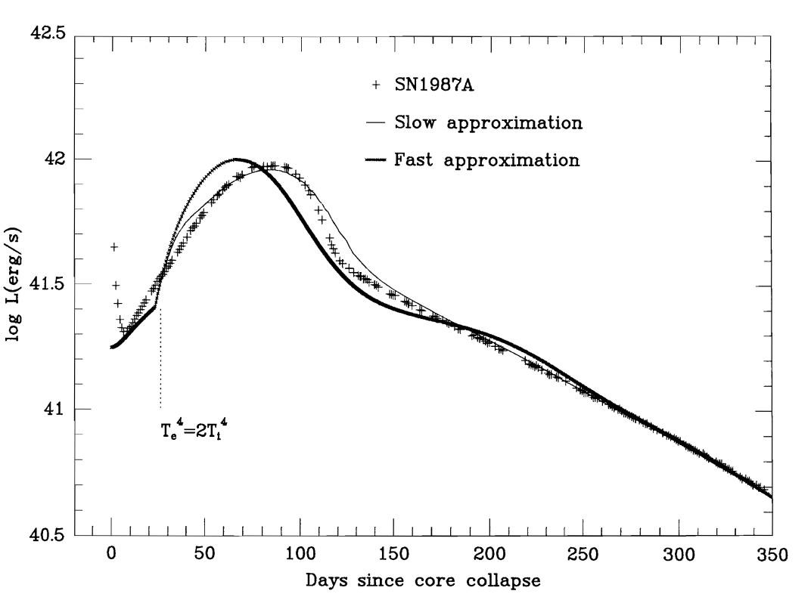
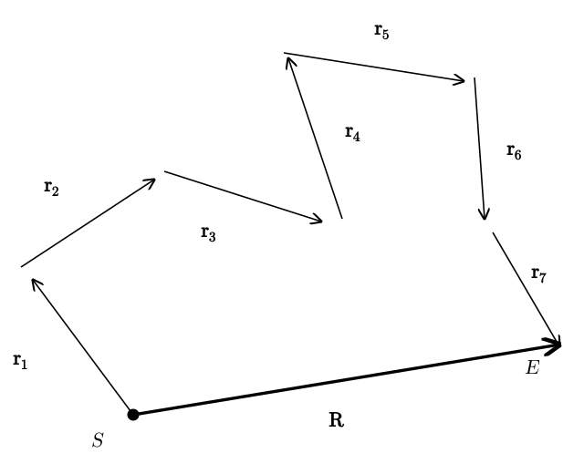
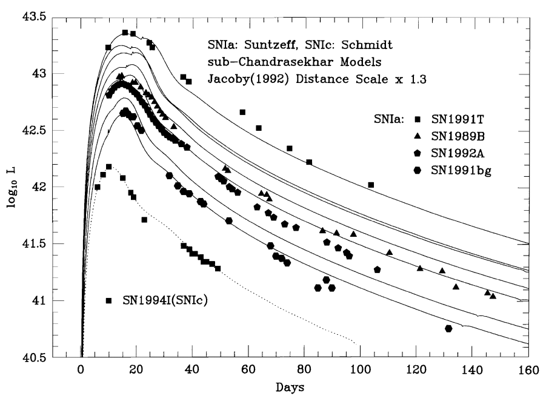
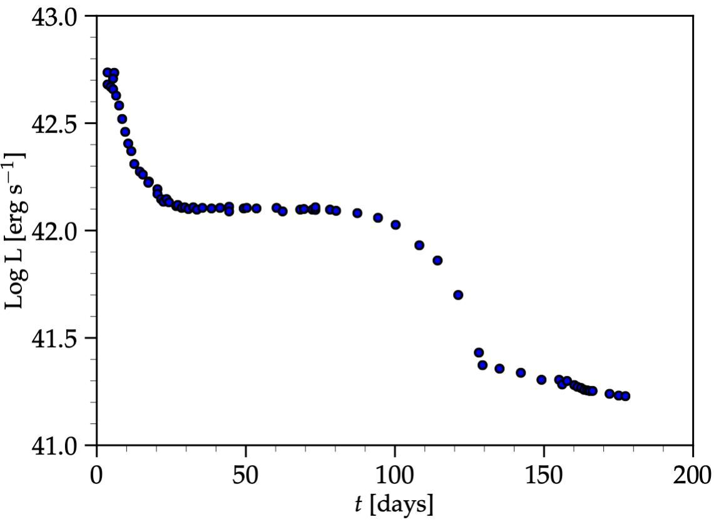

# Supernovae {#sec-sn}

## Observational facts

Supernovae are among the most energetic and luminous transients in the sky. They are the result of the explosion of massive stars, or of accreting white dwarfs at the end of their lives. Here, we use the tools of fluid mechanics we have developed so far to construct a simple model for these and similar explosive transients, such as novae and kilonovae. Our goal is to understand the basic physics, not to develop precise models, or to discuss all the nuances of the problem, for which we refer to the specialized literature.

Observationally, supernovae are characterized by a fast rise in the luminosity, on a timescale of a few days. They peak on a timescale of days to weeks and then decline over a timescale of months. A famous example of a core-collapse supernova light curve is given by the SN 1987A light curve in @fig-sn-sn1987a. At peak magnitude, supernovae have luminosity $L \sim 10^{10} L_{\odot}$, where $L_{\odot}$ is the luminosity of the Sun. They remain bright for weeks to months, before beginning to fade. At peak, their typical effective temperature is $T_{\mathrm{eff}} \sim 2 T_{\odot} \approx 12{,}000\,\mathrm{K}$, $T_{\odot}$ being the effective temperature of the Sun. For a black body, the Stefan–Boltzmann law gives a relation between temperature and luminosity:
$$
L = 4 \pi R^2 \sigma T^4,
$$ {#eq-sn-1}
where $\sigma$ is the Stefan–Boltzmann constant
$$
\sigma = \frac{ac}{4} = 5.6704 \times 10^{-8} \, \mathrm{W} \, \mathrm{m}^{- 2}
\, \mathrm{K}^{- 4} .
$$ {#eq-sn-2}
Assuming in first approximation supernovae to be black body emitters, this implies that the characteristic radius of a supernova at peak magnitude is
$$
R_p \sim 2.5 \times 10^4 R_{\odot} \approx 10^{13} \, \mathrm{m} .
$$ {#eq-sn-3}
This is about twenty times larger than the radius of the largest stars. The duration of the peak is of a few weeks, say $\sim 2 \times 10^6\,\mathrm{s}$, so the total energy release in photons is
$$
\mathcal{E}_r \sim (2 \times 10^6\,\mathrm{s}) \times 10^{10} L_{\odot} \approx 8 \times
 10^{49}\,\mathrm{erg} .
$$ {#eq-sn-4}
Here and in the rest of the chapter, we follow the custom of quoting large energies in erg and luminosities in $\mathrm{erg\,s^{-1}}$, with $1\,\mathrm{erg} = 10^{-7}\,\mathrm{J}$.
From the observation of Doppler shifted emission and absorption lines, we know that the typical velocities are in the range of $2{,}000\,\mathrm{km}\,\mathrm{s}^{- 1}$ to $10{,}000\,\mathrm{km}\,\mathrm{s}^{- 1}$. These velocities are consistent with the estimated length and temporal scales of the supernova phenomenon:
$$
v \sim \frac{10^{13} \, \mathrm{m}}{10^6\,\mathrm{s}} = 10^7 \, \mathrm{m} \, \mathrm{s}^{- 1} =
10^4 \, \mathrm{km} \, \mathrm{s}^{- 1} .
$$ {#eq-sn-5}
The associated kinetic energy is
$$
K \sim \frac{1}{2} Mv^2 \approx 10^{51}  \left( \frac{M}{M_{\odot}} \right)
\mathrm{erg} \gg \mathcal{E}_r .
$$ {#eq-sn-6}

From these basic observational facts, we know that supernovae must be powered by objects with large surface areas and require large energies. All these numbers already suggest that supernovae could be powered by the explosion of stars. This is most dramatically confirmed by the disappearance of stars previously observed at the location of supernovae.

{#fig-sn-sn1987a fig-alt="Plot of log luminosity in erg per second, from 40.5 to 42.5, against days since core collapse, from 0 to 350. The SN 1987A data rise from about 41.3 at day 10 to a peak near 42 at about 85 days, then decline, almost linearly in log L after day 150, to about 40.7 at day 350. Two model curves, labelled slow and fast approximation, follow the data; the fast one peaks earlier, at about 70 days."}

## Shock breakout

Our supernova model begins with a star of radius $R_0$ in which a large amount of energy $\mathcal{E}$, much larger than the gravitational binding energy of the star, is injected. The source of this energy might be gravitational, in the case of core-collapse supernovae, or thermonuclear, but the outcome is similar: the progenitor is disrupted and matter starts expanding with large velocities. To fix our ideas, we will consider the explosion of a red supergiant with $R_0 \sim 10^{12}\,\mathrm{m}$, however all our results can be rescaled for other radii.

Immediately after the energy has been injected into the star, kinetic and internal energy are expected to be in equipartition $K \sim E \sim \mathcal{E} \sim 10^{51}\,\mathrm{erg} = 10^{44}\,\mathrm{J}$, so we can estimate the temperature, assuming the gas to be radiation dominated:
$$
E = \frac{4}{3} \pi R^3_0 aT^4 .
$$ {#eq-sn-7}
This estimate gives a temperature of
$$
T \approx 4.2 \times 10^5\,\mathrm{K} \left( \frac{R_0}{10^{12} \, \mathrm{m}}
\right)^{- 3 / 4}  \left( \frac{E}{10^{51}\,\mathrm{erg}} \right)^{1 / 4} .
$$ {#eq-sn-8}
The energy is injected close to the center of the star and it is carried outwards by a shock wave (@sec-shock), which reaches the surface of the star after a time $\sim R_0 / v \sim 10^5\,\mathrm{s}$, about a day (see @eq-sn-32 below). When this happens, the hot radiation behind the shock is able to escape. This is the so-called *shock breakout*, which is the first light emanating from the supernova. Because of the high temperature, the radiation spectrum at breakout peaks in the UV and X-ray bands.

We can check if the assumption of radiation dominated gas is consistent by computing the ratio of radiation pressure to gas pressure:
$$
\beta = \frac{\frac{1}{3} aT^4}{nk_B T} = \frac{a}{3 k_B}  \frac{T^3}{n}
\approx \frac{a}{3 k_B}  \frac{4 \pi R^3_0}{3}  \frac{\mu m_u}{M} T^3,
$$ {#eq-sn-9}
where we have approximated $n$ with the average number density, $n = \rho / (\mu m_u)$ (@eq-continua-5), and $M$ is the mass of the progenitor. We find $\beta$:
$$
\beta \approx 4.8 \times 10^3 \mu  \left( \frac{1
M_{\odot}}{M} \right)  \left( \frac{R_0}{10^{12} \, \mathrm{m}} \right)^{3 / 4}
\left( \frac{E}{10^{51}\,\mathrm{erg}} \right)^{3 / 4},
$$ {#eq-sn-10}
confirming that radiation dominates at early times. As we will see later, for homologous expansion, $E \sim R^{- 1}$, so $\beta$ is independent of the radius to which the ejecta has expanded, and matter remains radiation dominated.

## Radiation diffusion

After the breakout, the star is full of radiation, but the photons need to make their way out of the explosion debris, before they can reach our telescopes. The dominant source of opacity is Thomson scattering on free electrons, but photons can also be absorbed and then re-emitted through various free-free, bound-free, and bound-bound processes. Their path out of the ejecta can be described as a random walk, such as the one illustrated in @fig-sn-random-walk.

{#fig-sn-random-walk fig-alt="A photon path made of seven straight steps r1 to r7 of different lengths and directions, starting at the point S and ending at the point E. A thick arrow labelled R joins S to E and shows the net displacement, which is much shorter than the total path length."}

Consider a photon emitted at some location $S$ deep inside the supernova ejecta. The photon is not able to escape immediately. Instead, it propagates over a distance $\lambda_1$ before interacting with matter, either because it is scattered, or because it is absorbed and subsequently re-emitted in a different direction. The photon then moves in a new straight line over another distance $\lambda_2$ and interacts again. This process is repeated $N$ times (7 in the figure). We want to estimate how many steps are necessary for the photon to escape.

Let $\vb{r}_1$, $\vb{r}_2$, etc., be the displacement vectors between emission and absorption locations. We want to compute the total displacement
$$
\vb{R}=\vb{r}_1 +\vb{r}_2 +\vb{r}_3 + \cdots,
$$ {#eq-sn-11}
and compare $| \vb{R} |$ with the size of the expanding ejecta cloud $R$. Since the direction of each step is random
$$
\langle \vb{R} \rangle = \langle \vb{r}_1 +\vb{r}_2
+\vb{r}_3 + \cdots \rangle = \langle \vb{r}_1 \rangle + \langle
\vb{r}_2 \rangle + \langle \vb{r}_3 \rangle + \cdots = 0.
$$ {#eq-sn-12}
However, the mean square of the displacement does not vanish:
$$
\begin{alignedat}{2}
\langle \vb{R}^2 \rangle &{}={} && \langle (\vb{r}_1 +\vb{r}_2
+\vb{r}_3 + \cdots) \\
&&& \quad \cdot (\vb{r}_1 +\vb{r}_2 +\vb{r}_3 +
\cdots) \rangle \\
&{}={} && \langle \vb{r}_1^2 \rangle + \langle \vb{r}_2^2 \rangle +
\langle \vb{r}_3^2 \rangle + \cdots \\
&&& + 2 \langle \vb{r}_1 \cdot
\vb{r}_2 \rangle + 2 \langle \vb{r}_1 \cdot \vb{r}_3 \rangle +
\cdots
\end{alignedat}
$$ {#eq-sn-13}
The mixed products disappear, since the orientation of the displacement vectors is random, but
$$
\langle \vb{r}_i^2 \rangle = \lambda^2 > 0,
$$ {#eq-sn-14}
up to a factor of order unity, where $\lambda$ is the photon mean free path. We conclude that
$$
\langle \vb{R}^2 \rangle = N \lambda^2 .
$$ {#eq-sn-15}
Equating this to the size $R$ of the supernova, we find that the number of interactions experienced by the photon before escaping is
$$
N = \left( \frac{R}{\lambda} \right)^2 .
$$ {#eq-sn-16}
Neglecting the time between absorption and re-emission, the time required for the photon to escape, the so-called radiative diffusion time, is given by
$$
\tau_d = N \frac{\lambda}{c} = \frac{R^2}{\lambda c} .
$$ {#eq-sn-17}
The mean free path can be expressed as $\lambda = 1 / (\kappa \rho)$, where $\kappa$ is the opacity (compare with @eq-continua-mean-free-path, $\kappa \rho$ plays the role of $n \sigma$), and $\rho = \frac{3 M}{4 \pi R^3}$, so
$$
\tau_d = \frac{\kappa \rho}{c} R^2 = \frac{3}{4 \pi}  \frac{\kappa M}{Rc} .
$$ {#eq-sn-18}
Our calculation did not account for geometrical effects, but captured the essence of the problem. A more careful numerical calculation reveals that the characteristic radiation diffusion time scale is
$$
\boxed{\tau_d = \frac{\kappa M}{\beta Rc}},
$$ {#eq-sn-19}
where $\beta$ is a geometrical factor, not to be confused with the ratio of radiation to gas pressure. For spherical geometry, $\beta \approx 13.8$.

Note that, since $R = R_0 + vt \approx vt$, the diffusion time scale decays with time. On the other hand, the hydrodynamic time scale $\tau_h = R / \dot{R} \approx t$ increases with time. Most of the radiation will escape at the time at which $t_p = \tau_d (t_p)$, which is also the time at which diffusion and hydrodynamic time scales become equal:
$$
\boxed{t_p = \left( \frac{\kappa M}{\beta cv} \right)^{1 / 2} .}
$$ {#eq-sn-20}
This is the peak time of the *bolometric luminosity*. For Thomson scattering in a hydrogen-rich, ionized gas $\kappa = 0.4\,\mathrm{cm}^2\,\mathrm{g}^{- 1}$, that is, $0.04\,\mathrm{m^2\,kg^{-1}}$ (as is customary, we quote opacities in $\mathrm{cm^2\,g^{-1}}$), so
$$
t_p = 1.4 \times 10^6\,\mathrm{s} \left( \frac{M}{M_{\odot}} \right)^{1 / 2}
\left( \frac{\kappa}{0.4\,\mathrm{cm}^2\,\mathrm{g}^{- 1}} \right)^{1 / 2}
\left( \frac{v}{10^4 \, \mathrm{km} \, \mathrm{s}^{- 1}} \right)^{- 1 / 2} .
$$ {#eq-sn-21}
The characteristic radius of the supernova at this time is
$$
R_p = R_0 + t_p v \approx t_p v \sim 10^{13} \, \mathrm{m} .
$$ {#eq-sn-22}
This time scale and characteristic radius are in good agreement with observations. These formulae also show that the typical duration of the rise time of the supernova is proportional to the square root of the mass and of the opacity, and inversely proportional to the square root of the velocity. This implies that the explosion of less massive stars produces faster transients, while more massive stars produce light curves that evolve over longer timescales. These relations are key to interpret not only supernovae, but also other explosive transients, such as kilonovae. For SN 1987A the inferred velocity from spectroscopy is $v \sim 3000\,\mathrm{km\,s^{-1}}$ and the peak time is $t_p \approx 100\,\mathrm{days}$ (@fig-sn-sn1987a), so we can estimate $M \approx 10 M_{\odot}$. This gives an explosion energy of $\mathcal{E}= \frac{1}{2} Mv^2 \sim 10^{51}\,\mathrm{erg}$. These estimates are only correct to within an order of magnitude, since they neglect important effects, such as recombination, which we discuss below.

## Ejecta expansion

We describe the supernova outflow as a single fluid element undergoing homologous expansion (@sec-continua-homologous), the so-called "one-zone approximation". Accordingly, the equation for energy balance in the ejecta is (@eq-thermo-energy-lagrangian)
$$
\rho \frac{\dd \varepsilon}{\dd t} + p \nabla \cdot \vb{v}= \rho
\dot{q} .
$$ {#eq-sn-23}
For the moment, we neglect radioactive heating, so $\dot{q}$ only accounts for the loss of energy due to the escape of photons. Using the fact that $\rho = M / V$ and $M$ is constant, we can rewrite this as
$$
\frac{\dd (\varepsilon M)}{\dd t} + pV \nabla \cdot \vb{v}= M
\dot{q} .
$$ {#eq-sn-24}
The first term is just the time derivative of the total internal energy in the ejecta $E = \varepsilon M$, while the term on the RHS is minus the total luminosity, $L = - M \dot{q}$, since $\dot{q}$ only accounts for the energy lost by the escape of photons. Using the fact that $\nabla \cdot \vb{v}= \frac{1}{V} \frac{\dd V}{\dd t}$ (@eq-continua-volume), the second term in the LHS can be rewritten as
$$
pV \nabla \cdot \vb{v}= p \frac{\dd V}{\dd t},
$$ {#eq-sn-25}
so the energy equation becomes
$$
\dot{E} + p \dot{V} = - L.
$$ {#eq-sn-26}
This is, of course, just the first law of thermodynamics applied to the entire supernova.

Using dimensional arguments, we can estimate the luminosity as
$$
\boxed{L \approx \frac{E}{\tau_d}},
$$ {#eq-sn-luminosity-scale}
where $E$ is the total thermal energy in the ejecta and $\tau_d$ is the radiative diffusion time. This formula is valid when $t \gtrsim \tau_d$, that is after the peak of the light curve, because photons are trapped for $t \ll \tau_d$. We should be careful with the interpretation of the results we will find using @eq-sn-luminosity-scale. For example, we will find that the light curve decays for all times, but, as previously discussed, we actually expect the supernova light curve to rise and then decline. However, @eq-sn-luminosity-scale is only valid after the peak.

It is useful to rewrite the pdV term as
$$
p \dot{V} = pV \frac{\dot{V}}{V} = 3 pV \left( \frac{\dot{R}}{R} \right) = 3
pV \frac{1}{\tau_h},
$$ {#eq-sn-28}
where we have used the hydrodynamical timescale $\tau_h = R / \dot{R} = R / v$, and the fact that
$$
\frac{\dot{V}}{V} = 3 \frac{\dot{R}}{R} .
$$ {#eq-sn-29}
For a radiation dominated gas, $p = u / 3$ (@eq-thermo-radiation-pressure), so
$$
p = \frac{1}{3} \rho \varepsilon \Longrightarrow 3 pV = M \varepsilon = E.
$$ {#eq-sn-30}
Combining the last two equations with @eq-sn-luminosity-scale, we obtain
$$
\dot{E} + \frac{E}{\tau_h} = - \frac{E}{\tau_d} \Longrightarrow
\boxed{\frac{\dot{E}}{E} = - \left( \frac{1}{\tau_h} + \frac{1}{\tau_d}
\right) .}
$$ {#eq-sn-31}
Remember that this expression is only valid for $t \gtrsim \tau_d$. Also note that both $\tau_h$ and $\tau_d$ depend on time.

At the time of break out, the hydrodynamical time scale is
$$
\tau_{h, 0} = \frac{R}{v} = 10^5\,\mathrm{s} \left( \frac{R_0}{10^{12}
\, \mathrm{m}} \right)  \left( \frac{v}{10^4 \, \mathrm{km} \, \mathrm{s}^{- 1}}
\right)^{- 1} .
$$ {#eq-sn-32}
The radiation diffusion time scale can be estimated using $\kappa \approx 0.4\,\mathrm{cm}^2\,\mathrm{g}^{- 1}$ to be
$$
\tau_{d, 0} = 2 \times 10^7\,\mathrm{s} \left( \frac{M}{M_{\odot}} \right)
\left( \frac{R_0}{10^{12} \, \mathrm{m}} \right)^{- 1} \gg \tau_{h, 0} .
$$ {#eq-sn-33}
So at early times radiation is trapped in the expanding ejecta, however most of the thermal energy is "lost" to pdV work (it is converted to kinetic energy) on a time scale $t \sim \tau_h$, before it has a chance to escape as radiation. Indeed, at early times we can neglect the radiative losses to find
$$
\frac{\dot{E}}{E} + \frac{\dot{R}}{R} = 0 \Longrightarrow ER \sim
\mathrm{const} \Longrightarrow E \sim \frac{1}{R} .
$$ {#eq-sn-34}
So after matter has expanded by a factor $10$, the thermal energy is reduced to a tenth of the initial value. This explains why $\mathcal{E}_r \ll \mathcal{E}$ in supernovae. Indeed, since $R_p \sim 10 R_0$ (@eq-sn-22), we expect $\mathcal{E}_r \sim \mathcal{E} / 10 \sim 10^{50}\,\mathrm{erg}$, in agreement with @eq-sn-4.

To calculate the bolometric light curve, we write the energy as
$$
\frac{\dot{E}}{E} + \frac{\dot{R}}{R} = - \frac{1}{\tau_d (t)}
\Longrightarrow \frac{\dd \ln (ER)}{\dd t} = - \frac{1}{\tau_d (t)} .
$$ {#eq-sn-35}
and expand $\tau_d (t)$ as:
$$
\tau_d (t) = \tau_{d, p}  \frac{R_p}{R_p + vt} = \tau_{d, p}  \frac{R_p /
v}{R_p / v + t} = \frac{\tau_{d, p} \tau_{h, p}}{\tau_{h, p} + t},
$$ {#eq-sn-36}
where $\tau_{d, p}$ and $\tau_{h, p}$ are the diffusion and hydrodynamic time scale at the peak of the light curve, respectively, and where we now measure $t$ from the time of the peak.

In this way we find
$$
\frac{\dd \ln (ER)}{\dd t} = - \frac{t + \tau_{h, p}}{\tau_{d, p}
\tau_{h, p}} \Rightarrow ER = (E_p R_p) \exp \left( - \frac{\tau_{h, p} t +
t^2 / 2}{\tau_{d, p} \tau_{h, p}} \right) .
$$ {#eq-sn-37}
The last expression gives the expression for the luminosity, because
$$
L = \frac{E}{\tau_d} = \left( \frac{\beta c}{\kappa M} \right) ER,
$$ {#eq-sn-38}
so
$$
\boxed{\begin{aligned} L = {} & \left( \frac{\beta cE_p R_p}{\kappa M} \right) \exp \left( -
\frac{\tau_{h, p} t + t^2 / 2}{\tau_{d, p} \tau_{h, p}} \right) \\
& \mathrm{for}\ t \geq 0 .\end{aligned}}
$$ {#eq-sn-39}
The luminosity at peak can be estimated as
$$
\begin{aligned}
L_0 &= \frac{\beta cE_p R_p}{\kappa M} = \frac{E_p}{\tau_{d, p}} \\
&\approx 5.2 \times 10^{43}\,\mathrm{erg}\,\mathrm{s}^{- 1}  \left(
\frac{E_p}{10^{50}\,\mathrm{erg}} \right) \\
&\qquad \times \left( \frac{R_p}{10^{13}
\, \mathrm{m}} \right) \left( \frac{M_{\odot}}{M} \right)  \left( \frac{0.4
\mathrm{cm}^2\,\mathrm{g}^{- 1}}{\kappa} \right)
\end{aligned}
$$ {#eq-sn-40}
For the explosion of a red supergiant with $M \sim 10 M_{\odot}$, we have $R_p \sim 10 R_0 \sim 10^{13}\,\mathrm{m}$ and $E_p \sim \mathcal{E} / 10 \sim 10^{50}\,\mathrm{erg}$, so this formula predicts $L_0 \sim 5 \times 10^{42}\,\mathrm{erg}\,\mathrm{s}^{- 1}$, comparable to the luminosity of Type II-P supernovae (@fig-sn-sn1999em). For SN 1987A, whose progenitor was a compact blue supergiant with $R_0 \approx 3 \times 10^{10}\,\mathrm{m}$, this estimate is about ten times smaller than the observed peak. As we will see below, the light curve of SN 1987A is powered by radioactive decays.

This shows that, in absence of radioactive heating, or when radioactive heating is subdominant, the luminosity declines rapidly after having peaked at $t = t_p$. At late times, $t \gtrsim \tau_{h, p}$, the luminosity decreases as $\exp (- t^2 / \tau_{\mathrm{lc}}^2)$, where the characteristic decay time for the light curve is given by
$$
\begin{aligned}
\tau_{\mathrm{lc}} &= \sqrt{2 \tau_{d, p} \tau_{h, p}} \\
&\approx 2 \times 10^6\,\mathrm{s} \left( \frac{\kappa}{0.4\,\mathrm{cm}^2\,\mathrm{g}^{- 1}} \right)^{1/ 2}  \left( \frac{M}{M_{\odot}} \right)^{1 / 2} \\
&\qquad \times \left( \frac{v}{10^4
\, \mathrm{km} \, \mathrm{s}^{- 1}} \right)^{- 1 / 2} .
\end{aligned}
$$ {#eq-sn-41}
Note that $\tau_{\mathrm{lc}}$ does not depend on the expansion radius, but remains constant. Since $\tau_{d, p} = t_p$ and $\tau_{h, p} \approx t_p$, we also have $\tau_{\mathrm{lc}} \approx \sqrt{2} t_p$, which explains why @eq-sn-41 and @eq-sn-21 have the same scaling.

This simple model with no radioactive heating already predicts several key properties of supernovae and other explosive transients. It shows that the luminosity is proportional to the explosion energy per unit mass and to the radius of the progenitor, and inversely proportional to the opacity. Indeed, using $E_p \approx \mathcal{E} R_0 / R_p$ in @eq-sn-40, we find $L_0 \approx \beta c \mathcal{E} R_0 / (\kappa M)$. It also shows that the typical duration of the transient is proportional to the square root of the mass and of the opacity, and inversely proportional to the square root of the velocity. For example, we have found that the explosion of less massive stars produces faster transients, while more massive stars produce light curves that evolve over longer timescales.

## Radioactive heating

The radioactive decay of $^{56}\,\mathrm{Ni}$ to $^{56}\,\mathrm{Co}$ and of $^{56}\,\mathrm{Co}$ to $^{56}\,\mathrm{Fe}$ powers the light curve of supernovae. These decays produce $\gamma$-rays and positrons. Some of these particles escape from the ejecta, so their energy does not contribute to the optical light curve. However, especially in the first weeks, the majority of the decay products are reprocessed into thermal radiation. After having included this new heating source, the first law of thermodynamics is:
$$
\dot{E} + p \dot{V} = \dot{Q}_{\mathrm{heat}} - L,
$$ {#eq-sn-42}
where $\dot{Q}_{\mathrm{heat}}$ is the energy deposited by the radioactive decays in $\mathrm{erg}\,\mathrm{s}^{- 1}$.

Proceeding as before, we can introduce a heating time scale
$$
\tau_{\mathrm{heat}} = \frac{E}{\dot{Q}_{\mathrm{heat}}},
$$ {#eq-sn-43}
and obtain the energy equation
$$
\frac{\dot{E}}{E} + \frac{\dot{R}}{R} = \frac{1}{\tau_{\mathrm{heat}}} -
\frac{1}{\tau_d} \Longrightarrow \boxed{\frac{\dd \ln (E R)}{\dd
t} = \frac{1}{\tau_{\mathrm{heat}}} - \frac{1}{\tau_d} .}
$$ {#eq-sn-arnett-model-radioactive}
With the inclusion of radioactive heating, the light curve changes qualitatively. In particular, the luminosity can continue to grow even after $t \gtrsim \tau_d$ and reach a higher maximum. To see this, we use the fact that $E R = (\kappa M / \beta c) L \propto L$ (@eq-sn-38), which implies that the peak is reached when the RHS of @eq-sn-arnett-model-radioactive vanishes:
$$
\frac{1}{\tau_{\mathrm{heat}}} = \frac{1}{\tau_d} \Longrightarrow
\frac{\dot{Q}_{\mathrm{heat}}}{E} = \frac{1}{\tau_d} \Longrightarrow
\boxed{\dot{Q}_{\mathrm{heat}} = \frac{E}{\tau_d} = L.}
$$ {#eq-sn-45}
This shows that the luminosity at peak equals the heating rate. This is a key result in supernova theory called "Arnett's rule"[^sn-1]. Since the energy released by each nuclear decay is known from laboratory experiments, Arnett's rule provides a way to estimate the amount of radioactive material produced by the supernova. Type Ia supernovae (@fig-sn-type-ia), which are the result of the thermonuclear explosion of white dwarfs, are an example of supernovae in which radioactivity plays the dominant role in the light curve over all times and for which Arnett's rule can be applied.

The effect of radioactive heating is illustrated in @fig-sn-one-zone, which shows the solution of the one-zone model, @eq-sn-arnett-model-radioactive with $L = E / \tau_d$, for the explosion of a red and of a blue supergiant. The explosion of the compact blue supergiant would be very faint without radioactive heating, because most of its thermal energy is lost to $p \dd V$ work. With radioactive heating, the light curve has a broad peak after about four months, which is qualitatively similar to the one of SN 1987A (@fig-sn-sn1987a). Note that the peak is reached when the luminosity equals the heating rate, as predicted by Arnett's rule.

{#fig-sn-one-zone fig-alt="Plot of log luminosity in erg per second, from 39.5 to 42.9, against time since explosion, from 0 to 250 days. The red-supergiant curve without heating starts at about 42.4, stays nearly flat for about 50 days and then declines, faster and faster, to 40.8 at day 250. The blue-supergiant curve without heating is about thirty times fainter, starting at 40.9 and falling below 39.5 near day 235. The blue-supergiant curve with nickel heating rises from 40.9 to a broad peak at about 41.5 near day 125, where it crosses the dotted curve of the radioactive heating rate, and then stays slightly above it, declining slowly to 41.2 at day 250."}

{#fig-sn-type-ia fig-alt="Plot of log luminosity, from 40.5 to 43.5, against days, from 0 to 160, for four Type Ia supernovae (SN1991T, SN1989B, SN1992A, SN1991bg) and the Type Ic SN1994I, each with a model curve. All rise steeply to a peak at about 15 to 20 days, at log L between about 42.2 and 43.4, and then decline smoothly; brighter supernovae decline more slowly."}

## Recombination and nebular phase

After the peak of the light curve, as the explosion debris expand and cool, other physical effects start to become important. First, a larger fraction of gamma rays and positrons escape and/or are not thermalized. Secondly, ions begin to recombine. This removes the free electrons that were responsible for the Thomson opacity from the gas which then becomes transparent in the infrared/optical bands. Thus, as matter recombines, radiation quickly escapes, rapidly cooling down the material. This process launches a recombination wave into the supernova debris. The photons we see at this stage are no longer coming from the outer edge of the ejecta, but instead are emitted at a photosphere that is very close to the recombination front.

Recombination of hydrogen and helium is important for many classes of supernovae, including for SN 1987A, but their impact is particularly spectacular in hydrogen rich, Type II-P supernovae. Because recombination of hydrogen happens at a fixed temperature[^sn-2], the luminosity can be estimated as
$$
L = 4 \pi R_r^2 (t) \sigma T^4_r,
$$ {#eq-sn-46}
where $T_r \approx 6000\,\mathrm{K}$ is the recombination temperature (a constant), and $R_r (t)$ is the position of the recombination front (which nearly coincides with the photosphere). In Type II-P supernovae, $R_r (t) \sim \mathrm{const}$ for $\sim 100$ days and the bolometric luminosity plateaus to a nearly constant value (P stands for plateau). A prototypical example is SN 1999em, shown in @fig-sn-sn1999em.

::: {.callout-tip icon=false}
## Example

Consider the plateau of SN 1999em. If we take the radius of the recombination front to be $R_r \sim 10^{13}\,\mathrm{m}$, as estimated in @eq-sn-22, and $T_r \approx 6000\,\mathrm{K}$, @eq-sn-46 gives
$$
L \approx 4 \pi \left( 10^{13}\,\mathrm{m} \right)^2 \sigma \left( 6000\,\mathrm{K} \right)^4 \approx 9 \times 10^{34}\,\mathrm{W} = 9 \times 10^{41}\,\mathrm{erg\,s^{-1}},
$$ {#eq-sn-plateau}
or $\log L \approx 42.0$, in good agreement with the plateau in @fig-sn-sn1999em.
:::

After the recombination wave has swept through the ejecta, the supernova enters the so called nebular phase. In this stage there is no longer a photosphere, because the material is transparent. The black body approximation fails, because radiation is produced by various decays and matter is no longer in thermodynamic equilibrium. Often, the luminosity decays exponentially, with characteristic time scale equal to the mean lifetime of $^{56}\,\mathrm{Co}$, $\tau \approx 111$ days (its half life is 77 days), so it is possible to fit the decay tail to estimate the amount of radioactive material. This has to be done carefully, accounting for the thermalization efficiency of positrons and gamma-rays.

{#fig-sn-sn1999em fig-alt="Plot of log luminosity in erg per second, from 41 to 43, against time in days, from 0 to 200. The luminosity drops from about 42.7 in the first days to a plateau at about 42.1, which lasts from day 25 to about day 100. It then falls steeply to about 41.4 at day 130 and declines slowly to about 41.2 at day 180."}

## In-class worksheet {#sec-sn-worksheet}

1.  Consider the explosion of a red supergiant with radius $R_0 = 10^{12}\,\mathrm{m}$ and mass $M \sim 10\,M_\odot$. At time $t = 0$, we inject a large amount of energy into the star, $\sim 10^{51}\,\mathrm{erg} = 10^{44}\,\mathrm{J}$.

    Constants: $a = 7.6 \times 10^{-16}\,\mathrm{J\,m^{-3}\,K^{-4}}$, $k_B = 1.4 \times 10^{-23}\,\mathrm{J/K}$, $h = 6.6 \times 10^{-34}\,\mathrm{J\,s}$.

    1.  Find the temperature of the gas, and determine the waveband in which the black body emission peaks.

    2.  Show that the gas is radiation dominated. Compute $\beta = P_{\mathrm{rad}} / P_{\mathrm{gas}}$.

2.  Given the mean free path $\lambda = 1 / (\kappa \rho)$, and the definition of the photon diffusion time through a system of size $R$, $\tau_d = R^2 / \lambda c$, find the time needed for a photon to escape the Sun, after being created in the core. Take $\kappa \sim 25\,\mathrm{cm^2\,g^{-1}}$.

3.  Show that:
    $$
    \tau_d (t) = \frac{\tau_d (0) \tau_h (0)}{\tau_h (0) + t} .
    $$ {#eq-sn-ws-diffusion-time}

## Exercises {#sec-sn-exercises}

::: {#exr-sn-katz-integral}
## The Katz integral

Consider a homologously expanding radioactive cloud of debris, with radius $R \approx v t$, launched by an explosion of some kind, e.g., a supernova.

1.  Assume that the gas is described by the gamma-law equation of state
    $$
    p = (\Gamma - 1) \rho \varepsilon .
    $$ {#eq-sn-katz-gamma-law}
    Show that the first law of thermodynamics becomes
    $$
    \frac{\dd E}{\dd t} = - L + \dot{Q} - 3 (\Gamma - 1)
    \frac{E}{t},
    $$ {#eq-sn-katz-energy}
    where $L$ is the luminosity (energy radiated away in erg/s), and $\dot{Q}$ is the radioactive heating rate in erg/s.

2.  Show that the following exact relation holds *under suitable assumptions*:
    $$
    \int_0^t L (t') t' \dd t' = \int_0^t \dot{Q} (t') t' \dd t' .
    $$ {#eq-sn-katz-integral}
    The quantity on the LHS is called the Katz integral and can be determined observationally. Discuss the validity of the approximations made to derive this result.

3.  The radioactive heating can be written as
    $$
    \dot{Q} = M (t)  \frac{q}{\tau},
    $$ {#eq-sn-katz-heating}
    where $q$ is the radioactive energy release in J/kg, $\tau$ is the radioactive decay timescale, and $M (t) = M_0 \ee^{- t / \tau}$ is the mass of the radioactive material at time $t$. Show how $M_0$ can be *estimated* from the Katz integral, assuming $q$ and $\tau$ to be known from nuclear physics experiments.
:::

::: {.content-visible when-profile="solutions"}
::: {.solution}
1.  From the first law of thermodynamics we have
    $$
    \frac{\dd E}{\dd t} = - L + \dot{Q} - p \dot{V} .
    $$
    We can write the last term as
    $$
    p \dot{V} = pV \frac{\dot{V}}{V} = 3 pV \left( \frac{\dot{R}}{R} \right)
    = 3 pV \frac{1}{t} .
    $$
    For a gamma-law equation of state
    $$
    pV = (\Gamma - 1) \rho \varepsilon V = (\Gamma - 1) E.
    $$
    So we obtain
    $$
    \frac{\dd E}{\dd t} = - L + \dot{Q} - 3 (\Gamma - 1)  \frac{E}{t} .
    $$

2.  We multiply the last equation by $t$ and integrate in time
    $$
    \int_0^t \frac{\dd E (t')}{\dd t'} t' \dd t' = - \int_0^t L (t') t'
    \dd t' + \int_0^t \dot{Q} (t') t' \dd t' - 3 (\Gamma - 1)  \int_0^t
    E (t') \dd t' .
    $$
    The term on the LHS can be integrated by parts to give
    $$
    \int_0^t L (t') t' \dd t' = \int_0^t \dot{Q} (t') t' \dd t' + (4 -
    3 \Gamma)  \int_0^t E (t') \dd t' - E (t) t.
    $$
    Assuming $\Gamma = 4 / 3$ (radiation pressure dominated gas) and $E (t) \sim 0$ for $t \gg 0$, gives
    $$
    \int_0^t L (t') t' \dd t' \approx \int_0^t \dot{Q} (t') t' \dd t' .
    $$
    We have shown in @sec-sn that the assumption of radiation dominance is well satisfied in supernovae. The second assumption states that we are integrating the luminosity in time for sufficiently long to be able to consider the ejecta as being cold. Note also that we have assumed $R = vt$, that is, we have neglected the initial radius $R_0$. If we use $R = R_0 + vt$ instead, the boundary term at $t = 0$ does not vanish, and the Katz integral acquires an additional term of order $E_0 R_0 / v$, the initial thermal energy times the initial expansion time scale. This term is small for compact progenitors.

3.  The integral of the heating rate is
    $$
    \int_0^t \frac{qM_0}{\tau} \ee^{- t' / \tau} t' \dd t' = qM_0 \tau - M_0
    q (t + \tau) \ee^{- t / \tau} .
    $$
    In practice the second term can be neglected if $t$ is taken to be sufficiently large, so we can estimate $M_0$ as
    $$
    M_0 \approx \frac{1}{q \tau}  \int_0^t L (t') t' \dd t' .
    $$
:::
:::

## Further reading {#sec-sn-reading}

- @arnett1982 derives the light-curve model used in this chapter.
- @arnett1996 covers supernova light curves and nucleosynthesis in depth.

[^sn-1]: See @arnett1982.

[^sn-2]: But note that the onset of recombination depends on the composition.
