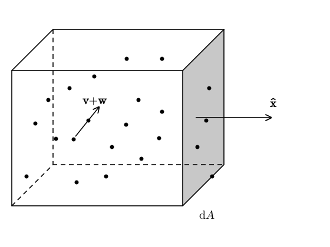
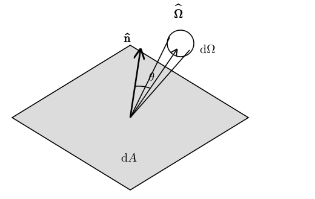
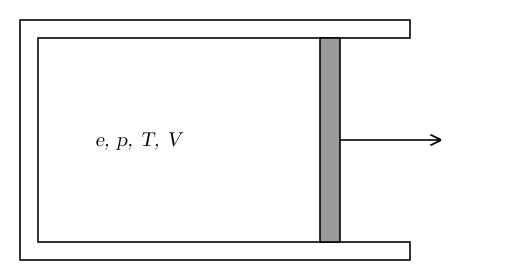

# Thermodynamics Refresher {#sec-thermo}

## Equation of state for ideal gases

In our discussion so far, we have considered a gas to be a set of fluid elements, each with its own macroscopic velocity $\vb{v}$. However, gases are actually composed of particles, each with its own microscopic velocity. How do we reconcile these two pictures? For simplicity, let's consider a fluid element $\mathcal{V}$ containing a single species of atoms, each having mass $m$. Let $\vb{u}_i$ be the velocity of the $i$th particle. Then we can decompose $\vb{u}_i$ as
$$
\vb{u}_i =\vb{v}+\vb{w}_i,
$$ {#eq-thermo-1}
where
$$
\vb{v}= \langle \vb{u} \rangle = \frac{1}{N}  \sum_{i = 1}^N
\vb{u}_i,
$$ {#eq-thermo-2}
is the average velocity and $\vb{w}_i$ is the peculiar velocity of each particle. By definition $\langle \vb{w} \rangle = 0$.

{#fig-thermo-particle-velocities fig-alt="A cube representing a fluid element, filled with dots for the particles. One particle carries an arrow labelled v plus w, the sum of the mean velocity and its peculiar velocity. An arrow labelled x-hat points right, normal to the shaded right face of the cube, which is labelled dA."}

Because the random component of the velocity averages to zero, it does not impact the continuity equation. To see this, consider the net mass crossing the grayed surface in @fig-thermo-particle-velocities. Over any given $\dd t$, only the particles in the region with volume $\langle u_x \rangle \dd t \dd A$ cross the surface, so the mass crossing the surface is
$$
nm \langle u_x  \rangle \dd t \dd A = \rho v_x \dd t \dd A .
$$ {#eq-thermo-3}
However, the random motion of particles contributes to a net *momentum* flux. This is because each particle contributes a momentum $mu_x$, so the momentum flux is
$$
F \dd t = nm \langle u_x^2 \rangle \dd t \dd A = \rho v_x^2 \dd
t \dd A + \rho \langle w_x^2 \rangle \dd t \dd A.
$$ {#eq-thermo-4}
Note that the momentum flux per unit time has units of
$$
[F] = [\rho v_x^2 \dd A] = \mathrm{kg} \, \mathrm{m} \, \mathrm{s}^{- 2} = \mathrm{N},
$$ {#eq-thermo-5}
where $\mathrm{N}$ (newton) is the SI unit of force, so the quantity $\rho \langle w_x^2 \rangle$ is a force per unit area. Pressure is measured in pascal, $1\,\mathrm{Pa} = 1\,\mathrm{N\,m^{-2}}$. If the random motions are isotropic, that is, if they have no preferred direction, then $\langle w_x^2 \rangle = \langle w_y^2 \rangle = \langle w_z^2 \rangle = \frac{1}{3} \langle | \vb{w} |^2 \rangle$. Accordingly, we define as *gas pressure* the quantity
$$
p = \frac{1}{3} \rho \langle | \vb{w} |^2 \rangle .
$$ {#eq-thermo-meaning-pressure}
The factor $1 / 3$ can be understood to come from the fact that pressure forces are the result of random motion in three directions. In analogy, the quantity $\rho v_x^2$ is called the ram pressure. If you are swimming in a river the ram pressure is the force that tries to drag you along with the flow, while the pressure is responsible for the buoyancy you experience.

For a monoatomic gas with particles of mass $m$, the rms velocity can be computed using the equipartition theorem[^thermo-1]:
$$
m \langle | \vb{w} |^2 \rangle = 3 k_B T,
$$ {#eq-thermo-7}
where $T$ is the temperature in kelvin and $k_B$ is the Boltzmann constant,
$$
k_B = 1.380649 \times 10^{- 23} \, \mathrm{J} \, \mathrm{K}^{- 1} .
$$ {#eq-thermo-8}
Combining this with @eq-thermo-meaning-pressure we find the equation of state for an ideal gas:
$$
\boxed{p = nk_B T.}
$$ {#eq-thermo-ideal-gas}
Often, the equation of state for ideal gases is written in terms of the ideal gas constant $\mathcal{R}$ as
$$
p = \frac{\mathcal{R}}{N_A m} \rho T,
$$ {#eq-thermo-ideal-gas-2}
where $N_A$ is Avogadro's number. Since $n = \frac{\rho}{m}$, we see that $\mathcal{R}$ is just an alias for $N_A k_B$. For mixtures of monoatomic gases, @eq-thermo-ideal-gas remains unchanged, with $n$ now being the number density of particles of any species, while @eq-thermo-ideal-gas-2 becomes
$$
p = \frac{\mathcal{R}}{N_A \mu m_u} \rho T = \frac{\rho k_B T}{\mu m_u},
$$ {#eq-thermo-11}
where $m_u$ is the atomic mass unit and $\mu$ is the mean molecular weight (@eq-continua-mu):
$$
\mu = \frac{\rho}{n m_u} .
$$ {#eq-thermo-12}
Thermal motion is not only a source of pressure, but also a reservoir of energy for the gas. In other words, because of their motion, the particles in the gas have average kinetic energy per unit mass
$$
\varepsilon = \frac{1}{2} \langle | \vb{w} |^2 \rangle = \frac{3}{2 m}
k_B T \Longrightarrow k_B T = \frac{2}{3} m \varepsilon .
$$ {#eq-thermo-13}
Using this definition we can eliminate the temperature from the ideal-gas equation of state:
$$
p = \frac{2}{3} \rho \varepsilon,
$$ {#eq-thermo-monoatomic-eos}
where we have used the definition $\rho = nm$.

The last equation is a particular case of a $\Gamma$-law equation of state:
$$
\boxed{p = (\Gamma - 1) \rho \varepsilon,}
$$ {#eq-thermo-gamma-law}
where $\Gamma = \frac{5}{3}$ for a monoatomic gas. The $\Gamma$-law equation of state is a good approximation also for non monoatomic gases or mixture of gases, for which @eq-thermo-monoatomic-eos does not hold. For example, air can be described with a $\Gamma$-law equation of state with $\Gamma = 1.4$. Another example is given by radiation-dominated gases, which we discuss below. Note that it is possible to rewrite @eq-thermo-gamma-law as
$$
p = (\Gamma - 1) u,
$$ {#eq-thermo-16}
where $u = \rho \varepsilon$ is the internal energy density, measured in $\mathrm{J} / \mathrm{m}^3$.

## The first law of thermodynamics

The first law of thermodynamics applied to a fluid element of volume $V$ and mass $\mathcal{M}$ reads
$$
\dd E = \delta Q - \delta W.
$$ {#eq-thermo-first-law}
It states that the amount of energy in the fluid element increases by the amount of heat absorbed by the fluid element, $\delta Q$, and decreases by the amount of mechanical work done, $\delta W$.

For a perfect fluid, the mechanical work is given by
$$
\delta W = p \dd V,
$$ {#eq-thermo-18}
where $V$ is the volume of the fluid element. In the case of nonperfect fluids, there are corrections that arise from the anisotropic components of the stress tensor.

For a reversible process, the amount of absorbed heat is given by
$$
\delta Q = T \dd S.
$$ {#eq-thermo-19}
In many cases, it is convenient to work with the first law of thermodynamics using specific (per unit mass) quantities:
$$
\varepsilon = \frac{E}{\mathcal{M}}, \qquad w = \frac{W}{\mathcal{M}},
\qquad q = \frac{Q}{\mathcal{M}}, \qquad s = \frac{S}{\mathcal{M}}, \qquad v
= \frac{V}{\mathcal{M}} = \frac{1}{\rho} .
$$ {#eq-thermo-20}
Note that here $v$ denotes the specific volume, that is, the volume per unit mass, and not the velocity.
In terms of the specific quantities, the first law reads
$$
\dd \varepsilon = \delta q - \delta w = T \dd s - p \dd v = T
\dd s + \frac{p}{\rho^2} \dd \rho .
$$ {#eq-thermo-first-law2}
In the case of adiabatic flows $\delta q = 0$, the first law simplifies to
$$
\dd \varepsilon = \frac{p}{\rho^2} \dd \rho .
$$ {#eq-thermo-22}
For a $\Gamma$-law equation of state $\varepsilon = \frac{p}{(\Gamma - 1) \rho}$, so we find
$$
\frac{1}{\rho} \dd p - \frac{p}{\rho^2} \dd \rho = (\Gamma - 1)
\frac{p}{\rho^2} \dd \rho \Longrightarrow \frac{\dd p}{p} = \Gamma
\frac{\dd \rho}{\rho} .
$$ {#eq-thermo-23}
If $\Gamma$ is constant, this can be integrated to yield
$$
\boxed{p = K \rho^{\Gamma},}
$$ {#eq-thermo-poly}
where $K$ is an integration constant. @eq-thermo-poly represents a so-called **polytropic equation of state**. Note that for an adiabatic flow, $K$ is constant with time in each fluid element, but $K$ does not have to be the same in each fluid element. A comparison between @eq-thermo-poly and @eq-thermo-gamma-law shows that
$$
K = (\Gamma - 1) \rho^{1 - \Gamma} \varepsilon .
$$ {#eq-thermo-25}
For an ideal gas, $K$ is a function of the specific entropy only, so we can think of $K$ as a measure of the entropy of a fluid element.

::: {.callout-tip icon=false}
## Example

Consider a fluid element of monoatomic ideal gas ($\Gamma = 5/3$) that is compressed adiabatically, so that its density doubles. Since $K$ is constant, the pressure increases by a factor $2^{5/3} \approx 3.2$. From the ideal-gas law, $T \propto p / \rho \propto \rho^{\Gamma - 1}$, so the temperature increases by a factor $2^{2/3} \approx 1.6$.
:::

Note that, if $K$ is the same for all fluid elements, @eq-thermo-poly is barotropic, that is, the pressure depends only on the density. In this case, this equation of state, together with the continuity equation and the equation for the velocity (Euler's equation, @sec-euler), form a closed system of equations, using which it is, in principle, possible to compute all quantities in the flow. If $K$ differs between fluid elements, the system is still closed, since $K$ is constant along each fluid element ($\dd K / \dd t = 0$). However, the polytropic equation of state cannot be applied if $\delta q \neq 0$, due to the presence of heating or cooling of the gas. Even if the flow is adiabatic ($\delta q = 0$), there are irreversible thermodynamic processes that operate in shocks. When this happens, the steps we took to get  @eq-thermo-poly from @eq-thermo-first-law2 are no longer valid, because in irreversible processes the entropy of a fluid element increases even if no heat is exchanged, $T \dd s > \delta q$. In all these situations, it is necessary to derive a new equation, in addition to the equation of state and the velocity and continuity equations, to close the system. In the presence of heating and cooling, this is the energy equation discussed below. Shocks require a different treatment, which we will discuss in @sec-conserv and @sec-shock.

## Radiation pressure

Gas-pressure is not the only relevant source of pressure in astrophysical flows. Radiation pressure is another important component. While gas pressure arises due to the random (or thermal) component of the velocity of particles, radiation pressure arises as a result of momentum deposition by photons in optically thick conditions, in which radiation can be considered to be isotropic and in thermal equilibrium with the gas. We can derive the radiation pressure using a similar method as for the gas pressure, if we assume that photons carry momentum. However, to relate the radiation pressure to the temperature we need to use thermodynamics, and the value of the constant of proportionality can only be derived using quantum mechanics.

Consider a region filled with radiation and let $u$ be the energy density in radiation. We assume that the radiation field is isotropic, meaning that there is an equal probability to find a photon traveling in each direction. In other words, the energy density of photons per unit solid angle of direction is $J = \frac{u}{4 \pi}$. Let's compute the flux of momentum crossing an area $\dd A$ with normal $\hat{\vb{n}}$ (shown in @fig-thermo-radiation-area).

{#fig-thermo-radiation-area fig-alt="A shaded parallelogram, the area element dA, with its unit normal n-hat pointing up from its centre. A second arrow, the photon direction Omega-hat, makes an angle theta with the normal and ends in a small circle that represents the solid angle dOmega."}

Each photon with energy $\varepsilon_{\mathrm{ph}}$ carries a momentum $\varepsilon_{\mathrm{ph}} / c$. Over the time interval $\dd t$ photons in the volume $\dd V = c \dd t \dd A \cos \theta$ will cross $\dd A$, each carrying a normal component of the momentum equal to $(\varepsilon_{\mathrm{ph}} / c) \cos \theta$, so the overall flux of momentum is
$$
\int J (\cos \theta)^2 \dd t \dd A \dd \Omega = \frac{u \dd t
\dd A}{4 \pi} \int_0^{2 \pi} \dd \phi \int_0^{\pi} \dd \theta \sin \theta
(\cos \theta)^2 = \frac{1}{3} u \dd t \dd A \Longrightarrow
\boxed{p = \frac{1}{3} u.}
$$ {#eq-thermo-radiation-pressure}
So we have found that the radiation pressure can be described with a $\Gamma$-law equation of state with $\Gamma = 4 / 3$. However, to be able to actually compute the pressure, we need to find a relation between $u$, $p$, and the temperature $T$. Consider the following thought experiment (@fig-thermo-blackbody-enclosure):

{#fig-thermo-blackbody-enclosure fig-alt="A rectangular box filled with radiation of energy density u, pressure p, temperature T and volume V. A shaded piston closes the right side; an arrow pointing right shows it moving outward, so that the volume increases."}

The first and second law of thermodynamics read
$$
\delta Q = \dd E + p \dd V, \quad T \dd S = \delta Q.
$$ {#eq-thermo-first-and-second-law}
The energy can be written in terms of the energy density as $E = uV$, so
$$
\dd E = V \dd u + u \dd V = V \frac{\dd u}{\dd T} \dd T + u
\dd V
$$ {#eq-thermo-28}
Solving @eq-thermo-first-and-second-law for $\dd S$ and using @eq-thermo-radiation-pressure to eliminate $p$, we find
$$
\dd S = \frac{V}{T}  \frac{\dd u}{\dd T} \dd T + \frac{4}{3}
\frac{u}{T} \dd V.
$$ {#eq-thermo-29}
We can rewrite the previous equation as:
$$
\left( \frac{\partial S}{\partial T} \right)_V = \frac{V}{T}  \frac{\dd
u}{\dd T}, \qquad \left( \frac{\partial S}{\partial V} \right)_T =
\frac{4}{3}  \frac{u}{T} .
$$ {#eq-thermo-30}
Since $\dd S$ is an exact differential:
$$
\frac{\partial^2 S}{\partial V \partial T} = \frac{1}{T}  \frac{\dd
u}{\dd T} = \frac{4}{3}  \frac{1}{T}  \frac{\dd u}{\dd T} -
\frac{4}{3}  \frac{u}{T^2} = \frac{\partial^2 S}{\partial T \partial V} .
$$ {#eq-thermo-31}
Combining the terms we find
$$
\frac{\dd u}{\dd T} = 4 \frac{u}{T} \Longrightarrow \boxed{u =
aT^4 .}
$$ {#eq-thermo-32}
The constant of integration is the *radiation constant*. It can be derived using quantum mechanics:
$$
a \cong 7.5657 \times 10^{- 16} \, \mathrm{J} \, \mathrm{m}^{- 3} \, \mathrm{K}^{- 4}
.
$$ {#eq-thermo-33}
The radiation constant is related to the Stefan–Boltzmann constant $\sigma$ by
$$
a = \frac{4 \sigma}{c},
$$ {#eq-thermo-34}
where $c$ is the speed of light.

In general, both radiation and gas pressure can be present. For example, for ionized stellar matter the pressure and energy densities can be computed as
$$
p = \frac{\rho k_B T}{\mu m_u} + \frac{1}{3} aT^4, \qquad u = \rho \varepsilon =
\frac{3}{2}  \frac{\rho k_B T}{\mu m_u} + aT^4 .
$$ {#eq-thermo-35}

::: {.callout-tip icon=false}
## Example

Consider the center of the Sun, where $\rho \approx 150\,\mathrm{g\,cm^{-3}} = 1.5 \times 10^5\,\mathrm{kg\,m^{-3}}$ and $T \approx 1.5 \times 10^7\,\mathrm{K}$. For fully ionized solar matter $\mu \approx 0.6$, so the gas pressure is
$$
p_{\mathrm{gas}} = \frac{\rho k_B T}{\mu m_u} \approx 3 \times 10^{16}\,\mathrm{Pa},
$$ {#eq-thermo-sun-gas}
while the radiation pressure is
$$
p_{\mathrm{rad}} = \frac{1}{3} a T^4 \approx 1.3 \times 10^{13}\,\mathrm{Pa}.
$$ {#eq-thermo-sun-rad}
So radiation contributes only about $0.04\%$ of the pressure at the center of the Sun. As we will see in @sec-sn, the situation is very different in the ejecta of supernovae, which are radiation dominated.
:::

## Energy equation {#sec-thermo-energy}

The first law of thermodynamics can be used to derive the energy equation for a perfect fluid. We start from the first law written for the energy per unit mass
$$
\dd \varepsilon = \delta q + \frac{p}{\rho}  \frac{\dd \rho}{\rho} .
$$ {#eq-thermo-38}
Dividing both terms by $\dd t$, multiplying by $\rho$, and using the continuity equation (@eq-continua-15) gives
$$
\boxed{\rho \frac{\dd \varepsilon}{\dd t} = \rho \dot{q} - p
\nabla \cdot \vb{v}.}
$$ {#eq-thermo-energy-lagrangian}
The first term on the RHS contains the net heating rate per unit mass, $\dot{q} = \dot{q}_{\mathrm{heat}} - \dot{q}_{\mathrm{cool}}$. For example,  $\dot{q}_{\mathrm{heat}}$ might represent the energy generation due to nuclear burning in the gas, while $\dot{q}_{\mathrm{cool}}$ might be the energy lost by emitting radiation. The second term is the so-called pdV term. It represents the energy spent by doing work on the environment, or on other fluid elements. A list of common heating and cooling processes in astrophysics is given in @clarke2007, Section 4.5.

## In-class worksheet {#sec-thermo-worksheet}

For a reversible process in a gas with fixed composition, the first law of thermodynamics reads
$$
\dd E = T \dd S - p \dd V.
$$ {#eq-thermo-ws1}
Define the specific (per unit mass) quantities:
$$
\varepsilon = \frac{E}{\mathcal{M}}, \qquad w = \frac{W}{\mathcal{M}},
\qquad q = \frac{Q}{\mathcal{M}}, \qquad s = \frac{S}{\mathcal{M}},
\qquad v = \frac{V}{\mathcal{M}} = \frac{1}{\rho} .
$$ {#eq-thermo-ws2}

1.  Find an expression for $\dd \varepsilon$ in terms of $T, s, p, \rho$.

2.  Consider an ideal-gas with $p = (\Gamma - 1) \rho \varepsilon$ undergoing an adiabatic process ($\delta q = 0$).

    1.  Show that
        $$
        p = K \rho^{\Gamma} .
        $$ {#eq-thermo-ws3}

    2.  What is the relation between $K$ and $\varepsilon$?

3.  Consider an adiabatically expanding radiation-pressure dominated gas sphere. Let $T$ and $V$ be the temperature and volume of the gas at a given time $t.$

    1.  Find an expression for the entropy of the gas $S$.

    2.  Show that $pV^{4 / 3} = \mathrm{const}$ as the gas expands.

## Exercises {#sec-thermo-exercises}

::: {#exr-thermo-equation-of-state}
## Equation of state of an H/He plasma

Consider a mixture of ionized hydrogen and helium with $X_{\mathrm{H}} = 70\%$ and $X_{\mathrm{He}} = 30\%$. The pressure is given by
$$
p = p_{\mathrm{ions}} + p_e + p_{\mathrm{rad}},
$$ {#eq-thermo-stellar-pressure}
where $p_{\mathrm{ions}}$ is the partial pressure of the ions, $p_e$ is the partial pressure of the electrons, and $p_{\mathrm{rad}}$ is the radiation pressure. Treat ions and electrons as ideal monoatomic gasses (with the appropriate mean molecular weights), and assume that the radiation is in thermal equilibrium with the gas.

1.  Write a code to compute $p_{\mathrm{ions}}$, $p_e$, and $p_{\mathrm{rad}}$ for any given density $\rho$ and temperature $T$.

2.  Plot $p_{\mathrm{ions}}$, $p_e$, and $p_{\mathrm{rad}}$ as a function of temperature for $\rho = 150\,\mathrm{g\,cm^{-3}}$ (central density of the Sun) and for $\rho = 10^{-24}\,\mathrm{g\,cm^{-3}}$ (ISM density). At what temperature does radiation become dominant in each case?
:::

::: {.content-visible when-profile="solutions"}
::: {.solution}
1.  To compute the pressure, we need the number density of hydrogen, helium, and electrons. From the definition of mass fraction of a species $i$, we have
    $$
    X_i = \frac{\rho_i}{\rho} = \frac{m_i n_i}{\rho} \Longrightarrow n_i =
    \rho \frac{X_i}{m_i} .
    $$
    Note that we do not actually need to compute the mean molecular weight. Instead, we can directly set
    $$
    n_{\mathrm{H}} = \rho \frac{X_{\mathrm{H}}}{m_p}, \qquad n_{\mathrm{He}}
    = \rho \frac{X_{\mathrm{He}}}{4 m_p}, \qquad n_e = n_{\mathrm{H}} + 2
    n_{\mathrm{He}} .
    $$
    The pressure is computed as
    $$
    p_{\mathrm{ions}} = (n_{\mathrm{H}} + n_{\mathrm{He}}) k_B T, \qquad p_e =
    (n_{\mathrm{H}} + 2 n_{\mathrm{He}}) k_B T, \qquad p_{\mathrm{rad}} =
    \frac{a}{3} T^4 .
    $$

2.  See [`equation-of-state.py`](https://github.com/dradice/astrofluids/blob/main/solutions/code/thermodynamics/equation-of-state.py). Overall, we find that in the Sun the radiation pressure would dominate if $T \gtrsim 2 \times 10^8\,\mathrm{K}$, while in ISM-like conditions the radiation pressure dominates if $T \gtrsim 0.4\,\mathrm{K}$.

    Note that we have assumed that the radiation is in thermal equilibrium with the gas, so that $p_{\mathrm{rad}} = a T^4 / 3$, where $T$ is the temperature of the gas. This is a good approximation in stellar interiors, where the gas is hot and dense enough to be optically thick. In the ISM, instead, the radiation is not in equilibrium with the gas and the radiation pressure is different, so the result for the ISM density should be taken as a formal one. For comparison, the cosmic microwave background alone has a temperature of $2.7\,\mathrm{K}$.
:::
:::

## Further reading {#sec-thermo-reading}

- @clarke2007, Chapter 4 (the energy equation), in particular Sections 4.4–4.5 on energy transport and on heating and cooling processes.

[^thermo-1]: That is, we assign an energy $\frac{1}{2} k_B T$ to each of the 3 translational degrees of freedom of the gas particles.
