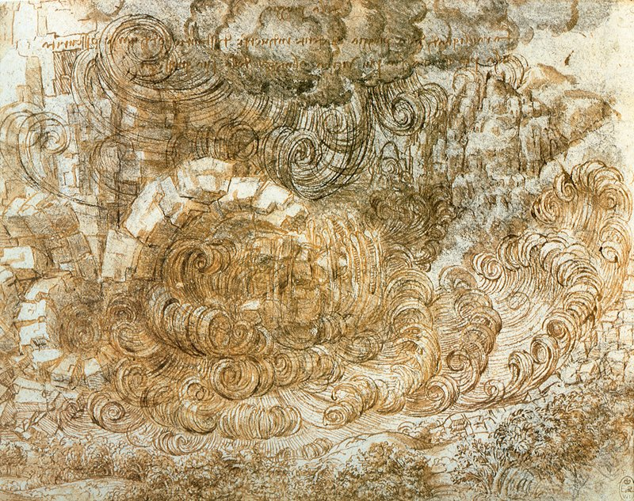
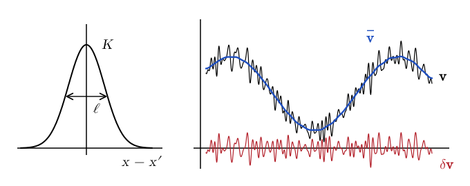
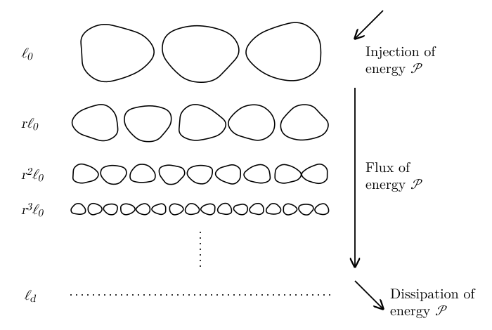
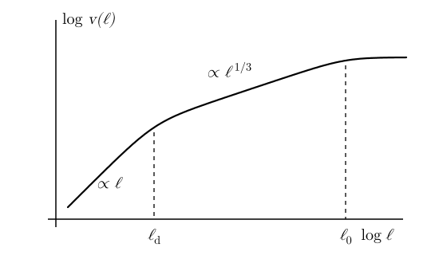
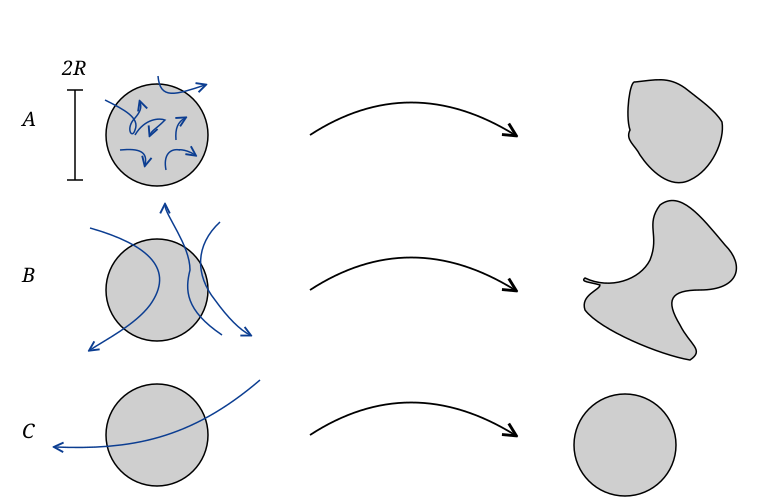

# Turbulence {#sec-turb}

## What is Turbulence?

Turbulence is the chaotic, complex motion observed in fluids across all scales, from the chaotic motion of the quark–gluon plasma produced in heavy-ion collisions (fm scale) to the motion of gas in the intracluster medium (Mpc scale). Turbulence plays an important role in many terrestrial and astrophysical flows. For example, turbulence in the interstellar medium is thought to generate overdensities that eventually grow up to become stars. Turbulence also shapes the evolution and death of stars. Turbulent flows efficiently mix fluid: think of the way in which milk and coffee mix once turbulence is generated with a spoon. Turbulent flows also efficiently dissipate kinetic energy and develop large *effective* shear viscosity, e.g., triggering angular momentum transport.

{#fig-turb-davinci fig-alt="Pen-and-ink drawing of a deluge: a turbulent mass of water and air drawn as a tangle of curling vortices of many different sizes, from large swirls down to small eddies."}

Despite its importance for a number of applications, including many of practical, industrial impact, and despite the fact that turbulence has been studied for more than 500 years, we still lack a rigorous theory of turbulence. The closest thing we have to a theory is Kolmogorov's 1941 theory (K41). These notes contain an introductory-level description of K41 and some example applications. For a more in depth description, I would recommend Landau–Lifshitz Vol. 6 [@landau1987] and Pope, *Turbulent Flows*, 2000 [@pope2000].

## Mean Flow and Fluctuations

We will assume that the flow is incompressible, which is a good approximation if the velocity fluctuations are small compared to the sound speed (@sec-sound). As we will see, the velocity fluctuations become smaller at smaller scales, so this is always true at sufficiently small scales, except in shocks. The flow is then described by the Navier–Stokes equations (@sec-visc)
$$
\partial_t \vb{v}+ (\vb{v} \cdot \nabla) \vb{v}=\vb{g}-
\frac{\nabla p}{\rho} + \nu \nabla^2 \vb{v}, \qquad \nabla \cdot
\vb{v}= 0,
$$ {#eq-turb-navier-stokes}
where $\vb{g}$ is some external acceleration field, typically gravity in astrophysical applications.

A turbulent flow has structure on many scales (@fig-turb-filter). To separate the large-scale motion from the small-scale fluctuations, we decompose the velocity into an average and a fluctuating component:
$$
\vb{v} = \bar{\vb{v}} + \delta\vb{v}, \qquad \bar{\vb{v}} (\vb{x}) = \int K (\vb{x} - \vb{x}') \, \vb{v} (\vb{x}') \dd^3 x',
$$ {#eq-turb-filter}
where the *filter* $K$ is a smooth, positive function of width $\ell$, with integral equal to one. In other words, $\bar{\vb{v}}$ is the average of $\vb{v}$ over a region of size $\ell$, and $\delta\vb{v}$ contains the motions on scales smaller than $\ell$.

We will assume that the average obeys the *Reynolds rules*: it is linear, it commutes with derivatives, and an averaged quantity can be treated as a constant under the average, $\overline{\bar{a} b} = \bar{a} \bar{b}$. In particular, averaging twice does not change the result, so
$$
\bar{\bar{\vb{v}}} = \bar{\vb{v}} \Longrightarrow \overline{\delta\vb{v}} = 0 .
$$ {#eq-turb-filter-mean}
These rules hold exactly for averages over time, in a statistically steady flow, or over many realizations of the flow. A spatial filter like the one in @fig-turb-filter does not satisfy them in general. We will come back to this point in @sec-turb-modeling.

{#fig-turb-filter fig-alt="Two panels. Left: a bell-shaped curve, the filter K, plotted against x minus x prime, with a double arrow marking its width l. Right: a black curve, the velocity v, follows a smooth wave but has many small, fast wiggles; a smooth blue curve, the average v bar, follows the wave; a red curve, the fluctuations delta v, oscillates rapidly around zero near the horizontal axis."}

Since $\nabla \cdot \vb{v} = 0$, we can write $(\vb{v} \cdot \nabla) \vb{v} = \nabla \cdot (\vb{v} \otimes \vb{v})$. Because the average is linear and commutes with derivatives (for a spatial filter, this requires $K$ to be the same everywhere), the average of @eq-turb-navier-stokes is
$$
\partial_t \bar{\vb{v}} + \nabla \cdot \overline{\vb{v} \otimes \vb{v}} = \bar{\vb{g}} - \frac{\nabla \bar{p}}{\rho} + \nu \nabla^2 \bar{\vb{v}},
$$ {#eq-turb-4}
with $\nabla \cdot \bar{\vb{v}} = 0$. However, $\overline{\vb{v} \otimes \vb{v}} \neq \bar{\vb{v}} \otimes \bar{\vb{v}}$. Instead,
$$
\overline{\vb{v} \otimes \vb{v}} = \overline{(\bar{\vb{v}} + \delta\vb{v}) \otimes (\bar{\vb{v}} + \delta\vb{v})} = \bar{\vb{v}} \otimes \bar{\vb{v}} + \overline{\delta\vb{v} \otimes \delta\vb{v}},
$$ {#eq-turb-5}
where we have used $\overline{\bar{\vb{v}} \otimes \bar{\vb{v}}} = \bar{\vb{v}} \otimes \bar{\vb{v}}$ and $\overline{\bar{\vb{v}} \otimes \delta\vb{v}} = \bar{\vb{v}} \otimes \overline{\delta\vb{v}} = 0$ (and the same for $\delta\vb{v} \otimes \bar{\vb{v}}$). The last term is the *Reynolds stress tensor*
$$
\vb{R} = \overline{\delta\vb{v} \otimes \delta\vb{v}} ,
$$ {#eq-turb-reynolds-stress}
so the filtered equations read
$$
\partial_t \bar{\vb{v}} + \nabla \cdot (\bar{\vb{v}} \otimes \bar{\vb{v}}) = \bar{\vb{g}} - \frac{\nabla \bar{p}}{\rho} + \nu \nabla^2 \bar{\vb{v}} - \nabla \cdot \vb{R} .
$$ {#eq-turb-momentum-averaged}
These are the equations for a fluid with velocity $\bar{\vb{v}}$ and pressure $\bar{p}$, with an additional stress $\vb{R}$ due to the fluctuations on scales smaller than $\ell$. They are exact, but they are not closed, because we do not have a way to compute $\vb{R}$ from $\bar{\vb{v}}$. This is the so-called turbulence closure problem. We will come back to it in @sec-turb-modeling.

The simplest case is that of *homogeneous and isotropic turbulence*, which has no mean flow: $\bar{\vb{v}} = 0$ and $\delta\vb{v} = \vb{v}$. This also applies locally, in a small region in which the mean flow is nearly uniform, after we remove it by working in the frame moving with $\bar{\vb{v}}$.

## Kolmogorov's Theory

Fluid motion is driven by external forces, such as gravity, which have a characteristic scale $\ell_0$ comparable to the size of the system of interest. For example, for a star $\ell_0 \sim R_*$, the radius of the star. The starting point of Kolmogorov's theory is to assume that, if the size $\ell$ of the region under consideration is sufficiently small, $\ell \ll \ell_0$, the fluctuating component of the velocity $\delta\vb{v}$, not necessarily assumed to be small, is *universal*, at least in a statistical sense, meaning that it does not depend on the particular system, but that is set by the equations of motion.

To keep our notation simple, we consider homogeneous and isotropic turbulence, so that $\bar{\vb{v}} = 0$ and $\delta\vb{v} = \vb{v}$. As discussed above, this is not a restriction on the theory we are developing, because on small scales the mean flow is nearly uniform, and we can remove it by working in the appropriate reference frame.

The equation for the evolution of the kinetic energy is obtained by multiplying @eq-turb-navier-stokes by $\vb{v}$:
$$
\frac{1}{2}  [\partial_t v^2 + (\vb{v} \cdot \nabla) v^2] =\vb{g}
\cdot \vb{v}- \frac{1}{\rho} \nabla p \cdot \vb{v}+ \nu \nabla^2
\vb{v} \cdot \vb{v}.
$$ {#eq-turb-kinetic-energy-full}
Consider the first term on the RHS, representing the work done by the external force on the flow. If $\ell \ll \ell_0$, then we can take $\vb{g} \sim \mathrm{const}$ over this region and
$$
\overline{\vb{g} \cdot \vb{v}} \simeq \vb{g} \cdot \bar{\vb{v}} = 0.
$$ {#eq-turb-9}
This suggests that the evolution of $v$ for $\ell \ll \ell_0$ is independent of the details of the external force $\vb{g}$, so $v$ can be universal. Of course, if $\ell \sim \ell_0$, then $\overline{\vb{g} \cdot \vb{v}} > 0$ in general, meaning that kinetic energy is injected at the scale $\ell_0$ by gravity and then evolves according to @eq-turb-kinetic-energy-full.

Let's now consider the role of pressure (note that $\rho = \mathrm{const}$):
$$
\overline{\nabla p \cdot \vb{v}} = \frac{1}{V} \int_V \nabla p
\cdot \vb{v} \dd V = \frac{1}{V} \int_V [\nabla \cdot (p
\vb{v}) - p \nabla \cdot \vb{v}] \dd V = \frac{1}{V} \oint_S
p\vb{v} \cdot \vb{n} \dd S = 0.
$$ {#eq-turb-10}
In the last equation we have assumed that $\vb{v}$ is isotropic (no preferred direction), so $\vb{v} \cdot \vb{n}$ is zero on average.

In a similar way, we can rewrite the average of the last term in the RHS of @eq-turb-kinetic-energy-full as
$$
\int_V \nabla^2 \vb{v} \cdot \vb{v} \dd V = \oint_S \vb{n}
\cdot (\nabla \vb{v}\vb{v}) \dd S - \int_V \nabla \vb{v}:
\nabla \vb{v} \dd V = - \int_V | \nabla \vb{v} |^2 \dd V .
$$ {#eq-turb-11}
This means that, on average, we can simplify the kinetic energy equation to read
$$
\partial_t v^2 = 2\vb{g} \cdot \vb{v}- (\vb{v} \cdot \nabla) v^2
- 2 \nu | \nabla \vb{v} |^2 .
$$ {#eq-turb-kinetic-energy}
As already mentioned, the first term on the RHS is responsible for energy injection. The last term describes kinetic energy *dissipation*. We can estimate this term as
$$
\nu | \nabla \vb{v} |^2 \sim \nu \left( \frac{v (\ell)}{\ell} \right)^2,
$$ {#eq-turb-dissipation-estimate}
where $v (\ell)$ is the characteristic velocity fluctuation on a length scale $\ell$:
$$
v (\ell) = \overline{| \vb{v} (\vb{x}+\vb{l}) -\vb{v}
(\vb{x}) |} = \frac{1}{V} \int_V | \vb{v}
(\vb{x}+\vb{l}) -\vb{v} (\vb{x}) | \dd V.
$$ {#eq-turb-14}
Here $| \vb{l} | = \ell$. We use the notation $A \sim B$ to signify that two quantities, $A$ and $B$, are equal up to factors of order unity.

The quantity on the RHS of @eq-turb-dissipation-estimate has units of power per unit mass, as expected, since it is the rate at which the kinetic energy per unit mass is dissipated. @eq-turb-dissipation-estimate suggests that the energy is dissipated at a scale $\ell_d$ (the dissipation or Kolmogorov scale) at which the dissipation rate is equal to the mean power of the global flow:
$$
\nu \left( \frac{v (\ell_d)}{\ell_d} \right)^2 \sim \frac{v^3
(\ell_0)}{\ell_0} \Longrightarrow \ell_d \sim \ell_0  \left[
\frac{\nu}{\ell_0 v (\ell_0)} \right]^{1 / 2}  \left[ \frac{v (\ell_d)}{v
(\ell_0)} \right] = \frac{\ell_0}{\mathrm{Re}^{1 / 2}}  \left[ \frac{v
(\ell_d)}{v (\ell_0)} \right] .
$$ {#eq-turb-ratio-of-scales-1}
In the previous equation, we have introduced the Reynolds number
$$
\mathrm{Re} = \frac{\ell_0 v (\ell_0)}{\nu} .
$$ {#eq-turb-16}
Experimental observations of fluids in pipes suggest that turbulence sets in when $\mathrm{Re} \gtrsim 10^3$. In astrophysical situations, $\mathrm{Re}$ can be much larger. For example, in the interstellar medium $\mathrm{Re} \sim 10^9$. In neutron star mergers we contend with flows having $\mathrm{Re} \sim 10^{15}$. Consequently, @eq-turb-ratio-of-scales-1 implies that $\ell_d \ll \ell_0$ for turbulent flows.

Summarizing, in our analysis of @eq-turb-kinetic-energy we have found that kinetic energy is injected at large scale $\ell_0$ (first term on the RHS) and dissipated at the dissipation scale $\ell_d \ll \ell_0$ (last term on the RHS). This means that there is a range of scales $\ell_d \ll \ell \ll \ell_0$, the so-called *inertial range*, in which the dynamics is dominated by the nonlinear term $(\vb{v} \cdot \nabla) v^2$. We can estimate it as
$$
(\vb{v} \cdot \nabla) v^2 \sim \frac{v^3 (\ell)}{\ell} .
$$ {#eq-turb-17}
Note that, for an incompressible flow, the nonlinear term can also be written as a divergence, $(\vb{v} \cdot \nabla) v^2 = \nabla \cdot (\vb{v} v^2)$. So, by the same argument we used for the pressure, its average over a region vanishes. In other words, the nonlinear term does not create or destroy kinetic energy. Instead, it moves kinetic energy between different scales. In a steady state, the energy per unit mass and per unit time injected at the scale $\ell_0$,
$$
\mathcal{P} = \frac{v^3 (\ell_0)}{\ell_0},
$$ {#eq-turb-power}
must flow through all the scales in the inertial range, without losses, until it reaches the dissipation scale, where it is dissipated. At the scale $\ell$, the kinetic energy per unit mass $v^2 (\ell)$ is passed on to smaller scales in a time $\ell / v (\ell)$, so the flux of energy is $v^3 (\ell) / \ell$. Since this must be the same at all scales, we have
$$
\frac{v^3 (\ell)}{\ell} \sim \mathcal{P} \Longrightarrow \boxed{v
(\ell) \sim (\mathcal{P} \ell)^{1/3} = v (\ell_0)  \left( \frac{\ell}{\ell_0} \right)^{1 / 3}} .
$$ {#eq-turb-kolmogorov-scaling}
This result is key to the theory of turbulence and is called Kolmogorov's second similarity hypothesis[^turb-1]. It has been verified many times through direct numerical simulations and experiments. Note that $v (\ell)$ decreases at smaller scales, so the flow is subsonic at sufficiently small scales, as we anticipated.

Often this hypothesis is formulated in terms of the *energy spectrum* $E (k)$. This is defined so that $E (k) \dd k$ is the kinetic energy per unit mass in eddies with wave numbers between $k$ and $k + \dd k$:
$$
\frac{1}{2} \overline{| \vb{v} |^2} = \int_0^{\infty} E (k) \dd k .
$$ {#eq-turb-20}
Eddies of size $\ell$ have wave numbers $k \sim 1 / \ell$. The kinetic energy per unit mass in eddies of size $\sim \ell$ is the energy in a range of wave numbers of width $\sim k$ around $k$, so
$$
v^2 (\ell) \sim k E (k) \Longrightarrow E (k) \sim \frac{v^2 (1 / k)}{k} \sim \mathcal{P}^{2/3} k^{- 5 / 3} .
$$ {#eq-turb-spectrum}
This is the famous Kolmogorov $k^{- 5 / 3}$ spectrum. A comparison between data and theory over about 16 orders of magnitude in scale is shown in @fig-turb-voyager. The figure collects measurements of density fluctuations in the interstellar medium from several types of observations, with spacecraft data, including Voyager 1, at the smallest scales. It shows the three-dimensional spectrum of density fluctuations, which in Kolmogorov's theory scales as $k^{- 11 / 3}$. The extra factor $k^{- 2}$ with respect to $E (k)$ comes from the area of a shell of radius $k$ in Fourier space. Deviations from the Kolmogorov scaling only appear at very small scales, when plasma kinetic effects become important.

{#fig-turb-voyager fig-alt="Log-log plot of the electron-density turbulence power spectrum against wavenumber q in inverse metres, over almost 20 orders of magnitude in q. Data points from different observations, including Voyager 1 at the high-wavenumber end, follow a single dashed straight line, the Kolmogorov power law with slope minus 11 thirds, labelled P_3N = 10 to the minus 2.79 times (m q) to the minus 11 thirds. Small deviations appear only at the largest wavenumbers, near the ion and electron scales marked at the top."}

A physical interpretation of the K41 model is given by the Richardson cascade (which actually predates K41). In this model, energy is injected at large scale by $\vb{g}$ and dissipated at small scales by the viscosity. The nonlinear term $(\vb{v} \cdot \nabla) v^2$ couples different scales and is responsible for the transport of energy from large scale to small scale, as illustrated in @fig-turb-richardson.

{#fig-turb-richardson fig-alt="Rows of eddies of decreasing size: a few large eddies of size l0 at the top, then more and more eddies of sizes r l0, r squared l0, r cubed l0, down to the dissipation scale l_d. Arrows on the right show energy injected at the rate P at the top, a constant flux of energy P from large to small scales, and dissipation of energy at the rate P at the bottom."}

The main mechanisms for the transport of energy are vortex stretching and shear (Kelvin–Helmholtz) instabilities (@sec-inst).

We can interpret $v^3 (\ell) / \ell$ as a term that controls the kinetic energy dissipation:
$$
\frac{v^3 (\ell)}{\ell} = \frac{v^2 (\ell)}{\tau}, \qquad \tau =
\frac{\ell}{v (\ell)},
$$ {#eq-turb-22}
where $\tau$ is the eddy turnover time, the time over which the specific kinetic energy $v^2 (\ell)$ is transferred to smaller scales. To see this, notice that for $\ell_d \ll \ell \ll \ell_0$, @eq-turb-kinetic-energy reduces to
$$
\boxed{\frac{\dd v^2 (\ell)}{\dd t} \sim - \frac{v^2 (\ell)}{\tau}
.}
$$ {#eq-turb-23}
The constancy of $v^3 (\ell) / \ell$ implies that **the rate at which turbulence dissipates kinetic energy is independent of $\nu$** or of the detailed form of the physical processes responsible for dissipation! Instead, it is set by the dynamics at large scale. In other words, when kinetic energy is injected by mechanical work at large scale in a turbulent flow, turbulence efficiently transports this energy to small scales (generating large velocity gradients) at which point it is dissipated. This is the reason why turbulence theory applies equally well to the flow of water around the propeller of a ship and to the motion of rarefied gas in the intergalactic medium. This finding also justifies turbulence modeling approaches used in simulations.

With Kolmogorov's second similarity law, we can provide a better estimate for $\ell_d$. Using @eq-turb-kolmogorov-scaling into @eq-turb-ratio-of-scales-1, we can eliminate $v (\ell_d)$ to find
$$
\boxed{\ell_d \sim \left( \frac{\nu}{\ell_0 v (\ell_0)} \right)^{3 / 4}
\ell_0 = \mathrm{Re}^{- 3 / 4} \ell_0} .
$$ {#eq-turb-24}
Equivalently, using @eq-turb-kolmogorov-scaling, $\ell_d$ is the scale at which the dissipation term, @eq-turb-dissipation-estimate, is comparable to the transport term, @eq-turb-17:
$$
\nu \left( \frac{v (\ell_d)}{\ell_d} \right)^2 \sim \frac{v^3 (\ell_d)}{\ell_d} \Longrightarrow \frac{v (\ell_d) \ell_d}{\nu} \sim 1,
$$ {#eq-turb-25}
that is, the Reynolds number of the eddies of size $\ell_d$ is of order unity. On smaller scales the flow is smooth, so $v (\ell) \sim | \nabla \vb{v} | \ell \propto \ell$, with $| \nabla \vb{v} | \sim v (\ell_d) / \ell_d$. On scales larger than $\ell_0$, $v (\ell)$ stops growing, because the velocities at points farther apart than $\ell_0$ are uncorrelated. These results are summarized in @fig-turb-velocity-scaling.

{#fig-turb-velocity-scaling fig-alt="Log-log sketch of the velocity fluctuation v(l) against the scale l. The curve rises with slope one, labelled proportional to l, up to the dissipation scale l_d; then it rises more slowly, labelled proportional to l to the one third, up to the injection scale l_0; beyond l_0 it is flat. Dashed vertical lines mark l_d and l_0."}

@eq-turb-24 shows that the scale separation in developed turbulence can be enormous. A direct numerical simulation needs to resolve all scales between $\ell_d$ and $\ell_0$, so it needs $(\ell_0 / \ell_d)^3$ grid cells. It also needs a number of time steps $\sim \ell_0 / \ell_d$, because the time step must be smaller than the time it takes for the flow to cross one cell. So the cost of a direct numerical simulation scales as
$$
\mathrm{cost} \sim \left( \frac{\ell_0}{\ell_d} \right)^4 \sim \mathrm{Re}^3,
$$ {#eq-turb-26}
which makes it impossible to directly simulate very turbulent flows. The largest simulations today have about $10^4$ grid cells in each direction, so they can reach $\mathrm{Re} \sim 10^5$. To study flows with higher Reynolds numbers, it is necessary to give up the idea of simulating all scales in the flow and instead resort to modeling the dynamics below the numerical grid scale using turbulence theory.

::: {.callout-tip icon=false}
## Example

Consider the wind in the atmosphere of the Earth, with $\ell_0 \sim 1\,\mathrm{km}$ and $v (\ell_0) \sim 10\,\mathrm{m\,s^{-1}}$. The kinematic viscosity of air is $\nu \approx 1.5 \times 10^{-5}\,\mathrm{m^2\,s^{-1}}$, so $\mathrm{Re} \sim 7 \times 10^8$. The dissipation scale is $\ell_d \sim \mathrm{Re}^{-3/4} \ell_0 \sim 0.2\,\mathrm{mm}$, and a direct numerical simulation would cost $\sim \mathrm{Re}^3 \sim 10^{26}$, many orders of magnitude beyond what is possible. Even a cup of coffee stirred with a spoon, with $\ell_0 \sim 3\,\mathrm{cm}$, $v (\ell_0) \sim 0.1\,\mathrm{m\,s^{-1}}$, and $\nu \approx 10^{-6}\,\mathrm{m^2\,s^{-1}}$, has $\mathrm{Re} \sim 3000$ and $\ell_d \sim 70\,\mu\mathrm{m}$.
:::

Before we discuss some applications of Kolmogorov's theory, it is worth mentioning its limitations. Astrophysical flows are often supersonic and highly magnetized. Compressibility and magnetic fields can have a profound role on the turbulent cascade. Shocks can dissipate kinetic energy directly at large scales (@sec-shock). Magnetic fields can give rise to *inverse cascade* whereby small magnetic field structures self-organize into large scale ordered fields (*turbulent dynamo process*, @sec-flux). The study of compressible, magnetized turbulence is still an active area of research and beyond the scope of this course. However, even for compressible, magnetized flows, Kolmogorov's theory provides a good starting point and can often be applied directly.

## Shredding of Clouds in a Turbulent Flow

Consider a cloud of gas of radius $R$, for example a patch of material enriched by a supernova, that is carried by the turbulent flow of the interstellar medium. We want to compute the evolution of $R$ with time. We will consider three cases, illustrated in @fig-turb-cloud.

{#fig-turb-cloud fig-alt="Three rows, each showing a grey circular cloud, an arrow, and the cloud afterwards. In case A small random flows act inside the cloud, which ends slightly deformed. In case B eddies stretch the cloud into a strongly distorted shape. In case C a single large-scale flow carries the cloud, which keeps its shape."}

If $R \sim \ell_d$ the particles in the cloud will undergo Brownian random motion, so, as in the case of the random diffusion of photons (@sec-conserv), we have $R \sim t^{1 / 2}$. If $R \sim \ell_0$, then the cloud is primarily advected by the mean flow. The edges of the cloud will still experience random diffusion, so $R \sim t^{1 / 2}$, but with an effective diffusion coefficient $\sim \ell_0 v (\ell_0)$, which is much larger than the molecular one. Indeed, eddies of size $\ell_0$ act like particles with mean free path $\ell_0$ (compare with @eq-continua-mean-free-path) moving with velocity $v (\ell_0)$. We will see that this is the same estimate used for the turbulent viscosity.

The more interesting case is when $\ell_d \ll R \ll \ell_0$. In this case, the cloud undergoes rapid distortion:
$$
\frac{\dd R}{\dd t} \sim v \sim R^{1 / 3} \Longrightarrow \frac{\dd
R^2}{\dd t} \sim Rv \sim R^{4 / 3} .
$$ {#eq-turb-27}
This is *Richardson's 4/3-law*. We can use the second Kolmogorov similarity hypothesis to find the time dependence for $R$:
$$
\frac{\dd R}{\dd t} \sim v (\ell_0)  \left( \frac{R}{\ell_0} \right)^{1 / 3}
\Longrightarrow R^{2 / 3} \sim \frac{v (\ell_0)}{\ell_0^{1 / 3}} t
\Longrightarrow R^2 \sim \mathcal{P} t^3 .
$$ {#eq-turb-28}
In other words, $R \propto t^{3 / 2}$: the cloud grows faster and faster, because, as it grows, it is torn apart by larger and faster eddies. This is an example of *superdiffusion*: the cloud grows faster than by ordinary diffusion, for which $R \propto t^{1 / 2}$.

Turbulence significantly accelerates the mixing of new elements produced in supernovae with the interstellar medium, where they can subsequently form new stars, planets, and people.

::: {.callout-tip icon=false}
## Example

Consider the metals ejected by a supernova into the warm interstellar medium, with $T \sim 10^4\,\mathrm{K}$ and $n \sim 1\,\mathrm{cm^{-3}}$. The turbulence in the interstellar medium is driven on scales $\ell_0 \sim 100\,\mathrm{pc}$, with $v (\ell_0) \sim 10\,\mathrm{km\,s^{-1}}$. So turbulence mixes the metals over $\sim 100\,\mathrm{pc}$ in a time $\sim \ell_0 / v (\ell_0) \sim 10\,\mathrm{Myr}$. How long would it take without turbulence? The mean free path of the particles in this gas is $\lambda \sim 10^{10}\,\mathrm{m}$, and their thermal velocity is $v_{\mathrm{th}} \sim 10\,\mathrm{km\,s^{-1}}$, so the diffusion coefficient is $D \sim \lambda v_{\mathrm{th}} / 3 \sim 3 \times 10^{13}\,\mathrm{m^2\,s^{-1}}$ (@sec-conserv). Molecular diffusion would take $\sim \ell_0^2 / D \sim 10^{16}\,\mathrm{yr}$, much longer than the age of the Universe. Note also that the ratio of the two timescales is $\ell_0 v (\ell_0) / D \sim 10^9$, which is the Reynolds number of the interstellar medium.
:::

## Turbulence Modeling {#sec-turb-modeling}

Directly simulating turbulent flows is impossible, so one of the goals of turbulence theory is to develop effective strategies to deal with unresolved turbulence in simulations. The idea is to solve the filtered equations, @eq-turb-momentum-averaged, instead of the Navier–Stokes equations. Because $\bar{\vb{v}}$ is much smoother than $\vb{v}$, @eq-turb-momentum-averaged can be solved on a coarse computational mesh. The problem of modeling turbulence is then reduced to that of finding a good model for $\vb{R}$. There are many such models in the literature.

Commonly used frameworks are the Reynolds averaged Navier–Stokes (RANS) and Large-Eddy Simulations (LES). In RANS, the average is over time or over many realizations of the flow, so $\vb{R}$ describes the fluctuations on all scales. In LES, $\ell$ is comparable to the size of the grid cells, and $\vb{R}$ describes only the unresolved eddies. In this case, the Reynolds rules do not hold: for example, $\overline{\bar{\vb{v}} \otimes \delta\vb{v}} \neq \bar{\vb{v}} \otimes \overline{\delta\vb{v}}$. So the Reynolds stress is defined as $\vb{R} = \overline{\vb{v} \otimes \vb{v}} - \bar{\vb{v}} \otimes \bar{\vb{v}}$, which reduces to @eq-turb-reynolds-stress for averages over time or over realizations. With this definition, @eq-turb-momentum-averaged follows from @eq-turb-4 for any filter that commutes with derivatives.

The simplest model, which is also the most commonly used for astrophysical applications, is the *turbulent* (or *eddy*) *viscosity* model. Accordingly, one takes
$$
\vb{R}= \frac{1}{3} (\mathrm{tr} \vb{R}) \vb{I} - \nu_T  (\nabla \bar{\vb{v}}+ \nabla^T \bar{\vb{v}}) .
$$ {#eq-turb-29}
The first term is needed because $\mathrm{tr} \vb{R} = \overline{|\vb{v}|^2} - |\bar{\vb{v}}|^2$ is positive: it is equal to $\overline{|\delta\vb{v}|^2}$ in RANS and to $\int K (\vb{x} - \vb{x}') \, |\vb{v} (\vb{x}') - \bar{\vb{v}} (\vb{x})|^2 \dd^3 x'$ in LES, while the trace of the second term vanishes for an incompressible flow. The first term is isotropic, so it acts like an additional pressure, the *turbulent pressure* $\rho \mathrm{tr} \vb{R} / 3$, which we include in $\bar{p}$. We will meet the turbulent pressure again in the in-class worksheet. With this choice, using $\nabla \cdot \bar{\vb{v}} = 0$ and taking $\nu_T$ constant, @eq-turb-momentum-averaged becomes
$$
\partial_t  \bar{\vb{v}} + \nabla \cdot \left(\bar{\vb{v}}
\otimes \bar{\vb{v}} + \frac{\bar{p}}{\rho} \vb{I} \right) = \bar{\vb{g}} + (\nu
+ \nu_T) \nabla^2 \bar{\vb{v}} .
$$ {#eq-turb-momentum-averaged-2}
That is, turbulence is described simply as a dissipative process and $\nu_T$ is an effective turbulent viscosity. The turbulent viscosity, in turn, is often obtained using dimensional analysis arguments:
$$
\nu_T = \ell_{\mathrm{mix}} V,
$$ {#eq-turb-31}
where $\ell_{\mathrm{mix}}$ is a characteristic length, also called the *mixing length*, and $V$ is a characteristic velocity. For example, in accretion disk theory (@sec-disk), $V = c_s$ and $\ell_{\mathrm{mix}}$ is taken to be proportional to the scale-height of the disk $H$:
$$
\ell_{\mathrm{mix}} = \alpha H = \alpha \frac{c_s}{\Omega} \Longrightarrow
\nu_T = \alpha \frac{c_s^2}{\Omega},
$$ {#eq-turb-32}
where $\Omega$ is the angular velocity of the flow. This is the so-called $\alpha$-viscosity model.

For shear flows along $x$ with shear in the $y$-direction, one can use the velocity gradient instead of $V$:
$$
\nu_T = \ell_{\mathrm{mix}}^2  \left| \frac{\partial \bar{v}_x}{\partial
y} \right| .
$$ {#eq-turb-33}
This is Prandtl's mixing-length model. The Smagorinsky model, which is often used in large-eddy simulations, is a generalization of this model, in which $\ell_{\mathrm{mix}}$ is proportional to the size of the grid cells and $| \partial \bar{v}_x / \partial y |$ is replaced by the magnitude of the rate of strain of $\bar{\vb{v}}$.

For industrial applications, a popular strategy is to solve additional equations for $\partial_t \vb{R}$, with coefficients calibrated to experimental (wind tunnel) results. More sophisticated "subgrid" models have also been proposed for astrophysical applications, but their detailed description is beyond the scope of this course. See @brandenburg2011 for more information.

Another popular approach is the Implicit Large-Eddy Simulations (ILES) method, in which $\vb{R}$ is not included explicitly in the equations. Instead, a numerical scheme is chosen that has a numerical viscosity $\nu_{\mathrm{num}} \approx \nu_T$. This approach is often effective, but ILES simulations need to be accompanied by careful resolution studies to assess their reliability, because accurate results can only be obtained if a sufficient portion of the inertial range is resolved by the simulations.

![Density in a high-resolution simulation of compressible turbulence in the interstellar medium [@federrath2021], as shown on the cover of *Nature Astronomy*, April 2021. © Springer Nature, reproduced for non-commercial educational use and not covered by the license of these notes.](../figures/turbulence/federrath-cover.png){#fig-turb-federrath fig-alt="Journal cover showing a slice of gas density from a turbulence simulation: filaments and sheets of dense gas in bright orange and yellow, separated by low-density regions in purple, with a highly irregular, multi-scale structure."}

## In-class worksheet {#sec-turb-worksheet}

**Turbulence in Core-Collapse Supernovae.** We construct here a simplified model showing the role of turbulence in aiding shock revival in core-collapse supernovae.

1.  Consider a steady accretion shock near the protoneutron star. Assume that the in-falling material is cold and that the velocity downstream of the shock is small. Show that the Rankine–Hugoniot conditions (@sec-shock) simplify to
    $$
    p_2 \approx \rho_1 v_1^2, \qquad \frac{\rho_2}{\rho_1} = \frac{\Gamma +
    1}{\Gamma - 1},
    $$ {#eq-turb-ws1}
    where all quantities have their usual meaning.

2.  Find the equilibrium pressure $p_2$ needed to support the accretion shock at a fixed radius $r_s$, given the mass of the protoneutron star $M$, and the accretion rate $\dot{M}$. Assume that the gas upstream of the shock falls freely from rest at infinity.

3.  Consider angular averages of the flow, e.g.,
    $$
    \langle \vb{v} \rangle = \frac{1}{4 \pi} \oint \vb{v} \dd
    \Omega .
    $$ {#eq-turb-ws2}
    Decompose the velocity downstream of the shock as the sum of an average (laminar) component $\langle \vb{v} \rangle$ and a turbulent fluctuating component $\delta \vb{v}$, $\vb{v}= \langle \vb{v} \rangle + \delta \vb{v}$. Assume that $\rho$ depends only on radius, so that $\langle \rho \vb{v} \rangle = \rho \langle \vb{v} \rangle$. Define the Reynolds stress as
    $$
    \vb{R}= \langle \delta \vb{v} \otimes \delta \vb{v} \rangle
    .
    $$ {#eq-turb-ws3}
    Show that the conservation of momentum across the shock can be written as
    $$
    \rho_2  \langle v_2 \rangle^2 + \rho_2 R_{r r} + p_2 = \rho_1 v_1^2 .
    $$ {#eq-turb-ws4}

4.  Define the specific turbulent kinetic energy as
    $$
    \varepsilon_{\mathrm{turb}} = \frac{1}{2}  | \delta \vb{v} |^2 =
    \frac{1}{2}  (R_{rr} + R_{\theta \theta} + R_{\phi \phi}) .
    $$ {#eq-turb-ws5}
    Assume that $R_{rr} = R_{\theta \theta} + R_{\phi \phi}$ and show that with this definition @eq-turb-ws4 can be written as
    $$
    \begin{aligned}
    & \rho_2  \langle v_2 \rangle^2 \\
    & \quad + \rho_2  [(\Gamma_{\mathrm{turb}} - 1)
    \varepsilon_{\mathrm{turb}} + (\Gamma - 1) \varepsilon_2] \\
    & \quad = \rho_1 v_1^2 .
    \end{aligned}
    $$ {#eq-turb-ws6}
    What is the effective adiabatic index of turbulence $\Gamma_{\mathrm{turb}}$?

5.  At early times, before the turbulence develops, the accretion shock is stalled at a radius $r_s$. What happens to the shock, once turbulence develops?

## Exercises {#sec-turb-exercises}

::: {#exr-turb-random-walks}
## Brownian and Lévy random walks

Consider the random walk of a particle. At each step $i$ a particle at position $\vb{x}_i$ jumps to position
$$
\vb{x}_{i + 1} =\vb{x}_i + R_i \vb{d}_i,
$$ {#eq-turb-random-walk}
where $\vb{d}_i$ is a random direction on the sphere (uniform in $\phi$ and $\cos \theta$) and $R_i$ is either

1.  a fixed constant (Brownian random walk); or

2.  it has a Pareto distribution $p (R) \sim R^{- 1 - \beta}$, for a given $\beta$ (Lévy random walk).

The Brownian random walk can be used to model ordinary diffusion process, while Lévy random walks can be used to model effective diffusion and mixing in a turbulent flow (superdiffusion).

Write a code to simulate Brownian and Lévy random walks with $\beta = 2 / 3$, then compute the median of the traveled distance $D_N = | \vb{x}_N -\vb{x}_0 |$ as a function of $N$ for the two. For $\beta < 1$ the mean length of a step is infinite, so the median is a better measure than the mean.

Show that $D_N \sim N^{\gamma}$ and estimate $\gamma$ in the two cases. Compare the results with the predictions from Kolmogorov theory for diffusion in a turbulent flow ($R \sim t^{3 / 2}$). Explain why the Lévy random walk gives $D_N \sim N^{1 / \beta}$.

\[You can use `numpy.random.uniform` and `numpy.random.pareto` to generate $R_i$ and $\vb{d}_i$.\]
:::

::: {.content-visible when-profile="solutions"}
::: {.solution}
See [`random-walks.py`](https://github.com/dradice/astrofluids/blob/main/solutions/code/turbulence/random-walks.py) for the implementation. The median of $D_N$ scales as $N^{1/2}$ for the Brownian random walk and as $N^{3/2}$ for the Lévy random walk with $\beta = 2/3$, which matches Richardson's law, since $N \propto t$.

For the Lévy random walk, the distance traveled after $N$ steps is dominated by the longest step. The probability that a single step is longer than $R$ is $\int_R^\infty p (R') \dd R' \propto R^{-\beta}$. Among $N$ steps, we expect about one to be longer than $R$ if $N R^{-\beta} \sim 1$, so the longest step has $R \sim N^{1/\beta}$, and $D_N \sim N^{1/\beta}$.
:::
:::

## Further reading {#sec-turb-reading}

- @clarke2007, Chapter 14 (introduction to turbulence).
- @landau1987 and @pope2000.

[^turb-1]: The first Kolmogorov similarity hypothesis concerns the universality of the flow at the dissipation scale. This is not relevant to astrophysical applications, because astrophysical plasmas become collisionless at small scale, i.e., they do not behave like a fluid anymore. However, Kolmogorov's theory still applies for $\ell \gg \ell_d$.
