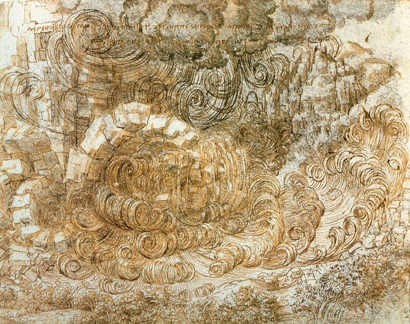
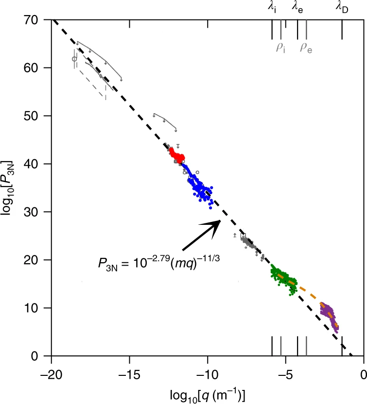
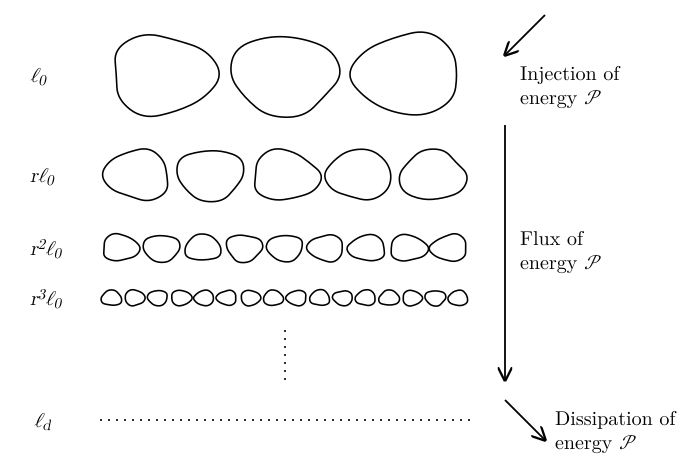
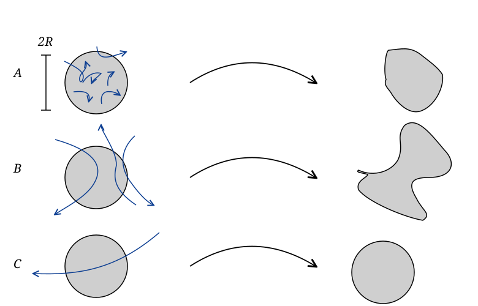

# Turbulence {#sec-turb}

## What is Turbulence?

Turbulence is the chaotic, complex motion observed in fluids across all scales, from the chaotic motion of quark gluon plasma at scales of (fm scale) to the motion of gas in the intercluster medium (Mpc scale). Turbulence plays an important role in many terrestrial and astrophysical flows. For example, turbulence in the interstellar medium is thought to generate overdensities that eventually grow up to become stars. Turbulence also shapes the evolution and death of stars. Turbulent flows efficiently mix fluid: think of the way in which milk and coffee mix once turbulence is generated with a spoon. Turbulent flows also efficiently dissipate kinetic energy and develop large *effective* shear viscosity, e.g., triggering angular momentum transport.

{#fig-turb-davinci fig-alt="Pen-and-ink drawing of a deluge: a turbulent mass of water and air drawn as a tangle of curling vortices of many different sizes, from large swirls down to small eddies."}

Despite its importance for a number of applications, including many of practical, industrial impact, and despite the fact that turbulence has been studied for more than 500 years, we still lack a rigorous theory of turbulence. The closest thing we have to a theory is Kolmogorov's 1941 theory (K41). These notes contain an introductory-level description of K41 and some example applications. For a more in depth description, I would recommend Landau-Lifshitz Vol. 6 [@landau1987] and Pope, *Turbulent Flows*, 2000 [@pope2000].

## Kolmogorov's Theory

Fluid motion is driven by external forces, such as gravity, which have a characteristic scale $\ell_0$ comparable to the size of the system of interest. For example, for a star $\ell_0 \sim R$ the star radius. Kolmogorov's theory starting point is to decompose the flow velocity in some patch of the fluid $\vb{v}$ into a mean flow $\langle \vb{v} \rangle$ and a fluctuating component $\vb{v}'$, not necessarily assumed to be small. The theory then assumes that, if the size $\ell$ of the region under consideration is sufficiently small, $\ell \ll \ell_0$, $\vb{v}'$ is *universal*, at least in a statistical sense, meaning that it does not depend on the particular system, but that is set by the equations of motion.

To keep our notation simple, we set $\langle \vb{v} \rangle = 0$, meaning that $\vb{v}' =\vb{v}$. Note that we can always set $\langle \vb{v} \rangle = 0$ by working in the appropriate reference frame, so this is not a restriction on the theory we are developing. We are also going to assume that the flow is incompressible, which is typically a good assumption away from shocks and over a sufficiently small region. The flow is then described by the Navier-Stokes equations
$$
\partial_t \vb{v}+ (\vb{v} \cdot \nabla) \vb{v}=\vb{g}-
\frac{\nabla p}{\rho} + \nu \nabla^2 \vb{v}, \qquad \nabla \cdot
\vb{v}= 0,
$$ {#eq-turb-navier-stokes}
where $\vb{g}$ is some external acceleration field, typically gravity in astrophysical applications.

The equation for the evolution of the kinetic energy is obtained by multiplying @eq-turb-navier-stokes by $\vb{v}$:
$$
\frac{1}{2}  [\partial_t v^2 + (\vb{v} \cdot \nabla) v^2] =\vb{g}
\cdot \vb{v}- \frac{1}{\rho} \nabla p \cdot \vb{v}+ \nu \nabla^2
\vb{v} \cdot \vb{v}.
$$ {#eq-turb-kinetic-energy-full}
Consider, the first term on the RHS, representing the work done by the external force on the flow. If $\ell \ll \ell_0$, then we can take $\vb{g} \sim \operatorname{const}$ over this region and
$$
\langle \vb{g} \cdot \vb{v} \rangle \sim \vb{g} \cdot \langle
\vb{v} \rangle = 0.
$$ {#eq-turb-3}
This suggests that the evolution of $v$ for $\ell \ll \ell_0$ is independent on the details of the external force $\vb{g}$, so $v$ can be universal. Of course, if $\ell \sim \ell_0$, then $\langle \vb{g} \cdot \vb{v} \rangle > 0$ in general, meaning that kinetic energy is injected at the scale $\ell_0$ by gravity and then evolves according to @eq-turb-kinetic-energy-full.

Let's now consider the role of pressure (note that $\rho = \operatorname{const}$):
$$
\langle \nabla p \cdot \vb{v} \rangle = \frac{1}{V} \int_V \nabla p
\cdot \vb{v} \dd V = \frac{1}{V} \int_V [\nabla \cdot (p
\vb{v}) - p \nabla \cdot \vb{v}] \dd V = \frac{1}{V} \oint_S
p\vb{v} \cdot \vb{n} \dd S = 0.
$$ {#eq-turb-4}
In the last equation we have assumed that $\vb{v}$ is isotropic (no preferred direction), so $\vb{v} \cdot \vb{n}$ is zero on average.

In a similar way, we can rewrite the average of the last term in the RHS of @eq-turb-kinetic-energy-full as
$$
\int_V \nabla^2 \vb{v} \cdot \vb{v} \dd V = \oint_S \vb{n}
\cdot (\nabla \vb{v}\vb{v}) \dd S - \int_V \nabla \vb{v}:
\nabla \vb{v} \dd V = - \int_V | \nabla \vb{v} |^2 \dd V .
$$ {#eq-turb-5}
This means that we can simplify the kinetic energy equation to read
$$
\partial_t v^2 = 2\vb{g} \cdot \vb{v}- (\vb{v} \cdot \nabla) v^2
- 2 \nu | \nabla \vb{v} |^2 .
$$ {#eq-turb-kinetic-energy}
As already mentioned, the first term on the RHS is responsible for energy injection. The last term describes kinetic energy *dissipation*. We can estimate this term as
$$
\nu | \nabla \vb{v} |^2 \sim \nu \left( \frac{v (\ell)}{\ell} \right)^2,
$$ {#eq-turb-dissipation-estimate}
where $v (\ell)$ is the characteristic velocity fluctuation on a length scale $\ell$:
$$
v (\ell) = \langle | \vb{v} (\vb{x}+\vb{l}) -\vb{v}
(\vb{x}) | \rangle = \frac{1}{V} \int_V | \vb{v}
(\vb{x}+\vb{l}) -\vb{v} (\vb{x}) | \dd^3 \vb{x}.
$$ {#eq-turb-8}
We use the notation $A \sim B$ to signify that two quantities, $A$ and $B$, are equal up to factors of order unity.

The quantity on the RHS of @eq-turb-dissipation-estimate has units of power per unit mass, as expected since it represents the decay rate of energy of the specific (per unit mass) kinetic energy. @eq-turb-dissipation-estimate suggests that the energy is dissipated at a scale $\ell_d$ (the dissipation or Kolmogorov scale) at which the dissipation rate is equal to the mean power of the global flow:
$$
\nu \left( \frac{v (\ell_d)}{\ell_d} \right)^2 \sim \frac{v^3
(\ell_0)}{\ell_0} \Longrightarrow \ell_d \sim \ell_0  \left[
\frac{\nu}{\ell_0 v (\ell_0)} \right]^{1 / 2}  \left[ \frac{v (\ell_d)}{v
(\ell_0)} \right] = \frac{\ell_0}{\operatorname{Re}^{1 / 2}}  \left[ \frac{v
(\ell_d)}{v (\ell_0)} \right] .
$$ {#eq-turb-ratio-of-scales-1}
In the previous equation, we have introduced the Reynolds number
$$
\operatorname{Re} = \frac{\ell_0 v (\ell_0)}{\nu} .
$$ {#eq-turb-10}
Experimental observations of fluids in pipes suggest that turbulence sets in when $\operatorname{Re} \gtrsim 10^3$. In astrophysical situations, $\operatorname{Re}$ can be much larger. For example, in the interstellar medium $\operatorname{Re} \sim 10^8$. In neutron star mergers we contend with flows having $\operatorname{Re} \sim 10^{15}$. Consequently, @eq-turb-ratio-of-scales-1 implies that $\ell_d \ll \ell_0$ for turbulent flows.

Summarizing, in our analysis of @eq-turb-kinetic-energy we have found that kinetic energy is injected at large scale $\ell_0$ (first term on the RHS) and dissipated at the dissipation scale $\ell_d \ll \ell$ (last term on the RHS). This means that there is range of scales $\ell_d \ll \ell \ll \ell_0$, the so-called *inertial range*, in which the dynamics is dominated by the nonlinear term $(\vb{v} \cdot \nabla) v^2$. We can estimate it as
$$
(\vb{v} \cdot \nabla) v^2 \sim \frac{v^3 (\ell)}{\ell} .
$$ {#eq-turb-11}
Note that the non-linear term is different from the other two in that there are no scales linked to it, so we assume that it is independent on the scale $\ell$, as long as $\ell_d \ll \ell \ll \ell_0$:
$$
\frac{v^3 (\ell)}{\ell} \sim \operatorname{const} \Longrightarrow \boxed{v
(\ell) \sim v (\ell_0)  \left( \frac{\ell}{\ell_0} \right)^{1 / 3}} .
$$ {#eq-turb-kolmogorov-scaling}
This assumption is key to the theory of turbulence and is called Kolmogorov's second similarity hypothesis[^turb-1]. This is an assumption that has been verified many times through direct numerical simulations and experiments. Often this hypothesis is formulated in terms of the Fourier transform of $v^2 (\ell) :$
$$
E (k) = \int e^{\ii k \ell} v^2 (\ell) \dd \ell .
$$ {#eq-turb-13}
If $v (\ell) \sim \ell^{1 / 3}$, dimensional analysis shows $E (k) \sim k^{- 5 / 3}$. A comparison between data and theory over more than 10 orders of magnitude in scale is shown in @fig-turb-voyager, which collects data on turbulence in the local ISM recorded by the Voyager 1 mission. Deviations from the Kolmogorov scaling only appear at very small scales, when plasma kinetic effects become important.

{#fig-turb-voyager fig-alt="Log-log plot of the electron-density turbulence power spectrum against wavenumber q in inverse metres, over almost 20 orders of magnitude in q. Data points from different observations, including Voyager 1 at the high-wavenumber end, follow a single dashed straight line, the Kolmogorov power law with slope minus 11 thirds, labelled P_3N = 10 to the minus 2.79 times (m q) to the minus 11 thirds. Small deviations appear only at the largest wavenumbers, near the ion and electron scales marked at the top."}

A physical interpretation of the K41 model is given by the Richardson cascade (which actually predates K41). In this model, energy is injected at large scale by $\vb{g}$ and dissipated at small scales by the viscosity. The nonlinear term $(\vb{v} \cdot \nabla) v^2$ couples different scales and is responsible for the transport of energy from large scale to small scale, as illustrated in @fig-turb-richardson.

{#fig-turb-richardson fig-alt="Rows of eddies of decreasing size: a few large eddies of size l0 at the top, then more and more eddies of sizes r l0, r squared l0, r cubed l0, down to the dissipation scale eta. Arrows on the right show energy injected at the rate epsilon at the top, a constant flux of energy epsilon from large to small scales, and dissipation of energy at the rate epsilon at the bottom."}

The main mechanisms for the transport of energy are vortex stretching and shear (Kelvin-Helmholtz) instabilities. It is possible to show that $v^3 (\ell) / \ell \sim \operatorname{const}$ implies that, in steady state, the flux of energy across scales is constant.

We can interpret $v^3 (\ell) / \ell$ as a term that controls the kinetic energy dissipation:
$$
\frac{v^3 (\ell)}{\ell} = \frac{v^2 (\ell)}{\tau}, \qquad \tau =
\frac{\ell}{v (\ell)},
$$ {#eq-turb-14}
where $\tau$ is the eddy turnover time, the time over which the specific kinetic energy $v^2 (\ell)$ is dissipated. To see this, notice that for $\ell_d \ll \ell \ll \ell_0$, @eq-turb-kinetic-energy reduces to
$$
\boxed{\frac{\dd v^2 (\ell)}{\dd t} \sim - \frac{v^2 (\ell)}{\tau}
.}
$$ {#eq-turb-15}
The constancy of $v^3 (\ell) / \ell$ implies that **the rate at which turbulence dissipates kinetic energy is independent on $\nu$** or on the detailed form of the physical processes responsible for dissipation! Instead, it is set by the dynamics at large scale. In other words, when kinetic energy is injected by mechanical work at large scale in a turbulent flow, turbulence efficiently transports this energy to small scales (generating large velocity gradients) at which point it is dissipated. This is the reason why turbulence theory applies equally well to the flow of water around the propeller of a ship and to the motion of rarefied gas in the intergalactic medium. This finding also justifies turbulence modeling approaches used in simulations.

With Kolmogorov's second similarity law, we can provide a better estimate for $\ell_d$. Using @eq-turb-kolmogorov-scaling into @eq-turb-ratio-of-scales-1, we can eliminate $v (\ell_d)$ to find
$$
\boxed{\ell_d \sim \left( \frac{\nu}{\ell_0 v (\ell_0)} \right)^{3 / 4}
\ell_0} \sim \ell_d = \operatorname{Re}^{- 3 / 4} \ell_0 .
$$ {#eq-turb-16}
This shows that the scale separation in developed turbulence can be enormous. The cost of a direct numerical simulation scales as
$$
\operatorname{cost} \sim \left( \frac{\ell_0}{\ell_d} \right)^4 \sim \operatorname{Re}^3,
$$ {#eq-turb-17}
which makes it impossible to directly simulate very turbulent flows. Direct numerical simulations cannot probe regimes with $\operatorname{Re} \gtrsim 10^4$. To study flows with higher Reynolds numbers, it is necessary to give up the idea of simulating all scales in the flow and instead resort to modeling the dynamics below the numerical grid scale using turbulence theory.

Before we discuss some applications of Kolmogorov's theory, it is worth mentioning its limitations. Astrophysical flows are often supersonic and highly magnetized. Compressibility and magnetic fields can have a profound role on the turbulent cascade. Shocks can directly dissipate energy from large scale to small scales. Magnetic fields can give rise to *inverse cascade* whereby small magnetic field structure self-organize into large scale ordered fields (*turbulent dynamo process*). The study of compressible, magnetized turbulence is still an active area of research and beyond the scope of this course. However, even for compressible, magnetized flows, Kolmogorov's theory provides a good starting point and can often be applied directly.

## Shredding of Clouds in a Turbulent Flow

Consider a spherical supernova remnant of radius $R$ immersed in the turbulent interstellar medium. We want to compute the evolution of $R$ with time. We will consider three cases, illustrated in @fig-turb-cloud.

{#fig-turb-cloud fig-alt="Three rows, each showing a grey circular cloud, an arrow, and the cloud afterwards. In case A small random flows act inside the cloud, which ends slightly deformed. In case B eddies stretch the cloud into a strongly distorted shape. In case C a single large-scale flow carries the cloud, which keeps its shape."}

If $R \sim \ell_d$ the particles in the cloud will undergo Brownian random motion, so, as in the case of the random diffusion of photons, we have $R \sim t^{1 / 2}$. If $R \sim \ell_0$, then the cloud is primarily advected by the mean flow. The edges of the cloud will still experience random diffusion, so $R \sim t^{1 / 2}$.

The more interesting case is when $\ell_d \ll R \ll \ell_0$. In this case, the cloud undergoes rapid distortion:
$$
\frac{\dd R}{\dd t} \sim v \sim R^{1 / 3} \Longrightarrow \frac{\dd
R^2}{\dd t} \sim Rv \sim R^{4 / 3} .
$$ {#eq-turb-18}
This is *Richardson's 4/3-law*. We can use the second Kolmogorov similarity hypothesis to find the time dependence for $R$:
$$
v (R) \sim v (\ell_0)  \left( \frac{R}{\ell_0} \right)^{1 / 3}
\Longrightarrow R^{- 2 / 3} \sim \frac{v (R)}{R}  \frac{\ell_0^{1 / 3}}{v
(\ell_0)} \Longrightarrow R \sim \left( \frac{R}{v (R)} \right)^{3 / 2} \sim
t^{3 / 2} .
$$ {#eq-turb-19}
Turbulence significantly accelerates the mixing of new elements produced in supernovae with the interstellar medium, where they can subsequently form new stars, planets, and people. Turbulence is essential for life to develop in the Universe.

## Turbulence Modeling: Reynolds Stress

Directly simulating turbulent flows is impossible, so one of the goals of turbulence theory is to develop effective strategies to deal with unresolved turbulence in simulations. Commonly used models are the Reynolds averaged Navier-Stokes (RANS) and Large-Eddy Simulations (LES) frameworks. Without going into the details, both approaches are based on the general idea of coarse graining the fluid equations. That is we replace $\vb{v}$ with a suitable average $\bar{\vb{v}}$ and try to come up with equations for it. If we coarse grain the Navier-Stokes equations, we find:
$$
\partial_t \vb{v}+ \nabla \cdot (\vb{v} \otimes \vb{v}+ p)
=\vb{g}+ \nu \nabla^2 \vb{v} \longrightarrow \partial_t
\overline{\vb{v}} + \nabla \cdot \overline{(\vb{v} \otimes
\vb{v}+ p)} = \overline{\vb{g}} + \nu \nabla^2 \overline{\vb{v}}
.
$$ {#eq-turb-20}
These equations are exact, but unfortunately not closed, because we do not have a way to compute $\overline{\vb{v} \otimes \vb{v}}$ from $\bar{\vb{v}}$. This is the so-called turbulence closure problem. To work around this, we define the *Reynolds stress tensor*
$$
\vb{R}= \overline{\vb{v} \otimes \vb{v}} - \overline{\vb{v}}
\otimes \overline{\vb{v}}
$$ {#eq-turb-21}
and the momentum equation becomes:
$$
\partial_t  \overline{\vb{v}} + \nabla \cdot (\overline{\vb{v}}
\otimes \overline{\vb{v}} +\vb{R}+ \overline{p}) =
\overline{\vb{g}} + \nu \nabla^2 \overline{\vb{v}} .
$$ {#eq-turb-momentum-averaged}
@eq-turb-momentum-averaged is the momentum equation for a fluid that has velocity equal to $\overline{\vb{v}}$, pressure $\overline{p}$, and a new component of the stress tensor $\vb{R}$. Because, $\overline{\vb{v}}$ is some average of the true velocity, @eq-turb-momentum-averaged can be solved on a coarse computational mesh. The problem of modeling turbulence is now reduced to that of finding a good model for $\vb{R}$. There are many such models in the literature.

The simplest model, which is also the most commonly used for astrophysical applications, is the *turbulent viscosity* or Smagorinsky model. Accordingly, one takes
$$
\vb{R}= - \frac{1}{2} \nu_T  (\nabla \vb{v}+ \nabla^T \vb{v}) .
$$ {#eq-turb-23}
With this choice, @eq-turb-momentum-averaged becomes
$$
\partial_t  \overline{\vb{v}} + \nabla \cdot (\overline{\vb{v}}
\otimes \overline{\vb{v}} + \overline{p}) = \overline{\vb{g}} + (\nu
+ \nu_T) \nabla^2 \overline{\vb{v}} .
$$ {#eq-turb-momentum-averaged-2}
That is turbulence is described simply as a dissipative process and $\nu_T$ is an effective turbulent viscosity. The turbulent viscosity, in turn, is often obtained using dimensional analysis arguments:
$$
\nu_T = \ell_{\operatorname{mix}} V,
$$ {#eq-turb-25}
where $\ell_{\operatorname{mix}}$ is a characteristic length, also called the *mixing length*, and $V$ is a characteristic velocity. For example, in accretion disk theory, $V = c_s$ and $\ell_{\operatorname{mix}}$ is taken to be proportional to the scale-height of the disk $H$:
$$
\ell_{\operatorname{mix}} = \alpha H = \alpha \frac{c_s}{\Omega} \Longrightarrow
\nu_T = \alpha \frac{c_s^2}{\Omega},
$$ {#eq-turb-26}
where $\Omega$ is the angular velocity of the flow. This is the so-called $\alpha$-viscosity model.

For shear flows along $x$ with shear in the $y$-direction, one can use the velocity gradient instead of $V$:
$$
\nu_T = \ell_{\operatorname{mix}}^2  \left( \frac{\partial \overline{v_x}}{\partial
y} \right) .
$$ {#eq-turb-27}
For industrial applications, a popular strategy is to solve additional equations for $\partial_t \vb{R}$, with coefficients calibrated to experimental (wind tunnel) results. More sophisticated "subgrid" models have also been proposed for astrophysical applications, but their detailed description is beyond the scope of this course. See @brandenburg2011 for more information.

Another popular approach is the Implicit Large-Eddy Simulations (ILES) method, in which $\vb{R}$ is not included explicitly in the equations. Instead, a numerical scheme is chosen that has a numerical viscosity $\nu_{\operatorname{num}} \approx \nu_T$. This approach is often effective, but ILES simulations need to be accompanied by careful resolution studies to assess their reliability, because accurate results can only be obtained if a sufficient portion of the inertial range is resolved by the simulations.

![Density in a high-resolution simulation of compressible turbulence in the interstellar medium [@federrath2021], as shown on the cover of *Nature Astronomy*, April 2021. © Springer Nature, reproduced for non-commercial educational use and not covered by the license of these notes.](../figures/turbulence/federrath-cover.png){#fig-turb-federrath fig-alt="Journal cover showing a slice of gas density from a turbulence simulation: filaments and sheets of dense gas in bright orange and yellow, separated by low-density regions in purple, with a highly irregular, multi-scale structure."}

## In-class worksheet {#sec-turb-worksheet}

**Turbulence in Core-Collapse Supernovae.** We construct here a simplified model showing the role of turbulence in aiding shock revival in core-collapse supernovae.

1.  Consider a steady accretion shock near the protoneutron star. Assume that the in-falling material is cold and that the velocity downstream of the shock is small. Show that the Rankine--Hugoniot conditions simplifies to
    $$
    p_2 \approx \rho_1 v_1^2, \qquad \frac{\rho_2}{\rho_1} = \frac{\Gamma +
    1}{\Gamma - 1},
    $$ {#eq-turb-ws1}
    where all quantities have their usual meaning.

2.  Find the equilibrium pressure $p_2$ needed to support the accretion shock at a fixed radius $r_s$, given the mass of the protoneutron star $M$, and the accretion rate $\dot{M}$.

3.  Consider angular averages of the flow, e.g.,
    $$
    \langle \vb{v} \rangle = \frac{1}{4 \pi} \oint \vb{v} \dd
    \Omega .
    $$ {#eq-turb-ws2}
    Decompose the velocity downstream of the shock as the sum of an average (laminar) component $\langle \vb{v} \rangle$ and a turbulent fluctuating component $\delta \vb{v}$, $\vb{v}= \langle \vb{v} \rangle + \delta \vb{v}$. Assume that $\rho$ depends only on radius, so that $\langle \rho \vb{v} \rangle = \rho \langle \vb{v} \rangle$. Define the Reynolds stress as
    $$
    \vb{R}= \langle \delta \vb{v} \otimes \delta \vb{v} \rangle
    .
    $$ {#eq-turb-ws3}
    Show that the conservation of momentum across the shock can be written as
    $$
    \rho_2  \langle v_2 \rangle^2 + \rho_2 R_{r r} + p_2 = \rho_1 v_1^2 .
    $$ {#eq-turb-ws4}

4.  Define the specific turbulent kinetic energy as
    $$
    \varepsilon_{\operatorname{turb}} = \frac{1}{2}  | \delta \vb{v} |^2 =
    \frac{1}{2}  (R_{\operatorname{rr}} + R_{\theta \theta} + R_{\phi \phi}) .
    $$ {#eq-turb-ws5}
    Assume that $R_{\operatorname{rr}} = R_{\theta \theta} + R_{\phi \phi}$ and show that with this definition @eq-turb-ws4 can be written as
    $$
    \begin{aligned}
    & \rho_2  \langle v_2 \rangle^2 \\
    & \quad + \rho_2  [(\Gamma_{\operatorname{turb}} - 1)
    \varepsilon_{\operatorname{turb}} + (\Gamma - 1) \varepsilon_2] \\
    & \quad = \rho_1 u_1^2 .
    \end{aligned}
    $$ {#eq-turb-ws6}
    What is the effective adiabatic index of turbulence $\Gamma_{\operatorname{turb}}$?

5.  At early times, before the turbulence develop, the accretion shock is stalled at a radius $r_s$. What happens to the shock, once turbulence develops?

## Exercises {#sec-turb-exercises}

::: {#exr-turb-random-walks}
## Brownian and Lévy random walks

Consider the random walk of a particle. At each step $i$ a particle at position $\vb{x}_i$ jumps to position
$$
\vb{x}_{i + 1} =\vb{x}_i + R_i \vb{d}_i,
$$ {#eq-turb-random-walk}
where $\vb{d}_i$ is a random direction on the sphere (uniform in $\phi$ and $\cos \theta$) and $R_i$ is either

1.  a fixed constant (Brownian random walk); or

2.  it has a Pareto distribution $p (R) \sim R^{- 1 - \beta}$, for a given $\beta$ (Lévy random walk).

The Brownian random walk can be used to model ordinary diffusion process, while Lévy random walks can be used to model effective diffusion and mixing in a turbulent flow (superdiffusion).

Write a code to simulate random Brownian and Lévy random walks with $\beta = 2 / 3$, then construct averages of the traveled distance $D_N = | \vb{x}_N -\vb{x}_0 |$ as a function of $N$ for the two.

Show that $D_N \sim N^{\gamma}$ and estimate $\gamma$ in the two cases. Compare the results with the predictions from Kolmogorov theory for diffusion in a turbulent flow ($R \sim t^{3 / 2}$).

\[You can use `numpy.random.uniform` and `numpy.random.pareto` to generate $R_i$ and $\vb{d}_i$.\]
:::

::: {.content-visible when-profile="solutions"}
::: {.solution}
See [`random-walks.py`](https://github.com/dradice/astrofluids/blob/main/solutions/code/turbulence/random-walks.py) for the implementation.
:::
:::

## Further reading {#sec-turb-reading}

- @clarke2007, Chapter 14 (introduction to turbulence).
- @landau1987 and @pope2000.

[^turb-1]: The first Kolmogorov similarity hypothesis concerns the universality of the flow at the dissipation scale. This is not relevant to astrophysical applications, because astrophysical plasmas become collisionless at small scale, i.e., they do not behave like a fluid anymore. However, as we will see later, Kolmogorov's theory still applies for $\ell \gg \ell_d$.
