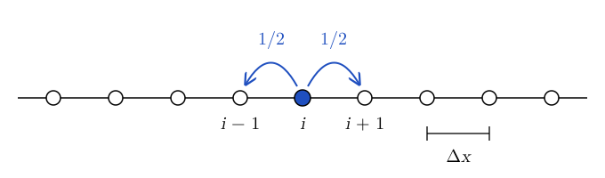
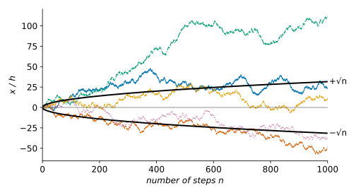
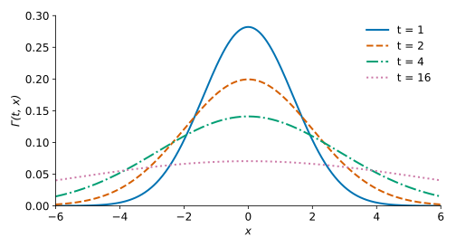

# Diffusion and Viscous Flows {#sec-visc}

The diffusion equation is used to model many processes in astrophysics. Examples are:

- the diffusion of radiation in optically thick matter, which we have already met in @sec-conserv;
- the diffusion of chemical substances, for example of the elements synthesized in supernovae into the interstellar medium;
- the diffusion of momentum, which is described by the shear viscosity.

In this chapter we first derive the diffusion equation from a simple model of a random walk. We then include bulk and shear viscosity in the momentum equation, we discuss how viscosity dissipates the kinetic energy of the flow, and we write the complete equations for a viscous fluid, the Navier–Stokes equations.

## Random walks and diffusion {#sec-visc-random-walk}

Consider a particle moving on a one-dimensional lattice with spacing $\Delta x$, as in @fig-visc-random-walk. At each time step $\Delta t$ the particle jumps to one of the two neighboring sites, to the left or to the right, with equal probability $1/2$. For example, the particle could be a photon traveling at the speed of light $c$ between two scatterings, in which case $\Delta x = c \Delta t$.

{#fig-visc-random-walk fig-alt="A row of nine equally spaced sites on a horizontal line, separated by a distance delta x. A particle sits on site i. Two curved arrows go from site i to the neighboring sites i minus 1 and i plus 1, each labelled with the probability one half."}

Suppose that the particle starts at $x = 0$. After $n$ steps, its average position is still $\langle x \rangle = 0$, because each step is equally likely to go to the left or to the right. However, the mean square displacement grows with the number of steps:
$$
\langle x^2 \rangle = n \Delta x^2 .
$$ {#eq-visc-random-walk-msd}
This is the same result that we used in @sec-sn to estimate the number of scatterings needed by a photon to escape from a supernova (@eq-sn-16). @fig-visc-random-walk-paths shows a few examples of random walks. The typical distance from the origin after a time $t = n \Delta t$ is $X = \sqrt{\langle x^2 \rangle} = \sqrt{n} \Delta x$, so the combination
$$
\frac{X^2}{2 t} = \frac{\Delta x^2}{2 \Delta t}
$$ {#eq-visc-random-walk-scale}
does not depend on $n$. So we expect it to be a characteristic scale of the problem.

{#fig-visc-random-walk-paths fig-alt="Position x, in units of the step size, against the number of steps n, from 0 to 1000. Five jagged lines, drawn in different colours and line styles, start at the origin and wander up and down. Two thick black curves, plus and minus the square root of n, open up from the origin and reach plus and minus about 32 at n equal to 1000. Some of the walks stay between the two curves, while others wander outside of them; one reaches about 110."}

Let $P(t, x)$ be the probability of finding the particle at the position $x$ at time $t$. The particle can be at $x$ at time $t + \Delta t$ only if it was at $x - \Delta x$ or at $x + \Delta x$ at time $t$, so
$$
P (t + \Delta t, x) = \frac{1}{2} \left[ P (t, x - \Delta x) + P (t, x + \Delta x) \right] .
$$ {#eq-visc-random-walk}
To take the continuum limit, we expand both sides in Taylor series:
$$
\begin{aligned}
P (t + \Delta t, x) &= P (t, x) + \Delta t \, \frac{\partial P}{\partial t} + O (\Delta t^2), \\
P (t, x \pm \Delta x) &= P (t, x) \pm \Delta x \, \frac{\partial P}{\partial x} + \frac{1}{2} \Delta x^2 \, \frac{\partial^2 P}{\partial x^2} + O (\Delta x^3) .
\end{aligned}
$$ {#eq-visc-taylor}
Inserting these expansions in @eq-visc-random-walk, the terms with $P(t, x)$ and the first derivatives in $x$ cancel, and we obtain
$$
\frac{\partial P}{\partial t} = \left( \frac{\Delta x^2}{2 \Delta t} \right) \frac{\partial^2 P}{\partial x^2} .
$$ {#eq-visc-random-walk-limit}
If we now take the limit $\Delta x, \Delta t \to 0$ keeping $\Delta x^2 / \Delta t$ fixed, we obtain the **diffusion equation**
$$
\boxed{\frac{\partial P}{\partial t} = D \frac{\partial^2 P}{\partial x^2},}
$$ {#eq-visc-diffusion}
where
$$
D = \frac{\Delta x^2}{2 \Delta t}
$$ {#eq-visc-diffusion-coefficient}
is the **diffusion coefficient**. This is the same combination we found in @eq-visc-random-walk-scale. In the continuum limit, $P (t, x)$ becomes a *probability distribution function* (pdf), meaning that $P (t, x) \dd x$ is the probability of finding the particle between $x$ and $x + \dd x$ at time $t$.

The diffusion coefficient has units of $\mathrm{m^2\,s^{-1}}$, as in @eq-conserv-30. For the photon, $\Delta x$ is the mean free path $\lambda$ and $D = \lambda c / 2$. This agrees with @eq-conserv-ch6-eq-fick-law, apart from the factor $1/2$ in place of $1/3$. The exact factor depends on the number of dimensions and on the distribution of the distances traveled between two scatterings, which in our model are all equal to $\Delta x$.

The solution of @eq-visc-diffusion for a particle that starts at $x = 0$, that is with $P (0, x) = \delta (x)$, is called the **fundamental solution**:
$$
\Gamma (t, x) = \frac{1}{\sqrt{4 \pi D t}} \ee^{- \frac{x^2}{4 D t}} .
$$ {#eq-visc-fundamental-solution}
This can be found from the central limit theorem, or using separation of variables. The fundamental solution is a Gaussian with variance $\langle x^2 \rangle = 2 D t$, which is @eq-visc-random-walk-msd with $n = t / \Delta t$. As shown in @fig-visc-fundamental-solution, the peak decreases and the distribution spreads out with time, while the area under the curve, the total probability, stays equal to 1. The width of the distribution grows as $\sqrt{D t}$, so the time needed to diffuse over a distance $L$ is $\sim L^2 / D$.

{#fig-visc-fundamental-solution fig-alt="Gamma of t and x against x, from minus 6 to 6, for t equal to 1, 2, 4 and 16, each in a different colour and line style. All curves are bell shaped and centred on x equal to 0. At t equal to 1 the curve is narrow with a peak of about 0.28; at later times the peak is lower and the curve wider, and at t equal to 16 the curve is almost flat, at about 0.07."}

In three dimensions, and allowing $D$ to depend on position, the diffusion equation reads
$$
\frac{\partial P}{\partial t} = \nabla \cdot (D \nabla P) .
$$ {#eq-visc-diffusion-3d}
Note that this has the form of a conservation law, $\partial_t P + \nabla \cdot \vb{F} = 0$, with a flux given by Fick's law, $\vb{F} = - D \nabla P$ (@eq-conserv-29). If, instead of a single particle, we consider many particles, then $P$ is replaced by their density. We will study the solutions of the diffusion equation, also in the presence of a flow, in the in-class worksheet (@sec-visc-worksheet).

## Viscous flows {#sec-visc-viscous}

In @sec-conserv we wrote the momentum equation in terms of the stress tensor $\vb{T}$. In the absence of external forces, it reads
$$
\rho \frac{\dd \vb{v}}{\dd t} = \nabla \cdot \vb{T} .
$$ {#eq-visc-momentum-stress}
So far we have only considered ideal fluids, for which $\vb{T} = - p \vb{I}$. We now write
$$
\vb{T} = - p \vb{I} + \vb{\tau},
$$ {#eq-visc-stress}
where $\vb{\tau}$ is the **viscous stress** tensor. Viscous stresses arise when neighboring fluid elements move with different velocities, so $\vb{\tau}$ must depend on the derivatives of the velocity, and it must vanish for a uniform flow. The simplest choice is to take $\vb{\tau}$ to be linear in $\nabla \vb{v}$. It is convenient to introduce the **rate-of-strain** (or shear) tensor
$$
\vb{S} = \frac{1}{2} \left( \nabla \vb{v} + \nabla \vb{v}^T \right) .
$$ {#eq-visc-strain}
Note that $\vb{S}$ is symmetric and that it vanishes for a rigid rotation, as it should, because a rigidly rotating fluid has no internal friction. If the fluid is isotropic, the only symmetric tensors that we can build from $\nabla \vb{v}$ to first order are $\vb{S}$ and $(\nabla \cdot \vb{v}) \vb{I}$. So the most general viscous stress tensor can be written as
$$
\boxed{
\begin{aligned}
\vb{\tau} &= \zeta (\nabla \cdot \vb{v}) \vb{I} \\
&\quad + \rho \nu \left[ \left( \nabla \vb{v} + \nabla \vb{v}^T \right) - \frac{2}{3} (\nabla \cdot \vb{v}) \vb{I} \right],
\end{aligned}}
$$ {#eq-visc-viscous-stress}
where $\nu$ is the kinematic **shear viscosity**, $\rho \nu$ the dynamic shear viscosity, and $\zeta$ the **bulk viscosity**. This is the form used in @clarke2007. Note that $\nu$ has units of $\mathrm{m^2\,s^{-1}}$, like a diffusion coefficient, while $\rho \nu$ and $\zeta$ have units of $\mathrm{kg\,m^{-1}\,s^{-1}} = \mathrm{Pa\,s}$. The term in square brackets has zero trace, so the shear viscosity describes the response of the fluid to a deformation that does not change its volume, while the bulk viscosity describes the response to a compression or expansion. Some books write the coefficient of $(\nabla \cdot \vb{v}) \vb{I}$, that is $\zeta - \frac{2}{3} \rho \nu$, as a single coefficient, called the second coefficient of viscosity.

To compute the divergence of $\vb{\tau}$, we first compute the divergence of $\vb{S}$. Writing $\vb{S}$ row by row, we have
$$
\vb{S} = \frac{1}{2}
\begin{pmatrix}
\partial_x \vb{v}^T + \nabla v_x^T \\
\partial_y \vb{v}^T + \nabla v_y^T \\
\partial_z \vb{v}^T + \nabla v_z^T
\end{pmatrix},
$$ {#eq-visc-strain-rows}
so that
$$
\begin{aligned}
\nabla \cdot \vb{S} &= \frac{1}{2} \partial_x \left[ \partial_x \vb{v} + \nabla v_x \right] + \frac{1}{2} \partial_y \left[ \partial_y \vb{v} + \nabla v_y \right] + \ldots \\
&= \frac{1}{2} \left[ \nabla^2 \vb{v} + \nabla (\nabla \cdot \vb{v}) \right] .
\end{aligned}
$$ {#eq-visc-strain-div}
Assuming that $\rho \nu$ and $\zeta$ are constant, we then find
$$
\nabla \cdot \vb{T} = - \nabla \left[ p - \left( \zeta + \frac{1}{3} \rho \nu \right) (\nabla \cdot \vb{v}) \right] + \rho \nu \nabla^2 \vb{v} .
$$ {#eq-visc-stress-div}
The term $- (\zeta + \frac{1}{3} \rho \nu) (\nabla \cdot \vb{v})$ acts like an additional pressure, the **bulk viscous pressure**. It is positive in a compression, $\nabla \cdot \vb{v} < 0$, and it opposes the compression. The last term in @eq-visc-stress-div is the shear viscosity term. Accordingly, the momentum equation becomes
$$
\boxed{
\begin{aligned}
\rho \frac{\dd \vb{v}}{\dd t} &= - \nabla p + \nabla \cdot \vb{\tau} \\
&= - \nabla \left[ p - \left( \zeta + \frac{1}{3} \rho \nu \right) (\nabla \cdot \vb{v}) \right] + \rho \nu \nabla^2 \vb{v} .
\end{aligned}}
$$ {#eq-visc-navier-stokes}
This is the **Navier–Stokes equation**. For an incompressible flow, $\nabla \cdot \vb{v} = 0$, it reduces to
$$
\frac{\partial \vb{v}}{\partial t} + (\vb{v} \cdot \nabla) \vb{v} = - \frac{1}{\rho} \nabla p + \nu \nabla^2 \vb{v},
$$ {#eq-visc-navier-stokes-incompressible}
which is the form we will use in @sec-turb (@eq-turb-navier-stokes). Note that, if we neglect the advection and the pressure terms, @eq-visc-navier-stokes-incompressible becomes $\partial_t \vb{v} = \nu \nabla^2 \vb{v}$, which is a diffusion equation for each component of the velocity, with $D = \nu$. In other words, the shear viscosity describes the diffusion of momentum.

::: {.callout-tip icon=false}
## Example

Consider a fluid with only shear viscosity, $\zeta = 0$, and no external forces. The momentum equation is
$$
\rho \frac{\dd \vb{v}}{\dd t} = - \nabla p + \rho \nu \left[ \nabla^2 \vb{v} + \frac{1}{3} \nabla (\nabla \cdot \vb{v}) \right] .
$$ {#eq-visc-shear-only}
Consider a situation in which $p = \mathrm{const}$ and the tangential velocity $v_y$ changes sharply across the plane $x = 0$, over a distance $\ell$. If the velocity is $\vb{v} = v_y (t, x) \hat{\vb{y}}$, then $\nabla \cdot \vb{v} = 0$, $(\vb{v} \cdot \nabla) \vb{v} = 0$, and the $y$ component of @eq-visc-shear-only becomes
$$
\frac{\partial v_y}{\partial t} = \nu \frac{\partial^2 v_y}{\partial x^2} .
$$ {#eq-visc-shear-layer}
We expect the velocity profile to diffuse, and the front to advance with an effective velocity
$$
| v_{\mathrm{eff}} | = \left| \nu \frac{\partial_x v_y}{v_y} \right| \sim \frac{\nu}{\ell} .
$$ {#eq-visc-shear-layer-speed}
This estimate is actually off, because the shear layer is unstable to the Kelvin–Helmholtz instability (@sec-inst-kh). The flow becomes turbulent (@sec-turb), and the two layers mix on a much shorter timescale.
:::

::: {.callout-tip icon=false}
## Example

Consider a molecular cloud with number density $n \sim 10^3\,\mathrm{cm^{-3}} = 10^9\,\mathrm{m^{-3}}$, temperature $T \sim 10\,\mathrm{K}$, and mean molecular weight $\mu \approx 2.3$. In a gas, momentum is carried from one fluid element to the next by the particles, which move with the thermal speed $v_{\mathrm{th}} \sim \sqrt{k_B T / (\mu m_u)}$ over a distance of about one mean free path $\lambda$ between collisions. So, by analogy with @eq-visc-diffusion-coefficient, we can estimate the kinematic viscosity as $\nu \sim \lambda v_{\mathrm{th}}$, up to a factor of order unity. Taking $\sigma \sim 10^{-19}\,\mathrm{m^2}$, as in @sec-continua, we find
$$
\lambda = \frac{1}{n \sigma} \sim 10^{10}\,\mathrm{m}, \qquad v_{\mathrm{th}} \approx 190\,\mathrm{m\,s^{-1}}, \qquad \nu \sim 2 \times 10^{12}\,\mathrm{m^2\,s^{-1}} .
$$ {#eq-visc-cloud-viscosity}
This is a very large viscosity compared with that of water, $\nu \approx 10^{-6}\,\mathrm{m^2\,s^{-1}}$, but the cloud is also very large. For a cloud of size $L \sim 10\,\mathrm{pc} \approx 3.1 \times 10^{17}\,\mathrm{m}$, the time needed for momentum to diffuse across the cloud is
$$
t_{\mathrm{visc}} \sim \frac{L^2}{\nu} \sim 5 \times 10^{22}\,\mathrm{s} \approx 2 \times 10^{15}\,\mathrm{yr},
$$ {#eq-visc-cloud-time}
about $10^5$ times the age of the Universe. On the other hand, the gas in molecular clouds moves with velocities $v \sim 2\,\mathrm{km\,s^{-1}}$, so the cloud changes its shape on a timescale $t_{\mathrm{dyn}} \sim L / v \approx 1.5 \times 10^{14}\,\mathrm{s}$, or about $5\,\mathrm{Myr}$. In other words, viscosity has no time to act on the scale of the cloud. Note that the ratio
$$
\frac{t_{\mathrm{visc}}}{t_{\mathrm{dyn}}} = \frac{L v}{\nu} \sim 3 \times 10^8
$$ {#eq-visc-cloud-ratio}
is the Reynolds number of the flow, which we will meet again in @sec-turb (@eq-turb-10). Such large values are typical of astrophysical flows, which are almost always turbulent. Viscosity becomes important only on much smaller scales, where $L^2 / \nu$ is comparable to $L / v$.
:::

## Kinetic energy dissipation {#sec-visc-dissipation}

To see how viscosity affects the energy of the flow, we multiply @eq-visc-navier-stokes by $\vb{v}$. Following the same steps as in @sec-conserv (@eq-conserv-21), we obtain
$$
\begin{aligned}
&\frac{\partial \left( \frac{1}{2} \rho v^2 \right)}{\partial t} + \nabla \cdot \left[ \left( \frac{1}{2} \rho v^2 + p \right) \vb{v} \right] \\
&\qquad = p \nabla \cdot \vb{v} + (\nabla \cdot \vb{\tau}) \cdot \vb{v} .
\end{aligned}
$$ {#eq-visc-kinetic-energy}
The last term is new and describes the **viscous dissipation** of kinetic energy.

Consider first the incompressible case. Integrating over a volume $V$, we find
$$
\begin{aligned}
\int_V (\nabla \cdot \vb{\tau}) \cdot \vb{v} \dd V &= \int_V \rho \nu \nabla^2 \vb{v} \cdot \vb{v} \dd V \\
&= \int_V \rho \nu \nabla \cdot \left[ (\nabla \vb{v}) \cdot \vb{v} \right] \dd V - \rho \nu \int_V | \nabla \vb{v} |^2 \dd V .
\end{aligned}
$$ {#eq-visc-dissipation-shear}
The first term on the RHS can be written as a surface integral using the divergence theorem, and it vanishes if, for example, the fluid is at rest on the boundary of $V$. So the shear viscosity always decreases the kinetic energy of the flow, and it does so at a rate proportional to $\int_V | \nabla \vb{v} |^2 \dd V$. For an incompressible flow, and if the boundary terms vanish, this integral is equal to $\int_V | \vb{\omega} |^2 \dd V$, where $\vb{\omega} = \nabla \times \vb{v}$ is the vorticity (@eq-wind-vorticity-def). This is the **enstrophy** of the flow. We will use this result in @sec-turb (@eq-turb-5).

If instead the flow is compressible and $\nu = 0$, we find
$$
\begin{aligned}
\int_V (\nabla \cdot \vb{\tau}) \cdot \vb{v} \dd V &= \zeta \int_V \nabla (\nabla \cdot \vb{v}) \cdot \vb{v} \dd V \\
&= \zeta \int_V \nabla \cdot \left[ (\nabla \cdot \vb{v}) \vb{v} \right] \dd V - \zeta \int_V (\nabla \cdot \vb{v})^2 \dd V .
\end{aligned}
$$ {#eq-visc-dissipation-bulk}
Once again, the first term on the RHS is a surface term that vanishes for suitable boundary conditions. So the bulk viscosity dissipates kinetic energy whenever the fluid is compressed or expanded. As we will see next, the kinetic energy lost to viscous dissipation is not destroyed, but it is converted into internal energy.

## The Navier–Stokes equations {#sec-visc-navier-stokes}

To complete the description of a viscous fluid, we need an equation for the total energy. The rate of change of the energy in a fixed region $\Omega$ is given by the work done by external forces in $\Omega$, plus the work done by the stresses on the boundary $\partial \Omega$, minus the energy carried out of $\Omega$ by the flow and by the heat flux $\vb{F}_{\mathrm{heat}}$:
$$
\begin{aligned}
&\frac{\partial}{\partial t} \int_{\Omega} \rho \left( \varepsilon + \tfrac{1}{2} v^2 \right) \dd V = \int_{\Omega} \vb{f} \cdot \vb{v} \dd V + \int_{\partial \Omega} \vb{v} \cdot \vb{T} \cdot \vb{n} \dd A \\
&\qquad - \int_{\partial \Omega} \left[ \rho \left( \varepsilon + \tfrac{1}{2} v^2 \right) \vb{v} + \vb{F}_{\mathrm{heat}} \right] \cdot \vb{n} \dd A .
\end{aligned}
$$ {#eq-visc-energy-integral}
Here $\vb{T} \cdot \vb{n} \dd A$ is the force exerted on the surface element $\dd A$ by the fluid outside of $\Omega$ (for an ideal fluid it is $- p \vb{n} \dd A$), so $\vb{v} \cdot \vb{T} \cdot \vb{n} \dd A$ is the work done per unit time by this force. Using the divergence theorem, we can rewrite this as
$$
\begin{aligned}
&\int_{\Omega} \biggl\{ \frac{\partial \left[ \rho \left( \varepsilon + \frac{1}{2} v^2 \right) \right]}{\partial t} \\
&\qquad + \nabla \cdot \left[ \left( \rho \varepsilon + \tfrac{1}{2} \rho v^2 \right) \vb{v} - \vb{T} \cdot \vb{v} + \vb{F}_{\mathrm{heat}} \right] \biggr\} \dd V = \int_{\Omega} \vb{f} \cdot \vb{v} \dd V,
\end{aligned}
$$ {#eq-visc-energy-integral-2}
where we have used the fact that $\vb{T}$ is symmetric. Since this must hold for any region $\Omega$, and using $\vb{T} = - p \vb{I} + \vb{\tau}$, we obtain
$$
\begin{aligned}
&\frac{\partial \left[ \rho \left( \varepsilon + \frac{1}{2} v^2 \right) \right]}{\partial t} \\
&\qquad + \nabla \cdot \left[ \left( \rho \varepsilon + \tfrac{1}{2} \rho v^2 + p \right) \vb{v} - \vb{\tau} \cdot \vb{v} + \vb{F}_{\mathrm{heat}} \right] = \vb{f} \cdot \vb{v} .
\end{aligned}
$$ {#eq-visc-energy-total}
Compared with @eq-conserv-ch6-eq-energy-total, the energy flux has two new terms. The first, $- \vb{\tau} \cdot \vb{v}$, describes the work done by the viscous stresses, while the second is the heat flux $\vb{F}_{\mathrm{heat}}$.

The equations for a viscous, heat-conducting fluid are called the **Navier–Stokes equations**. Adding a heating rate per unit mass $\dot{q}$, they read
$$
\boxed{
\begin{aligned}
&\frac{\partial \rho}{\partial t} + \nabla \cdot (\rho \vb{v}) = 0, \\
&\frac{\partial (\rho \vb{v})}{\partial t} + \nabla \cdot [\rho \vb{v} \otimes \vb{v} - \vb{T}] = \vb{f}, \\
&\frac{\partial \left[ \rho \left( \varepsilon + \frac{1}{2} v^2 \right) \right]}{\partial t} \\
&\qquad + \nabla \cdot \left[ \left( \rho \varepsilon + \tfrac{1}{2} \rho v^2 + p \right) \vb{v} - \vb{\tau} \cdot \vb{v} + \vb{F}_{\mathrm{heat}} \right] \\
&\qquad = \rho \dot{q} + \vb{f} \cdot \vb{v},
\end{aligned}}
$$ {#eq-visc-navier-stokes-system}
with $\vb{T} = - p \vb{I} + \vb{\tau}$ and $\vb{\tau}$ given by @eq-visc-viscous-stress. In non-conservation form, the momentum equation is @eq-visc-navier-stokes with the external force $\vb{f}$ added to the RHS. Subtracting @eq-visc-kinetic-energy, with $\vb{f} \cdot \vb{v}$ added to its RHS, from the energy equation, and using $\nabla \cdot (\vb{\tau} \cdot \vb{v}) = (\nabla \cdot \vb{\tau}) \cdot \vb{v} + \vb{\tau} : \nabla \vb{v}$, we find the equation for the internal energy:
$$
\rho \frac{\dd \varepsilon}{\dd t} = \rho \dot{q} - p \nabla \cdot \vb{v} + \vb{\tau} : \nabla \vb{v} - \nabla \cdot \vb{F}_{\mathrm{heat}} .
$$ {#eq-visc-internal-energy}
The term $\vb{\tau} : \nabla \vb{v}$ is the **viscous heating**. Using @eq-visc-viscous-stress, it can be written as
$$
\vb{\tau} : \nabla \vb{v} = 2 \rho \nu \left| \vb{S} - \frac{1}{3} (\nabla \cdot \vb{v}) \vb{I} \right|^2 + \zeta (\nabla \cdot \vb{v})^2 \geq 0,
$$ {#eq-visc-heating}
where $| \vb{A} |^2 = \vb{A} : \vb{A}$ is the sum of the squares of the components of $\vb{A}$. So viscosity always heats the fluid. This is the energy that the shear and bulk viscosity remove from the kinetic energy of the flow (@eq-visc-dissipation-shear and @eq-visc-dissipation-bulk).

## In-class worksheet {#sec-visc-worksheet}

1.  Core-collapse supernovae inject metals, such as oxygen, into the interstellar medium (ISM). After the supernova remnant has stalled its expansion, the diffusion of these elements throughout the galaxy can be modeled through an advection-diffusion equation:
    $$
    \frac{\partial \rho}{\partial t} + \nabla \cdot (\rho \vb{v}) = \nabla
    \cdot (D \nabla \rho),
    $$ {#eq-visc-advection-diffusion}
    where $\rho$ is the mass density of the newly synthesized elements, $\vb{v}$ is the local velocity of the ISM, and $D$ is a diffusion coefficient.

    1.  Show that, under suitable assumptions,
        $$
        \frac{\dd}{\dd t} \int_V \rho \dd^3 \vb{r}= 0.
        $$ {#eq-visc-35}

    2.  Assume that $\vb{v}= \mathrm{const}$, $D = \mathrm{const} > 0$, and look for solutions in the form
        $$
        \rho (t, \vb{x}) = \rho_0 \ee^{\ii (\vb{k} \cdot \vb{x}-
        \omega t)} .
        $$ {#eq-visc-ansatz}
        Sketch the solution for different times and give a physical interpretation of the results.

    3.  How do the results change if $D < 0$?

    4.  Show that @eq-visc-advection-diffusion can be written as
        $$
        \frac{\partial \rho}{\partial t} + \nabla \cdot \left[ \rho \left(
        \vb{v}- D \frac{\nabla \rho}{\rho} \right)  \right] = 0.
        $$ {#eq-visc-37}
        Interpret the term in round brackets as an effective propagation velocity $\vb{v}_{\mathrm{eff}}$. How does $\vb{v}_{\mathrm{eff}}$ depend on the wave number $\vb{k}$ if $\rho$ is as in @eq-visc-ansatz?

## Exercises {#sec-visc-exercises}

::: {#exr-visc-vortex}
## Steady viscous vortex

Consider a steady-state, axisymmetric solution of the incompressible, viscous, Navier–Stokes equations in cylindrical coordinates $(R, \phi, z)$ in the form
$$
v_R = - \alpha R, \qquad v_{\phi} = \frac{\mathcal{C}}{2 \pi R} g (R), \qquad
v_z = 2 \alpha z,
$$ {#eq-visc-vortex-ansatz}
where $\alpha > 0$ and $\mathcal{C} > 0$ are given constants, while $g (R)$ is a function satisfying
$$
\lim_{R \rightarrow 0} g (R) = 0, \qquad \lim_{R \rightarrow \infty} g (R)
= 1.
$$ {#eq-visc-vortex-limits}
Let $\nu > 0$ be the kinematic viscosity.

1.  Show that the flow is incompressible.

2.  Derive an equation for $g (R)$ assuming the flow to be steady state.

3.  Compute the vorticity $\vb{\omega}$ of the flow.
:::

::: {.content-visible when-profile="solutions"}
::: {.solution}
1.  The divergence in cylindrical coordinates is
    $$
    \nabla \cdot \vb{v} = \frac{1}{R} \partial_R  (Rv_R) + \frac{1}{R}
    \partial_{\phi} v_{\phi} + \partial_z v_z = - 2 \alpha + 0 + 2 \alpha
    = 0.
    $$

2.  The $\phi$ component of the momentum equation reads (assuming steady state)
    $$
    v_R \partial_R v_{\phi} + \frac{v_{\phi}}{R} \partial_{\phi}
    v_{\phi} + v_z \partial_z v_{\phi} + \frac{v_R v_{\phi}}{R} = -
    \frac{1}{\rho R} \partial_{\phi} p + \nu \left( \frac{1}{R} \partial_R
    (R \partial_R v_{\phi}) + \frac{2}{R^2} \partial_{\phi} v_R -
    \frac{v_{\phi}}{R^2} \right) .
    $$
    After some simplifications we obtain
    $$
    Rg'' (R) + \left( \frac{R^2 \alpha}{\nu} - 1 \right) g' (R) = 0.
    $$
    We make the change of variable $g' (R) = h (R)$ to obtain
    $$
    h' (R) = \left( \frac{1}{R} - \frac{\alpha R}{\nu} \right) h (R) .
    $$
    This equation can be solved using separation of variables to find
    $$
    h (R) = CR \exp \left( - \frac{\alpha R^2}{2 \nu} \right),
    $$
    where $C$ is an arbitrary constant, to be fixed using the boundary conditions later. $g (R)$ can be obtained by integrating the last expression and imposing the boundary conditions to find
    $$
    g (R) = \left[ 1 - \exp \left( - \frac{\alpha R^2}{2 \nu} \right) \right]
    .
    $$

3.  The vorticity can be computed as
    $$
    \begin{alignedat}{2}
    \vb{\omega} &{}={} && \nabla \times \vb{v} \\
    &{}={} && \left[ \frac{1}{R} \partial_{\phi} v_z - \partial_z v_{\phi}
    \right]  \hat{\vb{R}} + [\partial_z v_R - \partial_R v_z]
    \hat{\vb{\phi}} + \left[ \frac{1}{R} \partial_R  (Rv_{\phi}) -
    \frac{1}{R} \partial_{\phi} v_R \right] \hat{\vb{z}} .
    \end{alignedat}
    $$
    The only non-zero component is $\omega_z$:
    $$
    \omega_z = \frac{\mathcal{C} g' (R)}{2 \pi R} = \left( \frac{\alpha \mathcal{C}}{2
    \pi \nu} \right) \exp \left( - \frac{\alpha R^2}{2 \nu} \right) .
    $$
:::
:::

::: {#exr-visc-bulk-sound}
## Sound waves and bulk viscosity

Consider a fluid with bulk viscosity $\zeta$, but no shear viscosity ($\nu = 0$). In one dimension, the continuity and momentum equations are
$$
\partial_t \rho + \partial_x (\rho v) = 0, \qquad \rho (\partial_t v + v \partial_x v) = - \partial_x p + \zeta \partial_x^2 v .
$$ {#eq-visc-bulk-sound}
The background is homogeneous, with $\rho = \rho_0$, $v = 0$, and $p = p_0$. Consider small adiabatic perturbations of the form $\ee^{\ii (k x - \omega t)}$.

1.  Derive the dispersion relation $\omega (k)$. How is it modified compared with the case $\zeta = 0$ (@sec-sound)?

2.  Show that, if $\zeta$ is small, sound waves are damped, and find the damping rate. Which waves are damped faster, short or long ones?

3.  What happens to perturbations with $k > 2 \rho_0 c_s / \zeta$?
:::

::: {.content-visible when-profile="solutions"}
::: {.solution}
1.  We write $\rho = \rho_0 + \rho_1$, $v = v_1$, and $p = p_0 + c_s^2 \rho_1$, where $c_s$ is the adiabatic sound speed. To first order, the equations become
    $$
    \partial_t \rho_1 + \rho_0 \partial_x v_1 = 0, \qquad \rho_0 \partial_t v_1 = - c_s^2 \partial_x \rho_1 + \zeta \partial_x^2 v_1 .
    $$
    Inserting perturbations of the form $\ee^{\ii (k x - \omega t)}$, we find
    $$
    \omega \rho_1 = \rho_0 k v_1, \qquad - \ii \omega \rho_0 v_1 = - \ii k c_s^2 \rho_1 - \zeta k^2 v_1 .
    $$
    Eliminating $\rho_1$ we obtain the dispersion relation
    $$
    \omega^2 + \ii \frac{\zeta k^2}{\rho_0} \omega - c_s^2 k^2 = 0 .
    $$
    For $\zeta = 0$ this gives $\omega = \pm c_s k$, as in @sec-sound. With $\zeta > 0$ the solutions are
    $$
    \omega = - \ii \frac{\zeta k^2}{2 \rho_0} \pm \sqrt{c_s^2 k^2 - \left( \frac{\zeta k^2}{2 \rho_0} \right)^2} .
    $$

2.  If $\zeta k / (2 \rho_0) \ll c_s$, then
    $$
    \omega \approx \pm c_s k - \ii \frac{\zeta k^2}{2 \rho_0} ,
    $$
    so the perturbations go as $\ee^{\ii k (x \mp c_s t)} \ee^{- \zeta k^2 t / (2 \rho_0)}$. These are sound waves that propagate with the usual sound speed, but that are damped at a rate $\zeta k^2 / (2 \rho_0)$. Short waves are damped faster. This makes sense, because the damping term has the same form as a diffusion term with $D = \zeta / \rho_0$, and the diffusion time over a wavelength is $\sim 1 / (D k^2)$.

3.  If $k > 2 \rho_0 c_s / \zeta$ the square root is imaginary, and both solutions are purely imaginary, with $\mathrm{Im}\, \omega < 0$. The perturbations do not oscillate, but they decay exponentially. In other words, viscosity damps them before they can complete an oscillation.
:::
:::

## Further reading {#sec-visc-reading}

- @clarke2007, Chapter 11 (viscous flows).
