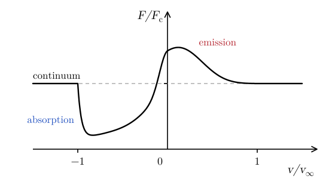
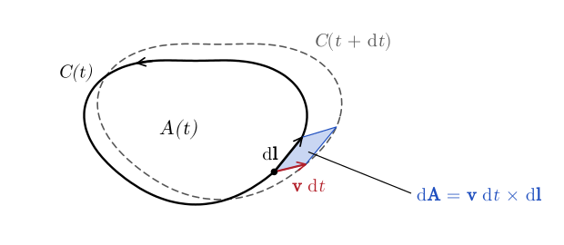
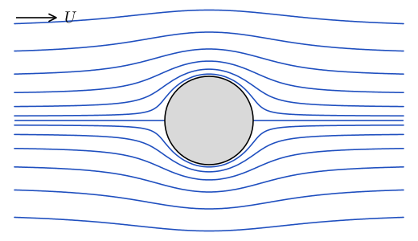
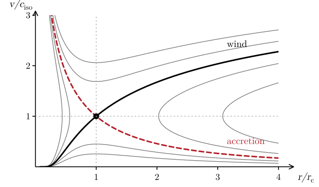
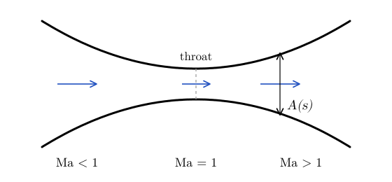

# Stellar Winds and Spherical Accretion {#sec-wind}

All stars lose mass through winds. Their mass-loss rates span 10 orders of magnitude, $\dot{M} \sim 10^{-14}$–$10^{-4}\,M_{\odot}/\mathrm{yr}$, and have terminal velocities in the wide range $v_{\infty} \sim 10$–$3000\,\mathrm{km/s}$ (@fig-wind-wr140). Depending on the mechanism that accelerates them, we distinguish:

- **Line-driven winds**, driven by the absorption of UV photons in the lines of metals in the atmospheres of hot stars. They are massive and fast, with $\dot{M} \sim 10^{-6}$–$10^{-5}\,M_{\odot}/\mathrm{yr}$ and $v_{\infty} \sim 2500\,\mathrm{km/s}$.
- **Dust-driven winds**, driven by the absorption of IR photons by dust in the atmospheres of cool giants. They are massive and slow, with $\dot{M} \sim 10^{-5}$–$10^{-4}\,M_{\odot}/\mathrm{yr}$ and $v_{\infty} \sim 10\,\mathrm{km/s}$.
- **Coronal winds**, driven by the pressure gradient in the hot corona of the star. They are not massive. This is the mechanism of the solar wind, which has $\dot{M} \sim 10^{-14}\,M_{\odot}/\mathrm{yr}$.
- **Alfvén-wave-driven winds**, driven by MHD processes, for example in magnetic rotators.

{#fig-wind-wr140 width="70%" fig-alt="A bright star at the centre of a dark field of stars, surrounded by about a dozen nested, evenly spaced rings of reddish dust. The rings are not complete: they are brightest towards the upper right and the lower left, and they look like a set of concentric, roughly square ripples spreading out from the star."}

The most sensitive diagnostics of the winds of hot stars are P Cygni line profiles (@fig-wind-pcygni), named after the star P Cygni, where they were first observed. The gas in front of the star moves towards us and absorbs the light of the star at blue-shifted wavelengths, up to $v_{\infty}$, while the rest of the wind scatters photons into our line of sight, with both red and blue shifts. Other diagnostics are optically thin emission lines (at low $\dot{M}$), the bremsstrahlung emission of the wind, and molecular lines (for the winds of cool stars).

{#fig-wind-pcygni fig-alt="Flux, in units of the continuum flux, against the Doppler velocity in units of the terminal velocity of the wind, from -1.5 to 1.5. The continuum is a dashed horizontal line at 1. On the blue side, between -1 and 0, the flux drops well below the continuum in an absorption trough, which ends sharply at -1. On the red side there is an emission peak, about 1.5 times the continuum just above zero velocity, which decreases to the continuum at +1."}

In this chapter we study the simplest model of a stellar wind, the isothermal wind of @parker1958. Before we can do that, we will take a little detour to introduce the concept of vorticity and Bernoulli's theorem. The latter will give us the equation describing the acceleration of the wind.

## Vorticity, circulation, and Bernoulli's theorem {#sec-wind-bernoulli}

Consider the circulation of the velocity around a closed curve $C$, bounding a surface $A$. It is given by
$$
\mathcal{C} = \oint_C \vb{v} \cdot \dd \vb{l} = \int_A (\nabla \times \vb{v}) \cdot \dd \vb{A} = \int_A \vb{\omega} \cdot \dd \vb{A},
$$ {#eq-wind-circulation}
where we have used Stokes' theorem and introduced a new quantity: the *vorticity*
$$
\vb{\omega} = \nabla \times \vb{v} .
$$ {#eq-wind-vorticity-def}
The vorticity measures the local rotation of the fluid. For example, a fluid in solid-body rotation with angular velocity $\vb{\Omega}$ has $\vb{\omega} = 2 \vb{\Omega}$. A flow with $\vb{\omega} = 0$ is said to be *irrotational*.

Using the identity
$$
(\vb{v} \cdot \nabla) \vb{v} = \nabla \left( \frac{1}{2} v^2 \right) - \vb{v} \times (\nabla \times \vb{v}),
$$ {#eq-wind-identity}
the momentum equation (@eq-lagrange-18) for a fluid subject to gravity becomes
$$
\frac{\partial \vb{v}}{\partial t} + \nabla \left( \frac{1}{2} v^2 \right) + \vb{\omega} \times \vb{v} = - \frac{1}{\rho} \nabla p - \nabla \Psi .
$$ {#eq-wind-momentum}
Taking the curl of this equation, and remembering that $\nabla \times \nabla f = 0$ for any function $f$, we obtain the *vorticity equation*
$$
\frac{\partial \vb{\omega}}{\partial t} + \nabla \times (\vb{\omega} \times \vb{v}) = \frac{1}{\rho^2} \nabla \rho \times \nabla p .
$$ {#eq-wind-vorticity}
For a barotropic fluid, $p = p (\rho)$ (@eq-euler-20), $\nabla p$ is parallel to $\nabla \rho$, so
$$
\boxed{\frac{\partial \vb{\omega}}{\partial t} + \nabla \times (\vb{\omega} \times \vb{v}) = 0 .}
$$ {#eq-wind-vorticity-barotropic}
This means that, if $\vb{\omega} = 0$ at some time, then $\vb{\omega}$ remains zero at all times: irrotational barotropic flows stay irrotational. We will find the same equation for the magnetic field in @sec-flux. Note that, if $\nabla \rho$ is not parallel to $\nabla p$, for example because there is a temperature gradient that is not aligned with the pressure gradient, then vorticity is generated by the right-hand side of @eq-wind-vorticity. This is the so-called *baroclinic* generation of vorticity.

### Kelvin's circulation theorem

Consider now a surface $A (t)$, bounded by a closed curve $C (t)$, that moves with the fluid. In a time $\dd t$, each element $\dd \vb{l}$ of $C (t)$ sweeps an area $\dd \vb{A} = \vb{v} \times \dd \vb{l} \, \dd t$ (@fig-wind-kelvin). So
$$
\begin{aligned}
\frac{\dd \mathcal{C}}{\dd t} &= \frac{\dd}{\dd t} \int_{A (t)} \vb{\omega} \cdot \dd \vb{A} \\
&= \int_{A (t)} \frac{\partial \vb{\omega}}{\partial t} \cdot \dd \vb{A} + \oint_{C (t)} \vb{\omega} \cdot (\vb{v} \times \dd \vb{l}) \\
&= \int_{A (t)} \frac{\partial \vb{\omega}}{\partial t} \cdot \dd \vb{A} + \oint_{C (t)} \dd \vb{l} \cdot (\vb{\omega} \times \vb{v}) \\
&= \int_{A (t)} \left[ \frac{\partial \vb{\omega}}{\partial t} + \nabla \times (\vb{\omega} \times \vb{v}) \right] \cdot \dd \vb{A} = 0,
\end{aligned}
$$ {#eq-wind-kelvin}
where we have used Stokes' theorem and @eq-wind-vorticity-barotropic (the first step also uses $\nabla \cdot \vb{\omega} = 0$: no vortex lines start or end inside the volume swept by the surface). This is *Kelvin's circulation theorem*: the number of vortex lines that thread any surface moving with the fluid does not change in the barotropic flow of an ideal fluid. In other words, vortex lines are material lines: they move with the fluid.

{#fig-wind-kelvin fig-alt="A closed curve C(t), drawn as a solid black line with an arrow showing its counterclockwise orientation, encloses the surface A(t). A short element dl of the curve is drawn as an arrow along it. In a time dt the fluid carries the curve to a new position, C(t + dt), drawn as a dashed line, displaced to the upper right and slightly stretched. Each point of dl moves by v dt, drawn as an arrow from the start of dl. The element sweeps a small shaded parallelogram with sides dl and v dt, whose area is dA = v dt cross dl."}

::: {.callout-note}
## Going further: Potential flows

Kelvin's theorem tells us that a barotropic flow that starts irrotational remains irrotational. A flow that is both incompressible and irrotational has
$$
\nabla \cdot \vb{v} = 0, \qquad \nabla \times \vb{v} = 0 .
$$ {#eq-wind-potential-conditions}
The second equation implies that $\vb{v} = \nabla \Phi$ (a *potential flow*). The first equation then gives
$$
\boxed{\nabla^2 \Phi = 0 .}
$$ {#eq-wind-laplace}
For example, the flow with speed $U$ around a cylinder of radius $a$ has $\Phi = U (R + a^2 / R) \cos \phi$ in cylindrical coordinates (@fig-wind-cylinder).

{#fig-wind-cylinder fig-alt="Streamlines of an incompressible, irrotational flow from left to right, with speed U, around a cylinder, shown as a grey disk. Far from the cylinder the streamlines are straight horizontal lines. Near the cylinder they bend around it symmetrically, so that the pattern is the same in front of and behind the cylinder. The flow splits at a stagnation point on the left of the cylinder and joins again at a stagnation point on the right."}

More generally, for an incompressible flow the curl of the vorticity is
$$
\nabla \times \vb{\omega} = \nabla \times (\nabla \times \vb{v}) = \nabla (\nabla \cdot \vb{v}) - \nabla^2 \vb{v} \Longrightarrow \nabla^2 \vb{v} = - \nabla \times \vb{\omega} .
$$ {#eq-wind-incompressible}
Together with the vorticity equation, @eq-wind-vorticity-barotropic, this completely determines the flow. We can then find the pressure from the velocity, by taking the divergence of the momentum equation with $\rho = \rho_0$:
$$
\rho_0 \left[ \frac{\partial \vb{v}}{\partial t} + (\vb{v} \cdot \nabla) \vb{v} \right] = - \nabla p \Longrightarrow \nabla^2 p = - \rho_0 \nabla \cdot \left[ (\vb{v} \cdot \nabla) \vb{v} \right] .
$$ {#eq-wind-pressure}
The pressure is no longer a function of the density! Instead, it takes whatever value is needed to keep $\nabla \cdot \vb{v} = 0$: in the limit $c_s \to \infty$, sound waves adjust the pressure instantaneously.

When can we treat a flow as incompressible? Consider a quasi-steady, adiabatic flow. The continuity equation gives
$$
0 \approx - \frac{\partial \rho}{\partial t} = \vb{v} \cdot \nabla \rho + \rho \nabla \cdot \vb{v} \Longrightarrow \frac{1}{c_s^2} \vb{v} \cdot \nabla p \approx - \rho \nabla \cdot \vb{v},
$$ {#eq-wind-compression-1}
where we have used $\nabla p = c_s^2 \nabla \rho$. The momentum equation, @eq-wind-momentum without gravity, gives
$$
0 \approx - \frac{\partial \vb{v}}{\partial t} = \nabla \left( \frac{1}{2} v^2 \right) + \vb{\omega} \times \vb{v} + \frac{\nabla p}{\rho} \Longrightarrow \vb{v} \cdot \nabla p \approx - \rho \vb{v} \cdot \nabla \left( \frac{1}{2} v^2 \right) .
$$ {#eq-wind-compression-2}
Combining the two, we find
$$
\nabla \cdot \vb{v} \approx \frac{1}{c_s^2} \vb{v} \cdot \nabla \left( \frac{1}{2} v^2 \right) \sim \left( \frac{v}{c_s} \right)^2 \frac{v}{L} = \mathrm{Ma}^2 \frac{v}{L},
$$ {#eq-wind-compression}
where $L$ is the length scale of the flow. In practice, this means that the equation of state does not matter for flows with $\mathrm{Ma} \lesssim 0.3$.
:::

### Bernoulli's theorem

For a barotropic fluid, we can introduce the enthalpy as the indefinite integral
$$
\mathcal{H} = \int \frac{\dd p}{\rho}, \qquad \nabla \mathcal{H} = \frac{\nabla p}{\rho},
$$ {#eq-wind-enthalpy}
and write @eq-wind-momentum as
$$
\frac{\partial \vb{v}}{\partial t} + \nabla \mathcal{B} + \vb{\omega} \times \vb{v} = 0, \qquad \mathcal{B} = \frac{1}{2} v^2 + \mathcal{H} + \Psi .
$$ {#eq-wind-momentum-bernoulli}
For an isentropic flow, $\mathcal{H}$ is the specific enthalpy $h$ of @sec-shock; for other barotropic flows, such as isothermal ones, it is not. For a pressureless fluid, $\mathcal{H} = 0$, and $\mathcal{B}$ is just the mechanical energy (kinetic plus potential) per unit mass. In a steady state, $\partial_t \vb{v} = 0$. Taking the dot product of @eq-wind-momentum-bernoulli with $\vb{v}$, we find $\vb{v} \cdot \nabla \mathcal{B} = 0$, that is (*Bernoulli's theorem*)
$$
\boxed{\mathcal{B} = \frac{1}{2} v^2 + \mathcal{H} + \Psi = \text{const along streamlines.}}
$$ {#eq-wind-bernoulli}
This theorem generalizes the conservation of mechanical energy, which is so useful to solve problems in mechanics, to the domain of fluids. As we will see, Bernoulli's theorem can be used to solve many fluid-related problems with minimal effort. If the flow is also irrotational, then $\nabla \mathcal{B} = 0$, and $\mathcal{B}$ has the same value everywhere.

## Isothermal winds {#sec-wind-isothermal}

Consider a spherical, steady, isothermal wind, $p = c_{\mathrm{iso}}^2 \rho$, from a star with mass $M$. The wind starts at a radius $r_0$, the photosphere or the corona of the star, and is accelerated outwards.

For an isothermal fluid, @eq-wind-enthalpy gives
$$
\mathcal{H} = \int c_{\mathrm{iso}}^2 \frac{\dd \rho}{\rho} = c_{\mathrm{iso}}^2 \ln \rho,
$$ {#eq-wind-enthalpy-isothermal}
and the wind is described by the conservation of mass and by Bernoulli's theorem:
$$
\dot{M} = 4 \pi r^2 \rho v = \mathrm{const}, \qquad \frac{1}{2} v^2 + c_{\mathrm{iso}}^2 \ln \rho - \frac{GM}{r} = \mathrm{const} .
$$ {#eq-wind-isothermal}
Differentiating the first equation, we find
$$
2 r \rho v + r^2 v \frac{\dd \rho}{\dd r} + r^2 \rho \frac{\dd v}{\dd r} = 0 \Longrightarrow \frac{1}{\rho} \frac{\dd \rho}{\dd r} = - \frac{2}{r} - \frac{1}{v} \frac{\dd v}{\dd r} .
$$ {#eq-wind-mass-derivative}
Differentiating the second, we find
$$
v \frac{\dd v}{\dd r} + \frac{c_{\mathrm{iso}}^2}{\rho} \frac{\dd \rho}{\dd r} = - \frac{GM}{r^2} .
$$ {#eq-wind-bernoulli-derivative}
Combining the two, we obtain the *wind equation*
$$
\boxed{(v^2 - c_{\mathrm{iso}}^2) \frac{1}{v} \frac{\dd v}{\dd r} = \frac{2 c_{\mathrm{iso}}^2}{r} - \frac{GM}{r^2} .}
$$ {#eq-wind-equation}
At this point, before we analyze this equation in detail, it is important to remark that energy is *not* conserved in this problem. The assumption of constant temperature requires that heat is supplied to the wind: by thermal conduction and non-radiative heating in the solar corona, by the radiation of the star in hot stars. Remember that, if energy is conserved, an expanding flow cools adiabatically, like the hot bubble of a supernova remnant in the snowplough phase (@sec-blast-snr). What is happening here is that energy is being injected into the flow and that this heating is implicit in our assumption that the flow is isothermal. We will come back to this in @sec-wind-energy.

### The critical point

Close to the star, where the wind is almost in hydrostatic equilibrium, $v \ll c_{\mathrm{iso}}$, while far from it, $v \gg c_{\mathrm{iso}}$. So, if the wind accelerates, it must cross the sound speed somewhere. At that point the left-hand side of @eq-wind-equation vanishes, so the right-hand side must also vanish. This happens only at the *critical point*, or *sonic point*,
$$
\boxed{r_c = \frac{GM}{2 c_{\mathrm{iso}}^2} .}
$$ {#eq-wind-rc}
Note that $c_{\mathrm{iso}} = v_{\mathrm{esc}} (r_c) / 2$, where $v_{\mathrm{esc}} = (2GM / r)^{1/2}$ is the escape velocity. In the worksheet, you will show that the acceleration at the critical point is finite:
$$
\left( \frac{\dd v}{\dd r} \right)_{r_c} = \pm \frac{2 c_{\mathrm{iso}}^3}{GM} .
$$ {#eq-wind-acceleration}

The wind equation can be written as
$$
\frac{\dd}{\dd r} \left[ \frac{v^2}{2} - c_{\mathrm{iso}}^2 \ln v \right] = \frac{\dd}{\dd r} \left[ \frac{GM}{r} + 2 c_{\mathrm{iso}}^2 \ln r \right] .
$$ {#eq-wind-integrable}
Integrating, dividing by $- c_{\mathrm{iso}}^2$, and taking the exponential of both sides, we find
$$
v \exp \left( - \frac{v^2}{2 c_{\mathrm{iso}}^2} \right) = \frac{C}{r^2} \exp \left( - \frac{2 r_c}{r} \right),
$$ {#eq-wind-family}
where $C$ is an integration constant. @fig-wind-solutions shows the solutions for different values of $C$. The solution that passes through the critical point, $v = c_{\mathrm{iso}}$ at $r = r_c$, has
$$
c_{\mathrm{iso}} \ee^{- 1 / 2} = \frac{C}{r_c^2} \ee^{- 2} \Longrightarrow C = c_{\mathrm{iso}} r_c^2 \ee^{3 / 2},
$$ {#eq-wind-constant}
so
$$
\boxed{v \exp \left( - \frac{v^2}{2 c_{\mathrm{iso}}^2} \right) = c_{\mathrm{iso}} \left( \frac{r_c}{r} \right)^2 \exp \left( - \frac{2 r_c}{r} + \frac{3}{2} \right) .}
$$ {#eq-wind-parker}

{#fig-wind-solutions fig-alt="Curves of v over c_iso against r over r_c, from 0 to 4, for different values of the integration constant. Two critical solutions cross at r = r_c, v = c_iso, marked by a dot. The wind, a thick black line, starts subsonic near the star, accelerates, becomes supersonic at r_c, and keeps accelerating slowly. The accretion solution, a thick red dashed line, is subsonic at large radii and supersonic inside r_c. Thin grey curves show the other solutions: some are subsonic everywhere, with a maximum of v at r_c; some are supersonic everywhere, with a minimum of v at r_c; others are double valued, either at small radii, where the velocity reaches c_iso with an infinite slope before r_c, or at large radii, where they never reach r_c."}

Only one of the solutions in @fig-wind-solutions starts subsonic close to the star and becomes supersonic: this is the wind. The other solutions are double valued, or supersonic already at the base of the wind, or subsonic everywhere. The last ones, the *breezes*, have $v \to 0$ and a finite density at large radii, so their pressure at infinity is much larger than that of the ISM [@parker1958]. At the base of the wind, $v_0 \ll c_{\mathrm{iso}}$, so @eq-wind-parker gives
$$
v_0 \approx c_{\mathrm{iso}} \left( \frac{r_c}{r_0} \right)^2 \exp \left( - \frac{2 r_c}{r_0} + \frac{3}{2} \right) .
$$ {#eq-wind-v0}
In other words, the speed at the base of the wind is set by the critical point. The wind regulates itself. If the speed at the base is too large, the gas reaches the sound speed before $r_c$, where $\dd v / \dd r \to \infty$: the flow stalls, and a shock forms, which slows down the wind. If the speed at the base is too small, the gas remains subsonic, and a rarefaction wave forms, which lowers the pressure and accelerates the wind.

### Velocity and density of the wind

Far from the star, $r \gg r_c$, the wind is supersonic, and @eq-wind-parker gives
$$
\frac{v^2}{2 c_{\mathrm{iso}}^2} \approx 2 \ln \left( \frac{r}{r_c} \right) + \ln \left( \frac{v}{c_{\mathrm{iso}}} \right) - \frac{3}{2} \Longrightarrow v \approx 2 c_{\mathrm{iso}} \left[ \ln \left( \frac{r}{r_c} \right) \right]^{1 / 2} .
$$ {#eq-wind-vlarge}
The isothermal wind keeps accelerating, albeit slowly.

Dividing @eq-wind-parker by @eq-wind-v0, we find
$$
\frac{v}{v_0} \exp \left( - \frac{v^2}{2 c_{\mathrm{iso}}^2} \right) \approx \left( \frac{r_0}{r} \right)^2 \exp \left[ \frac{GM}{c_{\mathrm{iso}}^2} \left( \frac{1}{r_0} - \frac{1}{r} \right) \right] .
$$ {#eq-wind-velocity}
So, from the conservation of mass, in the subsonic part of the wind
$$
\frac{\rho}{\rho_0} = \left( \frac{r_0}{r} \right)^2 \frac{v_0}{v} \approx \exp \left[ - \frac{GM}{c_{\mathrm{iso}}^2} \left( \frac{1}{r_0} - \frac{1}{r} \right) \right],
$$ {#eq-wind-density}
which is the density of an isothermal atmosphere in hydrostatic equilibrium. The mass-loss rate is $\dot{M} = 4 \pi r_c^2 \rho_c c_{\mathrm{iso}}$, where $\rho_c = \rho_0 (r_0 / r_c)^2 v_0 / c_{\mathrm{iso}}$ is the density at the critical point. Using @eq-wind-v0,
$$
\boxed{\dot{M} = 4 \pi \rho_0 c_{\mathrm{iso}} r_c^2 \exp \left( \frac{3}{2} - \frac{r_0}{H_0} \right),}
$$ {#eq-wind-mdot}
where $H_0 = c_{\mathrm{iso}}^2 / g_0 = c_{\mathrm{iso}}^2 r_0^2 / (GM) = r_0^2 / (2 r_c)$ is the pressure scale height at the base of the wind. The mass-loss rate is exponentially sensitive to $r_0 / H_0$, that is, to the temperature at the base of the wind.

::: {.callout-tip icon=false}
## Example

@tbl-wind-sun gives the isothermal wind of the Sun for different temperatures of the corona. The observed solar wind has $v \approx 400$–$800\,\mathrm{km/s}$ at the Earth and $\dot{M} \approx 2 \times 10^{-14}\,M_{\odot}/\mathrm{yr}$, consistent with a corona at $T \approx 1.5$–$2 \times 10^6\,\mathrm{K}$. In reality, the corona is not isothermal: it cools as the wind expands.

| $T\ (\mathrm{K})$ | $1 \times 10^6$ | $1.5 \times 10^6$ | $2 \times 10^6$ | $3 \times 10^6$ |
|:--|--:|--:|--:|--:|
| $c_{\mathrm{iso}}\ (\mathrm{km/s})$ | 120 | 140 | 170 | 200 |
| $r_c / R_{\odot}$ | 6.9 | 4.6 | 3.4 | 2.3 |
| $v (1\,\mathrm{AU})\ (\mathrm{km/s})$ | 430 | 560 | 670 | 870 |
| $\dot{M}\ (M_{\odot}/\mathrm{yr})$ | $3 \times 10^{-16}$ | $1 \times 10^{-14}$ | $9 \times 10^{-14}$ | $5 \times 10^{-13}$ |

: Isothermal wind of the Sun, for $\mu = 0.6$ and a density $n_0 = 10^8\,\mathrm{cm^{-3}}$ at $r_0 = R_{\odot}$. {#tbl-wind-sun}

For a hot star, with $M = 50\,M_{\odot}$, $r_0 = 15\,R_{\odot}$, and $T = 4 \times 10^4\,\mathrm{K}$ at the photosphere, $r_0 / H_0 \approx 10^3$, so thermal pressure cannot drive a wind. The winds of hot stars are driven by radiation (see @exr-wind-radiation-driven for a simple model).
:::

### Energy of the wind {#sec-wind-energy}

The energy per unit mass of the wind is
$$
e = \frac{v^2}{2} - \frac{GM}{r} + \frac{p}{(\Gamma - 1) \rho} = \frac{v^2}{2} - \frac{GM}{r} + \frac{c_{\mathrm{iso}}^2}{\Gamma - 1},
$$ {#eq-wind-energy}
where $\Gamma$ is the adiabatic index of the gas. At the base of the wind, $v^2 \ll c_{\mathrm{iso}}^2 = v_{\mathrm{esc}}^2 (r_c) / 4 \ll v_{\mathrm{esc}}^2 (r_0)$, so $e (r_0) \approx - GM / r_0 < 0$. Far from the star, $v \gg c_{\mathrm{iso}}$, so $e \approx v^2 / 2 > 0$. This means that energy is not conserved in an isothermal wind: the wind must be heated to stay isothermal. Polytropic winds, $p \propto \rho^{\Gamma}$ with polytropic exponent $\Gamma$, have the same qualitative features, as long as $\Gamma < 3 / 2$ [@lamers1999]. An adiabatic wind with $\Gamma = 5 / 3$ cannot accelerate to supersonic speeds.

### The de Laval nozzle {#sec-wind-nozzle}

Surprisingly, there is an exact mathematical equivalence between stellar winds and transonic flows in nozzles. Consider a one-dimensional, barotropic flow in a pipe with cross-sectional area $A (s)$, $s$ being a coordinate along the pipe (@fig-wind-nozzle). The flow is described by the conservation of mass and by Bernoulli's theorem:
$$
\rho v A = \mathrm{const}, \qquad \frac{1}{2} v^2 + \mathcal{H} = \mathrm{const} .
$$ {#eq-wind-nozzle-equations}
Differentiating the first equation, we obtain
$$
\frac{1}{\rho} \frac{\dd \rho}{\dd s} + \frac{1}{v} \frac{\dd v}{\dd s} + \frac{1}{A} \frac{\dd A}{\dd s} = 0 .
$$ {#eq-wind-nozzle-mass}
Bernoulli's theorem gives, with $c_s^2 = \dd p / \dd \rho$ and $\mathrm{Ma} = v / c_s$,
$$
v \frac{\dd v}{\dd s} + \frac{c_s^2}{\rho} \frac{\dd \rho}{\dd s} = 0 \Longrightarrow \frac{1}{\rho} \frac{\dd \rho}{\dd s} = - \mathrm{Ma}^2 \frac{1}{v} \frac{\dd v}{\dd s} .
$$ {#eq-wind-nozzle-bernoulli}
Combining the last two equations, we find
$$
\boxed{(1 - \mathrm{Ma}^2) \frac{1}{v} \frac{\dd v}{\dd s} = - \frac{1}{A} \frac{\dd A}{\dd s} .}
$$ {#eq-wind-nozzle}
We will see below that this equation coincides with the wind equation, @eq-wind-equation, with the proper choice of $A (s)$.

{#fig-wind-nozzle fig-alt="A pipe whose cross-sectional area A(s) decreases to a minimum, the throat, and then increases again. The gas flows from left to right. It is subsonic, Ma < 1, before the throat, it reaches Ma = 1 at the throat, and it is supersonic, Ma > 1, after it."}

- If $\mathrm{Ma} < 1$, the flow accelerates where the pipe narrows, $\dd A / \dd s < 0$. The opposite happens for $\mathrm{Ma} > 1$.
- The flow can become supersonic without a shock, that is with a finite $\dd v / \dd s$, only at a throat, where $\dd A / \dd s = 0$.
- In principle, we could reverse the nozzle and have a flow that decelerates smoothly from supersonic to subsonic. In practice, this almost always produces shocks. Shocks, and dissipation in general, break the time symmetry of the fluid equations, even though these are derived from classical mechanics, which is time reversible (compare the famous Loschmidt paradox).
- Rocket engines use de Laval nozzles to accelerate their exhaust to supersonic speeds.
- The flow regulates itself, as the wind does. A sonic point before the throat makes $\dd v / \dd s$ diverge: a shock forms, and the flow stalls. The additional pressure moves the sonic point towards the throat. A sonic point after the throat also makes $\dd v / \dd s$ diverge, but now a rarefaction wave forms, which decreases the pressure and brings the sonic point back to the throat.

For an isothermal gas, $c_s = c_{\mathrm{iso}}$, and @eq-wind-nozzle becomes
$$
(v^2 - c_{\mathrm{iso}}^2) \frac{1}{v} \frac{\dd v}{\dd s} = c_{\mathrm{iso}}^2 \frac{\dd \ln A}{\dd s} .
$$ {#eq-wind-nozzle-isothermal}
This is the wind equation, @eq-wind-equation, if $c_{\mathrm{iso}}^2 \, \dd \ln A / \dd r = 2 c_{\mathrm{iso}}^2 / r - GM / r^2$, that is if $A \propto r^2 \exp (2 r_c / r)$. This effective area has a minimum at $r = r_c$: the critical point is the throat of the nozzle.

## Spherical accretion {#sec-wind-bondi}

The same equations, with $v < 0$, describe the steady accretion of gas onto a star from a uniform medium, at rest far from the star. The physical solution is the one labelled "accretion" in @fig-wind-solutions: the gas falls in subsonically at large radii, and it crosses the sound speed at $r_c$. This is called *Bondi accretion* [@bondi1952]. We work it out in @exr-wind-bondi.

## In-class worksheet {#sec-wind-worksheet}

1.  The radial velocity $v$ for an isothermal wind with isothermal sound speed $c_{\mathrm{iso}}$ satisfies the equation
    $$
    (v^2 - c_{\mathrm{iso}}^2)  \frac{1}{v} \frac{\dd v}{\dd r} = \frac{2 c_{\mathrm{iso}}^2}{r} - \frac{GM}{r^2} .
    $$ {#eq-wind-40}
    Find the acceleration of the wind at the sonic point
    $$
    r_c = \frac{GM}{2 c_{\mathrm{iso}}^2} .
    $$ {#eq-wind-41}

## Exercises {#sec-wind-exercises}

::: {#exr-wind-radiation-driven}
## Radiation-driven winds

Consider an isothermal steady stellar wind. Radiation pressure in optically thin conditions produces an additional force per unit mass that can be parameterized as
$$
f = \frac{A}{r^2},
$$ {#eq-wind-42}
where $A > 0$.

1.  Show that the momentum equation becomes
    $$
    (v^2 - c_{\mathrm{iso}}^2)  \frac{1}{v}  \frac{\dd v}{\dd r} = \frac{2 c_{\mathrm{iso}}^2}{r} -
    \frac{GM}{r^2} + \frac{A}{r^2},
    $$ {#eq-wind-43}
    where $c_{\mathrm{iso}}$ is the isothermal sound speed.

2.  Assuming $A < GM$, how does the structure of the wind change?

3.  How does the radial profile of the velocity change if $A > GM$? Give a physical interpretation of the results.
:::

::: {.content-visible when-profile="solutions"}
::: {.solution}
1.  The momentum equation becomes
    $$
    v \frac{\dd v}{\dd r} + \frac{c_{\mathrm{iso}}^2}{\rho} \frac{\dd \rho}{\dd r} = \frac{A - GM}{r^2} = -
    \frac{GM_{\mathrm{eff}}}{r^2},
    $$
    where the effective mass is $M_{\mathrm{eff}} = M - A / G$. Proceeding as for the isothermal wind (@eq-wind-equation), we find
    $$
    (v^2 - c_{\mathrm{iso}}^2)  \frac{1}{v}  \frac{\dd v}{\dd r} = \frac{2 c_{\mathrm{iso}}^2}{r} -
    \frac{GM}{r^2} + \frac{A}{r^2} .
    $$

2.  If $A < GM$, then $M_{\mathrm{eff}} > 0$. The main difference is that the sonic point is now at
    $$
    r_c = \frac{GM_{\mathrm{eff}}}{2 c_{\mathrm{iso}}^2} .
    $$
    As long as $r_c > r_0$, the stellar radius, the wind solution does not change qualitatively. If $r_c < r_0$, then there is no sonic point, which means that the wind never becomes supersonic.

3.  If $A > GM$, then $M_{\mathrm{eff}} < 0$ and
    $$
    (v^2 - c_{\mathrm{iso}}^2)  \frac{1}{v} \frac{\dd v}{\dd r} = \frac{2 c_{\mathrm{iso}}^2}{r} + \frac{G | M_{\mathrm{eff}}
    |}{r^2} > 0.
    $$
    If the wind is subsonic at its base, then $v < c_{\mathrm{iso}}$ everywhere and $\dd v / \dd r < 0$, meaning that the wind decelerates. This result is counter-intuitive, because it shows that with the inclusion of a radial force, the wind is actually decelerated. What is happening is that, with the inclusion of an external force, the hydrostatic equilibrium acquires a more shallow density profile. In other words, the wind becomes more dense and slows down.
:::
:::

::: {#exr-wind-bondi}
## Isothermal Bondi accretion

Far from a star of mass $M$ located at the origin, isothermal gas has pressure $p_{\infty} = c_{\mathrm{iso}}^2 \rho_{\infty}$ and density $\rho_{\infty}$. This gas is steadily accreted onto the star.

1.  Find the accretion rate, assuming that the gas remains isothermal. At what radius does the infalling gas reach the sound speed?

2.  Let $c_{\mathrm{iso}} = 1\, \mathrm{km} /\mathrm{s}$ and $n_{\infty} = 10^3$ hydrogen atoms per $\mathrm{cm}^{3}$, and take the mass of the hydrogen atom to be $1.66 \times 10^{- 27}\, \mathrm{kg}$. Express this radius in units of the solar radius $R_{\odot} = 7 \times 10^8\, \mathrm{m}$.

3.  Calculate the time that a star of mass $M$ needs to double its mass.

4.  The gas is captured by the star inside the *Bondi radius* $r_B$, where the gravitational energy per unit mass, $GM / r$, becomes comparable to the thermal energy per unit mass, $c_{\mathrm{iso}}^2$. Find $r_B$ and compare it with the radius of part 1. Estimate the accretion rate as the mass flux $\rho_{\infty} c_{\mathrm{iso}}$ through a disk of radius $r_B$, and compare your estimate with the result of part 1.

Adapted from @clarke2007, Problem 30.
:::

::: {.content-visible when-profile="solutions"}
::: {.solution}
1.  The infalling gas is described by
    $$
    \dot{M} = 4 \pi r^2 \rho v = \mathrm{const}, \qquad v \frac{\dd v}{\dd r} + \frac{c_{\mathrm{iso}}^2}{\rho}
    \frac{\dd \rho}{\dd r} = - \frac{GM}{r^2} .
    $$
    The first equation yields
    $$
    0 = 2 r \rho v + r^2 v \frac{\dd \rho}{\dd r} + r^2 \rho \frac{\dd v}{\dd r} \Longrightarrow
    \frac{1}{\rho} \frac{\dd \rho}{\dd r} = - \frac{2}{r} - \frac{1}{v} \frac{\dd v}{\dd r} .
    $$
    Plugging this into the velocity equation, we obtain
    $$
    \frac{1}{v} \frac{\dd v}{\dd r}  (v^2 - c_{\mathrm{iso}}^2) = \frac{2 c_{\mathrm{iso}}^2}{r} - \frac{GM}{r^2} .
    $$
    This is the same equation we obtained for the stellar wind. The sonic point is at
    $$
    r_c = \frac{GM}{2 c_{\mathrm{iso}}^2} .
    $$

2.  The radius does not depend on the density at large distance, but only on the mass of the star
    $$
    r_c \approx 10^5 R_{\odot}  \left( \frac{M}{M_{\odot}} \right) .
    $$

3.  The velocity is given by
    $$
    v \exp \left( - \frac{v^2}{2 c_{\mathrm{iso}}^2} \right) = c_{\mathrm{iso}} \left( \frac{r_c}{r}
    \right)^2 \exp \left( - \frac{2 r_c}{r} + \frac{3}{2} \right) .
    $$
    For $r \gg r_c$, we have $v \ll c_{\mathrm{iso}}$ and
    $$
    v_{\infty} = c_{\mathrm{iso}} \left( \frac{r_c}{r} \right)^2 \ee^{3 / 2} .
    $$
    The accretion rate is
    $$
    \dot{M} = 4 \pi r^2 v \rho = 4 \pi c_{\mathrm{iso}} r_c^2 \rho_{\infty} \ee^{3 / 2} .
    $$
    With $n_{\infty} = 10^3\, \mathrm{cm}^{- 3} = 10^9\, \mathrm{m}^{- 3}$ hydrogen atoms, each of mass $1.66 \times 10^{- 27}\, \mathrm{kg}$, we have $\rho_{\infty} = 1.7 \times 10^{- 18}\, \mathrm{kg} \, \mathrm{m}^{- 3}$.

    Since $r_c \propto M$, the accretion rate grows as the star gains mass: $\dot{M} = k M^2$, with $k = \pi G^2 \rho_{\infty} \ee^{3 / 2} / c_{\mathrm{iso}}^3$. Integrating from the initial mass $M_0$,
    $$
    \frac{\dd M}{\dd t} = k M^2 \Longrightarrow \frac{1}{M_0} - \frac{1}{M} = k t,
    $$
    so the mass doubles after
    $$
    t = \frac{1}{2 k M_0} = \frac{M_0}{2 \dot{M}_0} \approx 7.7 \times 10^7\, \mathrm{yr} \left( \frac{M_{\odot}}{M_0} \right),
    $$
    half the time we would estimate with a constant $\dot{M}$.

4.  Setting $GM / r_B = c_{\mathrm{iso}}^2$, we find
    $$
    r_B = \frac{GM}{c_{\mathrm{iso}}^2} = 2 r_c \approx 2 \times 10^5 R_{\odot} \left( \frac{M}{M_{\odot}} \right) .
    $$
    The accretion rate is then
    $$
    \dot{M} \approx \pi r_B^2 \rho_{\infty} c_{\mathrm{iso}} = \frac{\pi G^2 M^2 \rho_{\infty}}{c_{\mathrm{iso}}^3} = 4 \pi c_{\mathrm{iso}} r_c^2 \rho_{\infty},
    $$
    which is smaller than the exact result by a factor $\ee^{3 / 2} \approx 4.5$. The estimate captures the scaling $\dot{M} \propto M^2 \rho_{\infty} c_{\mathrm{iso}}^{- 3}$, which holds also for adiabatic gas [@bondi1952].
:::
:::

## Further reading {#sec-wind-reading}

- @clarke2007, Chapter 9 (Bernoulli's equation).
- @lamers1999, for the theory of stellar winds.
